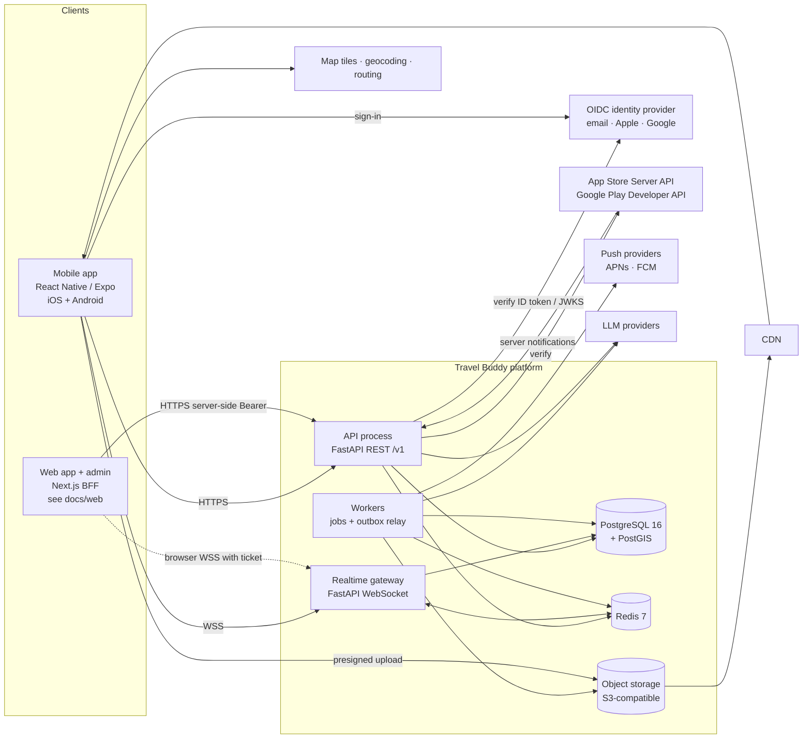

# 02 — System Architecture

| | |
|---|---|
| **Status** | Draft v1.0 — Phase 0 |
| **Owner** | Architecture |
| **Related** | [PRD](01-prd.md) · [ERD](04-database-erd.md) · [REST API](05-rest-api-specification.md) · [Realtime protocol](06-realtime-messaging-protocol.md) · [Threat model](08-privacy-security-threat-model.md) · [ADRs](adr/) |

"Travel Buddy" is the working name used throughout the code (`travelbuddy`). It can be renamed before launch without architectural impact.

---

## 1. Architectural drivers

| Driver | Consequence |
|---|---|
| Strangers can discover and contact each other | Privacy and authorization are domain primitives, not middleware afterthoughts. Discovery stores **no coordinates** (see §6). |
| Global audience, many locales, unreliable connectivity | i18n from day one; offline-first mobile storage for trips/guides; idempotent mutations everywhere. |
| Small team, uncertain scale | **Modular monolith** (one deployable codebase, several process roles) with enforced module boundaries, so a module can be extracted later without a rewrite ([ADR-0001](adr/0001-modular-monolith.md)). |
| Paid entitlements gate features | One central entitlement evaluator in the backend; the client is never trusted ([ADR-0006](adr/0006-central-entitlement-evaluation.md)). |
| Vendor choices not final (cloud, IdP, maps, AI, billing) | Every external dependency sits behind a *port* (Python `Protocol`) with swappable adapters; development-only adapters are explicitly marked and refuse to start in production. |

## 2. System context



## 3. Process roles (one codebase, several deployables)

| Role | Entry point | Scales on | Notes |
|---|---|---|---|
| `api` | `uvicorn app.main:app` | Request rate | Stateless REST. All mutations, all authorization. |
| `realtime` | `uvicorn app.realtime_main:app` | Open sockets | WebSocket gateway. Holds no durable state. Persists through the same domain services as `api`. Uses Redis pub/sub for cross-instance fanout. |
| `worker` | `python -m app.worker` | Queue depth | Executes jobs from the durable job table (media processing, push, notifications, AI, indexing, retention purges). |
| `relay` | `python -m app.worker --role relay` | Outbox lag | Moves committed outbox events to subscribers and the job queue. Can run inside `worker` at low scale. |
| `scheduler` | `python -m app.worker --role scheduler` | Single leader | Cron-style jobs: challenge activation, discovery-session expiry, retention purges, entitlement expiry sweeps. Leader election via a Postgres advisory lock. |

## 4. Backend module structure

### 4.1 Layout and layering

```
backend/app/
  core/                 # cross-cutting kernel — no domain logic
    config.py           # typed settings (pydantic-settings)
    logging.py          # structured JSON logs + correlation context
    errors.py           # RFC 9457 problem details + stable error codes
    middleware.py       # request ID, timing, security headers
    pagination.py       # signed opaque cursors
    ids.py              # UUIDv7
    feature_flags.py
    db.py               # async engine/session, unit of work
    security/           # token verification, Principal, authz primitives
  modules/
    <domain>/
      api.py            # FastAPI router (HTTP adapter only)
      schemas.py        # Pydantic request/response models (public contract)
      service.py        # application service = the module's PUBLIC interface
      domain.py         # pure domain logic: state machines, policies, rules
      models.py         # SQLAlchemy models (PRIVATE to the module)
      repository.py     # persistence (PRIVATE)
      events.py         # domain events this module publishes
      adapters/         # external providers behind ports
  main.py               # API app factory
  realtime_main.py      # WebSocket app factory
  worker.py
```

**Dependency rules.** An AST-based architecture test ([`backend/tests/unit/test_architecture_boundaries.py`](../backend/tests/unit/test_architecture_boundaries.py)) checks these in CI. It is used instead of import-linter because import-linter cannot express "only another module's `service`/`events` may be imported".

1. `core` imports no module.
2. A module may import another module **only** through `modules.<other>.service`, `modules.<other>.events` or `modules.<other>.schemas` (its public response models). Importing another module's `models`, `repository` or `domain` is forbidden.
3. Modules form a DAG. Lower layers never import higher ones (layer order is in §4.3).
4. `domain.py` is pure: no I/O, no SQLAlchemy, no FastAPI. That keeps state machines and policies unit-testable.

Cross-module reactions use **domain events** through the transactional outbox (§7), not direct calls. Example: `connections` emits `ConnectionAccepted`, and `notifications` reacts to it.

### 4.2 Domain modules

| # | Module (`app/modules/…`) | Owns data | Public interface (service) | Publishes events |
|---|---|---|---|---|
| 1 | `identity` | users, authentication_identities, user_sessions, consent_records, admin_role_assignments | `provision_user`, `exchange_idp_token`, `refresh_session`, `revoke_session`, `get_principal` | `UserRegistered`, `UserDeactivated`, `UserDeletionRequested` |
| 2 | `profiles` | user_profiles, user_preferences, user_privacy_settings | `get_public_profile(viewer, user)`, `get_privacy_settings`, `update_*` | `ProfileUpdated`, `PrivacySettingsChanged` |
| 3 | `location` | user_selected_locations, traveler_discovery_sessions (coarse only) | `resolve_point_to_destination`, `set_browse_destination`, `start/stop_discovery_session` | `DiscoverySessionStarted/Ended` |
| 4 | `destinations` | destinations, destination_localizations, places, place_localizations | `search`, `get`, `ancestors`, `nearby_places` | `DestinationUpdated` |
| 5 | `social` | posts, post_media, post_destinations, post_tags, comments, reactions, follows, bookmarks, feed_feedback | `create_post`, `react`, `comment`, `follow`, `visible_posts_for(viewer)` | `PostPublished`, `PostRemoved`, `UserFollowed`, `CommentCreated` |
| 6 | `feed` | feed sessions (Redis), ranking config | `get_feed(viewer, tab, filters, cursor)` | — |
| 7 | `discovery` | — (reads location + profiles via services) | `discover_travelers(viewer, filters)` | — |
| 8 | `connections` | connection_requests, user_connections | `request`, `accept`, `decline`, `cancel`, `relationship(a,b)`, `are_connected` | `ConnectionRequested`, `ConnectionAccepted`, `ConnectionRemoved` |
| 9 | `messaging` | conversations, conversation_members, messages, message_attachments, message_receipts, message_reactions, message_mentions, conversation_pins | `open_direct`, `send`, `edit`, `delete`, `history`, `mark_read` | `MessageCreated`, `MessageEdited`, `MessageDeleted`, `ReceiptUpdated` |
| 10 | `groups` | travel_groups, group_memberships, group_roles, group_invitations, group_join_requests, group_settings, group_ownership_transfers | `create_group`, `invite`, `accept_invitation`, `change_role`, `remove_member`, `group_permissions(user, group)` | `GroupCreated`, `MemberJoined`, `MemberRemoved`, `OwnershipTransferred` |
| 11 | `group_chat` | — (uses `messaging` with `kind=group`, adds announcements/moderation policies) | `post_announcement`, `pin`, `moderate_message` | via messaging |
| 12 | `challenges` | group_challenges, challenge_answers, challenge_hints, challenge_teams, challenge_participants, challenge_submissions, challenge_winners, challenge_rewards, reward_fulfillments, challenge_disputes, badges, user_badges | `create`, `publish`, `submit`, `judge`, `publish_results`, `fulfill_reward` | `ChallengeActivated`, `SubmissionEvaluated`, `ChallengeCompleted`, `RewardFulfilled` |
| 13 | `ai_assistant` | ai_generations | `generate_itinerary`, `replan_trip`, `chat` | `ItineraryGenerated` |
| 14 | `trips` | trips, trip_destinations, trip_collaborators, itinerary_days, itinerary_items, saved_places | `create_trip`, `apply_itinerary`, `sync_changes` | `TripUpdated` |
| 15 | `guides` | destination_guides, audio_tours, audio_tour_stops, offline_packages, offline_package_licenses | `list_guides`, `request_offline_package`, `manifest` | — |
| 16 | `billing` | products, subscriptions, subscription_entitlements, purchases, billing_events | `entitlements_for(user)`, `has(user, feature)`, `verify_purchase`, `process_notification` | `EntitlementGranted`, `EntitlementRevoked`, `SubscriptionStateChanged` |
| 17 | `notifications` | notifications, device_push_tokens | `notify(user, type, payload)`, `register_device` | — |
| 18 | `trust_safety` | content_reports, user_blocks, moderation_actions | `is_blocked(a,b)`, `report`, `apply_action`, `rate_limit_check` | `UserBlocked`, `ContentActioned` |
| 19 | `admin` | — (orchestrates other services with admin authorization) | admin REST surface | — |
| 20 | `observability` | audit_logs, metrics, traces | `audit(actor, action, resource)` | — |
| — | `media` (shared) | media_assets | `create_upload`, `finalize`, `signed_url(viewer, asset)` | `MediaReady`, `MediaRejected` |
| — | `platform` (shared) | asynchronous_jobs, outbox_events, idempotency_keys, data_subject_requests | job/outbox/idempotency primitives | — |

### 4.3 Dependency DAG (lower layers never import upper)

```
Layer 0  core
Layer 1  platform, observability
Layer 1b media (uses platform jobs and idempotency; profiles and destinations reference media)
Layer 2  profiles, destinations, billing
Layer 3  identity, trust_safety, location
Layer 4  connections, social, trips, guides
Layer 5  messaging, groups, feed, discovery, notifications(consumer)
Layer 6  group_chat, challenges, ai_assistant
Layer 7  admin, health
```

`identity` sits above `profiles` and `billing` because registration creates the default profile in the same transaction and `GET /v1/users/me` composes all three. Request *authentication* (platform token verification) lives in the kernel (`app/core/security`), so other modules never import `identity`. `trust_safety.is_blocked` sits at layer 3 because almost every social path consults it. `notifications` consumes events from every layer but only imports `identity` and `profiles` services, so it creates no cycle.

## 5. Platform-wide API conventions

The normative contract lives in [`contracts/openapi/openapi.yaml`](../contracts/openapi/openapi.yaml). These conventions apply to every endpoint.

| Concern | Convention |
|---|---|
| Versioning | URL prefix `/v1`. Breaking changes require `/v2`. Additive changes are allowed in place, and clients ignore unknown fields. |
| IDs | UUIDv7 (time-ordered) generated by the application, serialized as lowercase strings. Never sequential integers in public APIs, which prevents enumeration. |
| Time | `timestamptz` stored in UTC. API uses RFC 3339 with `Z`. Calendar dates (`travel_date`, trip days) are `YYYY-MM-DD` in the **destination's** time zone, which is carried as an IANA name. |
| Naming | JSON `snake_case`. Enums are lowercase `snake_case` strings. |
| Errors | `application/problem+json` (RFC 9457): `type`, `title`, `status`, `detail`, `instance`, plus `code` (stable machine code), `request_id`, and optional `errors[]` (`{field, code, message}`) for validation. Clients switch on `code`, never on `title`. |
| Auth | `Authorization: Bearer <access token>` (platform-issued JWT, 15 min). See §8. |
| Correlation | `X-Request-ID`. If absent or invalid it is generated. It is echoed in the response, logged, propagated to jobs and outbox events, and included in problem bodies. |
| Pagination | Cursor only: `?limit=` (1–100, default 20) and `?cursor=`. The response envelope is `{ "data": [...], "page": { "next_cursor": string\|null, "has_more": bool } }`. Cursors are opaque, HMAC-signed and expire. Offsets are never accepted. |
| Idempotency | `Idempotency-Key` header (UUID) is **required** on resource-creating POSTs that clients may retry: posts, comments, messages (REST), purchases/verify, challenge submissions, group creation, and invitations. A replay with the same key and body returns the original response. The same key with a different body returns `409 idempotency_key_reused`. Keys are kept for 24 h (billing: 72 h). Messages additionally carry `client_message_id`. |
| Concurrency | Mutable aggregates (trips, challenges, group settings) expose `version`. Updates send `If-Match: "<version>"`. A mismatch returns `412 precondition_failed`. |
| Rate limits | Per principal + route class, using a sliding window in Redis. Responses carry `RateLimit-Limit`, `RateLimit-Remaining`, `RateLimit-Reset`. A rejection returns `429 rate_limited` with `Retry-After`. |
| Localization | `Accept-Language` selects UI strings and localized destination names. User content is returned in its original language with a `language` field. Machine translations are separate fields marked `machine_translated: true`. |
| Privacy | Responses never include another user's coordinates, distance, email, birth data, or session data. Schemas for "another user" (`PublicProfile`) are distinct types from "me" (`MyProfile`). |
| Authorization failures | Return `404` instead of `403` whenever revealing existence would leak information, for example a private group, a blocked user's profile, or a conversation you are not in. |

Stable error codes (initial set, extended per module): `validation_failed`, `unauthenticated`, `token_expired`, `forbidden`, `not_found`, `conflict`, `precondition_failed`, `idempotency_key_reused`, `rate_limited`, `entitlement_required`, `feature_disabled`, `age_restricted`, `blocked_relationship`, `connection_required`, `connection_request_cooldown`, `group_capacity_reached`, `invitation_invalid`, `challenge_not_active`, `attempts_exhausted`, `payload_too_large`, `unsupported_media_type`, `service_unavailable`.

## 6. Location architecture (privacy by construction)

The six location concepts from the requirements are separate data, each with its own lifecycle:

| Concept | Where it lives | Precision | Retention |
|---|---|---|---|
| Home location | `user_profiles.home_country_code`, `home_region` (free text) | Country/region | Until changed |
| Current device location | **Request-scoped only.** Sent as query parameters (`near=lat,lng`) when the user asks for "Nearby". The server rounds it to 3 decimals (~110 m) before use and never persists or logs it. Log redaction covers the parameters. | Rounded | Not stored |
| Selected discovery destination | `user_selected_locations` (kind `browse`) → `destination_id` | Destination | Until changed |
| Post destination | `post_destinations` (destination + ancestors), optional `place_id` | Destination or public place | Life of post |
| Trip destination | `trip_destinations` | Destination | Life of trip |
| Traveler discovery location | `traveler_discovery_sessions` → `destination_id` (city) + optional `area_destination_id` (neighborhood). **No coordinates column exists.** When GPS is used, the server resolves the point to a destination with PostGIS `ST_Covers` and discards the point. | City or neighborhood | Session TTL ≤ 72 h. Purged 30 days after end. |

Discovery queries take a **destination**, never an arbitrary coordinate plus radius. That removes the trilateration attack: nothing finer than "this neighborhood" can be learned. Results carry no distances. See [ADR-0005](adr/0005-coarse-location-discovery.md) and threat model T-LOC-*.

Nearby **content** ("Nearby" feed tab) and nearby **people** (discovery) are separate endpoints, separate modules and separate consents.

## 7. Data flow patterns

### 7.1 Transactional outbox

Every state change that others must react to writes an `outbox_events` row **in the same transaction** as the change. The relay process reads unpublished rows (`FOR UPDATE SKIP LOCKED`), then (a) publishes realtime fanout to Redis, (b) enqueues jobs for subscribers, and (c) marks them published. Consumers are idempotent and key on `event_id`. This guarantees that no event is lost if Redis is down and no event fires for a rolled-back transaction.

### 7.2 Durable jobs

The `asynchronous_jobs` table is the queue: `SELECT … FOR UPDATE SKIP LOCKED` with exponential backoff, a `max_attempts` cap, a dead-letter status, and a `dedupe_key`. It sits behind a `JobQueue` port, so SQS, RabbitMQ or another broker can replace it when throughput demands without touching producers ([ADR-0004](adr/0004-postgres-outbox-and-job-queue.md)).

### 7.3 Messaging write path

```mermaid
sequenceDiagram
  participant C as Client
  participant RT as Realtime/API
  participant S as messaging.service
  participant DB as PostgreSQL
  participant R as Relay
  participant P as Redis pub/sub
  participant O as Other clients

  C->>RT: message.send {client_message_id, conversation_id, body}
  RT->>S: send(principal, cmd)
  S->>S: authorize (member, not blocked, not restricted, rate limit)
  S->>DB: BEGIN; UPDATE conversations SET last_seq=last_seq+1 RETURNING last_seq;<br/>INSERT message(seq, client_message_id) ON CONFLICT DO NOTHING;<br/>INSERT outbox_event; COMMIT
  S-->>RT: Message(seq, id)
  RT-->>C: message.ack {client_message_id, id, seq}
  R->>DB: poll outbox
  R->>P: publish conv:{id}
  P->>RT: fanout (all instances)
  RT->>O: message.new {seq,...}
  R->>DB: enqueue push job for offline members
```

The client sends with `client_message_id`. A retry hits the unique constraint and returns the original message, so delivery is idempotent. Per-conversation `seq` gives a total order and gap detection: a client that sees a seq jump fetches `GET /conversations/{id}/messages?after_seq=n`.

### 7.4 Feed read path

1. **Candidate generation**: posts joined through `post_destinations` for the target destination (which includes the destination's descendants by virtue of the ancestor fan-out at write time), within a recency window (default 30 days, widening when sparse). Visibility, blocks and moderation state are filtered in SQL.
2. **Scoring**: deterministic weighted score (see [PRD FEED-020](01-prd.md)) computed in the application with weights loaded from versioned config.
3. **Diversification**: an author cap per page (max 2) and a near-duplicate suppression pass.
4. **Snapshot**: the ranked ID list (≤ 500) is stored in Redis under a `feed_session_id` (TTL 15 min). The cursor encodes `(feed_session_id, offset)`, so pages are stable while new posts arrive. If the session has expired, a new snapshot is computed and the client is told (`page.reset: true`).
5. **Cold start**: the destination chain falls back from GPS-resolved → selected → upcoming trip destinations → interests → global popular. This guarantees a non-empty feed for a brand-new account (PRD FEED-001).

### 7.5 Web cache revalidation (SAFE-012)

The web app caches public pages (ISR, ≤ 60 s). Privacy-relevant changes must not wait for expiry. When a post is removed, deleted, made non-public or loses `indexable`, or a profile changes visibility or indexing consent, or a destination or guide changes, the domain transaction writes an outbox event. The relay then enqueues a `web.revalidate` job, which POSTs the `webCacheRevalidation` webhook (contract `webhooks:` section) to `WEB_REVALIDATE_URL`:

* HMAC-SHA256 signature over `"<t>.<body>"` with a timestamp. Receivers reject > 300 s skew. Two secrets may be active during rotation.
* At-least-once delivery with exponential backoff (max 10 attempts over about 1 h). The receiver is idempotent on `event_id`.
* Propagation target ≤ 10 s. ISR expiry is only the fallback.

## 8. Identity and sessions

([ADR-0003](adr/0003-oidc-idp-with-platform-sessions.md))

* A managed **OIDC identity provider** owns credentials: email + password, email verification, password reset, Sign in with Apple, and Google Sign-In. The vendor is selected by configuration (issuer, audience, JWKS URL). Candidates are Auth0, AWS Cognito, Firebase Authentication, Ory Network and Keycloak; all satisfy the audited-provider requirement.
* The mobile app signs in through the IdP SDK and receives an **IdP ID token**. It calls `POST /v1/auth/register` (first time: age attestation and terms consent) or `POST /v1/auth/login`. The backend verifies the ID token signature, issuer, audience, expiry and nonce against the JWKS, maps `(issuer, subject)` to a user, and issues a **platform session**:
  * access token: JWT, 15 min, `EdDSA`-signed, claims `sub`, `sid`, `roles`, `ver`;
  * refresh token: opaque 256-bit random value, stored only as a SHA-256 hash in `user_sessions`, rotated on every use, with **reuse detection** (presenting a rotated token revokes the whole token family). Each successor is `HMAC-SHA256(REFRESH_TOKEN_DERIVATION_KEY, previous token)`, so within the 30 s leeway the server can recompute and return the *same* successor without storing raw tokens. Hashes of all rotated tokens are kept in `retired_refresh_tokens`, so reuse of *any* ancestor is detected.
* Multi-device session management means listing and revoking sessions (`GET/DELETE /v1/users/me/sessions`). Revocation takes effect at the next refresh, and immediately for WebSockets through a `session.revoked` event.
* **Clients.** `POST /v1/auth/login|register` carry `client ∈ {ios, android, web}`, which is recorded on `user_sessions.platform`. The web app never exposes platform tokens to browser JavaScript: its Next.js server acts as a BFF and keeps them in a sealed HTTP-only cookie ([ADR-0011](adr/0011-web-bff-cookie-sessions.md)).
* **Refresh reuse leeway.** Presenting the *immediately previous* refresh token within **30 s** of its rotation returns the same successor pair, so parallel refreshes from one client don't log the user out. Any other reuse revokes the whole family (`401 refresh_token_reused`, audited).
* **Realtime tickets for browsers.** `POST /v1/realtime/tickets` returns a single-use, 30 s, 256-bit ticket (hashed in Redis, bound to user and session). The realtime `auth` frame accepts either `access_token` (mobile) or `ticket` (web) ([ADR-0013](adr/0013-realtime-tickets-for-browsers.md)).
* Platform roles (`support`, `moderator`, `admin`, `superadmin`) come from `admin_role_assignments`. Group-level roles are resource-scoped and never appear in tokens.
* A **development-only** IdP (`DevIdentityProvider`) mints test ID tokens: `POST /v1/dev/idp/token {sub, email, email_verified?, name?}` → `{id_token, expires_at}`, with public keys at `GET /v1/dev/idp/jwks.json`. Tokens are EdDSA (Ed25519) JWTs with `kid=dev-1`, `iss=urn:travelbuddy:dev-idp`, `aud=travelbuddy-api`, a 10-minute expiry and `amr=["dev"]`, and they pass through the **same** OIDC verifier as production tokens. The endpoints exist only when `APP_ENV ∈ {development, test}` (404 otherwise), and the process refuses to boot with the dev IdP enabled in staging or production. Mobile dev builds and the web BFF both use it.

## 9. Authorization model

Three layers, all evaluated server-side:

1. **Authentication**: `Principal(user_id, session_id, platform_roles, account_status, age_assured)`.
2. **RBAC for platform administration**: `require_platform_permission(Permission.MODERATION_ACTIONS_WRITE)`. Permissions map to roles in code (`Permission` mirrors the contract's `PlatformPermission`, enforced by a contract test), and every admin action is audited. Staff hardening on `/v1/admin/*`:
   * **MFA required** (ADM-007): the platform session records the IdP `amr` at token exchange. Admin routes require an MFA method (`otp`, `hwk`, `mfa`, `swk`), otherwise `403 mfa_required`.
   * **Session limits** (ADM-008): 30 min idle (server-side `last_admin_activity_at` on the session) and 12 h absolute since `auth_time`, otherwise `401 reauthentication_required`.
   * **Justification** (ADM-009): mutations and sensitive reads require `X-Audit-Justification` (10–500 chars), stored in `audit_logs.metadata.justification`, otherwise `400 justification_required`.
3. **Resource-level policies** live in each module's `domain.py` as pure functions:
   * `messaging.can_send(principal, conversation, membership, relationship, block_state)`
   * `groups.can(principal, action, group, membership, group_entitlement)`
   * `social.can_view(viewer, post, author_privacy, relationship, block_state)`

Policy functions return `Allow | Deny(reason_code)`, which makes denials testable and auditable. Blocks are checked in **both directions** for every social interaction. Entitlements come only from `billing.service.entitlements_for(user)` (§10). A paid entitlement never overrides another user's privacy settings or blocks.

## 10. Entitlements

See [07 — Subscription and entitlement policy](07-subscription-entitlement-policy.md). Summary:

* Providers: `apple`, `google` (mobile in-app purchases, [ADR-0017](adr/0017-billing-direct-store-integration.md)), `stripe` (web checkout, [ADR-0012](adr/0012-web-billing-provider.md)), and `dev` (development and tests only). The evaluator takes the **union** of active grants across providers.
* Provider notifications (Apple App Store Server Notifications v2, Google Real-time Developer Notifications, Stripe webhooks) arrive at `/v1/billing/webhooks/{provider}`. Their signatures are verified, they are stored once in `billing_events` (unique `(provider, provider_event_id)`), and they are processed asynchronously into `subscriptions` and then `subscription_entitlements`.
* `billing.service.has(user, Feature.GROUPS_CREATE, at=now)` is the single gate. Results are cached in Redis for 60 s and invalidated by an `EntitlementGranted/Revoked` event.
* A group's premium capabilities derive from its **owner's** entitlement, with a configurable admin grace period after lapse. Safety moderation tools are **never** behind a paywall.

## 11. Media pipeline

1. The client requests an upload: `POST /v1/media/uploads` with `{purpose, mime_type, bytes, sha256}`. The server validates type and size per purpose and returns a presigned PUT to a **quarantine** bucket (5 min TTL).
2. The client uploads, then calls `POST /v1/media/{id}/finalize`.
3. A worker runs: magic-byte type check, malware scan (ClamAV adapter), CSAM hash matching (PhotoDNA or an equivalent adapter, required before launch), **EXIF/GPS metadata stripping** by re-encoding, variant generation (WebP sizes, video transcoding through a managed service), and a moderation classifier adapter. The output goes to the `public` bucket (post media, avatars, served through CDN) or the `private` bucket (message attachments, served through **short-lived signed URLs** issued only after a per-request authorization check).
4. `media_assets.status` moves through `pending_upload → scanning → ready | rejected`. Posts and messages referencing a non-ready asset render a placeholder.

## 12. Realtime

See [06 — Realtime messaging protocol](06-realtime-messaging-protocol.md). The WebSocket at `wss://…/v1/realtime` authenticates in the first frame (`auth`) within 5 s, never in the URL, so credentials never land in access logs. Mobile sends the access token. Browsers send a single-use ticket and are additionally checked against an `Origin` allow-list (§8). Subscriptions are implicit, covering every conversation the user is a member of, and are re-validated on membership events. Redis pub/sub channels are `conv:{id}` and `user:{id}`. Presence and typing indicators are ephemeral in Redis with a TTL and are never persisted.

## 13. AI orchestration

* The `AIProvider` port exposes `generate_structured(task, schema, context) -> validated model`. Adapters are configured per task (model, temperature, max tokens, timeout, cost ceiling).
* **Grounding**: itinerary generation receives catalog candidates (places in the destination, filtered by interests) as context, and the output schema requires each activity to reference a `place_id` from that set or be flagged `unverified: true`. Opening hours, prices and availability are never generated; they are joined from licensed place data with `data_freshness_at`, or omitted.
* Output passes Pydantic validation, then semantic checks (dates inside the trip, place IDs inside the candidate set, no time overlaps). Failure triggers one repair retry, then a typed error.
* **Data minimization**: prompts contain trip parameters, interests and catalog data only. Exact locations, private messages and other users' data are excluded by construction. The context builder takes typed inputs only, never a raw user object.
* Every call is recorded in `ai_generations` (tokens, cost, latency, model, prompt version, validation result). Per-user monthly quotas are enforced through entitlements, and there is a global spend circuit breaker.

## 14. Maps, guides and offline

* **Rendering**: MapLibre Native (open-source renderer) with a licensed vector-tile provider whose terms permit **offline caching**, and region packs as PMTiles. Google Maps tiles are excluded because their terms generally prohibit offline storage ([ADR-0008](adr/0008-maps-provider-strategy.md), proposed).
* **Routing**: walking route previews come from a hosted routing API (Mapbox, GraphHopper or Valhalla-based) behind a `RoutingProvider` port. The platform does not build a navigation engine.
* **Offline packages**: a versioned manifest (`files[] {path, bytes, sha256}`, `total_bytes`, `min_app_version`, `license`, `expires_at`) is signed by the server. The client verifies each file hash after download, stores files in app storage with SQLite metadata, checks for updates by comparing `version`, and enforces the storage quota per entitlement.
* **Offline guarantees for v1**: available offline are saved trips, downloaded guides, audio tours (with location triggers using on-device geofencing) and downloaded map regions. Feed, discovery, messaging, AI and search **require connectivity**, and the UI labels them that way.

## 15. Caching (Redis)

| Key space | Contents | TTL |
|---|---|---|
| `feed:sess:{id}` | Ranked post ID snapshot | 15 min |
| `ent:{user_id}` | Entitlement set | 60 s, invalidated by event |
| `rl:{principal}:{class}` | Sliding-window counters | Window length |
| `presence:{user_id}` / `typing:{conv}:{user}` | Ephemeral realtime state | 60 s / 8 s |
| `idem:{user}:{key}` | Fast path for idempotency (durable copy in Postgres for billing) | 24 h |
| `dest:{id}:{locale}` | Destination read model | 1 h |

Redis holds **no source-of-truth data**. Losing it degrades performance and presence, not correctness.

## 16. Observability

* **Logs**: JSON to stdout, carrying `request_id`, `user_id` (as a pseudonymous ID), `route`, `status` and `latency_ms`. A redaction filter covers `authorization`, `near`, `lat`, `lng`, `email`, `token` and message bodies.
* **Metrics**: OpenTelemetry, covering RED metrics per route, job-queue depth and age, outbox lag, WebSocket connections, AI tokens and cost, and entitlement cache hit rate.
* **Traces**: OpenTelemetry with W3C `traceparent`, propagated into jobs through the outbox.
* **Audit**: `audit_logs` is append-only (the application DB role has no UPDATE/DELETE grant on it). It records admin actions, moderation, group role changes, entitlement changes, challenge judging and data-subject requests.

## 17. Failure behaviour (summary)

| Dependency down | Behaviour |
|---|---|
| Redis | Feed falls back to an un-snapshotted query (pages may shift). Rate limiting fails **closed** for unauthenticated and abuse-sensitive routes (connection requests, sign-up) and **open** for reads. Realtime fanout pauses, and clients catch up via REST sync. Presence and typing are lost. |
| IdP | Existing sessions keep working (platform tokens). New logins fail with `503 service_unavailable`. |
| Store APIs | Notifications retry (the stores redeliver). Entitlements keep their last known state until `current_period_end` plus the store grace period. |
| AI provider | `503 ai_unavailable` with retry guidance. The rest of the app is unaffected. A provider failover adapter is optional. |
| Object storage | Uploads fail with a retryable error. Existing media is still served from the CDN cache. |
| Postgres primary | API returns 503 for writes. Read replicas (later) serve feed and destination reads. |

## 18. Technology summary

| Layer | Choice |
|---|---|
| Mobile | React Native + TypeScript (strict) on **Expo** (dev builds / prebuild), Expo Router, TanStack Query, Zustand, expo-sqlite (offline data), expo-secure-store (tokens), i18next, MapLibre RN (Phase 4) |
| Web app + admin | Next.js (App Router) as a BFF, in an npm-workspaces monorepo (`apps/web`, `packages/*`). Owned by the web workstream. See [docs/web](web/01-architecture.md) and ADR-0009…0014 |
| Backend | Python 3.12, FastAPI, Pydantic v2, SQLAlchemy 2 (async, asyncpg), Alembic, GeoAlchemy2 |
| Data | **Supabase** managed PostgreSQL ([ADR-0018](adr/0018-supabase-managed-postgres.md)) + PostGIS, extensions `postgis`, `citext`, `pg_trgm`, `unaccent` (in the `extensions` schema). Database only: the Supabase Data API is locked down (RLS deny-all, API roles revoked) and the backend is the sole data path. CI and local dev use plain PostGIS |
| Cache / ephemeral | Redis 7 |
| Media | S3-compatible storage (MinIO locally), CDN |
| Quality | ruff, mypy (strict), pytest (incl. architecture-boundary tests); ESLint, TypeScript `strict`, Jest + React Native Testing Library, Maestro (E2E) |
| Infra | Docker, Terraform (cloud-agnostic module layout), GitHub Actions, OpenTelemetry |
