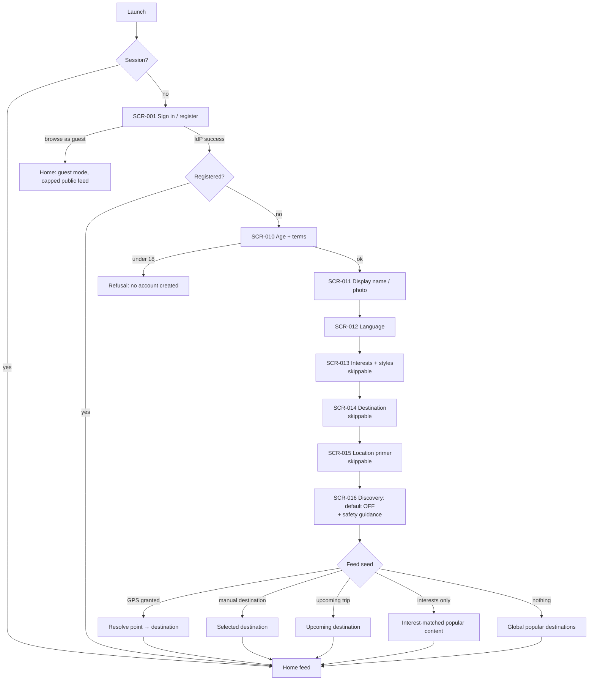
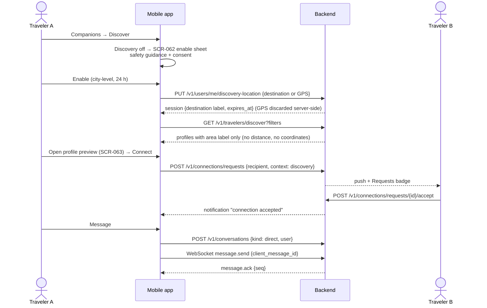
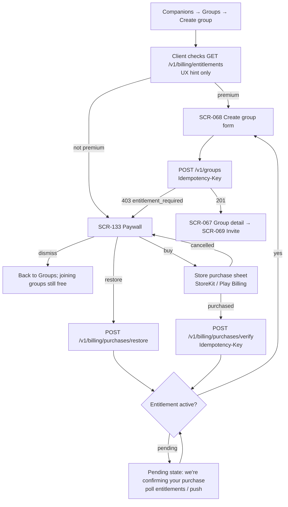

# 03 — Mobile Navigation and Screen Inventory

| | |
|---|---|
| **Status** | Draft v1.0 — Phase 0 |
| **Owner** | Mobile / UX |
| **Platforms** | iOS and Android (React Native + Expo Router, [ADR-0015](adr/0015-expo-react-native.md)) |
| **Related** | [PRD](01-prd.md) · [Architecture](02-system-architecture.md) · [Entitlement policy](07-subscription-entitlement-policy.md) · [Threat model](08-privacy-security-threat-model.md) · [`mobile/README.md`](../mobile/README.md) |

Requirement IDs use the PRD prefixes: AUTH, PROF, LOC, DEST, POST, FEED, DISC, CONN, DM, GRP, GCHAT, CHAL, AI, TRIP, GUIDE, OFF, I18N, BILL, NOTIF and SAFE. Endpoints in this document are **indicative**. The normative contract is `contracts/openapi/openapi.yaml`.

---

## 1. Information-architecture principles

1. **Five primary destinations, no more** (master prompt §21). Everything else is reached contextually from where it is relevant: trip planning from Profile or Explore, audio tours from a destination or place, challenges from a group.
2. **The travel guide stands alone.** Home, Explore, trips, guides and offline downloads are fully usable with location permission denied and traveler discovery off (DISC-011).
3. **Content near you ≠ people near you.** The Home "Nearby" tab shows destination-tagged *posts*. People discovery lives only in Companions, behind its own opt-in and consent (DISC-001, DISC-003).
4. **Connectivity is explicit.** Every screen is classified (§8). Online-only features carry an "Online only" badge before the user commits to them, not an error afterwards.
5. **Safety is designed in.** Report and block are reachable within two taps from any user-generated content or profile. Discovery copy never calls meeting strangers "safe" (DISC-010).
6. **The server is the authority.** The client hides or teases premium features for UX only. Every gated action is re-checked by the backend (BILL, GRP).

## 2. Primary navigation (bottom tabs)

| Tab | Route | Purpose | Top-level content | Primary phase |
|---|---|---|---|---|
| **Home** | `/` | Local travel feed for the destination being browsed | Feed tabs *For You · Nearby · Following · Destinations*, destination switcher, trending destinations, notifications bell | 1 |
| **Explore** | `/explore` | Discover places and plan | Map, attractions, guides and audio tours, AI trip planner entry | 4 (destination search from 1) |
| **Companions** | `/companions` | People and groups | Segments *Discover · Requests · Groups*, discovery status chip, safety center link | 2–3 |
| **Messages** | `/messages` | Conversations | Unified inbox (DMs and group chats), group activities entry | 3 |
| **Profile** | `/profile` | Me | Posts, saved, trips, badges, settings (privacy, subscription, account) | 1 |

Tab rules: tab labels are always visible (never icon-only). Re-tapping the active tab scrolls to top, then pops to the tab root. The unread badge on Messages is a count capped at "99+". The Companions badge counts pending connection requests and group invitations.

## 3. Route tree (target)

Expo Router, file-based. `( … )` groups do not appear in URLs. Screens that must stack over any tab (post detail, profiles, conversations) are registered in the root stack so they can be pushed from anywhere.

```
app/
  _layout.tsx                         Root stack + providers
  (auth)/                             Presented modally when signed out
    sign-in.tsx                       /sign-in            SCR-001
    verify-email.tsx                  /verify-email       SCR-002
  (onboarding)/
    onboarding.tsx                    /onboarding         SCR-010 (entry; step routes below)
    onboarding/[step].tsx             /onboarding/:step   SCR-011…016
  (tabs)/
    index.tsx                         /                   SCR-020 Home
    explore.tsx                       /explore            SCR-040
    companions.tsx                    /companions         SCR-060
    messages.tsx                      /messages           SCR-080
    profile.tsx                       /profile            SCR-100
  destinations/[destinationId].tsx    SCR-024
  posts/[postId].tsx                  SCR-023
  users/[userId].tsx                  SCR-025
  places/[placeId].tsx                SCR-041
  guides/[guideId].tsx                SCR-045
  tours/[tourId].tsx                  SCR-046
  trips/[tripId]/…                    SCR-104 (+ planner, AI review)
  groups/[groupId]/…                  SCR-067…072, challenges SCR-085…090
  conversations/[conversationId].tsx  SCR-081 / SCR-082
  settings/…                          SCR-106…114
  invite/[token].tsx                  SCR-073 (deep link)
  (modals)/compose.tsx, report.tsx, block.tsx, paywall.tsx, connect.tsx …   SCR-130…137
  +not-found.tsx                      SCR-150
```

**Deep links:** custom scheme `travelbuddy://` and universal/app links on the production domain. Supported entry points: `invite/:token` (group invitation), `posts/:id`, `users/:handle`, `destinations/:slug`, `conversations/:id` (push notification tap). Every deep link re-runs auth and authorization server-side. A link to a resource the user cannot see shows the generic not-found screen (no existence leak, per architecture §5).

## 4. Onboarding

Order and rules (PROF-001, AUTH-008/009, LOC-003, DISC-001):

| # | Step | Required | Notes |
|---|---|---|---|
| 1 | **Account** (SCR-001): email, Apple or Google via the IdP | Yes | Guest browsing remains available from this screen (AUTH-012) |
| 2 | **Age and terms** (SCR-010): date of birth, terms and privacy acceptance | Yes | 18+ at launch. DOB is used transiently and only `birth_year` is stored. Under 18 → friendly refusal and no account (`age_restricted`) |
| 3 | **Profile basics** (SCR-011): display name, optional photo | Name only | Photo upload strips EXIF server-side |
| 4 | **Language** (SCR-012) | Yes (pre-filled from device) | Changes UI immediately (PROF-006) |
| 5 | **Interests and travel styles** (SCR-013) | Skippable | Chips: adventure, backpacking, luxury, food, culture, photography, digital nomad, nature, family |
| 6 | **Current or upcoming destination** (SCR-014) | Skippable | Search with localized names. Upcoming trips take optional dates |
| 7 | **Location permission** (SCR-015): primer *before* the OS prompt | Skippable | Explains it is used for the Nearby feed and never stored. "Not now" is a first-class choice |
| 8 | **Traveler discovery** (SCR-016) | Skippable, **default OFF** | Shows the safety guidance (`DiscoverySafetyNotice`). Enabling here records the separate discovery consent |

After the last step the user lands **directly on Home** with a non-empty feed (PROF-002, FEED cold start).



## 5. Contextual stacks

| Stack | Entry points | Screens |
|---|---|---|
| **Destination** | Destination switcher, post destination chip, search | SCR-022 picker → SCR-024 destination page (feed, guides, audio tours, groups heading there) |
| **Trip planning** | Profile → Trips, Explore → "Plan a trip", AI planner | SCR-103 trips → SCR-104 itinerary editor → SCR-042/043 AI generate and review → SCR-047 walking route preview |
| **Guides and audio tours** | Destination page, place detail, Explore | SCR-044 list → SCR-045 reader / SCR-046 player (lock-screen controls, on-device geofence triggers) → SCR-105 downloads |
| **Group detail** | Companions → Groups, group chat header, invitation link | SCR-067 overview (destination, dates, itinerary, members) → SCR-069 invite, SCR-070 members and roles, SCR-071 join requests, SCR-072 settings, ownership transfer |
| **Challenge details** | Group chat banner, group overview, push notification | SCR-085 list → SCR-086 detail and submit (attempts left, hints released) → SCR-088 results and rewards. Admins: SCR-087 create, SCR-090 judge queue. Team mode: SCR-089 team thread |
| **Settings** | Profile → gear | SCR-106 home → privacy center, language and region, notifications, devices and sessions, subscription, blocked users, safety center, account deletion and export |

## 6. Modal flows

| Modal | Trigger | Behaviour |
|---|---|---|
| **Compose post** (SCR-130) | Home FAB, destination page, trip summary "share" | Kind picker (text, photo, video, recommendation, review, tip, itinerary summary). Destination is required unless location precision is `none`. Place tag is optional. Default precision comes from privacy settings. Media uploads via presigned URLs with progress. The draft is kept locally if offline, but publishing requires connectivity. Requires a verified email (AUTH-004) |
| **Report** (SCR-131) | "⋯" on post, comment, message, profile, group, challenge | Reason list (spam, harassment, hate, sexual content, minor safety, violence, self-harm, scam, privacy violation, impersonation, illegal, other) plus optional details. Confirmation explains next steps. Offers "Also block" |
| **Block** (SCR-132) | Profile "⋯", report confirmation, chat header | Plain-language summary of effects: removes connection and follows, hides content in both directions, ends DMs. The blocked user is not notified. Reversible in Settings → Blocked users |
| **Paywall** (SCR-133) | Any premium-gated action (create group, premium guide, extra offline storage, AI quota exhausted) | States what the user tried to do. Shows plans with store-localized prices, restore purchases, terms and auto-renewal disclosure. Dismissible. Never blocks safety features |
| **Connection request** (SCR-135) | Traveler profile preview, group member list | Optional 140-character note (spam-filtered). Shows the recipient's request policy outcome before sending. Rate-limit errors are explained, not hidden |
| **Location permission primer** (SCR-015 as a sheet) | First tap on Nearby or GPS-based discovery | Explains purpose and non-persistence, then the OS prompt. Denial leaves a manual destination path |
| **Share** (SCR-136) | Post, trip, destination, group invite | System share sheet. Invitation links are expiring tokens |

## 7. Key flows

### 7.1 Discovery → connection → direct message



Failure states shown in UI: `connection_request_cooldown`, `rate_limited` (with retry time), `blocked_relationship` (shown as a generic "not available"), `connection_required` (DM before acceptance), `discovery_invisible`.

### 7.2 Paywall → purchase → group creation



## 8. Screen inventory

Auth levels: **Guest** (no account) · **User** (signed in) · **Verified** (email verified, required for publishing, messaging and requests) · **Premium** (server-checked entitlement) · **Group role** (owner/admin/moderator, resource-scoped) · **Group member**.

Offline: **Works offline** (fully functional from local data) · **Cached read-only** (last synced data viewable, mutations disabled or queued as drafts) · **Online only** (shows the "Online only" badge, and an inline offline state when disconnected).

### Auth and onboarding

| ID | Screen | Route | Phase | Auth | Offline | Key endpoints | Req |
|---|---|---|---|---|---|---|---|
| SCR-001 | Sign in / register (IdP options, guest entry) | `/sign-in` | 1 | Guest | Online only | IdP SDK, `POST /v1/auth/register`, `POST /v1/auth/login` | AUTH |
| SCR-002 | Email verification status | `/verify-email` | 1 | User | Online only | `GET /v1/users/me` | AUTH |
| SCR-003 | Password reset (IdP-hosted hand-off) | external | 1 | Guest | Online only | IdP | AUTH |
| SCR-010 | Age gate and terms | `/onboarding` | 1 | User | Online only | `POST /v1/auth/register` | AUTH, SAFE |
| SCR-011 | Profile basics (name, photo) | `/onboarding/profile` | 1 | User | Online only | `PATCH /v1/users/me/profile`, `POST /v1/media/uploads` | PROF |
| SCR-012 | Language | `/onboarding/language` | 1 | User | Works offline (synced later) | `PATCH /v1/users/me/preferences` | I18N, PROF |
| SCR-013 | Interests and travel styles | `/onboarding/interests` | 1 | User | Online only | `PATCH /v1/users/me/profile` | PROF |
| SCR-014 | Current or upcoming destination | `/onboarding/destination` | 1 | User | Online only | `GET /v1/destinations/search`, `PUT /v1/users/me/browse-destination` | LOC, DEST |
| SCR-015 | Location permission primer | `/onboarding/location` | 1 | User | Works offline | OS permission only | LOC |
| SCR-016 | Discovery visibility and safety guidance | `/onboarding/discovery` | 2 (step shown from 1, toggle enabled in 2) | User | Online only | `PATCH /v1/users/me/privacy`, consent record | DISC, SAFE |

### Home

| ID | Screen | Route | Phase | Auth | Offline | Key endpoints | Req |
|---|---|---|---|---|---|---|---|
| SCR-020 | Home feed (For You, Nearby, Following, Destinations) | `/` | 1 | Guest (capped) / User | Cached read-only | `GET /v1/feed` | FEED, LOC |
| SCR-021 | Feed filters sheet | `/` (sheet) | 1 | Guest / User | Online only | `GET /v1/feed?…` | FEED |
| SCR-022 | Destination picker and search | `/destinations/search` | 1 | Guest / User | Online only | `GET /v1/destinations/search` | DEST, LOC |
| SCR-023 | Post detail and comments | `/posts/[postId]` | 1 | Guest (read) / Verified (comment) | Cached read-only | `GET /v1/posts/{id}`, `POST /v1/posts/{id}/comments`, `POST /v1/posts/{id}/reactions` | POST |
| SCR-024 | Destination page | `/destinations/[destinationId]` | 1 | Guest / User | Cached read-only | `GET /v1/destinations/{id}`, `GET /v1/feed?destination_id=` | DEST, FEED |
| SCR-025 | Other traveler's profile | `/users/[userId]` | 1 | User | Cached read-only | `GET /v1/users/{id}` (PublicProfile) | PROF, CONN, SAFE |
| SCR-026 | Notifications inbox | `/notifications` | 1 | User | Cached read-only | `GET /v1/notifications` | NOTIF |

### Explore

| ID | Screen | Route | Phase | Auth | Offline | Key endpoints | Req |
|---|---|---|---|---|---|---|---|
| SCR-040 | Explore map and attractions | `/explore` | 4 | Guest / User | Works offline for downloaded regions, otherwise online only | `GET /v1/places/nearby`, tiles provider | GUIDE, DEST |
| SCR-041 | Place detail | `/places/[placeId]` | 4 | Guest / User | Cached read-only | `GET /v1/places/{id}` | DEST, GUIDE |
| SCR-042 | AI trip planner prompt | `/trips/plan` | 4 | User | Online only | `POST /v1/ai/itineraries/generate` | AI |
| SCR-043 | AI itinerary review (accept, edit, regenerate) | `/trips/plan/review` | 4 | User | Online only | `POST /v1/trips`, `POST /v1/ai/trips/{id}/replan` | AI, TRIP |
| SCR-044 | Guides and audio tours list | `/destinations/[id]/guides` | 4 | Guest / User / Premium | Cached read-only | `GET /v1/destinations/{id}/guides` | GUIDE, BILL |
| SCR-045 | Guide reader | `/guides/[guideId]` | 4 | User / Premium | Works offline (downloaded) | `GET /v1/guides/{id}` | GUIDE, OFF |
| SCR-046 | Audio tour player | `/tours/[tourId]` | 4 | User / Premium | Works offline (downloaded) | offline package manifest | GUIDE, OFF |
| SCR-047 | Walking route preview | `/places/[id]/route` | 4 | User | Online only | routing provider | GUIDE |

### Companions

| ID | Screen | Route | Phase | Auth | Offline | Key endpoints | Req |
|---|---|---|---|---|---|---|---|
| SCR-060 | Companions hub: a map around the traveller's approximate city, *Search for companions* with a radar sweep, travellers on the map and listed below (Discover), Requests, Groups | `/companions` | 2 | User | Cached read-only (requests, groups); the map and search need a connection | `GET /v1/users/me/approximate-location`, `GET /v1/travelers/discover` | DISC, CONN, GRP, LOC-010 |
| SCR-061 | Discovery results | `/companions/discover` | 2 | Verified | Online only | `GET /v1/travelers/discover` | DISC |
| SCR-062 | Discovery session settings (enable, granularity, duration, invisible) | `/companions/discover/settings` | 2 | Verified | Online only | `PUT /v1/users/me/discovery-location`, `PATCH /v1/users/me/privacy` | DISC, LOC, SAFE |
| SCR-063 | Traveler profile preview | `/users/[userId]?context=discovery` | 2 | Verified | Online only | `GET /v1/users/{id}` | DISC, PROF |
| SCR-064 | Connection requests inbox | `/companions/requests` | 2 | User | Cached read-only | `GET /v1/connections/requests`, `POST …/accept`, `POST …/decline` | CONN |
| SCR-065 | Connections list | `/companions/connections` | 2 | User | Cached read-only | `GET /v1/connections` | CONN |
| SCR-066 | My groups | `/companions/groups` | 3 | User | Cached read-only | `GET /v1/groups?member=me` | GRP |
| SCR-067 | Group detail | `/groups/[groupId]` | 3 | Group member | Cached read-only | `GET /v1/groups/{id}`, `GET /v1/groups/{id}/members` | GRP |
| SCR-068 | Create group | `/groups/new` | 3 | Premium | Online only | `POST /v1/groups` | GRP, BILL |
| SCR-069 | Invite to group (direct, expiring link) | `/groups/[groupId]/invite` | 3 | Group role (+ owner premium) | Online only | `POST /v1/groups/{id}/invitations` | GRP |
| SCR-070 | Members and roles | `/groups/[groupId]/members` | 3 | Group member (admin actions by role) | Cached read-only | `GET /v1/groups/{id}/members`, role and remove endpoints | GRP, SAFE |
| SCR-071 | Join requests review | `/groups/[groupId]/requests` | 3 | Group role | Online only | join-request endpoints | GRP |
| SCR-072 | Group settings and ownership transfer | `/groups/[groupId]/settings` | 3 | Group owner/admin | Online only | `PATCH /v1/groups/{id}`, transfer endpoints | GRP, BILL |
| SCR-073 | Invitation landing (deep link) | `/invite/[token]` | 3 | User | Online only | redeem invitation endpoint | GRP |

### Messages

| ID | Screen | Route | Phase | Auth | Offline | Key endpoints | Req |
|---|---|---|---|---|---|---|---|
| SCR-080 | Inbox (DMs and groups) | `/messages` | 3 | User | Cached read-only | `GET /v1/conversations`, WebSocket | DM, GCHAT |
| SCR-081 | Direct conversation | `/conversations/[id]` | 3 | Verified + connected | Recent chats kept on the device and shown offline. Messages written offline show at once ("Sending…"), are kept in an outbox across restarts and sent with the same `client_message_id` when a connection is back. A refused message shows "Not sent" with retry or delete | `GET /v1/conversations/{id}/messages`, WebSocket `message.send`, `typing.*`, `receipt.read` | DM, DM-014 |
| SCR-082 | Group chat | `/conversations/[id]` | 3 | Group member | Cached read-only (queued sends) | as above + pins and announcements | GCHAT |
| SCR-083 | Reply thread | `/conversations/[id]/thread/[messageId]` | 3 | Group member | Cached read-only | messages `?thread_root_id=` | GCHAT |
| SCR-084 | Pinned messages and announcements | `/conversations/[id]/pins` | 3 | Group member | Cached read-only | pins endpoint | GCHAT |
| SCR-085 | Group challenges list | `/challenges?groupId=` | 5 | Group member | Cached read-only | `GET /v1/groups/{id}/challenges` | CHAL |
| SCR-086 | Challenge detail and submit | `/challenges/[id]` | 5 | Group member | Online only (submission) | `POST /v1/challenges/{id}/submissions` | CHAL |
| SCR-087 | Create or edit challenge | `/challenges/new?groupId=` | 5 | Group role + owner premium | Online only | `POST /v1/groups/{id}/challenges` | CHAL, BILL |
| SCR-088 | Results and rewards | results inline in `/challenges/[id]`; `/rewards` (my rewards and codes) | 5 | Group member | Cached read-only | `GET /v1/challenges/{id}/results` | CHAL |
| SCR-089 | Team challenge thread | `/chat/[id]` (the team's conversation) | 5 | Team member | Cached read-only | team conversation | CHAL, GCHAT |
| SCR-090 | Judge review queue | `/challenges/review?id=` | 5 | `challenges.judge` role | Online only | judging endpoints | CHAL |

### Profile and settings

| ID | Screen | Route | Phase | Auth | Offline | Key endpoints | Req |
|---|---|---|---|---|---|---|---|
| SCR-100 | My profile (posts, saved, trips, badges) | `/profile` | 1 | User | Cached read-only | `GET /v1/users/me` | PROF, POST |
| SCR-101 | Edit profile | `/profile/edit` | 1 | User | Online only | `PATCH /v1/users/me/profile` | PROF |
| SCR-102 | Saved posts and places | `/profile/saved` | 1 / 4 | User | Cached read-only | bookmarks, saved places | POST, TRIP |
| SCR-103 | Trips list | `/trips` | 4 | User | Works offline | `GET /v1/trips` + local SQLite | TRIP, OFF |
| SCR-104 | Trip detail and itinerary editor | `/trips/[tripId]` | 4 | Owner / collaborator | Works offline (edits synced with `If-Match` version) | `GET/PATCH /v1/trips/{id}` | TRIP, OFF |
| SCR-105 | Offline downloads manager | `/settings/downloads` | 4 | User | Works offline | offline package manifests | OFF, GUIDE |
| SCR-106 | Settings home | `/settings` | 1 | User | Works offline (navigation) | — | — |
| SCR-107 | Privacy center | `/settings/privacy` | 1–2 | User | Online only | `GET/PATCH /v1/users/me/privacy` | PROF, DISC, SAFE |
| SCR-108 | Language and region | `/settings/language` | 1 | User | Works offline (synced later) | `PATCH /v1/users/me/preferences` | I18N |
| SCR-109 | Notification settings | `/settings/notifications` | 3 | User | Online only | preferences endpoint | NOTIF |
| SCR-110 | Devices and sessions | `/settings/sessions` | 1 | User | Online only | `GET/DELETE /v1/users/me/sessions` | AUTH |
| SCR-111 | Subscription management | `/settings/subscription` | 3 | User | Cached read-only | `GET /v1/billing/entitlements`, `POST /v1/billing/purchases/restore` | BILL |
| SCR-112 | Blocked users | `/settings/blocked` | 1 | User | Online only | blocks endpoints | SAFE |
| SCR-113 | Account deletion and data export | `/settings/delete-account`, `/settings/data` | 1 / 6 | User | Online only | deletion and export endpoints | AUTH |
| SCR-114 | Safety center (guidance, how reporting works) | `/settings/safety` | 1 | Guest / User | Works offline (bundled copy) | — | SAFE |
| SCR-116 | Help and legal (support contact, help centre, terms, privacy, guidelines, version) | `/settings/help` | 6 | User | Online only | `GET /v1/client-config` (`support`, `legal`) | AUTH |
| SCR-117 | Appearance (dark, light or match the phone) | `/settings/appearance` | 6 | User | Works offline (kept on the device) | — | NFR-008 |
| SCR-118 | Purchase history (payments, refunds, chargebacks; receipts) | `/settings/purchases` | 3 | User | Online only | `GET /v1/billing/transactions` | BILL-004, BILL-011 |
| SCR-119 | Chat settings (send button right or left, chat background) | `/settings/chat` | 3 | User | Works offline (kept on the device; a chosen trip photo is copied into the app) | `GET /v1/users/{id}/posts` (own story photos) | DM-015 |
| SCR-115 | Badges and achievements | `/profile/badges` | 5 | User | Cached read-only | badges endpoint | CHAL |

### Modals and system

| ID | Screen | Route | Phase | Auth | Offline | Key endpoints | Req |
|---|---|---|---|---|---|---|---|
| SCR-130 | Compose post | `/compose` | 1 | Verified | Online only to publish (local draft kept) | `POST /v1/media/uploads`, `POST /v1/posts` | POST |
| SCR-131 | Report | `/report` | 1 | User | Online only | report endpoint | SAFE |
| SCR-132 | Block confirmation | `/block` | 1 | User | Online only | block endpoint | SAFE |
| SCR-133 | Paywall | `/paywall` | 3 | User | Online only | store SDK, `POST /v1/billing/purchases/verify` | BILL |
| SCR-134 | Purchase result / restore | `/paywall/result` | 3 | User | Online only | `GET /v1/billing/entitlements` | BILL |
| SCR-135 | Connection request composer | `/connect` | 2 | Verified | Online only | `POST /v1/connections/requests` | CONN |
| SCR-136 | Share sheet | system | 1 | Guest / User | Online only | — | POST, GRP |
| SCR-137 | Media viewer | `/media/[id]` | 1 | per parent | Cached read-only | signed media URLs | POST, DM |
| SCR-150 | Not found / not available | `+not-found` | 0 | Any | Works offline | — | — |
| SCR-151 | Forced update / maintenance | `/update-required` | 1 | Any | Works offline | min-version config endpoint | — |

**Phase 0 implementation:** the five tabs, SCR-001 and SCR-010 exist as placeholder routes that render "Coming in Phase N" from `mobile/src/config/featureFlags.ts`. SCR-150 is implemented.

### 8.1 Implementation status (mobile app, 2026-11-11)

Where each screen lives in `mobile/app/` today. Routes differ from the target tree where a
screen was folded into another one; ✅ built, ⚠️ partly, ⬜ not yet (reason given).

| Screens | Status | Where |
|---|---|---|
| SCR-001 sign in, SCR-010 age gate and terms | ✅ | `/(auth)/sign-in` (email and password; Apple and Google once configured in Supabase), `/(auth)/complete-registration` |
| SCR-002 email verification status | ⚠️ | Sign-in offers to resend the confirmation email after sign-up or when the email isn't confirmed; publishing explains an unverified email; no dedicated status screen |
| SCR-003 password reset | ✅ | IdP flow on the web (`/forgot-password`), opened from sign-in (`password_reset_url` in `/v1/client-config`) |
| SCR-011..014 onboarding steps | ✅ | One flow at `/(onboarding)/onboarding` (profile, language, interests, destination) |
| SCR-015 location primer, SCR-016 discovery guidance | ✅ | Location asked in context on the Nearby tab; `/discovery/consent` |
| SCR-020 home feed, SCR-021 filters | ✅ | `/(tabs)/index` (filters inline) |
| SCR-022 destination picker | ✅ | Picker component in Explore, compose and upcoming trips |
| SCR-023 post detail | ✅ | `/post/[id]` (photo gallery, comments with replies, author edit and delete, save, share) |
| SCR-024 destination page | ⚠️ | Destination content shows in Explore once chosen (guides, places, offline packages, neighbourhoods); no standalone page |
| SCR-025, SCR-063 traveller profile | ✅ | `/user/[id]` (summary of stories, followers and following; badges; the lists open at `/user/follows`) |
| SCR-026 notifications | ✅ | `/notifications` (push opt-in banner; unread items are marked with a dot) |
| SCR-040 Explore | ⚠️ | `/(tabs)/explore` lists places, featured destinations and neighbourhoods; no map yet (BL-4.06, provider decision) |
| SCR-041 place, SCR-042 planner, SCR-043 review | ✅ | `/places/[id]`, `/trips/plan`, `/trips/review` |
| SCR-044 guides list, SCR-045 guide reader | ✅ | Guides listed in Explore; `/guides/[id]` |
| SCR-046 audio tour player, SCR-047 walking route | ⬜ | Need editorial audio (BL-4.07) and maps (BL-4.06) |
| SCR-060..062, SCR-064, SCR-065 companions | ✅ | `/(tabs)/companions`: the map starts around the city the connection points to (approximate, LOC-010); *Search for companions* shares that city, sweeps a radar and shows travellers around the area they share (DISC-012), and a tap opens the profile; requests and connections below. Find people at `/people` |
| SCR-066..068 groups | ✅ | `/groups`, `/groups/[id]`, `/groups/new` |
| SCR-069 invite, SCR-070 members and roles, SCR-072 settings and transfer | ✅ | Share an invitation link from the group page; `/groups/manage` (settings, roles, restrict, remove, invitations with revoke, ownership offer, archive); the offer is answered on the group page |
| SCR-071 join requests | ⬜ | Behind the `group_join_requests` flag (off) |
| SCR-073 invitation landing | ✅ | `/invite` opened by `travelbuddy://invite?t=<token>` (preview, join, open if already a member; signed-out travellers sign in first and come back). The web link's fragment form `#t=<token>` is read too, but Expo Go drops fragments, so app links use the query. Pasting a link or code in Groups still works. Opening `https://…/invite` links in the app needs universal links (associated domains) once the production domain is set |
| SCR-080 inbox, SCR-081/082 chats | ✅ | `/(tabs)/messages`, `/chat/[id]` (photos, replies, reactions, pins, announcements, mute, clear for me). Live over the realtime socket (ADR-0033): new messages, "Name is typing…", the reader's avatar next to "Read" and "Sent" otherwise; the send button sits on the input's line; offline outbox and on-device chat cache |
| SCR-119 chat settings | ✅ | `/settings/chat`, from Profile → Preferences → Chat and the palette button in a chat: send button on the right or the left (left-handed use) with a live preview; background None, Coast or Mountains (built-in CC0 trip photos, `assets/chat-backgrounds/CREDITS.md`) or one of the traveller's own story photos, downloaded into the app's documents (`state/chatPreferences.ts`, `chat-preferences.json`) |
| SCR-083 reply thread | ✅ | `/chat/thread` in group chats, opened from a message's reply count or "Reply in thread"; replies also stay quoted in the chat |
| SCR-084 pinned messages | ✅ | Pinned bar in `/chat/[id]` |
| SCR-085..090 challenges | ✅ | `/challenges`, `/challenges/[id]`, `/challenges/new`, `/challenges/review`, `/challenges/fulfillments`, `/rewards`; team threads in `/chat/[id]` |
| SCR-100 my profile, SCR-106 settings home | ✅ | `/(tabs)/profile` (profile summary, then settings grouped as Account, Your travels, Preferences, Safety and support) |
| SCR-101 edit profile, SCR-107 privacy | ✅ | `/settings/profile`, `/settings/privacy`; follow requests at `/settings/follow-requests` |
| SCR-102 saved | ✅ | `/saved` (places), `/bookmarks` (stories) |
| SCR-103 trips, SCR-104 trip and itinerary editor | ✅ | `/trips` (plan with AI or `/trips/new` by hand), `/trips/[id]` (offline-first editor, sharing, replanning); upcoming trips at `/settings/upcoming` |
| SCR-105 downloads | ✅ | `/downloads` |
| SCR-118 purchase history | ✅ | `/settings/purchases`, from Subscription: payments, refunds and chargebacks across the stores and the website, newest first, amounts in the payment's currency, receipt links; plan notices open Subscription |
| SCR-108..114, SCR-116, SCR-117 settings | ✅ | `/settings/language`, `/settings/notifications`, `/settings/sessions`, `/settings/subscription` (read-only until the purchase SDK), `/settings/blocked`, `/settings/delete-account`, `/settings/data`, `/settings/safety`, `/settings/help`, `/settings/appearance` |
| SCR-115 badges | ✅ | On profiles; rewards at `/rewards` |
| SCR-130 compose, SCR-131 report | ✅ | `/compose` (up to ten photos; a destination and optionally a public spot in it), `/report` |
| SCR-132 block, SCR-135 connection request | ✅ | From the profile (blocking asks for confirmation first) |
| SCR-133 paywall, SCR-134 purchase result | 🟡 | `/paywall` (modal): what the traveller tried to do, the Premium benefits, the store's Premium offers (subscriptions and passes) with titles, the auto-renewal disclosure, terms and privacy; opened from Subscription, group creation, premium guides and offline downloads. No web price or link (ADR-0031). Buying waits for the StoreKit / Play Billing adapter in a development build; development builds can buy through the backend's test store (`EXPO_PUBLIC_PURCHASES=test`), with restore and a result state |
| SCR-136 share sheet, SCR-137 media viewer | ✅ | System share sheet (stories, invitations); full-screen photo viewer from a story |
| SCR-150 not found, SCR-151 forced update | ✅ | `+not-found`; update gate in the root layout (from `/v1/client-config`) |

## 9. Offline behaviour summary (OFF)

| Works offline (after download or sync) | Cached read-only | Online only |
|---|---|---|
| Saved trips and itinerary editing (sync on reconnect, version conflicts surfaced) · downloaded guides · audio tours (with on-device geofences) · downloaded map regions · language setting · safety center | Feed (last session) · post detail · profiles · conversations (queued sends) · groups · requests · subscription status | Sign-in · onboarding · discovery · search · AI planner · publishing · purchases · challenges submissions · routing · settings that write to the server |

Rules: queued chat messages show a "pending" clock and are sent in order with their original `client_message_id`. Drafts never auto-publish without the user seeing them sent. Cached screens show a subtle "Last updated …" timestamp when stale.

## 10. Design system

Tokens live in [`mobile/src/theme/tokens.ts`](../mobile/src/theme/tokens.ts). The contrast of every text pair and essential UI boundary is verified by a unit test (`theme/__tests__/contrast.test.ts`), so a token change that breaks WCAG AA fails CI.

The look is called **Noir** (2026-11-11): near-black surfaces, ivory text and a single champagne-gold accent, with serif titles over a geometric sans. Dark is the default theme. Light is the same system on warm ivory with a bronze accent. The aim is a calm, editorial feel in which photos carry the colour.

### 10.1 Colour (light / dark) — WCAG 2.2 AA

| Token pair | Light | Ratio | Dark | Ratio | Minimum |
|---|---|---|---|---|---|
| textPrimary / background | `#17140E` / `#FAF8F4` | 17.32 | `#F4F1EA` / `#0B0B0D` | 17.43 | 4.5 |
| textSecondary / surface | `#5F5A4F` / `#F2EEE6` | 5.93 | `#A9A59C` / `#131316` | 7.55 | 4.5 |
| onPrimary / primary | `#FFFFFF` / `#7A5910` | 6.43 | `#1B1404` / `#D9B56C` | 9.38 | 4.5 |
| primary (links) / background | `#7A5910` / `#FAF8F4` | 6.07 | `#D9B56C` / `#0B0B0D` | 10.09 | 4.5 |
| onPrimaryMuted / primaryMuted | `#5A4108` / `#F3E8CC` | 7.85 | `#EBD197` / `#2B2413` | 10.33 | 4.5 |
| onDanger / danger | `#FFFFFF` / `#B42318` | 6.57 | `#2B0A07` / `#F2857B` | 7.32 | 4.5 |
| onWarningSurface / warningSurface | `#734700` / `#FBEFD9` | 7.01 | `#F5CE85` / `#33260B` | 9.87 | 4.5 |
| onSuccessSurface / successSurface | `#1D6537` / `#E4F2E9` | 6.12 | `#8FDDB0` / `#10291C` | 9.69 | 4.5 |
| onInfoSurface / infoSurface | `#2B4375` / `#E8ECF6` | 8.21 | `#B8C8EE` / `#1A2030` | 9.69 | 4.5 |
| tabBarInactive / tabBarBackground | `#6A6558` / `#FFFFFF` | 5.81 | `#96928A` / `#0E0E11` | 6.22 | 4.5 |
| borderStrong (inputs) / surface | `#857E70` / `#F2EEE6` | 3.48 | `#77757D` / `#131316` | 4.08 | 3.0 |
| focusRing / background | `#1D4ED8` / `#FAF8F4` | 6.32 | `#F1DCA8` / `#0B0B0D` | 14.55 | 3.0 |

Surfaces step up in tone instead of casting shadows: `background` (the screen) → `surface` (cards, grouped rows) → `surfaceRaised` (pressed rows, secondary buttons, unread items). `primaryMuted` is a quiet tint of the accent for selected chips and the wells behind icons.

Two further token groups are tested in the same file:

* **`accentGradient`** (dark `#E8CB8A → #C9A255`, light `#8A6614 → #6B4D0C`) fills the main call to action, the compose button and the rule under a screen title. `onPrimary` text meets 4.5:1 on both ends.
* **`scrims`** are for text on photos, which ignore the theme: white text on a `rgba(11,11,13,0.72)` chip or on the lower gradient of a cover photo meets 4.5:1 even over a white photo.

Colour is never the only carrier of meaning: status chips pair colour with text or icon, errors include a message, the current tab changes glyph as well as colour, and an unread notification has a dot and is announced as unread.

### 10.2 Typography

Two typefaces, both under the SIL Open Font License and bundled with the app (`theme/fonts.ts`): **Playfair Display** for titles and **Manrope** for everything else. Each weight is its own font file, so styles choose a family from `theme.fonts` or `theme.typography` and never set `fontWeight` (Android would draw a fake bold). If the fonts fail to load the app opens with the system font. Text still follows the OS text-size setting.

| Style | Size / line height | Face | Use |
|---|---|---|---|
| display | 38 / 46 | Playfair Display Bold | Wordmark on sign-in |
| title1 | 30 / 38 | Playfair Display Bold | Screen titles, the name on a profile |
| title2 | 22 / 30 | Playfair Display SemiBold | Section titles, figures in a profile summary |
| title3 | 18 / 26 | Manrope Bold | Card titles, banners |
| body / bodyStrong | 16 / 24 | Manrope Regular / SemiBold | Default text |
| label | 14 / 20 | Manrope SemiBold | Buttons, chips, badges |
| caption | 12 / 16 | Manrope Medium | Metadata, timestamps (never for essential information) |
| overline | 11 / 16, wide tracking, capitals | Manrope Bold | The line above a title, the kind of a story, group titles |

### 10.3 Spacing, radii, elevation

* **Spacing:** 4-pt grid (`spacing[n] = 4n`: 0, 4, 8, 12, 16, 20, 24, 32, 40, 48, 64). Screen gutters are 16 (phones) and 24 (tablets).
* **Radii:** sm 6 · md 12 (inputs, notices) · lg 16 (cards, grouped rows, tiles) · xl 24 (sheets, story cards) · pill 999 (buttons, chips, badges).
* **Elevation:** levels 0–3, mapping Android `elevation` to iOS shadow. Both themes rely on surface tone and hairline dividers more than shadow; only the compose button floats.

### 10.4 Themes

Dark is the default. The traveller chooses Dark, Light or "Match this phone" on SCR-117 (`/settings/appearance`); the choice applies at once and is kept on the device in `ui-preferences.json` (`state/uiPreferences.ts`), so it survives a restart and is not tied to an account. A missing or damaged file means the default. Both themes define the same token set (enforced by test). The window background, the launcher icon and its adaptive background are obsidian too (`app.json`), and the launch screen shows the gold compass on obsidian (`expo-splash-screen`). It stays up until the typefaces are registered (`launch/launchScreen.ts`), so the app opens dark and the first frame is the finished one. The launch screen is the same in both themes, because it is drawn before the saved choice can be read. Map styles get matching light and dark variants in Phase 4.

### 10.4.1 Shared components

Screens are built from a small set in `mobile/src/components/` so the look stays consistent:

| Component | Use |
|---|---|
| `ScreenTitle` | Heading of a tab: optional overline, serif title, short gold rule, optional trailing action |
| `Button` | `primary` (gold gradient pill), `secondary` (raised surface), `ghost` (gold text); optional icon; busy state |
| `Chip` | Filters and single choices (`radio` role when exclusive); the selected chip is filled |
| `MenuGroup` / `MenuRow` | Settings lists: a titled card of rows with an icon well, optional count and chevron |
| `ActionTile` | Secondary shortcuts side by side (My trips, Downloads): icon well over a label |
| `CompanionMap` | The Companions map (ADR-0030): MapLibre GL JS in a WebView with OpenFreeMap's dark (or Positron) style, a gold radar sweep, avatar pins; driven by props, locked down by CSP and Subresource Integrity |
| `TextField`, `Notice`, `ActionSheet` | Inputs with a gold focus border, inline status messages, bottom sheets |
| `PostCard`, `PhotoGallery`, `Avatar` | Story cards with a cover photo, place chip and the kind as an overline; avatars with an optional gold ring |

The web app can adopt the same token values later; nothing in `packages/` changed.

### 10.5 Accessibility

* **Dynamic type:** text scales with the OS setting. Layouts must remain usable at 200 %: no fixed-height text containers, and rows wrap instead of truncating essential content. `maxFontSizeMultiplier` is applied only to dense chrome such as tab labels.
* **Touch targets:** minimum **44 × 44 pt** (`theme.minTouchTarget`), with `hitSlop` to reach Android's 48 dp on small icons.
* **Screen readers:** every interactive element has `accessibilityRole` and a label. Icon-only buttons always have labels. Screen titles use `accessibilityRole="header"`. Decorative icons are `accessible={false}`. Status badges expose a full-sentence label (e.g. "Online only. This feature needs an internet connection."). Chat bubbles announce sender, time and delivery state. Focus moves to the first heading on navigation.
* **Motion:** respect "Reduce motion". Map fly-to animations and parallax are disabled when it is on.
* **Media:** alt text field in compose for photos. Audio tours ship transcripts (`audio_tour_stops.transcript`).

### 10.6 Internationalization and RTL readiness

* All strings go through i18next. Keys are type-checked against `en.json`, and a test enforces key parity and the CLDR plural forms for every locale (es, fr and pt-BR need `_many`).
* Launch locales are en, es, pt-BR, fr and de. Adding one means a JSON file plus registration, with no schema change (I18N).
* Dates, times, numbers and currency use `Intl` with the user's locale. Trip days are shown in the **destination's** time zone.
* **RTL readiness:** `supportsRTL` is enabled in the localization config plugin, layouts use logical `start`/`end` properties (never `left`/`right`), directional icons are mirrored, and `RTL_LOCALES` is the single switch when Arabic or Hebrew is added.
* Machine-translated user content is always labelled as such, with a "Show original" toggle.

## 11. UX rules (non-negotiable)

1. **"Online only" badge** on every feature that needs connectivity (sign-in, discovery, AI planner, messaging sends, purchases, search). When offline, the badge switches to an "Offline" warning state and the action is disabled with an explanation, never a silent failure.
2. **Discovery is never presented as safe.** The required copy says that safety cannot be guaranteed and gives concrete guidance: meet in public, tell someone, keep personal details private, block and report. It is shown before first enablement (DISC-010) and lives in the safety center.
3. **The full travel guide works without social discovery.** No guide, trip, map, AI or offline flow may require enabling discovery or location permission. Location denial always offers a manual destination path.
4. **No fake data.** Unreleased features show "Coming in Phase N". Demo or seed content in non-production builds is visibly labelled as such.
5. **Never reveal more than the server returns.** The client must not compute or display distances to other travelers, and must not attempt to infer them.
6. **Premium prompts are contextual and dismissible**, explain what was attempted, and never gate reporting, blocking, leaving a group or deleting an account.
7. **Destructive actions** (delete post, leave group, remove member, block) need confirmation with a plain-language consequence summary. Reversible actions use undo toasts instead.

## 12. Open questions

| # | Question | Owner |
|---|---|---|
| 1 | Should the age gate also apply to guest browsing, or only to registration? | Legal / Product |
| 2 | Is history visible to new group members (`new_member_history`) by default, or from join only? | Product |
| 3 | Which in-app purchase library (expo-iap vs react-native-iap vs a RevenueCat SDK) once ADR-0017 adapters are settled? | Mobile / Billing |
| 4 | Maestro vs Detox for mobile E2E (test strategy proposes Maestro) | QA |
| 5 | Tablet layouts: phone-scaled in v1, or split view for Explore and Messages? | UX |
