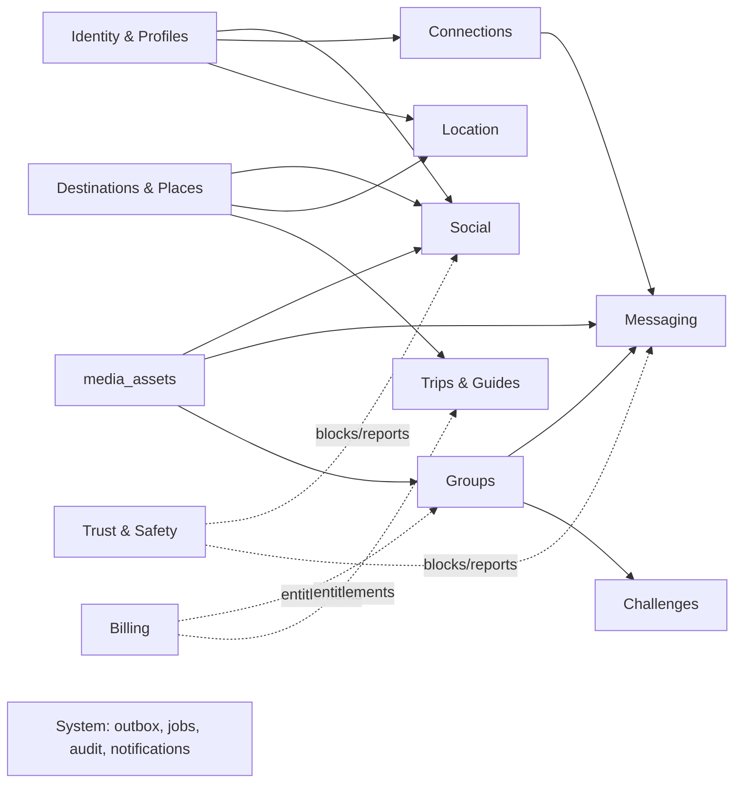
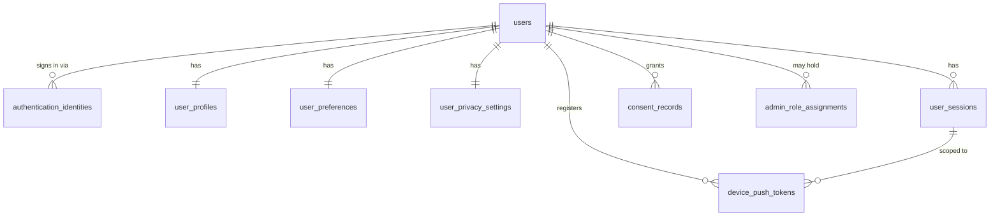
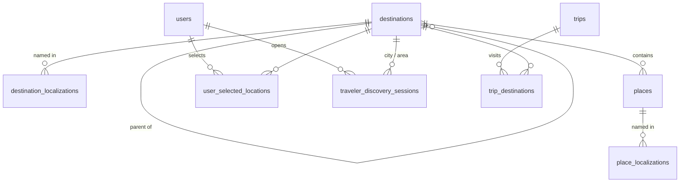
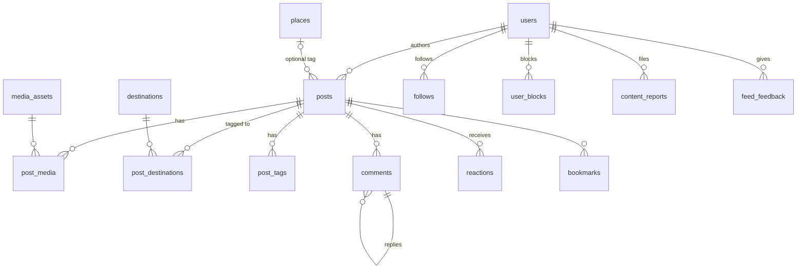
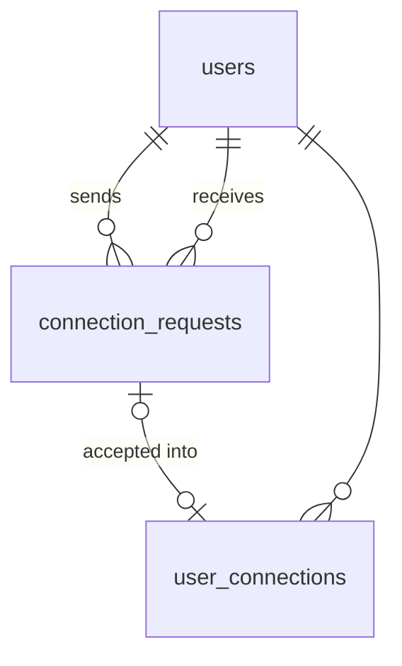
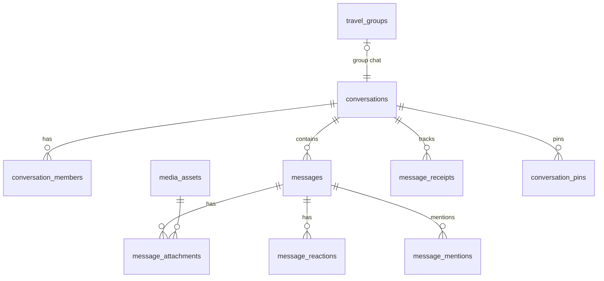
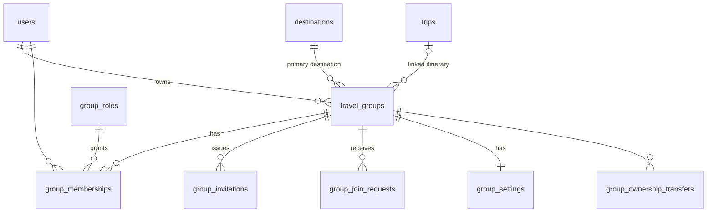
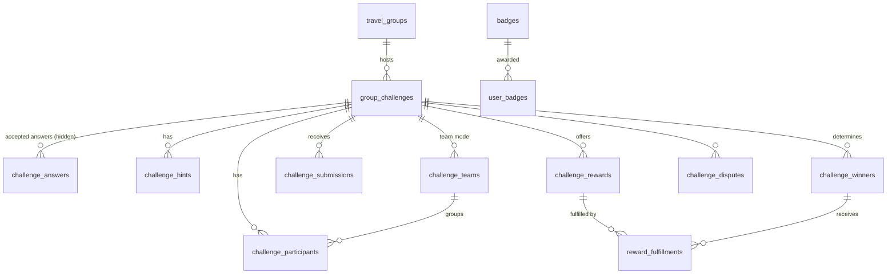
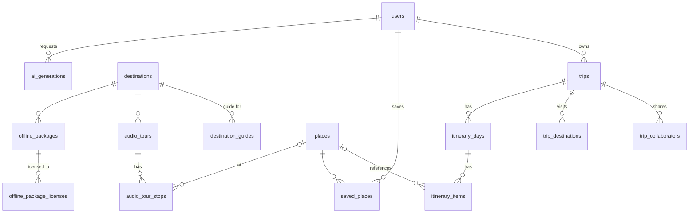
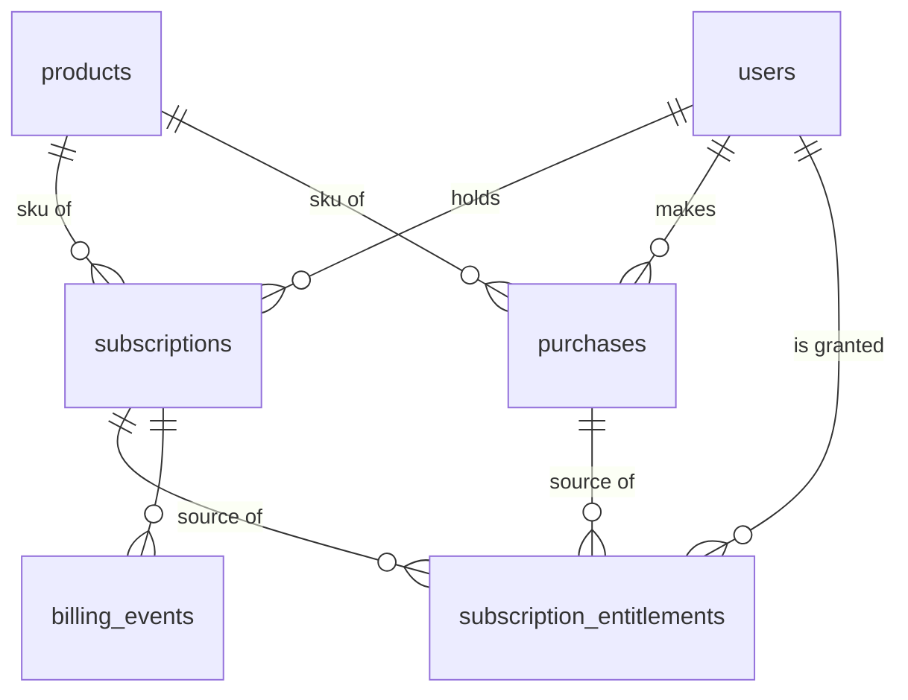

# 04 — Database ERD and Data Design

| | |
|---|---|
| **Status** | Draft v1.0 — Phase 0 |
| **Engine** | PostgreSQL 16 + PostGIS 3.4 (`postgis`, `citext`, `pg_trgm`, `unaccent`) |
| **Migrations** | Alembic, `backend/migrations/`. One migration series. Each module's tables arrive in the phase that implements the module. |
| **Related** | [Architecture](02-system-architecture.md) · [Threat model](08-privacy-security-threat-model.md) |

## 1. Conventions

| Rule | Detail |
|---|---|
| Primary keys | `id uuid` (UUIDv7, generated by the application), except pure join tables, which use composite PKs. |
| Timestamps | `created_at timestamptz NOT NULL DEFAULT now()`, and `updated_at timestamptz` on mutable rows. All timestamps are UTC. |
| Enumerations | `text` + `CHECK (col IN (...))`, not native PG enums, because they can be changed in a migration without `ALTER TYPE` locks. Allowed values are mirrored by Python `StrEnum`s. |
| Soft delete | `deleted_at` only where content must leave a tombstone (posts, comments, messages) or support undo. Personal data is hard-deleted or anonymized per retention (§12). |
| Foreign keys | Always declared. `ON DELETE` is chosen explicitly: `CASCADE` for owned children, `RESTRICT` for references, `SET NULL` for optional actors. |
| Geography | `geography(Point,4326)` / `geography(MultiPolygon,4326)` with GiST indexes. **No user-coordinate columns exist anywhere** (see §4). |
| Counters | Denormalized counters (`reaction_count` …) are updated in the same transaction as the source row, and a nightly job reconciles drift. |
| Money | Not stored in v1 (prices come from the stores). If added later: `amount_micros bigint` plus `currency char(3)`. |
| Text search | `pg_trgm` GIN indexes on `unaccent(lower(name))` for destination and place search. OpenSearch becomes justified when multilingual full-text ranking needs exceed this. |
| Supabase hardening | Every table in `public` has Row Level Security enabled with no policies, and Supabase's `anon`/`authenticated` roles have no privileges. This is applied automatically after every migration run (`SECURE_PUBLIC_SCHEMA_SQL`, ADR-0018). Extensions live in the `extensions` schema on Supabase |
| Naming | snake_case, plural table names. Indexes are `ix_<table>__<cols>`, uniques `uq_<table>__<cols>`, checks `ck_<table>__<rule>`. |

## 2. Domain overview

---

## 3. Identity and users

### users
| Column | Type | Notes |
|---|---|---|
| id | uuid PK | |
| status | text | `active`, `suspended`, `deactivated`, `pending_deletion`, `deleted` |
| email | citext NULL | From the IdP. `uq_users__email` partial `WHERE email IS NOT NULL AND status <> 'deleted'` |
| email_verified_at | timestamptz NULL | Mirrored from the IdP claim |
| birth_year | smallint NULL | Data minimization: the full DOB is used only transiently for the age gate |
| age_assured_at | timestamptz NULL | Age gate passed (self-attestation in v1) |
| primary_locale | text | BCP 47, e.g. `pt-BR` |
| last_active_on | date NULL | Day granularity only |
| deletion_requested_at | timestamptz NULL | Starts the deletion grace window |
| created_at / updated_at | timestamptz | |

### authentication_identities
| Column | Type | Notes |
|---|---|---|
| id | uuid PK | |
| user_id | uuid FK→users CASCADE | |
| issuer | text | OIDC `iss` |
| subject | text | OIDC `sub` |
| method | text | `email_password`, `apple`, `google`, `oidc` (generic federated), `dev` (development IdP only) |
| email_at_link | citext NULL | |
| created_at, last_used_at | timestamptz | |

`uq_authentication_identities__issuer_subject (issuer, subject)`. `ix__user_id`.

### user_profiles (1:1)
| Column | Type | Notes |
|---|---|---|
| user_id | uuid PK FK→users CASCADE | |
| handle | citext | `uq` — `^[a-z0-9_.]{3,30}$`. Used for mentions and invites |
| display_name | text | 1–50 chars |
| bio | text NULL | ≤ 300 chars |
| avatar_media_id | uuid NULL FK→media_assets SET NULL | |
| home_country_code | char(2) NULL | ISO 3166-1 |
| home_region | text NULL | Free text, optional |
| travel_styles | text[] | Codes from the catalog (`adventure`, `backpacking`, `luxury`, `food`, `culture`, `photography`, `digital_nomad`, `nature`, `family`) |
| interests | text[] | Interest catalog codes |
| languages_spoken | text[] | BCP 47 |
| account_visibility | text | `public`, `private` |
| onboarding_completed_at | timestamptz NULL | Drives `Me.onboarding_completed` |
| created_at, updated_at | timestamptz | |

GIN on `travel_styles`, `interests` for matching. Trigram index on `handle`, `display_name` (user search, Phase 2).

### user_preferences (1:1)
`user_id PK`, `ui_locale`, `content_languages text[]`, `time_zone` (IANA), `currency_code char(3)`, `distance_unit` (`km`, `mi`), `auto_translate bool DEFAULT false`, `notification_settings jsonb` (per-type channel matrix, validated by schema), `updated_at`.

### user_privacy_settings (1:1)
| Column | Default | Notes |
|---|---|---|
| user_id PK | | |
| discovery_enabled | **false** | Opt-in (DISC-001) |
| discovery_granularity | `city` | `city`, `neighborhood` |
| connection_requests_from | `everyone` | `everyone`, `shared_context` (same destination session, group or mutual connection), `nobody` |
| profile_visibility | `public` | `public`, `connections`. Who sees full profile details |
| show_trips_on_profile | false | |
| read_receipts_enabled | true | Reciprocal: disabling hides others' receipts too |
| post_location_default | `destination` | `none`, `destination`, `place` |
| search_engine_indexing | **false** | Opt-in (PROF-008). Gates `indexable` on the public profile and posts, and sitemap inclusion. Changes record a `search_indexing` consent |
| location_consent_version / _at | NULL | Device-location consent |
| discovery_consent_version / _at | NULL | Separate consent for traveler discovery |
| updated_at | | |

### user_sessions
| Column | Type | Notes |
|---|---|---|
| id | uuid PK | `sid` claim |
| user_id | uuid FK CASCADE | |
| refresh_token_hash | bytea | SHA-256 of the current refresh token. `uq`. The session itself is the token family |
| previous_refresh_token_hash | bytea NULL | Immediately previous token, for the 30 s replay leeway (partial index) |
| rotated_at | timestamptz NULL | Last rotation time |
| refresh_generation | int | Rotation counter |
| device_id | text | App-generated install ID |
| device_name, platform, app_version | text | `platform` ∈ `ios`, `android`, `web` |
| amr | text[] | IdP authentication methods at token exchange. Admin routes require an MFA method (ADM-007) |
| auth_time | timestamptz | IdP authentication time. Admin routes enforce a 12 h absolute limit (ADM-008) |
| last_admin_activity_at | timestamptz NULL | Updated on admin requests. 30 min idle limit (ADM-008) |
| created_at, last_used_at, expires_at | timestamptz | Refresh lifetime 60 days, sliding |
| revoked_at | timestamptz NULL | |
| revoked_reason | text NULL | `logout`, `user_revoked`, `reuse_detected`, `admin`, `password_changed`, `account_deleted` |
| last_ip | inet NULL | Nulled after 30 days (security investigations) |

`ix__user_id WHERE revoked_at IS NULL`.

### retired_refresh_tokens
`token_hash bytea PK` (SHA-256 of a rotated refresh token), `session_id FK→user_sessions CASCADE`, `retired_at`. `ix (session_id)`. Presenting any retired token revokes the session (reuse detection, AUTH-007). Rows can be purged once older than the refresh TTL, because such tokens are expired anyway.

### device_push_tokens
`id`, `user_id FK CASCADE`, `session_id FK→user_sessions CASCADE`, `provider` (`expo`, `fcm`, `apns`, `webpush`), `token_ciphertext bytea` (native token or Web Push endpoint URL, envelope-encrypted: endpoints are capability URLs), `token_hash bytea uq` (SHA-256 for dedupe and lookup), `webpush_p256dh`, `webpush_auth` (encrypted, `webpush` only), `device_id`, `created_at`, `last_seen_at`, `disabled_at` (set when the provider reports the token gone, e.g. HTTP 404/410 for Web Push). Revoking a session deletes its tokens. Never logged or returned.

**Account restrictions** (`MyAccount.restrictions`, SAFE-013) are derived from active `moderation_actions` (`action='restrict'`, `expires_at` null or in the future) and need no extra table.

### consent_records (append-only)
`id`, `user_id FK CASCADE`, `consent_type` (`terms`, `privacy_policy`, `location`, `traveler_discovery`, `marketing`, `ai_personalization`, `post_translation`, `search_indexing`), `version`, `granted bool`, `source` (`onboarding`, `settings`, `prompt`), `recorded_at`. `ix (user_id, consent_type, recorded_at DESC)`.

### admin_role_assignments
`user_id FK CASCADE`, `role` (`support`, `moderator`, `admin`, `superadmin`), `granted_by FK→users`, `granted_at`, `revoked_at`. PK `(user_id, role)`.

---

## 4. Locations and destinations

### destinations
| Column | Type | Notes |
|---|---|---|
| id | uuid PK | |
| parent_id | uuid NULL FK→destinations RESTRICT | Hierarchy: country → admin_region → city → district → neighborhood |
| kind | text | `country`, `admin_region`, `city`, `district`, `neighborhood`, `area` |
| country_code | char(2) | |
| continent | text | `africa`, `asia`, `europe`, `middle_east`, `north_america`, `central_america_caribbean`, `south_america`, `oceania` (editorial directory grouping, DEST-006). Denormalized from the country. `ix (continent, popularity_score DESC) WHERE status='active'` |
| cover_media_id | uuid NULL FK→media_assets SET NULL | Editorial cover. The asset must have `rights_verified_at` (DEST-007) |
| slug | text uq | `rio-de-janeiro-br` |
| path_segment | text | URL segment, unique among siblings: `uq (parent_id, path_segment)` (NULL parent treated as root via `COALESCE`). Supports `GET /v1/destinations/lookup?path=brazil/rio-de-janeiro` and `DestinationSummary.path` |
| default_name | text | English or ASCII fallback |
| centroid_lat, centroid_lng | double precision | Public centroid (`GeoPoint`). Plain columns so the catalog, hierarchy and search work without PostGIS |
| time_zone | text | IANA |
| path | uuid[] | Ancestor IDs root→self (denormalized, for cheap ancestor/descendant queries). GIN |
| depth | smallint | |
| geonames_id, osm_relation_id, wikidata_id | NULL | Each `uq` when present |
| popularity_score | real | Recomputed nightly from content volume (seeded with an editorial score until then) |
| is_featured | bool | |
| has_guides | bool | Maintained from guides events (Phase 4) |
| status | text | `active`, `hidden` |
| created_at, updated_at | | |

### destination_boundaries (PostGIS)
`destination_id PK FK CASCADE`, `boundary geography(MultiPolygon, 4326)` (GiST), `source` (license/provenance key, e.g. `approximate-bbox`, `osm:<relation>`), `updated_at`. Used only for `ST_Covers` point resolution (LOC-005), so databases without PostGIS still run everything else. Launch rows are approximate bounding boxes (docs/09 BL-1.05).

### destination_localizations
`destination_id FK CASCADE`, `locale`, `name`, `alt_names text[]`, `tagline text NULL` (≤ 140, editorial one-liner for directory cards), PK `(destination_id, locale)`. Trigram GIN on `unaccent(lower(name))` for search.

### places
| Column | Type | Notes |
|---|---|---|
| id | uuid PK | |
| destination_id | uuid FK→destinations | Most specific containing destination |
| category | text | `attraction`, `restaurant`, `cafe`, `bar`, `museum`, `beach`, `trail`, `viewpoint`, `park`, `market`, `lodging`, `transit_hub`, `other` |
| default_name | text | |
| location | geography(Point) | GiST. A **public place**, never a user position |
| address | jsonb NULL | |
| provider, provider_place_id | text | Licensed data source. `uq (provider, provider_place_id)` |
| license | text | Attribution and terms key |
| data_freshness_at | timestamptz | When the provider data was last verified |
| attributes | jsonb | Provider-sourced details (hours etc.), always shown with freshness |
| status | text | `active`, `closed_permanently`, `hidden` |

`place_localizations` mirrors `destination_localizations`.

### user_selected_locations
| Column | Notes |
|---|---|
| id uuid PK | |
| user_id FK CASCADE | |
| destination_id FK RESTRICT | |
| kind | `browse` (current browsing destination), `upcoming` (declared upcoming trip), `saved` (favorite destination) |
| start_date, end_date | For `upcoming` |
| share_for_discovery | bool DEFAULT false. Opt-in for `upcoming` entries to be matched by `GET /v1/travelers/discover?scope=upcoming` ("travelers going to X"). Requires discovery consent. Exposes destination and date overlap only |
| created_at | |

`uq (user_id) WHERE kind='browse'` (one active browse destination). `uq (user_id, destination_id, kind)`.

### traveler_discovery_sessions
**Deliberately contains no coordinates.** ([ADR-0005](adr/0005-coarse-location-discovery.md))

| Column | Notes |
|---|---|
| id uuid PK | |
| user_id FK CASCADE | |
| destination_id FK | City-level destination |
| area_destination_id FK NULL | Neighborhood, only if `discovery_granularity='neighborhood'` |
| source | `gps_resolved`, `manual` |
| travel_start_date, travel_end_date | Optional, for date-overlap matching |
| visibility | `visible`, `invisible` (invisible mode: can browse? **No.** Invisible users neither appear nor browse, which prevents lurking) |
| started_at, expires_at | TTL default 24 h, max 72 h |
| ended_at NULL | |

`uq (user_id) WHERE ended_at IS NULL`. `ix (destination_id, expires_at) WHERE ended_at IS NULL AND visibility='visible'`.

### trip_destinations
`id`, `trip_id FK CASCADE`, `destination_id FK RESTRICT`, `start_date`, `end_date`, `sort_order`. `ix (destination_id)` for "travelers going to X" matching (only for users who opted to share trips).

---

## 5. Social

### media_assets (shared)
| Column | Notes |
|---|---|
| id uuid PK | |
| owner_id FK→users SET NULL | |
| purpose | `post`, `avatar`, `message`, `group_cover`, `challenge`, `guide`, `audio`, `export` |
| bucket | `quarantine`, `public`, `private` |
| storage_key | `uq` |
| mime_type, bytes, sha256 | Declared values are checked against actual values after upload |
| width, height, duration_ms | NULL |
| status | `pending_upload`, `scanning`, `ready`, `rejected`, `deleted` |
| rejection_reason | NULL |
| metadata_stripped_at | NULL. Must be set before `ready` for images and video |
| attribution_text, attribution_license, attribution_url | NULL. Required for editorial purposes (`guide`, `audio`, destination covers). Exposed as `MediaRef.attribution` (DEST-007) |
| rights_verified_at, rights_verified_by FK→users SET NULL | NULL. Editorial media cannot be attached to published content until set. Not exposed in the API |
| variants | jsonb (`{"w320": key, ...}`) |
| created_at, updated_at | |

### posts
| Column | Notes |
|---|---|
| id uuid PK | |
| author_id FK→users CASCADE | |
| kind | `text`, `photo`, `video`, `story`, `attraction_recommendation`, `restaurant_recommendation`, `review`, `tip`, `itinerary_summary`, `experience` |
| body | text ≤ 5000 |
| language | BCP 47 (declared or detected) |
| visibility | `public`, `followers`, `connections`, `private` |
| place_id FK→places SET NULL | Optional public-place tag |
| location_precision | `none`, `destination`, `place` |
| primary_destination_id FK→destinations | NULL only when `location_precision='none'` |
| travel_date | date NULL |
| rating | smallint NULL, 1–5, reviews only |
| trip_id FK→trips SET NULL | `itinerary_summary` only |
| status | `draft`, `published`, `deleted` |
| moderation_state | `pending`, `approved`, `limited`, `removed` |
| published_at, edited_at, deleted_at | |
| reaction_count, comment_count, bookmark_count, share_count | int, default 0 |
| quality_score | real NULL (computed: media present, length, reports) |
| created_at, updated_at | |

Indexes: `ix (author_id, published_at DESC) WHERE status='published'`; `ix (published_at DESC) WHERE status='published' AND visibility='public' AND moderation_state IN ('approved','pending')` (global popular fallback).

`ck_posts__rating_only_reviews`, `ck_posts__destination_required_unless_none`.

### post_destinations (ancestor fan-out)
| Column | Notes |
|---|---|
| post_id FK CASCADE | |
| destination_id FK RESTRICT | |
| is_primary | bool |
| depth_from_primary | smallint (0 = primary, 1 = parent …) |
| published_at | Denormalized copy for the feed index |
| visibility_public | bool, denormalized |

PK `(post_id, destination_id)`. **Feed index:** `ix (destination_id, published_at DESC) WHERE visibility_public`. On publish, rows are written for the primary destination and every ancestor (neighborhood → city → region → country), so a Rio feed includes Copacabana posts with a single index range scan. Visibility changes update the denormalized columns transactionally.

### post_tags
`post_id FK CASCADE`, `tag citext` (normalized, ≤ 40), PK `(post_id, tag)`, `ix (tag)`.

### comments
`id`, `post_id FK CASCADE`, `author_id FK CASCADE`, `parent_comment_id FK→comments CASCADE NULL` (one level of nesting enforced in application code), `body ≤ 2000`, `language`, `moderation_state`, `created_at`, `edited_at`, `deleted_at`. `ix (post_id, created_at)`.

### reactions
`post_id FK CASCADE`, `user_id FK CASCADE`, `reaction` (`like`, `love`, `helpful`, `wow`), `created_at`. PK `(post_id, user_id)`: one reaction per user per post, changeable. `ix (user_id, created_at DESC)`.

### follows
`follower_id FK CASCADE`, `followee_id FK CASCADE`, `status` (`active`, `pending` for private accounts), `created_at`. PK `(follower_id, followee_id)`, `ck follower_id <> followee_id`, `ix (followee_id, status)`.

### bookmarks
`user_id`, `post_id`, `created_at`. PK `(user_id, post_id)`, `ix (user_id, created_at DESC)`.

### feed_feedback
`user_id`, `post_id`, `kind` (`hide`, `not_interested`, `see_less_author`), `created_at`. PK `(user_id, post_id, kind)`. A negative ranking signal. Retained 180 days.

### user_blocks
`blocker_id FK CASCADE`, `blocked_id FK CASCADE`, `created_at`. PK `(blocker_id, blocked_id)`, `ix (blocked_id)`. Blocks are evaluated **bidirectionally**. Creating a block, in one transaction: removes follows in both directions, removes the connection, cancels pending requests, ends direct-message send rights, and hides content in both directions.

### content_reports
| Column | Notes |
|---|---|
| id | |
| reporter_id FK SET NULL | |
| target_type | `post`, `comment`, `user`, `message`, `group`, `challenge`, `media` |
| target_id | uuid (polymorphic; validated in the service) |
| reason | `spam`, `harassment`, `hate`, `sexual_content`, `minor_safety`, `violence`, `self_harm`, `scam`, `privacy_violation`, `impersonation`, `illegal`, `other` |
| details | text ≤ 1000 |
| evidence | jsonb: content snapshot at report time (restricted access) |
| priority | smallint, derived from reason (minor_safety and self_harm are highest) |
| status | `open`, `in_review`, `actioned`, `dismissed` |
| assigned_to FK→users NULL | |
| resolution_note | |
| created_at, resolved_at | |

`uq (reporter_id, target_type, target_id) WHERE status IN ('open','in_review')`. `ix (status, priority DESC, created_at)` for the moderation queue.

---

## 6. Connections

### connection_requests
| Column | Notes |
|---|---|
| id | |
| requester_id, recipient_id | FK CASCADE, `ck requester_id <> recipient_id` |
| status | `pending`, `accepted`, `declined`, `cancelled`, `expired` |
| context | `discovery`, `group`, `profile`, `post` |
| context_ref_id | uuid NULL (destination, group …) |
| note | text NULL ≤ 140 (spam-filtered) |
| created_at, responded_at | |
| expires_at | default +30 days |

`uq (requester_id, recipient_id) WHERE status='pending'`. `ix (recipient_id, status, created_at DESC)` (inbox). Re-request cooldown after `declined` (default 30 days) is enforced in the service using `ix (requester_id, recipient_id, responded_at DESC)`.

### user_connections
`user_low_id`, `user_high_id` (canonical ordering, `ck user_low_id < user_high_id`), `source_request_id FK SET NULL`, `connected_at`. PK `(user_low_id, user_high_id)`, `ix (user_high_id)`.

Relationship state (as seen by viewer V about user U) is **derived**, never stored:
`blocked` (either direction) > `connected` > `request_pending` (V→U pending) > `request_received` (U→V pending) > `declined` (V→U declined within cooldown) > `none`.

---

## 7. Messaging

### conversations
| Column | Notes |
|---|---|
| id | |
| kind | `direct`, `group`, `challenge_team` |
| direct_key | text NULL, `"{low_uuid}:{high_uuid}"`, `uq`. Exactly one DM conversation per pair |
| group_id | FK→travel_groups CASCADE NULL, `uq WHERE kind='group'` |
| challenge_team_id | FK→challenge_teams CASCADE NULL |
| last_seq | bigint DEFAULT 0. Incremented under row lock to assign message order |
| last_message_at | |
| created_at | |

`ck` exactly one of (`direct_key`, `group_id`, `challenge_team_id`) per kind.

### conversation_members
`conversation_id FK CASCADE`, `user_id FK CASCADE`, `joined_at`, `left_at NULL`, `joined_at_seq bigint` (history visibility boundary for new group members, configurable), `muted_until NULL`, `notification_level` (`all`, `mentions`, `none`), `cleared_through_seq bigint DEFAULT 0` (per-user "clear chat"). PK `(conversation_id, user_id)`, `ix (user_id) WHERE left_at IS NULL`.

### messages
| Column | Notes |
|---|---|
| id | uuid PK |
| conversation_id FK CASCADE | |
| seq | bigint. `uq (conversation_id, seq)` |
| sender_id FK→users SET NULL | NULL for system messages or deleted users |
| client_message_id | uuid. `uq (conversation_id, sender_id, client_message_id)` gives idempotent submission |
| kind | `text`, `image`, `system`, `announcement` |
| body | text ≤ 4000. Set to NULL on delete (tombstone) |
| reply_to_message_id | FK→messages SET NULL |
| thread_root_id | FK→messages SET NULL (reply threads in group chat) |
| moderation_state | `visible`, `removed_by_moderator`, `removed_by_admin` |
| edited_at, deleted_at, deleted_by | |
| created_at | |

`ix (conversation_id, seq DESC)` covers history and sync. `ix (thread_root_id, seq) WHERE thread_root_id IS NOT NULL`. **Scale plan:** range-partition by `created_at` (monthly) once the table exceeds roughly 200 M rows. The application already routes all queries by `conversation_id + seq`.

### message_attachments
`id`, `message_id FK CASCADE`, `media_asset_id FK RESTRICT`, `sort_order`. Private bucket and signed URLs only.

### message_receipts (watermarks, not per-message rows)
`conversation_id`, `user_id`, `delivered_through_seq bigint`, `read_through_seq bigint`, `updated_at`. PK `(conversation_id, user_id)`. Updates are monotonic: `GREATEST(existing, new)`. Read state is exposed to others only if both parties have `read_receipts_enabled`.

### message_reactions
`message_id FK CASCADE`, `user_id FK CASCADE`, `emoji text` (≤ 16 bytes, validated against an allow-list of single emoji), `created_at`. PK `(message_id, user_id, emoji)`.

### message_mentions
`message_id FK CASCADE`, `user_id FK CASCADE`. PK both. `ix (user_id, message_id DESC)`.

### conversation_pins
`conversation_id FK CASCADE`, `message_id FK CASCADE`, `pinned_by FK SET NULL`, `pinned_at`. PK `(conversation_id, message_id)`. Max 10 pins per conversation (service rule).

---

## 8. Travel groups

### travel_groups
| Column | Notes |
|---|---|
| id | |
| name | 3–60 chars |
| description | ≤ 1000 |
| cover_media_id FK SET NULL | |
| primary_destination_id FK RESTRICT | |
| trip_id FK→trips SET NULL | |
| start_date, end_date | `ck start_date <= end_date` |
| visibility | `private` (v1), `unlisted`, `public` |
| join_policy | `invite_only` (v1), `request_to_join` |
| member_capacity | int, 2–`max_group_capacity` (config, default 50) |
| interests | text[] |
| owner_id FK→users RESTRICT | Ownership must be transferred before the owner's account is deleted. Otherwise the deletion job auto-transfers to the longest-tenured admin, or archives the group |
| created_by FK SET NULL | |
| status | `active`, `archived`, `suspended` |
| version | int, optimistic concurrency |
| created_at, updated_at, archived_at | |

`ix (owner_id) WHERE status='active'` (owned-group cap). `ix (primary_destination_id) WHERE visibility='public' AND status='active'` (later public discovery).

### group_roles (system roles seeded; custom roles reserved for later)
`id`, `group_id NULL` (NULL = system role), `key` (`owner`, `admin`, `moderator`, `member`), `permissions text[]`, `rank smallint` (owner 100, admin 80, moderator 50, member 10). `uq (coalesce(group_id, nil_uuid), key)`.

Permissions (initial): `group.edit`, `group.delete`, `group.transfer`, `members.invite`, `members.approve`, `members.remove`, `members.restrict`, `roles.assign`, `messages.remove`, `messages.pin`, `announcements.post`, `challenges.manage`, `challenges.judge`.

### group_memberships
`id`, `group_id FK CASCADE`, `user_id FK CASCADE`, `role_id FK→group_roles RESTRICT`, `status` (`active`, `restricted`, `removed`, `left`), `restricted_until NULL`, `joined_at`, `invited_by FK SET NULL`, `removed_by FK SET NULL`, `removed_at`, `removal_reason`. `uq (group_id, user_id)`, `ix (user_id, status)`. Partial `uq (group_id) WHERE role is owner AND status='active'` (implemented through a `is_owner bool` column so a partial unique index can express it).

### group_invitations
| Column | Notes |
|---|---|
| id | |
| group_id FK CASCADE | |
| kind | `direct` (to a user), `link` |
| invitee_user_id FK CASCADE NULL | `direct` only |
| token_hash | bytea NULL, `uq`. **Only the hash is stored.** The raw token (256-bit) is shown once |
| created_by FK SET NULL | |
| max_uses | int (direct = 1, link default 10, max 100) |
| use_count | int |
| expires_at | Required. Link default 7 days, max 30 |
| revoked_at, revoked_by | |
| status | `active`, `exhausted`, `revoked`, `expired`, `accepted`, `declined` |
| created_at | |

`uq (group_id, invitee_user_id) WHERE kind='direct' AND status='active'`. Redemption runs `SELECT … FOR UPDATE` on the invitation row: it checks status, expiry, `use_count < max_uses` and capacity, then increments, all in one transaction. That prevents reuse races (threat T-GRP-02).

### group_join_requests
`id`, `group_id`, `user_id`, `message ≤ 300`, `status` (`pending`, `approved`, `rejected`, `cancelled`), `reviewed_by`, `created_at`, `reviewed_at`. `uq (group_id, user_id) WHERE status='pending'`.

### group_settings (1:1)
`group_id PK`, `members_can_invite bool DEFAULT false`, `chat_mode` (`everyone`, `admins_only`), `new_member_history` (`full`, `from_join`), `challenge_defaults jsonb`, `updated_at`, `version`.

### group_ownership_transfers
`id`, `group_id`, `from_user_id`, `to_user_id`, `status` (`pending`, `accepted`, `declined`, `cancelled`, `expired`), `created_at`, `responded_at`, `expires_at`. `uq (group_id) WHERE status='pending'`.

---

## 9. Activities: challenges and prizes

### group_challenges
| Column | Notes |
|---|---|
| id | |
| group_id FK CASCADE | |
| created_by FK SET NULL | |
| kind | `riddle` (v1). Reserved: `trivia`, `scavenger_hunt`, `photo`, `quiz`, `mission` |
| title | ≤ 100 |
| description | ≤ 4000 (the riddle text) |
| media_asset_id | NULL |
| solving_mode | `individual`, `team` |
| validation_method | `exact`, `admin_review`, `ai_assisted` (`exact` covers multiple accepted answers) |
| normalization | jsonb: `{case_fold, strip_accents, strip_punctuation, collapse_whitespace, strip_articles:[lang]}` |
| max_attempts | smallint 1–20 |
| attempt_cooldown_seconds | int, default 30 |
| winner_policy | `first_correct`, `first_n_correct`, `all_correct`, `admin_selects` |
| max_winners | smallint |
| prize_description | text ≤ 500 (displayed) |
| participation_rules | text ≤ 2000 |
| starts_at, ends_at | `ck starts_at < ends_at` |
| status | `draft`, `scheduled`, `active`, `judging`, `completed`, `cancelled` |
| published_at, results_published_at | |
| rules_version | int. Incremented on any rule change. Changes after `active` are forbidden except for extending `ends_at` |
| version | Optimistic concurrency |
| created_at, updated_at | |

`ix (group_id, status, starts_at)`; `ix (status, starts_at) WHERE status='scheduled'` (scheduler activation); `ix (status, ends_at) WHERE status='active'`.

### challenge_answers (never serialized to non-judges)
`id`, `challenge_id FK CASCADE`, `answer_display` (as entered by the admin), `answer_normalized`, `created_at`. `uq (challenge_id, answer_normalized)`. Only `challenges.judge` holders can read it, through a dedicated endpoint, and every read is audited.

### challenge_hints
`id`, `challenge_id`, `sort_order`, `body ≤ 500`, `release_at NULL` (NULL = visible at start), `uq (challenge_id, sort_order)`. Hints with `release_at > now()` are filtered server-side.

### challenge_teams
`id`, `challenge_id FK CASCADE`, `name`, `captain_id FK SET NULL` (the authorized submitter), `conversation_id FK→conversations SET NULL` (team thread), `created_at`. `uq (challenge_id, name)`.

### challenge_participants
`challenge_id`, `user_id`, `team_id NULL FK`, `joined_at`, `attempts_used smallint`, `last_attempt_at`, `status` (`active`, `disqualified`, `withdrawn`). PK `(challenge_id, user_id)`.

### challenge_submissions (append-only, auditable)
| Column | Notes |
|---|---|
| id | |
| challenge_id FK CASCADE | |
| submitted_by FK SET NULL | |
| team_id FK NULL | Team mode |
| attempt_no | smallint. `uq (challenge_id, submitted_by, attempt_no)` for individual; `uq (challenge_id, team_id, attempt_no)` for team |
| answer_text | ≤ 500 |
| answer_normalized | |
| idempotency_key | uuid, `uq (challenge_id, submitted_by, idempotency_key)` |
| evaluation_status | `pending`, `correct`, `incorrect`, `needs_review`, `void` |
| evaluator | `exact`, `ai`, `admin` |
| evaluated_by FK SET NULL | Admin user, when the admin judged |
| ai_confidence | numeric(4,3) NULL |
| ai_rationale | text NULL (visible to judges only) |
| rules_version | Snapshot of the rules version the attempt was made under |
| submitted_at, evaluated_at | |

Submission transaction: lock the participant row (or team row), check `status='active'`, time window, `attempts_used < max_attempts` and cooldown, then insert the submission, increment `attempts_used`, evaluate if `exact`, and, if correct and the winner policy allows, insert into `challenge_winners`. Everything runs under a challenge-level advisory lock so first-correct ordering is deterministic.

### challenge_winners
`id`, `challenge_id`, `user_id NULL`, `team_id NULL` (`ck` exactly one), `submission_id FK`, `rank smallint`, `status` (`provisional`, `confirmed`, `revoked`), `determined_by` (`system`, `admin`), `determined_at`, `confirmed_by`. `uq (challenge_id, rank) WHERE status <> 'revoked'`.

### challenge_rewards
`id`, `challenge_id FK CASCADE`, `reward_type` (`badge`, `achievement`, `discount_code`, `promotional`), `title`, `description`, `badge_id FK NULL`, `sponsor_name NULL`, `quantity smallint`, `eligibility_rules text` (required for non-badge types), `terms_url NULL`, `fulfillment_owner` (`platform`, `group_admin`, `sponsor`), `requires_platform_review bool` (true for `discount_code`, `promotional`), `review_status` (`not_required`, `pending`, `approved`, `rejected`), `created_at`.

**Forbidden by constraint and validation:** cash, gift cards that convert to cash, paid entry, random draws. `reward_type` has no such values, and the validator rejects prize descriptions that match a monetary-pattern rule set, routing them to review.

### reward_fulfillments
| Column | Notes |
|---|---|
| id | |
| challenge_reward_id FK | |
| winner_id FK→challenge_winners | |
| recipient_user_id FK SET NULL | |
| status | `pending` → `issued` → `delivered`. Side exits: `failed`, `cancelled`, `disputed` |
| secret_ciphertext | bytea NULL. Discount codes, envelope-encrypted, shown only to the recipient |
| issued_by, issued_at, delivered_at | |
| notes | |
| created_at, updated_at | |

Every status transition writes an `audit_logs` row. `uq (challenge_reward_id, winner_id)`.

### challenge_disputes
`id`, `challenge_id`, `raised_by`, `submission_id NULL`, `reason ≤ 1000`, `status` (`open`, `upheld`, `rejected`), `resolved_by`, `resolution_note`, `created_at`, `resolved_at`. Escalation to platform moderation is possible via `content_reports`.

### badges / user_badges
`badges`: `id`, `key uq`, `name_i18n_key`, `icon_media_id`, `created_at`. `user_badges`: `user_id`, `badge_id`, `source_type` (`challenge`, `platform`), `source_id`, `awarded_at`, PK `(user_id, badge_id, source_id)`. **Non-transferable by design**: there is no endpoint or column that permits transfer.

---

## 10. Travel: trips, guides, offline, AI

### trips
`id`, `owner_id FK CASCADE`, `title`, `start_date`, `end_date`, `visibility` (`private`, `connections`, `group`, `public`), `group_id FK SET NULL`, `origin` (`manual`, `ai_generated`, `ai_assisted`), `ai_generation_id FK SET NULL`, `status` (`planning`, `active`, `completed`, `archived`), `version int` (offline sync, optimistic concurrency), `created_at`, `updated_at`, `deleted_at`.

### trip_collaborators
`trip_id`, `user_id`, `role` (`editor`, `viewer`), `added_by`, `added_at`. PK `(trip_id, user_id)`.

### itinerary_days
`id`, `trip_id FK CASCADE`, `day_index smallint`, `date`, `destination_id FK NULL`, `notes`. `uq (trip_id, day_index)`.

### itinerary_items
`id`, `day_id FK CASCADE`, `sort_order` (fractional `numeric` for cheap reordering), `kind` (`activity`, `meal`, `transit`, `lodging`, `note`, `free_time`), `place_id FK SET NULL`, `title`, `notes`, `start_time time NULL` (local), `duration_minutes`, `origin` (`user`, `ai`), `ai_confidence numeric(4,3) NULL`, `unverified bool` (AI suggestion without a catalog place), `source_attribution jsonb`, `data_freshness_at`, `client_updated_at` (sync), `created_at`, `updated_at`, `deleted_at` (tombstones for sync).

### saved_places
`user_id`, `place_id`, `collection text DEFAULT 'default'`, `note`, `created_at`. PK `(user_id, place_id, collection)`.

### destination_guides
`id`, `destination_id`, `locale`, `title`, `summary`, `content jsonb` (structured sections validated by schema; section `kind` ∈ `prose`, `faq`, where FAQ sections hold `faq_items [{question, answer_markdown}]`, GUIDE-006), `tier` (`free`, `premium`, `purchasable`), `product_id FK→products NULL`, `status` (`draft`, `published`, `retired`), `version int`, `content_license`, `content_source`, `rights_expire_at NULL`, `published_at`, `updated_at`. `uq (destination_id, locale, version)`.

### audio_tours / audio_tour_stops
`audio_tours`: `id`, `destination_id`, `guide_id NULL`, `locale`, `title`, `description`, `tier`, `product_id NULL`, `total_duration_s`, `status`, `version`, `content_license`, `rights_expire_at`.
`audio_tour_stops`: `id`, `tour_id FK CASCADE`, `sort_order`, `place_id FK`, `title`, `audio_media_id FK`, `transcript`, `trigger_radius_m smallint` (geofence, evaluated **on device**), `duration_s`. `uq (tour_id, sort_order)`.

### offline_packages
`id`, `destination_id`, `locale`, `kind` (`guide`, `audio_tour`, `map_region`, `bundle`), `version int`, `manifest jsonb` (files with `path`, `bytes`, `sha256`), `manifest_signature bytea`, `total_bytes bigint`, `sha256`, `tier`, `min_app_version`, `map_bbox geography(Polygon) NULL`, `content_license`, `license_expires_at NULL`, `status` (`building`, `published`, `retired`), `published_at`. `uq (destination_id, locale, kind, version)`.

### offline_package_licenses
`id`, `user_id`, `package_id`, `device_id`, `granted_at`, `expires_at NULL`, `revoked_at`. `uq (user_id, package_id, device_id)`. Count of active licenses per user is checked against the entitlement quota.

### ai_generations
`id`, `user_id FK SET NULL`, `feature` (`itinerary_generate`, `trip_replan`, `assistant_chat`, `challenge_judge`, `post_translate`), `provider`, `model`, `prompt_version`, `input_tokens`, `output_tokens`, `cost_micros bigint`, `latency_ms`, `status` (`succeeded`, `validation_failed`, `provider_error`, `refused`, `quota_exceeded`), `validation_errors jsonb`, `request_id`, `created_at`. **No raw prompt or response** is stored here. Optional debug capture goes to a separate `ai_generation_payloads` table with a 30-day TTL, disabled in production by default. `ix (user_id, feature, created_at DESC)` for quota counting.

---

## 11. Billing

### products
`id`, `sku` (store product ID), `platform` (`ios`, `android`, `web`), `kind` (`auto_renewable`, `non_consumable`), `plan_key` (`premium` or NULL), `period` (`P1M`, `P1Y`, NULL), `entitlement_keys text[]`, `grants_content jsonb NULL` (guide/tour IDs for purchasables), `active bool`. `uq (platform, sku)`.

### subscriptions
| Column | Notes |
|---|---|
| id | |
| user_id FK RESTRICT | Billing records outlive soft account deletion (legal retention) and are then pseudonymized |
| provider | `apple`, `google`, `stripe` (web, ADR-0012), `dev` (development-only, rejected in production) |
| product_id FK | |
| original_transaction_id | Apple `originalTransactionId` / Google `purchaseToken` lineage / Stripe subscription ID. `uq (provider, original_transaction_id)` |
| status | `active`, `in_grace_period`, `in_billing_retry`, `paused`, `expired`, `revoked` |
| auto_renew_enabled | bool |
| current_period_start, current_period_end | |
| grace_period_ends_at | NULL (store-side billing grace) |
| cancelled_at, expired_at, revoked_at | |
| environment | `production`, `sandbox` |
| last_event_at | Ordering guard. Out-of-order notifications with an older `signed_date` are ignored |
| created_at, updated_at | |

### subscription_entitlements (materialized grants; the only table the evaluator reads)
`id`, `user_id`, `entitlement_key` (`premium`, `content:<id>`), `source_type` (`subscription`, `purchase`, `promo`, `admin_grant`), `source_id`, `starts_at`, `ends_at NULL`, `revoked_at NULL`, `created_at`. `ix (user_id, entitlement_key) WHERE revoked_at IS NULL`. `uq (source_type, source_id, entitlement_key)`.

### purchases
`id`, `user_id`, `provider`, `product_id`, `transaction_id`, `kind` (`non_consumable`, `subscription_purchase`, `renewal`), `purchased_at`, `refunded_at NULL`, `environment`, `status` (`verified`, `refunded`, `revoked`), `created_at`. `uq (provider, transaction_id)`.

### billing_customers
`user_id FK RESTRICT`, `provider` (`stripe`), `provider_customer_id`, `created_at`. PK `(user_id, provider)`, `uq (provider, provider_customer_id)`. Maps a user to the Stripe Customer used for Checkout and the Customer Portal. Card data is never stored (hosted Checkout, PCI SAQ-A).

### billing_events (webhook inbox, idempotent)
`id`, `provider`, `provider_event_id` (`notificationUUID` / Pub/Sub `messageId`), `event_type`, `subtype`, `subscription_id NULL`, `signed_date`, `payload jsonb` (verified, decoded), `received_at`, `processed_at`, `processing_status` (`pending`, `processed`, `ignored`, `failed`), `error`, `attempts`. `uq (provider, provider_event_id)`.

---

## 12. System tables

### notifications
`id` (UUIDv7, so it orders by creation), `user_id FK CASCADE`, `type` (`connection_request`, `connection_accepted`, `new_message`, `group_invitation`, `group_announcement`, `challenge_started`, `challenge_result`, `post_reaction`, `post_comment`, `new_follower`, `follow_request`, `moderation_notice`, `subscription_notice`, `ai_generation_ready`, `data_export_ready`), `actor_id FK SET NULL`, `entity_type`, `entity_id`, `payload jsonb` (render data only; no message bodies; title and body are rendered at read time in the reader's locale), `dedupe_key` (`uq (user_id, dedupe_key)`: event redelivery and repeated actions notify once), `read_at`, `pushed_at`, `created_at`. `ix (user_id, id DESC)`, `ix (user_id) WHERE read_at IS NULL`, `ix (created_at)` (retention).

### audit_logs (append-only)
`id`, `occurred_at`, `actor_id NULL`, `actor_type` (`user`, `admin`, `system`, `service`), `action` (`group.member.removed`, `challenge.winner.confirmed`, `entitlement.granted`, `admin.user.suspended`, `answers.viewed` …), `resource_type`, `resource_id`, `scope_group_id NULL`, `request_id`, `metadata jsonb` (no secrets, no message bodies), `ip inet NULL`. Range-partitioned monthly. The application role has INSERT/SELECT only. `ix (resource_type, resource_id, occurred_at DESC)`, `ix (actor_id, occurred_at DESC)`.

### moderation_actions
`id`, `scope` (`platform`, `group`), `group_id NULL`, `target_type`, `target_id`, `action` (`remove_content`, `restore_content`, `limit_visibility`, `warn`, `restrict`, `suspend`, `ban`, `reinstate`, `remove_member`), `restriction_kind NULL` (`posting_limited`, `commenting_limited`, `messaging_limited`, `connection_requests_limited`, `discovery_disabled`, `media_upload_limited`; required when `action='restrict'`), `reason_code`, `notes`, `actor_id FK SET NULL`, `report_id FK NULL`, `expires_at NULL`, `created_at`. `ix (target_type, target_id, created_at DESC)`.

### asynchronous_jobs (durable queue)
`id`, `queue`, `kind`, `payload jsonb`, `status` (`queued`, `running`, `succeeded`, `failed`, `dead`), `priority smallint`, `attempts`, `max_attempts`, `run_at`, `locked_at`, `locked_by`, `last_error`, `dedupe_key NULL` (`uq WHERE status IN ('queued','running')`), `request_id`, `created_at`, `finished_at`. `ix (queue, priority DESC, run_at) WHERE status='queued'`.

### outbox_events
`id` (UUIDv7, which gives ordering), `aggregate_type`, `aggregate_id`, `event_type`, `payload jsonb`, `request_id`, `occurred_at`, `published_at NULL`, `attempts`. `ix (id) WHERE published_at IS NULL`.

### idempotency_keys
`user_id`, `key uuid`, `route` (method + template), `request_hash bytea`, `status` (`in_progress`, `completed`), `response_status`, `response_body jsonb`, `created_at`, `expires_at`. PK `(user_id, key)`.

### data_subject_requests
`id`, `user_id`, `kind` (`export`, `deletion`, `rectification`), `status` (`received`, `processing`, `completed`, `rejected`), `artifact_media_id NULL` (export archive, 7-day signed link), `requested_at`, `completed_at`, `handled_by`.

---

## 13. Access patterns → indexes (justification)

| Access pattern | Query shape | Index |
|---|---|---|
| Destination feed (For You / Destinations) | `post_destinations WHERE destination_id=$1 AND visibility_public ORDER BY published_at DESC LIMIT 500` | `ix_post_destinations__destination_id_published_at` (partial) |
| Nearby content | Resolve `near` → destination via `ST_Covers(boundary, point)`, then as above. Places: `ST_DWithin(location, point, r)` | GiST `destinations.boundary`, GiST `places.location` |
| Following feed | `posts WHERE author_id = ANY($followees) AND status='published' ORDER BY published_at DESC` | `ix_posts__author_id_published_at` |
| Traveler discovery | `traveler_discovery_sessions WHERE destination_id=$1 AND ended_at IS NULL AND expires_at>now() AND visibility='visible'` joined to profiles, privacy and blocks | partial `ix (destination_id, expires_at)` |
| Destination search | `unaccent(lower(name)) % $q` / `ILIKE $q%` | trigram GIN on `destination_localizations` |
| Point → destination | `destinations WHERE ST_Covers(boundary, $pt) ORDER BY depth DESC LIMIT 1` | GiST `boundary` |
| Conversation list | `conversation_members WHERE user_id=$1 AND left_at IS NULL` → `conversations ORDER BY last_message_at DESC` | `ix (user_id)` partial + `conversations.last_message_at` |
| Message history and sync | `messages WHERE conversation_id=$1 AND seq > $after ORDER BY seq LIMIT n` | `uq (conversation_id, seq)` |
| Connection inbox | `connection_requests WHERE recipient_id=$1 AND status='pending' ORDER BY created_at DESC` | `ix (recipient_id, status, created_at DESC)` |
| Block check | `user_blocks WHERE (blocker_id=$a AND blocked_id=$b) OR (blocker_id=$b AND blocked_id=$a)` | PK + `ix (blocked_id)` |
| Entitlement check | `subscription_entitlements WHERE user_id=$1 AND revoked_at IS NULL AND starts_at<=now() AND (ends_at IS NULL OR ends_at>now())` | partial `ix (user_id, entitlement_key)` |
| AI quota | `count(*) FROM ai_generations WHERE user_id=$1 AND feature=$2 AND created_at >= month_start AND status='succeeded'` | `ix (user_id, feature, created_at DESC)` |
| Job claim | `… WHERE status='queued' AND queue=$1 AND run_at<=now() ORDER BY priority DESC, run_at FOR UPDATE SKIP LOCKED LIMIT n` | partial `ix (queue, priority, run_at)` |

## 14. Retention schedule (initial; subject to legal review)

"Scheduler job" rows run as daily per-module purge jobs scheduled through `periodic_tasks` (BL-1.18). Rows for tables that do not exist yet take effect when their module lands.

| Data | Retention | Mechanism |
|---|---|---|
| Device GPS coordinates | **Never persisted** | Request-scoped; log redaction |
| traveler_discovery_sessions | Purged 30 days after `ended_at` or `expires_at` | Scheduler job |
| user_sessions | Deleted 90 days after revocation or expiry. `last_ip` nulled after 30 days | Scheduler job |
| notifications | 90 days | Scheduler job |
| feed_feedback | 180 days | Scheduler job |
| idempotency_keys | 24 h (billing routes 72 h) | Scheduler job |
| outbox_events (published) | 7 days | Scheduler job |
| asynchronous_jobs | Succeeded 7 days. Dead 30 days | Scheduler job |
| content_reports + evidence | 12 months after resolution, unless under legal hold | Scheduler job |
| moderation_actions | 3 years (repeat-offender detection) | Scheduler job |
| audit_logs | 24 months (configurable per jurisdiction) | Partition drop |
| ai_generations (metadata) | 13 months. Payload debug capture 30 days | Scheduler job |
| billing_events, purchases, subscriptions | 7 years (accounting/tax; legal review). Pseudonymized on account deletion | Pseudonymization job |
| Messages | Life of the conversation. On account deletion: bodies and attachments of the deleted user are erased, and the sender is shown as "Deleted user" | Deletion job |
| Posts, comments, media | Until deleted by the user, then hard-deleted after 30 days (undo window and moderation evidence). Removed-by-moderation content is kept as evidence per `content_reports` | Deletion job |
| Account deletion | 30-day grace (`pending_deletion`, reversible by login), then irreversible deletion or anonymization across all modules through a `UserDeletionRequested` saga | Saga in `identity` + per-module handlers |

## 15. Migration plan by phase

| Phase | Migration(s) |
|---|---|
| 0 | `0001_baseline`: extensions (`postgis`, `citext`, `pg_trgm`, `unaccent`), platform tables (`outbox_events`, `asynchronous_jobs`, `idempotency_keys`, `audit_logs`) |
| 1 | identity, profiles, privacy, consent, sessions, destinations, places, media_assets, posts and social tables, user_blocks, content_reports, moderation_actions, notifications, device_push_tokens |
| 2 | traveler_discovery_sessions, user_selected_locations (if not in 1), connection_requests, user_connections |
| 3 | conversations and messaging tables, products, subscriptions, subscription_entitlements, purchases, billing_events, travel groups and invitations |
| 4 | trips, itinerary_*, saved_places, guides, audio tours, offline packages, ai_generations |
| 5 | challenges and prize tables, badges |
| 6 | data_subject_requests, partitioning of `audit_logs` and `messages` if volumes warrant |
