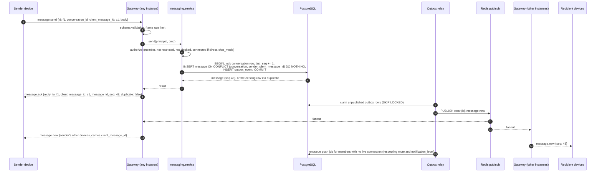
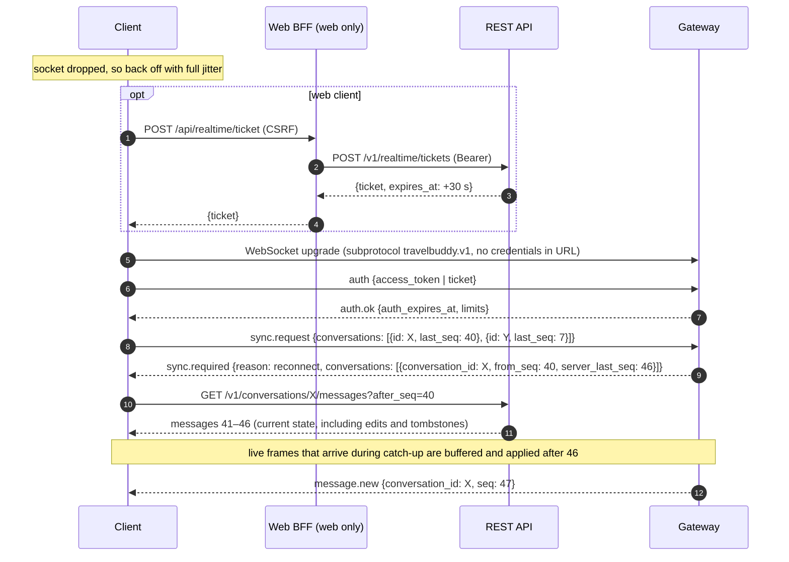

# 06 — Realtime Messaging Protocol

| | |
|---|---|
| **Status** | Draft v1.0 — Phase 0 (implemented in Phase 3) |
| **Normative source** | [`contracts/realtime/`](../contracts/realtime/), with one JSON Schema (2020-12) per frame type plus [`envelope.schema.json`](../contracts/realtime/envelope.schema.json) and [`catalog.json`](../contracts/realtime/catalog.json). |
| **Related** | [Architecture §7.3, §12](02-system-architecture.md) · [REST API](05-rest-api-specification.md) · ADR-0011 (web BFF sessions) · ADR-0013 (realtime tickets for browsers) · [Threat model](08-privacy-security-threat-model.md) |

## 1. Principles

1. **The WebSocket is a delivery channel, never the system of record.** Every mutation sent over the socket (`message.send`, `message.edit`, `message.delete`, receipts) executes the **same application service** as its REST counterpart and is committed to PostgreSQL before any acknowledgement or fanout. If the socket is unavailable, the REST API delivers identical behaviour.
2. **At-least-once delivery, idempotent application.** Sends are idempotent on `(conversation_id, sender_id, client_message_id)`. Clients de-duplicate inbound messages by `id` and order them by `seq`.
3. **Per-conversation total order.** Each message gets a monotonic `seq` inside its conversation, assigned in the persisting transaction. A gap in `seq` means missed events, and the fix is a REST catch-up. Cross-conversation order is not defined.
4. **Least disclosure.** No presence or online status in v1. Typing indicators are ephemeral and suppressed between blocked users. Read receipts are reciprocal and respect privacy settings. Frames never carry coordinates, emails or other users' private data.
5. **Authorization on every frame.** Authentication happens once per connection, but authorization is re-evaluated on every inbound mutation and on every membership change.

## 2. Endpoint and transport

| Item | Value |
|---|---|
| URL | `wss://<api-host>/v1/realtime` (TLS 1.2+ only) |
| Subprotocol | `Sec-WebSocket-Protocol: travelbuddy.v1`. The server echoes it. A missing or unknown subprotocol closes with `4010`. |
| Frames | UTF-8 **text** frames, one JSON object each. Binary frames close with `4000`. |
| Credentials in URL | **Never.** Query strings and paths carry no tokens or tickets, so credentials never reach access logs or proxies. |
| Origin check | Browser connections (those sending an `Origin` header) must match the configured web-origin allow-list, otherwise close `4005`. Native clients send no `Origin`. A native client that sends one is checked the same way. |
| Compression | `permessage-deflate` is **disabled**, to avoid compression side channels on mixed secret and attacker-influenced content. |
| Heartbeat | Client `ping` frame every 25 s (and WebSocket-level pings from the server). The server closes idle connections after 60 s with no inbound frame. |

## 3. Envelope

Every frame, in both directions:

```json
{ "v": 1, "type": "message.send", "id": "0193b1c4-5f2e-7a10-8c3d-9e8f7a6b5c4d", "ts": "2026-11-09T18:21:07Z", "data": { } }
```

| Field | Rules |
|---|---|
| `v` | Protocol version. Always `1`. Any other value gets `error {code: unsupported_version}` and close `4010`. |
| `type` | Frame type (see the catalogue). An unknown type gets `error {code: unknown_type}`, and the connection stays open (forward compatibility). |
| `id` | UUID chosen by the sender. Unique per frame. |
| `ts` | Sender clock. **Informational only.** The server never orders or authorizes by client time. |
| `reply_to` | Server frames only: the `id` of the client frame being answered (`auth.ok`, `auth.error`, `message.ack`, `error`, `rate_limited`). Client frames must not carry it (schema-enforced). |
| `data` | Type-specific payload, validated against `contracts/realtime/<direction>.<type>.schema.json`. Unknown fields in **client** frames are rejected (`validation_failed`). Clients must ignore unknown fields in **server** frames. |

## 4. Frame catalogue

### 4.1 Client → server

| Type | Purpose | Server reply |
|---|---|---|
| `auth` | First frame within 5 s, and re-auth on an open connection. `data` carries **exactly one** of `access_token` (mobile) or `ticket` (web). Optional: `client`, `app_version`. | `auth.ok` or `auth.error` + close |
| `ping` | Heartbeat | `pong` |
| `message.send` | Send `{conversation_id, client_message_id, kind?, body?, attachment_media_ids?, reply_to_message_id?, thread_root_id?, mentions?}`. Requires `body` or attachments. | `message.ack` (persisted) or `error` / `rate_limited` |
| `message.edit` | `{conversation_id, message_id, body}`. Sender only, within 15 min. | `message.updated` fanout (including to the sender), or `error` |
| `message.delete` | `{conversation_id, message_id, reason_code?}`. Sender, or a moderator with `messages.remove` (`reason_code` required). | `message.deleted` fanout, or `error` |
| `receipt.read` | `{conversation_id, read_through_seq}` (monotonic) | `receipt.updated` to others (if reciprocal), none to the sender |
| `receipt.delivered` | `{conversation_id, delivered_through_seq}` (monotonic) | `receipt.updated` to the other party (direct conversations only) |
| `typing.start` / `typing.stop` | `{conversation_id}`. At most one start per 3 s per conversation. | `typing` to other members (not to blocked users) |
| `sync.request` | `{conversations: [{conversation_id, last_seq}], conversation_list_synced_at?}` after `auth.ok` | `sync.required` |

### 4.2 Server → client

| Type | When |
|---|---|
| `auth.ok` | Auth accepted: `{user_id, session_id, connection_id, server_time, auth_expires_at, heartbeat_interval_s, limits}` |
| `auth.error` | Auth failed: `{code, message, close_code}`, followed by a close |
| `auth.expiring` | 60 s before `auth_expires_at`: `{expires_at, accepts}`. The client re-sends `auth` on the same socket. |
| `pong` | Heartbeat reply `{server_time}` |
| `message.ack` | The send was persisted: `{conversation_id, client_message_id, message_id, seq, created_at, duplicate}` |
| `message.new` | New message `{message}`. The `Message` shape mirrors the OpenAPI `Message` exactly. `client_message_id` is present only on frames sent to the sender's own devices. |
| `message.updated` | Edit, reactions, pin or moderation change: `{message, change}` |
| `message.deleted` | Tombstone `{conversation_id, message_id, seq, deleted_at, by_moderator}` |
| `receipt.updated` | Another member's watermark `{conversation_id, user_id, read_through_seq?, delivered_through_seq?}` |
| `typing` | `{conversation_id, user_id, state, expires_at}` (8 s TTL) |
| `conversation.updated` | Metadata change or a new conversation: `{conversation_id, created?, title?, last_seq?, muted_until?, notification_level?, can_send?, send_restriction?, pinned_message_ids?}` |
| `membership.changed` | `{conversation_id, group_id, user_id, change, role?, restricted_until?, effective_at}` |
| `challenge.event` | `{challenge_id, group_id, event, hint?, submission?, ends_at?}`. Never contains answers or others' submissions. |
| `notification.new` | Mirrors an item from `GET /v1/notifications`. Never contains private message bodies. |
| `sync.required` | `{reason, full_resync, conversations: [{conversation_id, from_seq, server_last_seq}]}`. Catch up via REST. |
| `session.revoked` | `{reason}`, then close `4003`. Do not reconnect with this session. |
| `error` | `{code, message, retryable, conversation_id?, client_message_id?, details?}` with `reply_to` |
| `rate_limited` | `{scope, retry_after_ms, client_message_id?}` with `reply_to` |

## 5. Connection lifecycle

### 5.1 Authentication

* **Mobile:** the first frame is `auth {access_token}` (the platform JWT, not an IdP token).
* **Web (ADR-0013):** the browser cannot read the access token (ADR-0011). It asks the BFF (`POST /api/realtime/ticket`, CSRF-protected), the BFF calls **`POST /v1/realtime/tickets`** with Bearer, and the browser sends `auth {ticket}`. A ticket is 256 bits of randomness (base64url, 43 chars), stored as a SHA-256 hash in Redis, has a **30 s TTL**, is **single use** (atomic `GETDEL`), and is **bound to `user_id` + `session_id`**. Revoking the session invalidates outstanding tickets. Every reconnect needs a fresh ticket.
* The server builds the same `Principal` from either credential. If no valid `auth` arrives within **5 s**, the server sends `auth.error {code: auth_timeout}` and closes `4002`.
* Until `auth.ok`, every other client frame is rejected and the connection is closed `4001`.

### 5.2 Re-authentication on an open connection

`auth_expires_at` is the access-token expiry for mobile, or **ticket issuance + 15 minutes** for web (so web connections periodically prove that the session can still be refreshed). 60 s before it, the server sends `auth.expiring`. The client sends a **new `auth` frame** on the same socket: a refreshed access token, or a fresh ticket obtained through the BFF. The new credential must belong to the **same user and session**. A different session gets `auth.error` and close `4001`. On success the server replies `auth.ok` with a new `auth_expires_at`. If no re-auth arrives by `auth_expires_at`, the server closes `4001`.

### 5.3 Subscriptions

Subscriptions are **implicit**. After `auth.ok`, the connection receives events for every conversation in which the user is an active member, plus user-scoped events (`notification.new`, `conversation.updated` with `created`, `session.revoked`). Internally the gateway subscribes to Redis channels `user:{user_id}` and `conv:{conversation_id}`. Membership changes update the subscription set immediately (see §8).

### 5.4 Reconnect strategy (client)

* **Backoff:** exponential with full jitter. `delay = random(0, min(30 s, 1 s × 2^attempt))`. Reset `attempt` after a connection has stayed healthy for 60 s.
* **Close-code handling** (§9): `4001` → refresh tokens (mobile) or get a new ticket (web), then reconnect. `4003` / `4004` → stop and sign out or show the notice. `4010` → prompt an upgrade. `1001` / `4011` → reconnect after a short jittered delay (0–5 s). `4008` → wait at least 60 s.
* **Network change:** on regaining connectivity or foregrounding the app, reconnect immediately (attempt counter preserved).
* **Background (mobile):** sockets close when the app is backgrounded. Push notifications cover delivery while closed.
* **Resume:** after `auth.ok`, send `sync.request` with the highest contiguous `seq` held per locally cached conversation, then follow `sync.required`.

## 6. Ordering, gaps and catch-up

* Clients track `last_contiguous_seq` per conversation.
* On `message.new` with `seq == last + 1`: apply it and advance.
* On `seq <= last`: it is a duplicate (at-least-once). Ignore it, and merge if `message.updated`.
* On `seq > last + 1`: **gap**. Buffer the frame and fetch `GET /v1/conversations/{id}/messages?after_seq={last}` until contiguous, then apply the buffered frames.
* The server sends `sync.required` when it knows a client may have missed events: replying to `sync.request`, after Redis fanout recovery (`server_recovered`), after dropping a slow consumer's buffer (`backpressure`), or after a resubscribe. `full_resync = true` means refetch `GET /v1/conversations` too (for example after many membership changes while offline).
* Edits, deletes and reactions **do not consume a seq**. They reference the original message's `seq`. During catch-up, REST history returns the current state of each message (edited body, tombstone), so a client that missed `message.updated` or `message.deleted` converges once it refetches.

## 7. Send, acknowledgement and fanout



**Acknowledgement semantics.**

* `message.ack` means *durably committed*. It is never sent before the commit.
* If the client receives no ack within **10 s** (or the socket drops), it **retries with the same `client_message_id`**, over the socket after reconnecting or via REST. A retry of an already-persisted message returns `message.ack {duplicate: true}` with the original `message_id` and `seq`, so nothing is duplicated.
* The outbox guarantees that every committed message is eventually fanned out (no loss if Redis blips) and that a rolled-back send never fans out.
* Optimistic UI: the client shows the message as "sending" keyed by `client_message_id` and reconciles it on `message.ack` or the echoed `message.new`.
* `error` with `retryable: false` (such as `connection_required`, `member_restricted`, `chat_admins_only`) means the client must not retry. Show the reason.

## 8. Reconnect and sync



## 9. Close codes

| Code | Name | Meaning | Client action |
|---|---|---|---|
| 1000 | normal | Client- or server-initiated clean close | Reconnect only when needed |
| 1001 | going_away | Server shutting down or deploying | Reconnect after a 0–5 s jitter |
| 1009 | message_too_big | Inbound frame exceeded the limit | Fix the client. Do not resend the frame |
| 1011 | internal_error | Unexpected server error | Reconnect with backoff |
| 4000 | bad_frame | Non-JSON, binary, envelope invalid, or repeated schema violations | Reconnect with backoff, and report |
| 4001 | auth_failed | Invalid or expired credential, or re-auth missed `auth_expires_at` | Refresh (mobile) or get a new ticket (web), then reconnect |
| 4002 | auth_timeout | No `auth` within 5 s | Reconnect and send `auth` first |
| 4003 | session_revoked | Session revoked | **Do not reconnect.** Sign out |
| 4004 | account_suspended | Account suspended or deleted | **Do not reconnect.** Show the notice |
| 4005 | origin_not_allowed | Browser `Origin` not allow-listed | Do not retry (configuration error) |
| 4008 | rate_limited_hard | Abuse threshold exceeded | Wait at least 60 s before reconnecting |
| 4009 | replaced | Connection limit exceeded, oldest connection closed | Do not auto-reconnect on this tab or device |
| 4010 | unsupported_protocol | Unknown subprotocol or `v` | Prompt an app upgrade |
| 4011 | server_draining | Instance draining (rolling restart) | Reconnect after a 0–5 s jitter |

## 10. Limits

| Limit | Value (initial) | On violation |
|---|---|---|
| Inbound frame size | 32 KiB | close `1009` |
| Outbound frame size | ≤ 256 KiB | Server splits into multiple frames or emits `sync.required` |
| `message.send` | 30 / min per user, burst 10 / 10 s, 20 / min per conversation (new accounts: half) | `rate_limited {scope: message_send}` |
| `typing.start` | 1 / 3 s per conversation | Silently dropped |
| Receipts | 60 / min per user (watermarks coalesced server-side) | Silently coalesced |
| Total inbound frames | 120 / min per connection | `rate_limited {scope: frames}`. Persistent abuse → `4008` |
| Re-auth attempts | 5 / min per connection | `rate_limited {scope: auth}`, then `4001` |
| Connections | 5 per session, 10 per user | Oldest gets `4009` |
| `sync.request` entries | 500 conversations | `validation_failed`. Use `full_resync` |
| Server send buffer per connection | 1000 frames or 1 MiB | Buffer dropped, `sync.required {reason: backpressure}` |

Limits are advertised in `auth.ok.limits` so clients can self-throttle.

## 11. Privacy rules for realtime data

| Topic | Rule |
|---|---|
| Presence | **Not exposed in v1.** No online, offline or last-seen indicators. Connection state lives only inside the gateway. |
| Typing | Ephemeral (Redis, 8 s TTL), never persisted, never sent between users with a block in either direction, and never sent to restricted members. |
| Read receipts | Sent only if **both** the reader and the viewer have `read_receipts_enabled` (reciprocal). Group read state is aggregated per member and shown only to members. Delivered watermarks only in direct conversations. |
| Message content | `notification.new` and push payloads never contain private message bodies. Push shows "New message from Ana" unless the user opts into previews. Attachment URLs are short-lived signed URLs minted per recipient. |
| Blocks | A block immediately stops typing and receipts between the pair, ends direct send rights (`send_restriction: blocked`), and in shared groups the blocked user's messages are still delivered but flagged for client-side collapse. |
| Logging | Frame bodies are not logged. Logs carry `type`, `id`, `conversation_id`, `user_id` (pseudonymous), size and latency only. |

## 12. Security

1. **Authorization on every send.** Each `message.send`, `edit`, `delete` and receipt re-runs the messaging policy: active membership, `restricted_until`, block state, connection (direct), `chat_mode` and group status (archived groups are read-only). Holding an open socket grants nothing by itself.
2. **Membership changes unsubscribe immediately.** On `MemberRemoved` or `MemberLeft` (or a block that ends a direct conversation's send rights), the gateway sends `membership.changed` to the affected user and then removes `conv:{id}` from that connection's subscription set **before** delivering any later event for the conversation. Gateways also re-check membership lazily when fanout arrives, as defence in depth against races.
3. **Token expiry mid-connection.** `auth.expiring`, then in-band re-auth (§5.2). Session revocation is pushed (`session.revoked`, close `4003`) through `user:{id}`, so it is not delayed until expiry.
4. **Credential handling.** Tokens and tickets travel only inside the `auth` frame over TLS, never in URLs. Tickets are single use, 30 s, hashed at rest, and bound to the session. The `Origin` allow-list for browsers prevents cross-site WebSocket hijacking. Compression is disabled.
5. **Input validation.** Every inbound frame is validated against its JSON Schema before reaching a service. Unknown fields are rejected, string lengths are bounded, and IDs must be UUIDs. Repeated invalid frames close `4000`.
6. **Resource exhaustion.** Frame size cap, per-connection and per-user rate limits, a connection cap, the 5 s auth deadline, the idle timeout, and bounded send buffers with backpressure.
7. **Enumeration.** A conversation or message the caller cannot access returns `error {code: not_found}`, the same as for a non-existent ID.
8. **Auditing.** Moderator removals via the socket produce the same `moderation_actions` and `audit_logs` rows as REST.

## 13. Implementation notes (Phase 3)

* Process role `realtime` (`app.realtime_main:app`), horizontally scaled behind a load balancer with WebSocket support. Sticky sessions are **not** required.
* Fanout: Redis pub/sub channels `conv:{id}` and `user:{id}`. Each gateway subscribes only to the channels its connected users need (reference-counted).
* Draining: on SIGTERM, stop accepting connections, send close `4011` with jitter over 30 s, and exit.
* Observability: connections gauge, auth failures by code, frames in and out by type, ack latency (receive → commit → ack), fanout lag (commit → delivery), `sync.required` count by reason, and backpressure drops.
* Contract tests: every frame the gateway emits in tests is validated against `contracts/realtime/*.schema.json`. CI also asserts that `envelope.schema.json#/$defs/Message` matches the OpenAPI `Message` schema property for property.
