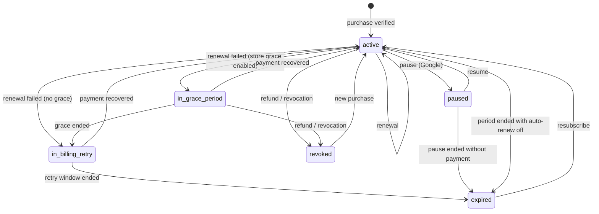

# 07 — Subscription and Entitlement Policy

| | |
|---|---|
| **Status** | Draft v1.0 — Phase 0 (normative for backend implementation) |
| **Code** | `backend/app/modules/billing/entitlements.py` (pure evaluator, unit-tested) |
| **Requirements** | BILL-001…009, GRP-001, GRP-008, GRP-009, GRP-013, CHAL-001, GUIDE-004, OFF-004, AI-005, AI-009 |

## 1. Principles

1. **The backend is the only authority.** The client may *display* entitlement state but never *asserts* it. Every gated mutation re-evaluates on the server (BILL-003, BILL-007).
2. **One evaluator.** `billing.service.has(user, Feature)` and `quota(user, Quota)` are the only gates. No module reads `subscriptions` directly. The evaluator reads only `subscription_entitlements` (materialized grants).
3. **Paying never overrides privacy or safety.** Premium cannot bypass blocks, privacy settings, connection requirements for DMs, rate limits or moderation.
4. **Lapsing never destroys data.** Groups, messages, trips and memberships survive any subscription change (GRP-009, GRP-011).
5. **Safety tools are free.** Removing messages, restricting and removing members, reporting and blocking are available in every group regardless of the owner's subscription.

## 2. Products

| Product | Store type | Grants | Notes |
|---|---|---|---|
| Free | — | Baseline | Everyone with an account |
| Premium Monthly | Auto-renewable (P1M) | `premium` entitlement | One subscription group across both periods, so upgrades and downgrades are handled by the store |
| Premium Annual | Auto-renewable (P1Y) | `premium` entitlement | |
| Premium destination guide | Non-consumable | `content:guide:<id>` | Permanent for the purchaser |
| Audio tour package | Non-consumable | `content:audio_tour:<id>` (one or many) | Permanent for the purchaser |
| Partner offerings | — | — | Future. Not modeled in v1 |

Store product IDs live in the `products` table, per platform (`ios`, `android`, `web`). Mobile prices are store-managed and shown from the store SDK. Web prices come from Stripe Prices ([ADR-0012](adr/0012-web-billing-provider.md)). The backend never hard-codes prices.

**Providers.** `apple` and `google` for in-app purchases on mobile ([ADR-0017](adr/0017-billing-direct-store-integration.md)), `stripe` for web purchases through hosted Checkout ([ADR-0012](adr/0012-web-billing-provider.md)), and `dev` for development and tests only. A user may hold grants from several providers, and the evaluator uses their **union**. The web pricing page hides purchase when a store subscription already grants `premium`. The mobile apps link to web checkout only where store rules for that region allow it.

## 3. Features and quotas

### 3.1 Boolean features (`Feature`)

| Key | Free | Premium | Description |
|---|---|---|---|
| `groups.create` | ✗ | ✓ | Create a new travel group (GRP-001) |
| `challenges.create` | ✗ | ✓ | Create challenges. Additionally requires a group role with `challenges.manage` **and** the group's premium features to be active (§5) |
| `guides.premium` | ✗ | ✓ | Access all premium-tier destination guides |
| `audio_tours.premium` | ✗ | ✓ | Access all premium-tier audio tours |
| `ai.trip_replan` | ✗ | ✓ | Context-sensitive replanning of existing trips (AI-005) |

Purchased content (`content:*`) grants access to that specific item regardless of plan.

### 3.2 Quotas (`Quota`)

| Key | Free | Premium | Period | Notes |
|---|---|---|---|---|
| `ai.itinerary_generations` | 5 | 60 | Calendar month (UTC) | Only `succeeded` generations count. Premium value is a fair-use ceiling |
| `ai.trip_replans` | 0 | 60 | Calendar month (UTC) | |
| `offline.packages` | 1 | 15 | None (concurrent) | Active `offline_package_licenses` across devices |
| `groups.owned` | 0 | 10 | None (concurrent) | Active groups where the user is owner |

All numbers are **configuration** (`ENTITLEMENT_*` settings), not code. Changing them requires no deploy of the mobile app.

### 3.3 Group-level limits (configuration)

| Setting | Default |
|---|---|
| `group_max_capacity` | 50 members |
| `group_max_active_challenges` | 3 |
| `group_admin_grace_period_days` | 14 |
| `invitation_link_max_ttl_days` | 30 |
| `invitation_link_max_uses` | 100 |

## 4. Subscription state machine

States mirror the stores' concepts, normalized across Apple and Google.



| State | `premium` entitlement active? | User-facing |
|---|---|---|
| `active` (auto-renew on or off) | ✓ until `current_period_end` | "Premium" (cancelled shows "ends on …") |
| `in_grace_period` | ✓ until `grace_period_ends_at` | Banner: "Update your payment method" |
| `in_billing_retry` | ✗ | "Payment issue, premium paused" |
| `paused` | ✗ | "Paused until …" |
| `expired` | ✗ | Free |
| `revoked` | ✗ (immediately) | Free. Content purchases refunded are revoked too |

**Materialization.** Each state transition rewrites the subscription's `subscription_entitlements` row (`starts_at`, `ends_at`, `revoked_at`) in the same transaction. The evaluator answers: *a grant is active at time t iff `starts_at ≤ t` and (`ends_at` is null or `t < ends_at`) and (`revoked_at` is null or `t < revoked_at`).* Evaluating at past instants this way keeps audits and dispute reviews exact. So expiry works without a job; the scheduler sweep only emits events and notifications.

**Ordering and idempotency.** `billing_events` is unique on `(provider, provider_event_id)`. A notification whose `signed_date` is older than `subscriptions.last_event_at` is recorded but `ignored`. When in doubt, the processor re-fetches authoritative status from the store API (App Store Server API `Get All Subscription Statuses`, Google `purchases.subscriptionsv2.get`) instead of trusting event order.

## 5. Group premium features and owner lapse (GRP-009)

A group's premium status derives from its **owner**:

```
group_premium_active(t) =
    owner has `premium` at t
 OR (owner's premium ended at E and t < E + group_admin_grace_period)
```

`premium_grace_until = E + grace` is exposed on the group so admins see the deadline.

| Capability | Requires | Owner premium active | In admin grace | After grace (lapsed) |
|---|---|---|---|---|
| View group, chat, read history | Membership | ✓ | ✓ | ✓ |
| Send messages, react, reply | Membership (not restricted) | ✓ | ✓ | ✓ |
| **Remove messages, restrict or remove members, handle reports** | Role permission | ✓ | ✓ | ✓ (**safety, never gated**) |
| Assign or revoke moderators | Role permission | ✓ | ✓ | ✓ |
| Pin messages, post announcements | Role permission | ✓ | ✓ | ✓ |
| Edit group details | Role permission | ✓ | ✓ | ✓ |
| Create new invitations (direct or link) | Role + group premium | ✓ | ✓ | ✗ (`entitlement_required`) |
| Existing unexpired invitation links | — | ✓ | ✓ | ✓ until their own expiry |
| Approve join requests | Role + group premium | ✓ | ✓ | ✗ |
| Create or publish challenges | Role + `challenges.create` on the creator + group premium | ✓ | ✓ | ✗ |
| Running challenges at lapse | — | Continue to completion. Results and fulfillment proceed | | |
| Increase capacity | Role + group premium | ✓ | ✓ | ✗ (existing members are kept even above any reduced limit) |
| Transfer ownership | Owner | ✓ | ✓ | ✓ (**always allowed**, so a group can be rescued by a premium member) |
| Archive group | Owner | ✓ | ✓ | ✓ |
| **Create a new group** | User's own `groups.create` | n/a | ✗ | ✗ |

**Notifications.** Owner and admins are notified at lapse, 3 days before the grace end, and at grace end. Members are not notified about the owner's billing state, which keeps that state private.

**Ownership transfer.** The owner offers and the recipient accepts (expires after 7 days). The recipient need not be premium. The group's premium status then follows the new owner. Audit: `group.ownership.transferred`.

**Owner account deletion.** Ownership is auto-offered to the longest-tenured admin, then moderator, then member. If nobody accepts within 14 days, the group is archived (read-only) and members are notified. It is never silently deleted.

## 6. Purchase verification and restore

1. The client completes a store purchase through StoreKit 2 / Play Billing and sends `POST /v1/billing/purchases/verify` with the signed transaction (Apple JWS `signedTransactionInfo`) or `purchaseToken` (Google), plus `Idempotency-Key`.
2. The server verifies:
   * Apple: the JWS signature chain to the Apple root CA, `bundleId`, `environment`, then calls the App Store Server API for authoritative status.
   * Google: `purchases.subscriptionsv2.get` / `purchases.products.get` via a service account, checking `packageName`, and acknowledges within 3 days.
3. Account binding: Apple `appAccountToken` / Google `obfuscatedExternalAccountId` must equal a hash of our user ID that is set at purchase time. **A transaction already bound to another user is rejected** (`409 purchase_owned_by_another_account`), which stops receipt sharing.
4. `POST /v1/billing/purchases/restore` re-verifies all transactions for the store account and re-materializes grants for the **bound** user only.
5. The response always returns the fresh `GET /v1/billing/entitlements` payload.

**Web (Stripe).** `POST /v1/billing/checkout-sessions {product_id, success_path, cancel_path}` creates a hosted Checkout Session bound to the user's `billing_customers` row and returns its URL. **Only** the signature-verified webhook `POST /v1/billing/webhooks/stripe` grants entitlements, and the success page grants nothing: it polls `GET /v1/billing/entitlements`. `POST /v1/billing/portal-sessions` returns a Customer Portal URL for web-purchased subscriptions. Stripe states map onto §4: `active`/`trialing` → `active`, `past_due` → `in_grace_period` (until Stripe's retry schedule ends), `unpaid`/`incomplete_expired`/`canceled` at period end → `expired`, `paused` → `paused`, charge refunded or disputed and lost → `revoked`.

Development adapter: `DevBillingProvider` (provider `dev`) lets tests and local builds simulate store events. It is enabled only when `APP_ENV ∈ {development, test}`, and production boot fails if it is configured. As built (BL-3.01): with `DEV_BILLING_ENABLED=true`, Apple and Google verification requests are served by the dev provider, which accepts `dev:<sku>:<original transaction id>[:<status>]` as the signed transaction or purchase token; `POST /v1/dev/billing/events {original_transaction_id, event}` then simulates renewals, grace, billing retry, pause, expiry and refunds through the same state machine. Without store credentials, real Apple and Google verification answers `503 service_unavailable`.

## 7. Entitlements API shape (contract)

`GET /v1/billing/entitlements`:

```json
{
  "plan": "premium",
  "status": "active",
  "premium_until": "2026-12-09T10:00:00Z",
  "store_grace_until": null,
  "features": {
    "groups.create": true,
    "challenges.create": true,
    "guides.premium": true,
    "audio_tours.premium": true,
    "ai.trip_replan": true
  },
  "quotas": {
    "ai.itinerary_generations": { "limit": 60, "used": 4, "resets_at": "2026-12-01T00:00:00Z" },
    "ai.trip_replans": { "limit": 60, "used": 0, "resets_at": "2026-12-01T00:00:00Z" },
    "offline.packages": { "limit": 15, "used": 2, "resets_at": null },
    "groups.owned": { "limit": 10, "used": 1, "resets_at": null }
  },
  "active_subscription": {
    "provider": "apple",
    "product_id": "0193…",
    "auto_renew": true,
    "management": "app_store"
  }
}
```

`active_subscription` is optional and additive. It is null when premium comes only from a promotion or admin grant, or when the user is free. Web uses it to hide Stripe checkout while a store subscription is active, and to link to the right management surface.

A denied gated action returns:

```json
{
  "type": "https://errors.travelbuddy.app/entitlement_required",
  "title": "Premium required",
  "status": 403,
  "code": "entitlement_required",
  "detail": "Creating travel groups requires an active Premium subscription.",
  "feature_key": "groups.create",
  "request_id": "0193…"
}
```

A quota exhaustion returns `429 quota_exceeded` with `quota`, `limit` and `resets_at`. It is deliberately distinct from `rate_limited`.

## 8. Refunds and abuse

* A refund or revocation revokes the grant immediately. Group premium for that owner ends **without** admin grace (grace applies to natural expiry only), but safety tools remain.
* Repeated purchase–refund cycles (≥ 3 in 90 days) are flagged for review.
* Family Sharing (Apple) is **disabled** for v1 products, because entitlement attribution to individual social accounts is ambiguous.

## 9. Test obligations

| Test | Type | Requirement |
|---|---|---|
| Feature matrix free vs premium | Unit (evaluator) | BILL-007 |
| Grant activity at boundaries (`starts_at`, `ends_at`, revoked) | Unit | BILL-005 |
| Group premium active / in grace / lapsed / refund without grace | Unit | GRP-009, BILL-008 |
| Safety actions allowed after lapse | Unit + integration | GRP-009 |
| Quota counting and reset | Unit + integration | AI-009, OFF-004 |
| Forged client entitlement ignored | Security | BILL-003 |
| Duplicate and out-of-order notifications | Integration | BILL-006 |
| Transaction bound to another account rejected | Security | BILL-003 |
| Purchase → `groups.create` allowed end-to-end | E2E | GRP-001 |
