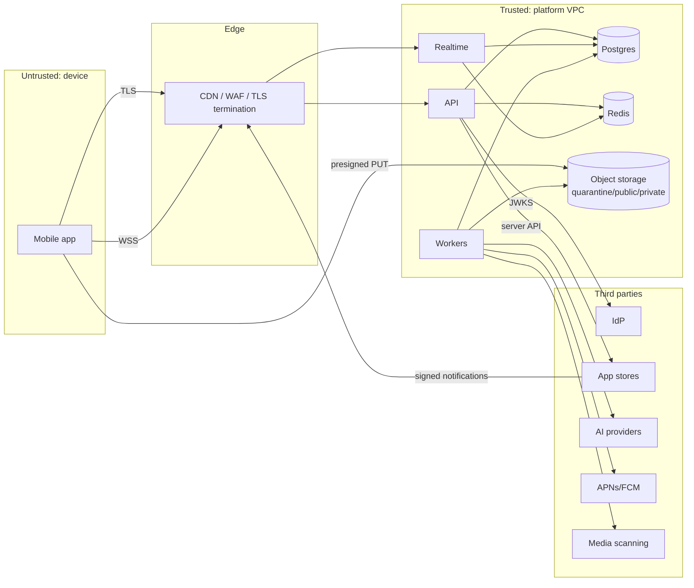

# 08 — Privacy and Security Threat Model

| | |
|---|---|
| **Status** | Draft v1.0 — Phase 0. Reviewed at the start of every phase |
| **Method** | STRIDE (security) + LINDDUN (privacy) over the data-flow diagram below. Each threat → mitigation → verification |
| **Owner** | Security engineering + trust and safety |
| **Related** | [Architecture](02-system-architecture.md) · [ERD retention](04-database-erd.md#14-retention-schedule-initial-subject-to-legal-review) · [Test strategy](10-test-strategy.md) |

## 1. Assets

| Asset | Sensitivity | Why |
|---|---|---|
| A1 Traveler whereabouts (discovery sessions, trip dates, post locations) | **Critical** | Physical safety: stalking, burglary of an empty home |
| A2 Private messages and attachments | High | Confidential communication |
| A3 Identity data (email, birth year, IdP links) | High | Account takeover, doxxing |
| A4 Sessions and refresh tokens | High | Account takeover |
| A5 Entitlements and billing records | Medium | Revenue fraud, financial data |
| A6 Challenge answers and judging data | Medium | Contest integrity, real-world prizes |
| A7 Moderation evidence and reports | High | Reporter safety, legal |
| A8 Group membership and private group content | High | Social graph exposure |
| A9 Content (posts, media) | Medium | Integrity, CSAM risk |
| A10 AI budget and keys | Medium | Cost abuse |

## 2. Threat actors

| Actor | Capability | Motivation |
|---|---|---|
| Stalker or harasser (registered user) | Normal app access, multiple accounts, patience | Locate or contact a specific person |
| Scammer or spammer | Scripted account farms, automation | Fraud, phishing, promotion |
| Curious insider (support staff) | Admin console access | Snooping |
| External attacker | Internet access, API knowledge | Data theft, takeover |
| Fraudulent purchaser | Jailbroken device, forged receipts | Free premium |
| Contest cheater | Multiple accounts, scripting | Win prizes |
| Malicious uploader | Crafted files | Malware, CSAM distribution, exploit parsers |

## 3. Data-flow diagram and trust boundaries

Boundary rules: (1) nothing from TB1 is trusted, including entitlement claims, coordinates, client timestamps, MIME types and file metadata; (2) TB4 inputs are verified by signature (IdP JWKS, Apple JWS, Google Pub/Sub OIDC push auth); (3) data sent to TB4 is minimized per processor and covered by DPAs.

## 4. Threat register

Verification column: **U** = unit test, **I** = integration test, **S** = security test suite, **R** = design/code review, **O** = operational control.

### 4.1 Location and discovery (A1): highest priority

| ID | Threat (STRIDE/LINDDUN) | Scenario | Mitigation | Verify |
|---|---|---|---|---|
| T-LOC-01 | Information disclosure / Identifiability | Attacker reads a target's coordinates from a discovery or profile API | No coordinate columns for users exist (ERD §4). `PublicProfile` and `DiscoveredTraveler` schemas have no location fields beyond area labels. Response-schema contract test asserts absence | S, R |
| T-LOC-02 | Disclosure via trilateration | Attacker queries "nearby" from several points to triangulate a target from distances | Discovery is keyed by **destination**, not coordinates. No distances returned. Area granularity floor = neighborhood (≥ ~1 km²) | S |
| T-LOC-03 | Enumeration / Linkability | Attacker hops destinations or creates accounts to map where a person is; or changes their own browse city and watches a target's `can_request_connection` flip | Destination-switch limit (10/day), discovery query limit (60/h), new-account restrictions, abuse signals (DISC-009, SAFE-011). The connection-request "shared context" counts only mutually shared signals (both visible in discovery in the same city, both sharing an upcoming trip for discovery, a shared active group), never a browse city, a private trip or an invisible session (fixed 2026-11-10 after the BL-2.09 review) | S |
| T-LOC-04 | Linkability over time | Attacker records discovery appearances to build a movement history | Sessions are coarse, short-lived (≤ 72 h) and purged after 30 days. No "last seen". Ordering is randomized within score bands, so result order does not track recency of presence | R, U |
| T-LOC-05 | Disclosure via media | Photo EXIF reveals home GPS | EXIF/XMP/GPS stripped by re-encoding before `ready`. The original never leaves quarantine | I |
| T-LOC-06 | Disclosure via posts | Real-time posting reveals current position | Precision choice per post (none / destination / place). Place tags only reference **public places**. Optional "post later" delay (Phase 1 S). Guidance in composer | R |
| T-LOC-07 | Disclosure via logs | Coordinates from `near=` land in logs or traces | Log redaction filter for `near`, `lat`, `lng`. Coordinates rounded before use. Never put in span attributes | U |
| T-LOC-08 | Disclosure via trip sharing | Public trip dates reveal when someone's home is empty | Trips private by default. `show_trips_on_profile=false` default. Home location is country/region only. "Travelers going to X" matching needs a separate per-trip opt-in (`share_for_discovery`), shows destination and date overlap only, and excludes blocked users | R |
| T-LOC-09 | Non-repudiation / unawareness | User forgets discovery is on | Persistent in-app indicator while visible, TTL expiry, reminder notification at re-enable | R |
| T-LOC-10 | Policy non-compliance | Discovery launched without DPIA in EU | DPIA gate in the launch checklist (SAFE-010) | O |
| T-LOC-11 | Disclosure via the map | Someone reads a map pin as the place a traveller is and goes looking | Pins are drawn around the public centre of the shared area on a spiral ordered by an id hash, so they carry nothing beyond the area label; the map says "Pins show the area people share, never where they are"; no API returns coordinates (DISC-012, ADR-0030) | R |
| T-LOC-12 | Identifiability / unawareness | The IP address places a traveller somewhere they didn't choose, or the lookup leaks the address | Local database (no third party); point rounded to about 1 km and discarded, never logged; the result describes only the caller; nobody becomes discoverable without pressing Search; the place is labelled approximate and can be changed (LOC-004, LOC-010) | S, R |

### 4.2 Identity and sessions (A3, A4)

| ID | Threat | Mitigation | Verify |
|---|---|---|---|
| T-AUTH-01 | Spoofing with a forged IdP token | Verify signature with JWKS (cached, rotated), `iss`, `aud`, `exp`, `iat` skew, `nonce`. Allowed algorithms pinned (no `none`, no HS*) | U, S |
| T-AUTH-02 | Refresh token theft and replay | Rotation with reuse detection (family revocation). Hashed at rest. Bound to `device_id`. Secure storage on device (Keychain/Keystore) | I, S |
| T-AUTH-03 | Access token theft | 15-min lifetime. Not placed in URLs (WebSocket uses first-frame auth). TLS only. HSTS on web and API | S |
| T-AUTH-04 | Account enumeration | Login and registration errors uniform. IdP handles credential flows | S |
| T-AUTH-05 | Credential stuffing | IdP brute-force protection + breached-password detection. Platform rate limits on token exchange | O |
| T-AUTH-06 | Session fixation or stale sessions after password change | Password-change event (IdP webhook or `auth_time` check) revokes sessions | I |
| T-AUTH-07 | Underage users | Age gate. Report category `minor_safety` with top priority. Account review | R, O |
| T-AUTH-08 | Dev IdP enabled in prod | Process refuses to boot if a dev adapter is configured with `APP_ENV=production` | U |
| T-AUTH-09 | Staff account taken over with a password alone | Staff permissions require `mfa` in the session `amr` (Supabase `aal2` after TOTP; with Firebase, `firebase.sign_in_second_factor`, which needs the Identity Platform upgrade, ADR-0028) or `403 mfa_required` (ADM-007). Admin routes enforce 30 min idle / 12 h absolute limits (ADM-008) | U, I |
| T-AUTH-10 | Auth codes or tokens redirected to an attacker-controlled site | Exact redirect-URL allow-list in Supabase Auth (no wildcard hosts). PKCE on web and mobile. The web callback validates `state` and the `next` path (same-origin only) | S, I |
| T-AUTH-11 | Sign-up spam or credential stuffing against the public Supabase Auth endpoints; conversely, per-IP limits locking out everyone, because the web BFF reaches Supabase from shared Vercel egress IPs | Supabase Auth rate limits now. Before launch: CAPTCHA (Turnstile/hCaptcha) so abuse is stopped per user rather than per IP, raised Auth rate limits sized for BFF traffic, our own per-account/per-client-IP limits on the BFF and token exchange (BL-1.15), leaked-password protection, custom SMTP (ADR-0020, docs/web/01 §6). With Firebase (ADR-0028): email enumeration protection, an 8-character password policy, the Web API key restricted to the Identity Toolkit and Token Service APIs, and App Check or reCAPTCHA Enterprise before launch. At sign-in the backend refuses tokens of disabled accounts and tokens revoked by a password change (`accounts:lookup`) | O |

### 4.3 Authorization and data isolation (A2, A8)

| ID | Threat | Mitigation | Verify |
|---|---|---|---|
| T-AZ-01 | Elevation via IDOR: read another conversation's messages by ID | Every query is scoped by membership (`JOIN conversation_members`). 404 for non-members. UUIDv7 IDs (not enumerable, and still never relied upon) | S |
| T-AZ-02 | Cross-group leakage | Group-scoped queries always include `group_id` plus a membership check. Realtime subscriptions re-validated on `membership.changed`. Removed members are disconnected from the channel | S |
| T-AZ-03 | Removed member keeps realtime stream | Membership change → server-side unsubscribe + `membership.changed` frame. Fanout filter re-checks membership per frame for group channels | I, S |
| T-AZ-04 | Unsolicited DMs via shared group | DM policy requires a connection. Group membership confers nothing (GCHAT-005) | S |
| T-AZ-05 | Blocked user interacts | `trust_safety.is_blocked` checked bidirectionally in every social policy function. Block side effects applied transactionally | U, S |
| T-AZ-06 | Mass assignment (client sets `owner_id`, `role`, `status`, `moderation_state`) | Separate Pydantic input models with explicit allow-listed fields. `extra="forbid"` | U |
| T-AZ-07 | Admin snooping or a compromised staff account (insider) | RBAC least privilege. Staff MFA mandatory (ADM-007). 30 min idle / 12 h absolute admin sessions (ADM-008). `X-Audit-Justification` on every admin mutation and sensitive read (ADM-009, contract-tested). Everything audited. Message content is not viewable unless reported (evidence snapshot) | R, O, S |
| T-AZ-08 | Private post visibility bypass via feed or search | Visibility filter is shared code used by feed, profile, search and direct GET. Contract tests per visibility value | S |

### 4.4 Messaging (A2)

| ID | Threat | Mitigation | Verify |
|---|---|---|---|
| T-MSG-01 | Message tampering in transit | TLS 1.2+ everywhere (terminated by the host); the API sends HSTS (two years, subdomains) outside development, so clients never fall back to plain HTTP (DM-013); database connections use TLS; storage is encrypted at rest by the providers | S |
| T-MSG-02 | Replay or duplication | `client_message_id` uniqueness. Seq ordering | I |
| T-MSG-03 | Spam floods | Per-user send rate (e.g., 30/min DM, 60/min group). Keyword filter for direct messages and edits from connections younger than 7 days, and for connection-request notes (staff-managed list, whole-word match after case, accent, punctuation and invisible-character folding; refused with `message_filtered`, SAFE-006). Link limits and URL reputation: not yet | S |
| T-MSG-04 | Attachment URL leakage | Private bucket. Signed URLs ≤ 5 min, issued per request after an authz check. No public listing | S |
| T-MSG-05 | Message bodies in push or logs | Push payloads contain IDs and a preview only if allowed. Logs never contain bodies (redaction) | U |
| T-MSG-07 | Web Push endpoint leakage (endpoints are capability URLs that let anyone push to the browser) | Stored envelope-encrypted with a hash for lookup. Never logged or returned by any API. Deleted on session revocation or provider 404/410 | U, R |
| T-MSG-06 | Lack of E2EE expectations | Disclosed in privacy policy (DM-013). E2EE requires a separate threat model | O |

### 4.5 Groups and invitations (A8)

| ID | Threat | Mitigation | Verify |
|---|---|---|---|
| T-GRP-01 | Invitation token guessing | 256-bit random tokens. Only the SHA-256 hash is stored. Constant-time compare via hash lookup | U |
| T-GRP-02 | Invitation token reuse or race | Row lock on redemption. `use_count < max_uses` checked and incremented in one transaction. Expiry enforced | I, S |
| T-GRP-03 | Leaked invite link | Revocable. Short default TTL (7 d). Admins see redemptions | R |
| T-GRP-04 | Capacity overrun under concurrency | Capacity check and insert under a group row lock | I |
| T-GRP-05 | Privilege escalation inside group (moderator promotes self) | Rank rule: an actor can only assign roles strictly below their own rank. Owner-only transfer | U, S |

### 4.6 Billing (A5)

| ID | Threat | Mitigation | Verify |
|---|---|---|---|
| T-BILL-01 | Client claims premium | Client entitlement input does not exist in any API. Server evaluator only | S |
| T-BILL-02 | Forged receipt | Apple JWS chain verification + server API check. Google server-side API check | U, S |
| T-BILL-03 | Receipt sharing across accounts | `appAccountToken` / `obfuscatedExternalAccountId` binding. Unique `(provider, original_transaction_id)` | S |
| T-BILL-04 | Forged webhook | Apple: signed payload verification. Google: Pub/Sub push with OIDC token audience check | U |
| T-BILL-05 | Replay or out-of-order webhooks | Idempotent inbox. `last_event_at` ordering guard. Re-fetch authoritative status | I |
| T-BILL-06 | Refund abuse | Immediate revocation. Pattern flagging | I, O |
| T-BILL-07 | Test payments grant real access (or live payments land in test) | A live key only in production and a test key elsewhere, checked at boot; events of the other mode are stored as ignored (`wrong_mode`) (BILL-012, ADR-0031) | S, E |
| T-BILL-08 | Double charge (two tabs, retries, races) | `409` when already owned or renewing; open Checkout session reused; per-user advisory lock; duplicate web subscription cancelled and refunded; daily reconciliation (BILL-006) | O |
| T-BILL-09 | Forged or tampered Stripe event body | HMAC over the raw body before parsing; only id, type, mode and object id are read, and the object is fetched from Stripe's API | S, T |

### 4.7 Challenges and prizes (A6)

| ID | Threat | Mitigation | Verify |
|---|---|---|---|
| T-CHAL-01 | Answer disclosure to members | Answers in a separate table. Member schemas omit them. Judge-only endpoint audited | S |
| T-CHAL-02 | Brute-force answers | Max attempts, cooldown, rate limits, team-captain-only submission, only correct/incorrect feedback | S |
| T-CHAL-03 | Multi-account cheating | One participation per account. Accounts must be group members before challenge start (configurable). Abuse signals (same device ID across accounts) | R, O |
| T-CHAL-04 | Admin collusion or unfair judging | All judging audited. Judges can't judge their own answers, and organizers (who can read the answers) can't take part. Rules versioned and frozen once active. Disputes escalate to platform | R |
| T-CHAL-05 | AI judge manipulation (prompt injection in answer text) | Answer passed as quoted data with a strict output schema. AI never final for real-world rewards | U |
| T-CHAL-06 | Illegal lottery or prize structures | Reward types restricted. Monetary-pattern review. Legal review per jurisdiction | R, O |
| T-CHAL-07 | Race: two "first correct" winners | Challenge-level row lock serializes submissions and winner determination (concurrency test) | I |

### 4.8 Media (A9)

| ID | Threat | Mitigation | Verify |
|---|---|---|---|
| T-MED-01 | Malware upload | Quarantine bucket, ClamAV scan, magic-byte sniffing, allow-listed MIME types per purpose | I |
| T-MED-02 | Parser exploits (image bombs, polyglots) | Decompression limits (`Image.MAX_IMAGE_PIXELS`), sandboxed worker container, re-encode all images | I |
| T-MED-03 | CSAM | Hash matching (PhotoDNA or equivalent) before `ready`. Mandatory reporting workflow (NCMEC etc.). Evidence preservation | O |
| T-MED-04 | Oversized uploads / cost abuse | Size limits per purpose, enforced in the presigned policy (`content-length-range`) and re-checked | I |
| T-MED-05 | Hotlinking private media | Private bucket + short signed URLs | S |

### 4.9 Injection and input handling

| ID | Threat | Mitigation | Verify |
|---|---|---|---|
| T-INJ-01 | SQL injection | SQLAlchemy parameterized queries only. Raw SQL banned by lint except reviewed migration files | S, R |
| T-INJ-02 | Stored XSS in admin console | React escaping. No `dangerouslySetInnerHTML`. CSP on admin | S |
| T-INJ-03 | Deep links / URL schemes injection | Allow-listed deep-link routes. Untrusted parameters validated | R |
| T-INJ-04 | SSRF via URL previews | Link previews (later) fetched by a sandboxed worker with an egress allow-list and blocked private IP ranges | R |
| T-INJ-05 | JSON payload abuse (huge bodies, deep nesting) | Body size limits (1 MB default) at the edge and the app. Pydantic constraints on lengths and list sizes | S |

### 4.10 AI (A10, privacy)

| ID | Threat | Mitigation | Verify |
|---|---|---|---|
| T-AI-01 | Sensitive data sent to providers | Typed context builders (no raw user objects). No exact locations, messages or other users' data. DPA + no-training terms | R, U |
| T-AI-02 | Prompt injection from catalog or user content | Content delimited as data. Output schema validation. No tool execution with side effects in v1 | U |
| T-AI-03 | Hallucinated safety or availability claims | Schema forbids such fields. Facts joined from licensed data with freshness | U |
| T-AI-04 | Cost exhaustion | Quotas, rate limits, global spend breaker, max tokens per call | I |

### 4.11 Platform and operations

| ID | Threat | Mitigation | Verify |
|---|---|---|---|
| T-OPS-01 | Secrets leakage | Managed secret store. No secrets in repo (gitleaks in CI). Short-lived cloud credentials (OIDC from CI) | O |
| T-OPS-02 | Vulnerable dependencies | Dependabot/Renovate. `pip-audit`, `npm audit` in CI | O |
| T-OPS-03 | Denial of service | CDN/WAF, rate limits, connection caps per IP for WebSockets, request timeouts, bounded queues | O, S |
| T-OPS-04 | Audit log tampering | Append-only grants. Partitions exported to WORM storage | R |
| T-OPS-06 | Removed or non-public content lingers in web caches, or a forged revalidation request is used to thrash the cache | Signed, timestamped `webCacheRevalidation` webhook (HMAC, 300 s skew, idempotent `event_id`). Propagation target ≤ 10 s with ISR ≤ 60 s fallback (SAFE-012) | I, S |
| T-OPS-07 | Search engines index people who never agreed to it | Indexing is opt-in (PROF-008). `indexable: false` → `noindex` and sitemap exclusion. Withdrawal triggers revalidation | S |
| T-OPS-08 | Direct table access through Supabase's auto-generated Data API using the public anon key, bypassing the backend's authorization | RLS deny-all on every table, `anon`/`authenticated` privileges and default privileges revoked, function EXECUTE revoked from PUBLIC, all re-applied after every migration. Data API disabled in the dashboard. `service_role` key never distributed (ADR-0018). The publishable key is used for Supabase Auth endpoints only: Realtime public channels disabled, no Storage buckets or policies, no Edge Functions (ADR-0020) | I, S |
| T-OPS-05 | Backup exposure | Encrypted backups. Restricted restore role. Restore drills | O |

## 5. Privacy design (LINDDUN summary)

| Category | Primary controls |
|---|---|
| **Linkability** | No location history. Short discovery TTL. Pseudonymous IDs in logs and analytics |
| **Identifiability** | Handles instead of real names required. Email never shown. Coarse areas |
| **Non-repudiation** (user's interest in deniability) | Message delete-for-everyone. No public read receipts if disabled |
| **Detectability** | Invisible mode. "Online" presence not exposed in v1 |
| **Disclosure of information** | Visibility controls. Encryption at rest and in transit. Signed URLs |
| **Unawareness** | Just-in-time consent screens. Discovery indicator. Privacy center. Plain-language policy |
| **Non-compliance** | Retention jobs. DSR tooling. DPIA. Records of processing. Processor DPAs |

### 5.1 Lawful basis register (initial)

| Processing | Basis (GDPR Art. 6) | Notes |
|---|---|---|
| Account, profile, posts, messaging | Contract | Core service |
| Traveler discovery | **Consent** | Separately recorded and withdrawable at any time (instant effect) |
| Device location for "Nearby" content | Consent (OS permission + in-app) | Not stored |
| Safety moderation, fraud prevention, audit | Legitimate interest | LIA documented |
| Billing records retention | Legal obligation | Tax/accounting |
| AI itinerary personalization | Contract (user-initiated). Consent for preference learning (AI-010) | |
| Marketing notifications | Consent | |

International transfers: processors outside the EEA under SCCs plus transfer impact assessments. Data residency options are deferred until the cloud provider decision.

## 6. Security requirements checklist (per pull request)

- [ ] New endpoint has an explicit authorization policy and a negative test (unauthorized → 401/403/404).
- [ ] Response schemas reviewed for leakage (no coordinates, emails, internal flags).
- [ ] Input models use `extra="forbid"` with length and size limits.
- [ ] Mutations that clients retry are idempotent.
- [ ] Rate-limit class assigned.
- [ ] Audit event emitted for privileged actions.
- [ ] No new personal data without an ERD retention entry.
- [ ] No secrets, tokens, coordinates or message bodies logged.

## 7. User-facing safety guidance (content requirement, SAFE-008)

Shown on first discovery enablement, on first connection acceptance, and in the Safety Center:

* Meet in busy public places and tell a friend where you're going.
* Don't share your accommodation address, room number or travel documents.
* Keep conversations in the app until you trust someone, so reporting stays possible.
* Trust your instincts. Leave, block and report if something feels wrong.
* Travel Buddy does not run background checks and **cannot guarantee anyone's identity or intentions**.
* Local emergency numbers for the current destination (from the destination catalog).
