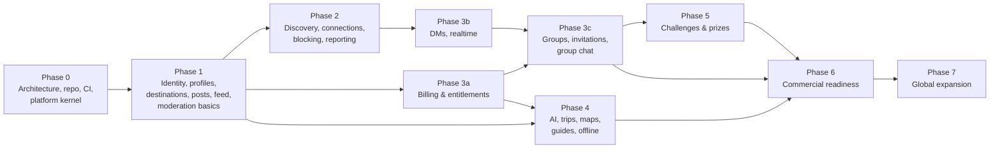

# 09 — Development Backlog and Dependencies

| | |
|---|---|
| **Status** | Draft v1.0 — Phase 0 |
| **Sizing** | T-shirt (S ≤ 2 d, M ≤ 5 d, L ≤ 10 d for one engineer). Re-estimated at each phase kickoff |
| **Item IDs** | `BL-<phase>.<nn>`. Each item lists the requirement IDs it satisfies |

## 1. Phase dependency graph

Cross-cutting rule: **identity, privacy, entitlement and authorization foundations are not deferred.** The entitlement evaluator, the authorization primitives, the audit log and the error and idempotency conventions land in Phase 0.

## 2. Phase 0 — Product and architecture (this delivery)

| ID | Item | Size | Depends | Req | Status |
|---|---|---|---|---|---|
| BL-0.01 | PRD with requirement IDs | M | — | all | ✅ Draft |
| BL-0.02 | System architecture + ADRs | M | — | NFR-* | ✅ Draft |
| BL-0.03 | Screen inventory, IA, UX flows | M | 0.01 | PROF-001, FEED-002 | ✅ Draft |
| BL-0.04 | ERD + retention schedule | L | 0.02 | SAFE-009 | ✅ Draft |
| BL-0.05 | OpenAPI 3.1 contract (all phases, phase-tagged) | L | 0.04 | — | ✅ Draft |
| BL-0.06 | Realtime protocol spec + JSON schemas | M | 0.05 | DM-003..006 | ✅ Draft |
| BL-0.07 | Subscription and entitlement policy | S | 0.01 | BILL-* | ✅ Draft |
| BL-0.08 | Threat model | M | 0.02 | SAFE-*, NFR-006 | ✅ Draft |
| BL-0.09 | Test strategy, infra plan, repo structure | M | 0.02 | NFR-012/013 | ✅ Draft |
| BL-0.10 | Monorepo initialization, tooling, conventions | S | — | NFR-012 | ✅ |
| BL-0.11 | Backend kernel: config, structured logging, request ID, problem+json errors, UUIDv7, signed cursors, feature flags, health/readiness | M | 0.10 | NFR-011 | ✅ |
| BL-0.12 | Authorization primitives (Principal, platform RBAC, policy decision type) | S | 0.11 | — | ✅ |
| BL-0.13 | Entitlement evaluator (pure) + group premium policy | S | 0.07 | BILL-007, GRP-009 | ✅ |
| BL-0.14 | Alembic baseline: extensions + platform tables (outbox, jobs, idempotency, audit) | S | 0.04 | SAFE-007 | ✅ |
| BL-0.15 | Docker Compose dev stack (PostGIS, Redis, MinIO) | S | — | — | ✅ |
| BL-0.16 | CI: lint, type, test (with PostGIS service), import boundaries, contract validation, mobile checks, secret scan | M | 0.10 | NFR-012 | ✅ |
| BL-0.17 | Mobile foundation: Expo + TS strict, router tabs, i18n (5 locales), theme tokens, API client, secure token store | M | 0.03 | I18N-001, OFF-003 | ✅ |
| BL-0.18 | Requirement traceability script | S | 0.01 | — | ✅ |
| BL-0.19 | Terraform module layout (cloud-neutral) | S | 0.02 | — | ✅ Layout documented. No resources until a cloud is chosen (Q-8) |
| BL-0.21 | Supabase as database: pooler/SSL support, Data API lockdown re-applied after every migration, extensions schema, remote-DB guard for tests (ADR-0018) | S | 0.14 | NFR-006 | ✅ Done. Migrations 0001–0002 applied to Supabase, lockdown verified, Data API disabled |
| BL-0.22 | Backend hosting (ADR-0019): Vercel serverless entry point (staging API) plus Render blueprint and `$PORT`-aware image (ready). Optional Redis. Supabase Auth as trusted issuer | S | 0.21 | — | ✅ Live: https://travel-buddy-api-jet.vercel.app (staging) |
| BL-0.20 | Move `mobile/` → `apps/mobile` into the npm workspace (ADR-0009). Consume shared `packages/*` (i18n resources, generated API client, domain types). Coordinate with the web workstream so the root lockfile isn't installed concurrently | M | 0.17, web | I18N-001 | ⏳ Planned |

Web-workstream items (Next.js app, BFF, web admin) are tracked by the web workstream in [docs/web](web/01-architecture.md). Backend work they depend on is listed in the phase tables below (BL-1.02, BL-3.01, BL-3.04, BL-3.14).

## 3. Phase 1 — Identity and local social feed

| ID | Item | Size | Depends | Req | Status |
|---|---|---|---|---|---|
| BL-1.01 | IdP port + OIDC verifier (JWKS cache, alg pinning) + DevIdentityProvider | M | 0.11 | AUTH-001..003, T-AUTH-01/08 | ✅ Done. Production IdP: Supabase Auth (ADR-0020), trusted in staging. `aal2` → `mfa`; `email_verified` only from the access token hook (migration 0003) |
| BL-1.02 | Platform sessions: access JWT, refresh rotation, reuse detection (30 s leeway, ADR-0011), `client` ∈ ios/android/web, session list/revoke | M | 1.01 | AUTH-006, AUTH-007 | ✅ Done |
| BL-1.03 | Registration with age gate, consent records, email-verified gate | M | 1.02 | AUTH-004, AUTH-008, AUTH-009 | ✅ Done. Email-verified gate enforced on posting (`403 email_unverified`). Password recovery (AUTH-005): the web app runs the IdP reset flow, which the mobile sign-in opens (`password_reset_url` in `/v1/client-config`); the first platform sign-in from a recovery link (IdP `amr` method `recovery`) revokes every older session, including any opened while the owner was on the reset form (`password_changed`; `users.last_recovery_at` keeps it once per recovery)
| BL-1.04 | Profiles, preferences, privacy settings (defaults per ERD) | M | 1.03 | PROF-001..007 | ✅ Done: `PATCH /v1/users/me` (handle uniqueness, reserved names, once-per-30-days change), onboarding completion, preferences and privacy GET/PATCH, consent ledger GET/POST mirrored into privacy settings, outbox events (`profile.updated`, `privacy.updated`, `discovery.disabled`, `user.onboarding_completed`). Avatar needs BL-1.08; social counters BL-1.11 |
| BL-1.05 | Destinations: schema, hierarchy, localization, seed loader (10 launch cities with boundaries) | L | 0.14 | DEST-001, DEST-002, DEST-005, LOC-006 | ✅ Done: hierarchy (path arrays, sibling-unique segments), 5-locale names/taglines/alt names, directory with stable `sort=slug` cursors, featured, lookup by path, children, idempotent seed loader (`python -m app.modules.destinations.seeding`) with 41 launch destinations: the 35 web-aligned ones plus Germany/Berlin, United Kingdom/London and Argentina/Buenos Aires, which complete the PRD's initial ten cities (DEST-005). Boundaries: approximate bounding boxes from the seed, replaced by licensed OSM relation polygons with `python -m app.modules.destinations.boundary_ingestion` (ADR-0027; `source = osm:<relation>`, ODbL; re-seeding keeps them). Pending: choose and check the relation IDs for the launch cities and load them on production |
| BL-1.06 | Destination search (trigram + unaccent) | S | 1.05 | DEST-001 | ✅ Done: trigram + f_unaccent over localized and alternative names, typo-tolerant (DEST-001) |
| BL-1.07 | Point → destination resolution, browse-destination selection | S | 1.05 | LOC-002, LOC-003, LOC-005, LOC-007, LOC-008 | ✅ Done: `GET /v1/destinations/resolve` (ST_Covers, ~110 m rounding, never stored); browse destination GET/PUT/DELETE (in `Me.browse_destination`, localized in the user's UI language); upcoming destinations (dates, 20 max, sharing requires discovery consent). Location freshness and precision (LOC-007, LOC-008): `near_ts` older than 15 minutes is refused with `stale_location` (resolve, nearby places, the feed; `point.captured_at` for discovery), and `near_accuracy_m` / `point.accuracy_m` above 5 km counts at city level only (resolve returns the city, nearby places search the whole city, the feed's For you uses the city, discovery sets no neighbourhood); the app sends both and locates again before a fix gets 14 minutes old |
| BL-1.08 | Media pipeline: presign, finalize, worker (type sniff, scan port, EXIF strip, variants) | L | 0.14 | POST-004, SAFE-004, T-MED-* | ✅ Done for photos (ADR-0022): `POST /v1/media/uploads` (idempotent, per-purpose types and sizes, presigned PUT signing type and length, pending-upload cap), `GET /v1/media/{id}`, `POST /v1/media/{id}/finalize`; `media.process` job verifies size, SHA-256 and magic bytes, runs the scanner port, re-encodes to EXIF/GPS-free WebP variants (orientation applied, bomb-limited) in the public bucket; S3-compatible storage with own SigV4, in-process store for dev/test; account erasure deletes stored objects; abandoned/rejected uploads purged. Photos attach to posts (`media_ids`, own uploaded post media, order kept, placeholder until ready; hard-deleted posts erase their stored photos); avatars via `PATCH /v1/users/me {avatar_media_id}` shown on every `UserSummary`, `MyProfile` and `PublicProfile` (a replaced avatar is erased). Before launch: real malware scanner + CSAM hash matching (SAFE-004); HEIC decoding and video transcoding. Editorial media (DEST-007): `editorial` purpose for content staff with credit and license, rights verified once processed (or revoked, which deletes the stored image) in `POST /v1/admin/media/{id}/rights` (audited; verification moves the asset to the platform), destination covers through `PATCH /v1/admin/destinations/{id}` `cover_media_id` and shown with `MediaRef.attribution` only while the rights stay verified; editorial renditions live under `e/` without the uploader's id |
| BL-1.09 | Job queue + outbox relay + scheduler (leader lock) | M | 0.14 | — | ✅ Done: Postgres queue (SKIP LOCKED claiming, DB-clock scheduling, 15 s→15 min backoff, dead-letter, crash recovery, dedupe keys), outbox relay with event subscriptions, `python -m app.worker`, cron-secured `/internal/jobs/tick`, optional after-response tick for serverless. Periodic scheduling landed with BL-1.18 (`periodic_tasks`, atomic claim instead of a leader lock) |
| BL-1.10 | Posts CRUD with destination ancestor fan-out, visibility, tags | L | 1.05, 1.08 | POST-001..003, POST-007..009, POST-011 | ✅ Done: create (stored-response idempotency, verified-email gate, per-kind rules), get, edit (marks edited, re-fans), delete (tombstone, out of every feed), user post list; ancestor fan-out with denormalized visibility; private accounts handled by a job; web cache events; photo posts with up to 10 uploaded images (BL-1.08). Place tags (POST-002 `place` precision): a listed place, filed under the place's destination, shown as `Post.place` until the place is taken down; leaving `place` precision drops the tag. Itinerary summaries (TRIP-006) reference a trip the author owns (check registered from main.py, since trips sit beside social) |
| BL-1.11 | Reactions, comments, bookmarks, follows (+ requests for private accounts), shares | M | 1.10 | POST-005, POST-006 | ✅ Done: reactions (one per user, changeable, by-type counts), comments (one reply level, idempotent create, tombstones, post-author moderation), bookmarks, share links (public posts only), follows with requests for private accounts (auto-approved on going public). Guest mode `GET /v1/public/posts[/{id}]` (public + approved + public accounts, 3-page cap) |
| BL-1.12 | Blocking (bidirectional effects) | M | 1.11 | SAFE-001 | ✅ Done: `user_blocks`; block/unblock/list; follows removed in the same transaction (composition-root hook); posts, profiles' post lists, comments, reactions, follower lists and follow attempts hidden both ways (404, nothing revealed). Feed, messaging and discovery use `trust_safety.service.blocked_ids` as they land |
| BL-1.13 | Feed: candidate generation, deterministic ranker, diversification, Redis snapshot, fallback chain, filters, tabs | L | 1.10, 1.12 | FEED-001..007, FEED-020, FEED-022 | ✅ Done: FEED-001 chain (gps → selected → upcoming → interests → global), tabs (for you, nearby, following, destinations), filters (destination, country, category, tag, language, sort, saved destinations), candidates via social (visibility, moderation, blocks, hidden posts in SQL), pure v1 ranker with versioned weights, author cap 2 per 20 + near-duplicate suppression, 15-min snapshots with `reset`, negative feedback. Snapshots in PostgreSQL (`feed_sessions`) instead of Redis so serverless works; Redis store later for scale |
| BL-1.14 | Reports + moderation queue + moderation actions + audit | M | 1.10 | SAFE-002, SAFE-003, SAFE-007, ADM-002 | ✅ Done: `POST /v1/reports` for posts, comments and users (evidence snapshot only when the reporter can see the target, one open report per reporter and target, optional block), queue ordered by severity priority then age, assign, resolve with an atomic action, idempotent moderation actions (remove/restore/limit content, suspend/ban/reinstate, warn/restrict recorded), staff user view with report and action counts. Removed posts disappear from feeds, destination pages and the web cache (`post.moderated`). Message, group, challenge and media targets arrive with their modules |
| BL-1.15 | Rate limiting middleware (Redis sliding window) + idempotency middleware | M | 0.11 | SAFE-005, NFR-006 | ✅ Done: stored-response idempotency (same-transaction claim, 24 h) on creating POSTs that declare it; rate limiting per docs/05 §5 with every contract class and bucket, sliding-window counter in Redis or PostgreSQL (UNLOGGED, for serverless) or memory (development), fail-open/closed per class, `RateLimit-*` headers and `429` with `Retry-After`, per-IdP-subject and per-session auth limits, trusted BFF client-IP forwarding (ADR-0021). The 7-day half limits for new accounts land with the contact, message and media modules |
| BL-1.16 | In-app notifications (center only) | S | 1.09 | NOTIF-001 | ✅ Done: list (cursor, `unread_only`), unread count, mark read by IDs or all; created from outbox events by a job (follow requests, new followers, reactions, comments, moderation notices), deduplicated per recipient (redelivery and react/un-react/react notify once), skipped for own activity, muted types (`in_app: false`) and blocked actors; blocked actors' existing notifications are hidden; title and body rendered at read time in `Accept-Language` or the user's UI locale (en, es, pt-BR, fr, de). Connections, messages, groups, challenges, billing, AI and exports notify when those modules land |
| BL-1.17 | Account deletion saga (grace period) | M | 1.03 | AUTH-010 | ✅ Done: `POST /v1/users/me/deletion` (idempotent, `sensitive` limit, signs out other devices, `DataSubjectRequest` with `scheduled_for`), `DELETE` cancels, signing in during the grace cancels; an hourly periodic job erases due accounts by deleting the `users` row (every module's data cascades; reports, moderation history and audit entries keep bare IDs), records `user.deleted` (web cache purge) and enqueues a retryable Supabase Auth Admin deletion (`SUPABASE_SECRET_KEY`); the `data_subject_requests` record outlives the account. Content stays visible during the grace period (hiding it is a product follow-up); messaging and billing pseudonymization join the saga with those modules |
| BL-1.18 | Retention jobs (sessions, notifications, idempotency, outbox, jobs) | S | 1.09 | SAFE-009 | ✅ Done: daily per-module purges scheduled through `periodic_tasks` (atomic claim per interval, no leader election needed; runs from workers, the cron tick or after-response ticks): sessions 90 d after revocation/expiry and `last_ip` nulled after 30 d, notifications 90 d, feed feedback 180 d and stale snapshots, idempotency keys past expiry, published outbox 7 d, succeeded jobs 7 d / dead 30 d, rate-limit counters, resolved reports 12 months, moderation actions 3 years (restrictions in force kept), user-deleted posts and comments hard-deleted after 30 d (comments with live replies kept). Batched `ctid` deletes in short transactions. Audit-log partition drops, discovery sessions, AI and billing rules land with their tables |
| BL-1.19 | Mobile: auth + onboarding flow | L | 1.03, 0.17 | PROF-001, PROF-002 | ✅ Done: sign-in (Supabase or development IdP), registration with age gate and legal versions, transparent token refresh, onboarding wizard (display name, app language applied immediately, interests, browse destination; optional steps skippable) that lands on the feed (PROF-002); returning users go straight to the feed. Location permission and traveler discovery steps arrive with Nearby and Phase 2 discovery Supabase sign-in offers to resend the confirmation email after sign-up or when the email isn't confirmed yet (rate limits explained). Social sign-in (AUTH-002, AUTH-003): "Continue with Apple / Google" through Supabase OAuth with PKCE (system browser, `travelbuddy://auth-callback`), shown only for the providers in `/v1/client-config` `auth_providers` (`AUTH_SOCIAL_PROVIDERS`); needs the providers configured in Supabase (docs/11 §1.12). Native Sign in with Apple on iOS is a later refinement |
| BL-1.20 | Mobile: feed tabs, filters, post detail, composer with location precision | L | 1.13 | FEED-002/003, POST-002 | ✅ Done: Home feed (For you / Nearby / Following, server fallback context, story-type filter, infinite scroll, pull to refresh, snapshot reset handling, guest mode with public stories); Nearby asks for location only when opened, coarse-only permission (fine and background blocked on Android), position rounded to ~1 km before it leaves the device, uncovered areas explained; post cards with optimistic likes; post detail with comments; composer with destination search, audience and up to ten photos (system picker or camera, JPEG/PNG/WebP; SHA-256 declared, presigned PUT, finalize; a retry re-uploads only the photos that failed; `photo` stories need a photo); transparent token refresh. Uploads need object storage configured on staging Photo gallery: lists show the first photo with "+N", the story shows every photo, and a full-screen viewer (SCR-137) swipes through the ready ones (the detail screen used to show only the first photo) Saved stories (POST-005, SCR-102): a save toggle on every story for signed-in readers (optimistic, reverted on failure) and a private Saved stories list Authors edit their story text and audience (only changed fields are sent; a text-only story can't be emptied) and delete it after a confirmation (POST-003) Comment actions: delete (own comments, and any comment on one's own story, per `viewer.can_delete`) and report other people's comments (SAFE-002) Feed feedback from a story's menu (hide, not interested, see less from the author; the card collapses at once) and sharing public stories through the share sheet with a tracked link Upcoming trips (LOC-005, FEED-001): add destinations with optional dates (validated) so the feed shows them before arrival, or remove them; never shared for discovery from here Comment replies (POST-005, one level): reply to a comment and open its replies |
| BL-1.21 | Mobile: profile, settings, privacy center, block/report flows | M | 1.04, 1.12, 1.14 | PROF-007, SAFE-001/002 | ✅ Done: profile tab (avatar, bio, pending-deletion banner with keep-my-account, active restrictions with expiry, unread notifications), edit profile, privacy (private account, opt-in search indexing with the private-account caveat), blocked accounts with unblock, delete account (explicit confirmation, idempotent, 30-day grace), notification center (marks read, opens the story or profile), other travellers' profiles (follow/requested, report, block; private accounts withheld), report flow (12 reasons, details, block in the same step, urgent-help guidance) from posts and profiles Devices (SCR-110, AUTH-006): signed-in sessions with the current device first, last activity and app version, sign out another device after a confirmation Language and region (SCR-108): app language saved to the account and applied again after a restart, the account time zone with a one-tap switch to the phone's, distance units. Forced update (SCR-151): when `/v1/client-config` says `update_required`, the app shows only an update screen with the store link; a failed or offline check never blocks Safety center (SCR-114, SAFE-008): bundled guidance on meeting travellers, location, scams, reporting and blocking, and emergencies (works offline, five languages) with a link to support Follow requests (POST-006): private accounts approve or decline people who ask to follow them (before this they could never gain followers in the app) Follower and following lists open from a profile (paged; the server hides private accounts' lists from non-followers) Find people by name or @handle from Companions (from two characters; blocked and deactivated accounts never appear) |
| BL-1.22 | Admin web: minimal moderation console (queue, review, actions) | M | 1.14 | ADM-001..003 |
| BL-1.23 | Seed editorial content for launch destinations | M | 1.10 | FEED-001 | ✅ Done: `python -m app.modules.social.seeding` creates the Travel Buddy Editors system account (reserved handle `travelbuddy`, no sign-in identity, indexing on) and 36 evergreen posts across the 15 launch cities and 6 neighbourhoods (no prices, hours or safety claims), idempotently (deterministic IDs). Seeded on staging; new users see it through the feed's destination and global fallbacks |
| BL-1.24 | E2E: registration → location-based feed | S | 1.19, 1.20 | PROF-002, FEED-001 | ✅ Done (API level): `tests/integration/test_e2e_journey.py` registers, onboards (name, language, interests, browse destination), completes onboarding and gets the localized Lisbon feed (`selected`, neighbourhood stories included), reacts, and with PostGIS switches to the device's city on Nearby; the mobile screens for the same journey are covered by component tests. A device-driven E2E (Maestro) comes with release automation |
| BL-1.25 | Web cache revalidation: outbox consumer + signed `webCacheRevalidation` webhook (retries, secret rotation). Settings `WEB_REVALIDATE_URL`, `WEB_REVALIDATE_SECRET`. The web receiver is already live and verified (accepts `current,previous` secrets) | S | 1.09 | SAFE-012 | ✅ Done (code): `profile.updated`/`privacy.updated` → signed webhook (`X-TB-Signature`, event_id = outbox ID, 4xx permanent, 5xx/429 retried). To enable on staging: `WEB_REVALIDATE_URL`/`WEB_REVALIDATE_SECRET` on the API, the same secret in the web's `WEB_REVALIDATE_SECRETS`, and `JOBS_INLINE_AFTER_RESPONSE=true` + `CRON_SECRET` |
| BL-1.26 | Staff hardening on `/v1/admin/*`: MFA (`amr`) check, idle/absolute session limits, `X-Audit-Justification` dependency → audit log | S | 1.02, 1.14 | ADM-007, ADM-008, ADM-009 | ✅ Done: MFA enforced in `authorize_platform` (`403 mfa_required`, Supabase `aal2`; dev IdP `mfa: true`); `admin.deps.staff()` checks 30 min idle / 12 h absolute staff session limits (`401 reauthentication_required`) and requires `X-Audit-Justification` (10–500 chars, `400 justification_required`) on sensitive routes; the justification is stored in the audit log |
| BL-1.27 | Search-indexing consent: privacy setting, `indexable` on public profile/posts, sitemap filter | S | 1.04, 1.10 | PROF-008 | ✅ Done: `search_engine_indexing` privacy setting (consent-ledger mirrored, default off), `indexable` on posts and on the new `GET /v1/users/{id}` / `GET /v1/users/by-handle/{handle}` public profiles (true only for unrestricted public profiles that opted in), web cache purges on changes; sitemaps include only `indexable` items (web). Public profiles 404 on blocks or inactive accounts and withhold details for private accounts the viewer doesn't follow |
| BL-1.28 | `MyAccount.restrictions` derived from active moderation actions | S | 1.14 | SAFE-013 | ✅ Done: `restrict` actions carry a `restriction_kind` (contract + migration 0014; required for and only for `restrict`), `Me.account.restrictions` lists active ones (not expired, not lifted by a later `reinstate`, longest per kind, `appealable: true` via support), `posting_limited` and `commenting_limited` are enforced with `403 account_restricted` (new contract code), and the user gets a moderation notice. Messaging, connection, discovery and media limits are enforced when those modules land |
| BL-1.29 | Tech debt: rename legacy check constraints whose names the naming convention doubled (`ck_<t>__ck_<t>__…`, migrations 0001–0013); new migrations pass `op.f(name)` | S | — | — | ✅ Done: migration 0042 renames the 43 doubled check constraints (some truncated at 63 characters) to the names the models declare; the list was generated by matching identical CHECK definitions between a migrated database (Supabase) and one built from the models, and each rename runs only when the old name exists and the new one does not, so model-built databases are untouched; a migration test asserts no doubled names remain |
| BL-1.30 | Localized server error text (`title`/`detail` by `Accept-Language`) | S | 0.11 | I18N-007 | ⬜ Deferred: `code` is stable and both apps translate every problem by `code` and `errors[].code` (neither shows the server's text), so users already see their language. Server-side catalogs are needed only for third-party API clients |

## 4. Phase 2 — Travel companions

| ID | Item | Size | Depends | Req | Status |
|---|---|---|---|---|---|
| BL-2.01 | Discovery consent + privacy settings UI and API | S | 1.04 | DISC-001, DISC-010 | ✅ Done: API (consent required to enable, withdrawal turns discovery off, city/neighbourhood granularity) and mobile consent screen (what's shared and never shown, safety guidance, explicit acknowledgement, granularity) |
| BL-2.02 | Discovery sessions (start/stop, TTL, invisible mode, GPS → destination resolution and discard) | M | 1.07 | DISC-002, DISC-003, DISC-006, LOC-009 | ✅ Done: `GET/PUT/DELETE /v1/users/me/discovery-location` (migration 0020, no coordinate column); by destination (neighbourhood only when the user chose that granularity) or GPS resolved with PostGIS and discarded (`GeoPointInput` repr redacted); 1-72 h TTL enforced by query filter; visible/invisible; one open session; 10 starts a day; purged 30 days after ending |
| BL-2.03 | Discover endpoint: matching score (interests, dates, languages, styles), block filtering, randomization within bands | M | 2.02, 1.12 | DISC-004, DISC-005, DISC-007, DISC-008 | ✅ Done: `GET /v1/travelers/discover` (`discovery` rate class): reciprocal (`here_now` only where the caller is visible; `upcoming` only with a shared trip there), invisible users neither appear nor browse, opted-out users vanish at once, blocks both ways excluded; documented weights (interests 0.40, styles 0.25, languages 0.20, dates 0.15) bucketed high/medium/low, shuffled within bands, declined requesters last; filters by style, interest, language; cards carry no coordinates, distances or activity times, respect profile visibility, show neighbourhood only if both chose it; relationship and can-request on each card |
| BL-2.04 | Connection state machine + requests API + inbox | M | 1.04 | CONN-001..003, CONN-006..008 | ✅ Done: `connection_requests` + canonical `user_connections` (migration 0019); pure state machine with every transition unit-tested (only the recipient accepts/declines, only the requester cancels, nothing connects without an accept); inbox (incoming/outgoing, by status), idempotent send, accept returns the connection, decline/cancel 204, connections list, silent idempotent removal; relationship state and `can_request_connection` on public profiles; notifications for requests and acceptances; 30-day expiry |
| BL-2.05 | Request policies, rate limits, new-account restrictions | S | 2.04, 1.15 | CONN-004, CONN-005, SAFE-006 | ✅ Done with BL-2.04: recipient policy (everyone / shared context = exploring the same destination / nobody) and blocks refused with one generic `connection_request_not_allowed`; 30-day decline cooldown; `contact` rate limit plus 5 a day for accounts under 7 days; `connection_requests_limited` restriction enforced. Shared context counts only mutually shared signals: both visible in discovery in the same city, both sharing an upcoming trip to the destination for discovery, or an active travel group (current members only; registered through `connections.add_shared_context` from main.py). Browse cities, private trips and invisible sessions never count, because `can_request_connection` on profiles would reveal them (BL-2.09 review). Keyword filter for direct messages from new connections (SAFE-006): sends and edits to a connection younger than `new_connection_days` (default 7), and connection-request notes, are refused with `message_filtered` when they contain a filtered term (invisible characters such as zero-width spaces are ignored); conservative default list in the five launch languages, replaced at runtime in `/v1/admin/safety/message-filter` (`safety.filters.manage`, admins, audited with the terms added and removed); the app explains the refusal |
| BL-2.06 | Block integration with connections and discovery | S | 2.04 | CONN-009 | ✅ Done: blocking ends connections and pending requests (CONN-009) and blocked users never appear in discovery in either direction |
| BL-2.07 | Anti-enumeration limits + abuse signals | S | 2.03 | DISC-009, SAFE-011 | ✅ Done: discover rate class (60/min, 500/day), 10 discovery-location changes a day, new-account connection limits, and an hourly abuse-signal job (mass connection requests with half declined, mass reporting, discovery in 4+ cities a day) that files deduplicated system reports into the moderation queue with the counts as evidence; nothing is enforced automatically |
| BL-2.08 | Mobile: Companions tab (discover, requests inbox, profile preview, safety guidance) | L | 2.03, 2.04 | DISC-*, SAFE-008 | ✅ Done: Companions tab with discovery (opt-in via the consent screen, share a city by coarse location or search, visible/invisible, stop sharing, turn off; traveller cards with compatibility, things in common and Connect), requests inbox (accept/decline with note, cancel), connections list, Connect on profiles, safety guidance throughout |
| BL-2.09 | Security tests: location enumeration, trilateration impossibility, block leakage | M | 2.03 | T-LOC-01..04 | 🟡 Partial: integration tests assert no coordinate columns or keys anywhere in discovery responses, GPS values never echoed, blocked/invisible/opted-out users absent, cross-city browsing refused. Internal review of discovery and location done (2026-11-10): one finding fixed, the connection-request "shared context" used private signals (browse city, unshared upcoming trips, invisible discovery sessions) that `can_request_connection` on profiles exposed to anyone who changed their own city; it now counts only mutually shared signals, with a regression test. External pentest still pending (BL-6.07) |
| BL-2.10 | DPIA for discovery (EU) | M | 2.03 | SAFE-010 | 🟡 Draft written (`docs/13-dpia-traveler-discovery.md`) from the implemented controls; needs DPO/privacy counsel review and sign-off before EU launch |
| BL-2.11 | E2E: discovery → accepted connection | S | 2.08 | CONN-002 | ✅ Done (API level): `test_e2e_journey.py::test_discovery_to_accepted_connection` — two travellers opt in with consent, share Lisbon, one finds the other with shared interests, sends a discovery-context request with a note, the other accepts, both are connected and discovery shows the relationship |
| BL-2.12 | Companions map: approximate start from the IP address, radar search, travellers on the map | M | 2.03 | LOC-004, LOC-010, DISC-012 | ✅ Done (2026-11-11, [ADR-0030](adr/0030-companions-map-ip-start-and-area-pins.md)). Backend: `GET /v1/users/me/approximate-location` with a local DB-IP Lite lookup (rounded, discarded, never logged), downloaded into the image; Helsinki added to the catalog. Mobile: MapLibre GL JS + OpenFreeMap in a locked-down WebView, gold radar sweep that reveals each traveller as the beam passes, pins around the public centre of the area each traveller shares, tap to open the profile, the same results listed below; reduce motion honoured; 5 locales. Searching shares the city (the lookup alone makes nobody discoverable). **Later:** a native map when ADR-0008's provider is chosen |

## 5. Phase 3 — Messaging, billing, groups

| ID | Item | Size | Depends | Req | Status |
|---|---|---|---|---|---|
| BL-3.01 | Billing module: products, Apple + Google adapters (verify, server notifications), DevBillingProvider | L | 0.13 | BILL-001..006 | ✅ Done: products (seeded premium monthly/annual for iOS and Android), subscriptions, purchases, store-event inbox; `GET /v1/billing/products`, `POST /v1/billing/purchases/verify` and `/restore` (idempotent, one store transaction per account → `409 purchase_already_linked`), normalized store events through the docs/07 state machine (duplicates once, out-of-order ignored); `DevBillingProvider` + `/v1/dev/billing/events` in dev/test. Store adapters done in BL-6.01: Apple (StoreKit 2 JWS verified locally, Server Notifications v2) and Google Play (Play Developer API verification and acknowledgement, RTDN via authenticated Pub/Sub push); each answers 503 until its credentials are set |
| BL-3.02 | Entitlement materialization + Redis cache + entitlements endpoint | M | 3.01 | BILL-007 | ✅ Done (without Redis cache: one indexed query per evaluation): grants rewritten on every state change in the same transaction; `GET /v1/billing/entitlements` (no-store) and `Me.entitlements` share one evaluator; status, grace end and `active_subscription` with its management path |
| BL-3.03 | Conversations + messages persistence (seq, idempotency), REST endpoints | L | 2.04 | DM-001, DM-004, DM-005, DM-010, DM-011 | ✅ Done: `/v1/conversations` (list, open direct, get, history and seq sync, send, edit within 15 min, delete as tombstone, reactions, threads, receipts, mute, clear, pins). Seq assigned under a conversation row lock; idempotent on `client_message_id`; authorization re-checked on every send (connection, blocks, `messaging_limited`); reciprocal read receipts; collapsed `new_message` notifications that respect mute and level and carry no bodies; message reports and staff removal; deleted accounts' messages tombstoned by retention |
| BL-3.04 | Realtime gateway: auth frame, fanout via Redis, acks, sync, typing, receipts | L | 3.03, 1.09 | DM-003, DM-006..008 | ✅ Done (ADR-0023): `/v1/realtime` with subprotocol and Origin checks, 5 s auth deadline, in-band re-auth and `auth.expiring`, send/edit/delete/receipts/typing through the messaging service (ack after commit, duplicate acks), `sync.request` → `sync.required`, per-connection frame limits, invalid-frame and idle closes; per-user fanout over a Memory or Redis bus with per-viewer rendering; every emitted frame validated against `contracts/realtime` in tests. Needs a long-running host + Redis to run on staging (REST fallback until then); web tickets are BL-3.15 |
| BL-3.05 | Private media for message attachments (signed URLs) | S | 1.08, 3.03 | DM-002 | ✅ Done: `message` media variants stored privately (`pm/` in the private bucket, never public); attachment refs carry 5-minute presigned GET URLs minted only after the membership check; tampered or expired URLs refused; deleting the message or account erases the objects |
| BL-3.06 | Push notifications (device registration, provider port, preferences, quiet hours) | M | 1.16 | DM-009, NOTIF-002..004 | ✅ Done: `POST`/`DELETE /v1/users/me/devices` (expo, fcm, apns, webpush; tokens AES-GCM encrypted, deduplicated by hash, scoped to the session and deleted on revoke); a push job per new notification honouring per-type push preferences, quiet hours in the user's time zone (`Preferences.quiet_hours`) and live sessions; titles and bodies from the notification templates in the reader's language (never message bodies or location); Expo push adapter with `DeviceNotRegistered` pruning, in-memory recorder in dev/test. FCM/APNs adapters pending credentials; Web Push sending is BL-3.16 Mobile notification settings (SCR-109): push on or off per kind of activity (account, safety and data notices always on) and quiet hours with validated 24-hour times in the account time zone |
| BL-3.07 | Groups: create (entitlement), roles, settings, capacity, owned-group cap | M | 3.02 | GRP-001..004, GRP-007, GRP-012, GRP-013 | ✅ Done: `/v1/groups` create (premium `groups.create` + owned-group quota via billing, idempotent; `feature_disabled` for public/request-to-join in v1), list, get (404 for non-members), update and settings with `If-Match` versions (428/412), archive (read-only chat, links revoked), roles matrix, members, role changes and removals by rank, restrictions, leave (owner must transfer first) |
| BL-3.08 | Invitations: direct + link (hashed tokens, max uses, expiry, revoke), redemption | M | 3.07 | GRP-005, GRP-008, T-GRP-01/02 | ✅ Done: direct invitations (inbox, accept free of charge, decline) and links (256-bit token shown once, only its hash stored, `#t=` URL); preview and redeem lock the invitation and check status, expiry, uses and capacity together; already-members don't consume a use; revoke |
| BL-3.09 | Group chat: announcements, threads, pins, mentions, moderation (remove, restrict), history policy | L | 3.03, 3.07 | GCHAT-001..007 | 🟡 Group chat done: one room per group created with it, membership kept in sync (removed/left members lose access at once), `full`/`from_join` history, member restrictions and admins-only mode enforced on send, moderator removals with a reason recorded as group moderation actions, pins need `messages.pin`, announcements (optionally pinned). Realtime `membership.changed` frames tell removed, restricted, re-roled or departing members at once; groups can be reported by their members (evidence snapshot) |
| BL-3.10 | Owner lapse handling, admin grace, ownership transfer | M | 3.02, 3.07 | GRP-009..011, BILL-008 | ✅ Done: group premium from the owner's grants with admin grace (`premium_features_active`, `premium_grace_until`); after lapse only inviting/approving/challenges stop, safety tools and transfer always work; ownership transfer offer → accept/decline/cancel (7 days). Owner account deletion: groups pass to the longest-tenured admin, then moderator, then member inside the erasure transaction, or are archived if nobody is left (never deleted). Owner and admins (never members) get localized notices when the admin grace starts, 3 days before it ends and at the lapse (6-hourly `groups.premium_watch`, once per stage) A pending transfer now appears on the group (`pending_transfer`, only to the owner who offered it and the member offered it), so the recipient can find and answer it; mobile shows accept/decline to the recipient and cancel to the owner. Mobile Manage group (SCR-072): chat and invitation settings with optimistic versions, role changes below one's own rank, removal and ownership offers behind confirmations, each shown only with its permission Manage group also restricts members from posting for 1 hour, 24 hours or 7 days and lifts restrictions (`members.restrict`, never paywalled) Manage group lists active invitations (who or how many uses) with revoke, and the owner can archive the group after a confirmation |
| BL-3.11 | Mobile: messages tab, DM screen, group chat, group management, paywall + purchase flow | L | 3.03..3.10 | DM-*, GRP-*, BILL-002/004 | 🟡 Direct messages done (messages tab with previews and unread counts, chat screen with polling per ADR-0023, idempotent send, read marks and reciprocal "Read", tombstones, delete/report from a long press, block restriction notice, "Message" on connected profiles, new-message notifications open the chat). Groups done: Companions → Groups (my groups, invitations to accept or decline, join by pasting a link or code with a preview, create when premium with destination search), group screen (members and roles, open chat, share an invitation link, leave), group chats with titles, sender names and announcements. Push registration done (BL-6.06). Chat replies (quoted in the thread) and pins (SCR-084: pinned bar, list, unpin; direct chats for either member, groups with `messages.pin`), and each send restriction now has its own explanation (admins-only chat, restricted member, archived group, block) instead of "connection required". Admins post group announcements (optionally pinned, retry-safe) from the group page. Photo messages (DM-002): choose or take a photo; it is uploaded to quarantine, scanned and sent as an image message, and received photos show in the chat instead of a placeholder. Message reactions (six quick emoji from the allow-list; chips toggle one's own) and clearing a chat for oneself. Chats can be muted for 1 hour, 8 hours or a week (no push; unread counts stay) and unmuted. Subscription screen done (SCR-111: plan, renewal or end date, promotional Premium, store grace warning, quota use and limits, the App Store / Google Play management page, web subscribers pointed to the website). Paywall (SCR-133, 2026-11-11): offers, reasons, benefits, auto-renewal disclosure, terms and privacy; entry points from Subscription, group creation, premium guides and offline downloads; test purchases through the backend's dev store in development builds. Pending: the StoreKit / Play Billing adapter in a development build and the store products (needs Apple and Google developer accounts) |
| BL-3.12 | Security tests: IDOR on messages, cross-group leakage, subscription bypass, invitation reuse | M | 3.09 | T-AZ-*, T-BILL-*, T-GRP-* | ✅ Done (`test_phase3_security.py`): every message operation on someone else's conversation answers 404, message IDs can't be reached through another conversation (reply, pin, delete, thread, report), groups never leak into each other (group, members, settings, chat, cross-chat removal), client-asserted premium is ignored and another account's purchase unlocks nothing, links and capacity hold under concurrent redemption, direct invitations work once for their invitee only |
| BL-3.13 | E2E: connection → DM, premium purchase (sandbox) → group, invitation → group chat | M | 3.11 | — | ✅ Backend journey done (`test_e2e_phase3.py`): connect → DM with unread and notification → premium through the dev store → group → link invitation → announcement and group chat. Device E2E (Detox/Maestro) waits for the mobile group screens |
| BL-3.15 | Payments phase 1 (ADR-0031): configurable offers and passes, money ledger and purchase history, hardened Stripe webhooks, duplicate protection, test/live separation | L | 3.14 | BILL-005, BILL-006, BILL-010..012 | ✅ Done (2026-11-11; works without credentials, Stripe answers 503 until `STRIPE_*` is set): product kinds `non_renewing` (passes that stack) and free ISO periods, per-locale titles and order (migration 0046, admin API); web prices from Stripe (cached); `billing_transactions` ledger for Stripe and store purchases, `GET /v1/billing/transactions` and SCR-118 in the app; webhooks re-read objects with a pinned API version, handle one-time and asynchronous payments (Pix, boleto), invoices, targeted refunds (partial refunds keep the purchase by default) and disputes; open Checkout session reused, per-user lock, duplicate web subscription cancelled and refunded, daily reconciliation; notices for failed and confirmed payments, refunds and Premium ending; live keys only in production and events of the other mode ignored. **Next:** Stripe test keys and Prices (BL-3.16), the store paywall (BL-3.11), legal check on in-app links (ADR-0031) |
| BL-3.16 | Connect Stripe test mode on staging: restricted key, webhook endpoint with the ADR-0031 events, Prices for the offers, Customer Portal settings; end-to-end check with test cards, Pix and refunds | S | 3.15 | BILL-002, BILL-012 | 🟡 Tooling done (2026-11-11): recommended launch offers and settings (docs/07 §2.1) in `seed/offers.json`, and `python -m app.modules.billing.stripe_setup` (dry run by default) creates the Prices, the webhook endpoint (secret only to a file) and the Customer Portal, then registers the offers for web and both stores; idempotent, a changed price replaces the old one; `STRIPE_PORTAL_CONFIGURATION`. ⏳ Waiting for a Stripe test restricted key to run it |
| BL-3.14 | Stripe adapter for web: checkout and portal sessions, signed webhooks, `billing_customers` (ADR-0012) | M | 3.01 | BILL-002..006 | ✅ Done (needs `STRIPE_SECRET_KEY`, `STRIPE_WEBHOOK_SECRET` and web products whose SKU is the Stripe price ID; 503 until set): `POST /v1/billing/checkout-sessions` (relative paths only, one Stripe customer per user in `billing_customers`, 409 when already entitled), `POST /v1/billing/portal-sessions`, `POST /v1/billing/webhooks/stripe` (HMAC over the raw body, 5-minute tolerance, stored once per event, subscription re-fetched, statuses mapped per docs/07 §6, refunds and lost disputes revoke) |
| BL-3.15 | Realtime tickets for browsers + Origin allow-list (ADR-0013) | S | 3.04 | DM-003 | ✅ Done: `POST /v1/realtime/tickets` (256-bit, 30 s, single use, only the SHA-256 stored in PostgreSQL since staging has no Redis, bound to the session; revoking it voids outstanding tickets); the gateway accepts `auth {ticket}`, requires re-auth 15 minutes after issuance, and checks the browser Origin allow-list |
| BL-3.16 | Web Push adapter (VAPID keys, encrypted endpoints, 404/410 pruning), `webpush` device registration | S | 3.06 | NOTIF-005 | ✅ Done (needs `WEB_PUSH_VAPID_PRIVATE_KEY`): RFC 8291 `aes128gcm` payload encryption (verified against the RFC's Appendix A vector), RFC 8292 VAPID tokens, `GET /v1/client-config` serves the public key, `webpush` subscriptions registered through the device registry (encrypted at rest), 404/410 disable the subscription, 429/5xx retry; pushes route to Expo or Web Push per device |

## 6. Phase 4 — AI travel guidance

| ID | Item | Size | Depends | Req | Status |
|---|---|---|---|---|---|
| BL-4.01 | Places ingestion from licensed provider (adapter) + freshness | L | 1.05 | DEST-003 | ✅ Done (ADR-0025; staging has OpenStreetMap places for the 7 featured destinations): `PlaceSource` port with an OpenStreetMap/Overpass adapter (ODbL attribution, published attributes only) and a JSON document source; idempotent ingestion command (`python -m app.modules.destinations.place_ingestion --destination <path>`) keeping editorial takedowns; `places` + `place_localizations` (migration 0031, lat/lng without PostGIS); `GET /v1/places/{id}` with attribution, freshness and `data_stale` (> 180 days), `/v1/places/search` (accent/typo-tolerant, destination subtree), `/v1/places/nearby` (bbox + haversine, cursors, point never stored); AI itineraries grounded on the most popular places per category; trip items reference active places |
| BL-4.02 | AI provider port, adapters, telemetry, quotas, circuit breaker | M | 3.02 | AI-001, AI-009 | ✅ Done (ADR-0024; Claude needs `ANTHROPIC_API_KEY`): `AIProvider` port with per-task model/effort/timeout config; Claude adapter on the official SDK (structured outputs, cacheable system prompt, server-side refusal fallback) and an offline fake for dev/tests; asynchronous `POST /v1/ai/itineraries/generate` → `GET /v1/ai/generations/{id}` with idempotency; `ai_generations` telemetry (tokens, cost, latency, attempts, validation errors; no prompts); monthly quotas through entitlements (failed generations are free; usage shown in `Me` and billing entitlements); database-backed daily spend and provider breakers (`503 ai_unavailable` + `Retry-After`); `ai_generation_ready` notification; retention (proposals 30 days, telemetry 13 months) |
| BL-4.03 | Itinerary generation (grounded candidates, schema, semantic validation, repair) | L | 4.01, 4.02 | AI-002..004, AI-007, AI-008 | 🟡 Generation done: draft schema with no hours/price/availability/safety fields, typed context builder grounded on catalog candidates (IDs, names and categories only), semantic checks (one day per date, candidate place IDs, no overlaps, before midnight), one repair retry then `ai_output_invalid`, licensed place joins with attribution and freshness, localized disclaimer and warnings, `POST /v1/trips/{id}/apply-itinerary` (replace/merge per day, AI origin, confidence and attribution kept). Pending: red-team eval set against a real model |
| BL-4.04 | Trips, days, items, saved places, collaborators, offline sync protocol | L | 1.05 | TRIP-001..005 | 🟡 Trips done: `/v1/trips` create (a day per date, destinations), list with role, get, edit and delete with `If-Match` versions; days and items (fractional ordering, moves between days, tombstones); `POST /sync` for offline batches (newer write wins, later server edits come back as conflicts with the server state, invalid ops reported, idempotent); owners and editors edit, viewers and public readers read. Saved places done: `/v1/users/me/saved-places` (idempotent `PUT` into named collections with a note, `DELETE`, newest-first list filtered by collection or destination subtree with cursors; taken-down places drop out). Sharing done (TRIP-005): `connections` trips visible to the owner's connections, `group` trips to members of the trip's group (the owner must belong to it), blocks hide every trip either way; `PUT /v1/trips/{id}/collaborators/{userId}` (owner shares with a connection or group member as editor or viewer, at most 20, `connection_required` otherwise) and `DELETE` (owner removes, collaborator leaves). Mobile: visibility chips and sharing with connections (role toggle, remove, leave) on the trip screen Mobile saved places (SCR-102): grouped by collection with notes, open or remove |
| BL-4.05 | Replanning (premium) | M | 4.03, 4.04 | AI-005 | ✅ Done: `POST /v1/ai/trips/{id}/replan` for owners and editors with entitlement `ai.trip_replan` and quota `ai.trip_replans` (free 0, premium 60/month); stale `base_version` → `409 conflict`; the current plan (items only, no collaborator data), the instruction, chosen days, kept items and avoided categories go into a separate prompt version (`replan.v1`); semantic checks enforce the requested days, kept items and avoided categories (one repair retry); nothing changes until `apply-itinerary` (replace per day). Mobile: premium "Change this trip with AI" on the trip screen (instruction, days), review, then "Apply to my trip" at the current version |
| BL-4.06 | Maps integration (MapLibre, tiles provider, routing port) | L | 4.01 | GUIDE-001..003 |
| BL-4.07 | Guides + audio tours content model, admin authoring, purchase grants | L | 3.02 | GUIDE-004, GUIDE-005, BILL-001 | 🟡 Backend done: `destination_guides`, `audio_tours`, `audio_tour_stops` (migration 0034; versioned, licensed, rights expiry); `/v1/destinations/{id}/guides` and `/v1/guides/{id}` (free guides anonymous for SEO, structured FAQ sections, best locale per guide), `/v1/destinations/{id}/audio-tours` and `/v1/audio-tours/{id}` (stops with place, audio and an on-device geofence radius); `premium` needs `guides.premium` / `audio_tours.premium`, `purchasable` that or the content purchase (`content:guide:<id>`); authoring through a validated, idempotent content loader (`python -m app.modules.guides.seeding`) that publishes new versions, retires old ones and maintains `destinations.has_guides`; an original free Lisbon guide (en, pt-BR) is seeded. Pending: admin authoring UI/API (not in the contract), audio upload purpose for editorial media, product SKUs for purchasable content, mobile guide reader and audio player (BL-4.09) |
| BL-4.08 | Offline packages: build pipeline, signed manifests, licensing, quota | L | 4.06, 4.07 | OFF-001, OFF-004, OFF-005 | 🟡 Guide packages done (ADR-0026): build command into private storage (versioned, unchanged content not republished), `offline_packages` + `offline_package_licenses` (migration 0035), `/v1/destinations/{id}/offline-packages`, per-device licensing with `offline.packages` quota (free 1, premium 15; re-licensing free, new versions replace old licenses), Ed25519-signed manifests (public key in client-config), token download URLs (`/v1/offline-downloads/{token}/{file}` → 307 to storage, license re-checked per file), content-license expiry enforced, my licenses, release. Mobile: download packs per destination (manifest signature verified with the client-config key, every file checked against its SHA-256 with one retry), Downloads screen with space used and removal (releases the license), guides read from the device when offline, expired content hidden. Pending: audio tour and map region packages (need editorial audio and BL-4.06), `OFFLINE_MANIFEST_PRIVATE_KEY` + S3 storage on staging |
| BL-4.09 | Mobile: Explore tab, AI planner, trip editor, map, guide reader, audio player with geofences, downloads manager | XL | 4.03..4.08 | OFF-002 | 🟡 First slice released: Explore tab (places in a destination or near me, place search), place detail with licensed attributes, source and freshness (stale notice) and save/unsave, AI planner (destination, dates, pace, interests; privacy hint) with polling review (disclaimer, warnings, unverified badges) and "save as trip", trips list and read-only trip detail, premium trip replanning, guides for the chosen destination and a guide reader (sections, bullet lists, FAQs, premium notice); 5 locales, tests. downloads manager with verified offline guide packs (BL-4.08). Itinerary editor done (TRIP-004): owners and editors add, edit, delete and reorder items (kind, title, 24-hour time, notes); every change shows at once, is kept on the device (survives restarts and airplane mode) and goes to `POST /v1/trips/{id}/sync` in batches whenever the device is online; replaced edits are reported, refused ones can be discarded, and nothing is retried in a loop. The server now honours the contract's `after_item_id: null` (first in the day) on create and patch. Explore starts from featured destinations (chips) and narrows a city to its neighbourhoods. Pending: map (BL-4.06), audio player with geofences (needs editorial audio, BL-4.07) |
| BL-4.10 | Post translation (labelled) | M | 4.02 | POST-010, I18N-006 | ✅ Done: `GET /v1/posts/{id}/translation?target=` through the AI provider port: posts the viewer can see only, `post_translation` consent required, same-language and empty posts rejected, always `machine_translated: true` with provider attribution, original never replaced; translations cached per post and language until the text changes (`post_translations`, migration 0033, purged after 90 days); telemetry and the spend breaker apply. Mobile post cards offer "Translate" for posts in another language, label the result "Machine-translated from …" with "Show original", and ask for consent in place. Pending: the same toggle on the web (web session) |
| BL-4.11 | E2E: offline download → airplane mode → playback | S | 4.09 | OFF-002 |

## 7. Phase 5 — Interactive community activities

| ID | Item | Size | Depends | Req | Status |
|---|---|---|---|---|---|
| BL-5.01 | Challenge model, config validation, lifecycle + scheduler activation | M | 3.07 | CHAL-001..003 | ✅ Done: challenge tables (migration 0036, incl. participants, submissions and winners for BL-5.03); create (idempotent, `challenges.manage` + group premium, else `entitlement_required`), list (drafts for managers only, cursors), member view (released hints only, no answers), manager view with ETag, edit with `If-Match` (after the start only `ends_at` may be extended, `rules_version` bumps), publish (review gate for discount/promotional rewards), cancel; scheduler starts and closes challenges every 5 min (reads apply due moves too) and notifies members; prize policy rejects cash, cash equivalents, raffles, wagers and paid entry |
| BL-5.02 | Answer normalization + exact/multi-answer evaluation | S | 5.01 | CHAL-006 | ✅ Normalization done (NFKC, case, accents, punctuation, whitespace, leading articles and elisions per locale); multiple accepted answers stored normalized and deduplicated; evaluation runs with submissions (BL-5.03) |
| BL-5.03 | Submissions: attempts, cooldown, transactional winner determination | M | 5.02 | CHAL-005, CHAL-009, CHAL-010 | ✅ Done: idempotent, append-only `POST /submissions` (rate class `submission`) under the challenge row lock, so submissions are serialized and first-correct order is commit order (race test: 5 concurrent correct answers, `first_n_correct` of 2 → the 2 earliest win); window check (`challenge_not_active`), attempt limit (`attempts_exhausted`), cooldown (`attempt_cooldown` + `Retry-After`), answers empty after normalization rejected without using an attempt, no second attempt after a correct answer; `exact` judged at once, `ai_assisted` exact matches correct and the rest `pending`, `admin_review` always `pending`; provisional winners per policy (`admin_selects` picks no one); `GET /submissions` (own, or all for `challenges.judge`, AI fields for judges only) and `GET /results` (members see confirmed winners after publication, judges see provisional ones). Error status for `attempts_exhausted`/`attempt_cooldown` aligned with the contract (409). Team mode submits via captains in BL-5.04 |
| BL-5.04 | Team mode (teams, captain, shared thread) | M | 5.03, 3.09 | CHAL-004 | ✅ Done: `challenge_teams` (migration 0037, FKs from participants, submissions, winners and team conversations); create (creator = captain; names unique per challenge, case-insensitive) and join (one team per participant per challenge, joining again is a no-op) while the challenge is scheduled or active; every team gets a `challenge_team` thread in messaging; only the captain submits, for their own team (`not_team_captain`), attempts and cooldown count per team, team winners carry the team; members see team attempts and `is_captain`. Leaving or being removed from the group (new `group.member_left` event) takes a member out of their teams and the thread, and captaincy passes to the longest-standing teammate |
| BL-5.05 | Admin review + AI-assisted judging (never final for real rewards) | M | 5.03, 4.02 | CHAL-006, CHAL-007 | ✅ Done: `POST /submissions/{id}/judgement` for `challenges.judge` (correct/incorrect/void with a note; audited; never on one's own or one's team's answer; closed once results are published); `GET /answers` judge-only, audited, `no-store`; organizers (judge holders) can't take part. AI judge through the provider port (`challenge_judge` task, prompt `judge.v1`: riddle, accepted answers and answer as quoted JSON data, strict verdict schema, telemetry and spend breaker apply): `ai_assisted` answers that don't match exactly are queued for it; a verdict settles only at confidence ≥ 0.8 and a match only when every reward is a badge, otherwise `needs_review`; no verdict (provider down, refusal, invalid output) → `needs_review`; rationale and confidence visible to judges only. Winners are re-derived after every decision in submission order (an earlier answer judged later still wins; confirmed winners keep their slot, revoked ones stay out) |
| BL-5.06 | Rewards, review gate, fulfillment state machine, badges | M | 5.03 | CHAL-012..015 | ✅ Done: platform review `POST /v1/admin/challenge-rewards/{id}/review` (`content.rewards.review`, justified and audited; drafts only); on publication each reward goes to the top `quantity` winners: badges and achievements (an in-app badge of their own) to every winning person, discount/promotional rewards into `reward_fulfillments` (migration 0038; recipient = winner or team captain); fulfillment state machine (pending→issued/cancelled/failed, issued→delivered/failed/disputed, failed→pending, disputed→issued/cancelled) run by group admins for group- and sponsor-fulfilled rewards, audited without the secret; discount codes AES-GCM-encrypted (key derived from the server secret, bound to the row) and shown only to the recipient in `GET /v1/users/me/rewards` (`no-store`); recipients notified when issued; `GET /v1/users/{id}/badges` (hidden across blocks) |
| BL-5.07 | Results publication, disputes | S | 5.06 | CHAL-011, CHAL-016 | ✅ Done: `POST /results/publish` (judges; needs every answer decided and no open dispute) confirms provisional winners (under `admin_selects` unpicked candidates are revoked), compacts ranks, completes the challenge, awards rewards and notifies the group; winner `confirm`/`revoke` (audited; `admin_selects` picks up to `max_winners`; revoking moves the next correct answer up); disputes by participants (own submissions only, 3 open at most, up to 14 days after publication), listed for judges (all) or members (own), resolved by another judge (audited) |
| BL-5.08 | Mobile: challenge screens (create, solve, team thread, results) | L | 5.01..5.07 | — | ✅ Done: group screen → challenges list (organizers: new challenge), challenge detail (riddle, rewards, released hints, attempts and cooldown, answer form with idempotency, verdict-only feedback, error states for cooldown/attempts/not active/rate limit/organizers), team mode (list and join teams, create a team, captain-only answers, team chat), results with winners, organizer publish and judge "publish results", new-challenge form (answers one per line, hint, duration, winner policy, attempts, teams, optional badge; saved as a draft), My rewards with discount codes, challenge notifications open the challenge; 5 locales, tests. Judge review queue (SCR-090: pending and needs-review answers with the AI advice, correct/incorrect/void, confirm or revoke winners) and a dispute form for participants. Organizers move real-world rewards through fulfillment (issue with a discount code, delivered, failed, cancelled, retry). Organizers edit drafts (title, riddle, answers, window, attempts, winner policy; versioned with If-Match) Badges now show on traveller profiles (`PublicProfile.badges`), as the challenge form promises Organizers cancel a draft, scheduled or active challenge with a required reason (members notified; submissions kept) |
| BL-5.09 | Security tests: answer leakage, brute force, race on first-correct | M | 5.03 | T-CHAL-* | ✅ Done: contract scan (member challenge schemas never carry answer fields or reward secrets), live check that a distinctive answer and an unreleased hint never appear in any member response (challenge, list, hints, results, submissions, teams, disputes, notifications) nor the answer in the manager view; submission rate limit on top of attempts and cooldown (refused calls use no attempt); first-correct race (5 concurrent correct answers), captain-only team submissions, prompt-injection handling of the AI judge, self-judging and organizer participation refused, secrets encrypted and kept out of audits. Multi-account cheating (T-CHAL-03) relies on one participation per account plus abuse signals |

## 8. Phase 6 — Commercial readiness

| ID | Item | Size | Req | Status |
|---|---|---|---|---|
| BL-6.01 | Subscription lifecycle hardening, refunds, restore, sandbox → production | M | BILL-* | 🟡 App Store done (needs `APPLE_BUNDLE_ID` and `APPLE_ROOT_CA_SHA256`; 503 until set): StoreKit 2 transactions verified locally (x5c chain to the pinned Apple root, Apple marker extensions, validity, ES256 signature, bundle id) for purchase verify and restore, and `POST /v1/billing/webhooks/apple` (Server Notifications v2 verified the same way, mapped to store events, stored once per `notificationUUID`, store timestamps never later than our clock). Google Play done (needs `GOOGLE_PLAY_PACKAGE_NAME`, `GOOGLE_PLAY_SERVICE_ACCOUNT_JSON`, `GOOGLE_PUBSUB_AUDIENCE`, `GOOGLE_PUBSUB_SERVICE_ACCOUNT`; 503 until set): purchases verified with the Play Developer API through a service account (OAuth JWT bearer grant; `subscriptionsv2` for subscriptions, `products` for one-time purchases, chosen from the catalog), new purchases acknowledged, Google's expiry used as the period end, pending payments refused; `POST /v1/billing/webhooks/google` checks the Pub/Sub push OIDC token (Google keys, issuer, audience, service account) before reading, stores each message once by `messageId`, re-reads the subscription from the API (a Play outage answers 503 and stores nothing, so Pub/Sub redelivers), revokes at once on `SUBSCRIPTION_REVOKED` and voided purchases (subscription or the content a one-time purchase unlocked), and ignores other apps and test messages. The billing port is async now. Pending: refund/dispute reporting, sandbox → production switch |
| BL-6.02 | Admin dashboards (moderation SLAs, ops), subscription config, promo grants | L | ADM-004..006, BILL-009 | 🟡 `GET /v1/admin/audit-logs` done (`audit.read`, justified; filters by resource, actor and time, newest first with cursors; every query is itself audited), `PATCH /v1/admin/destinations/{id}` (featured and hidden, audited). Promotional grants done (BILL-009): `POST /v1/admin/users/{id}/entitlement-grants` (`entitlements.grant`, justified; premium or a content key, ends within a year, reason audited), list and revoke; ops summary done (ADM-006): `GET /v1/admin/ops/summary` (open and unassigned reports by priority with the oldest age, unpublished outbox events and their lag, due/running jobs, failed and dead jobs in 24 h). Product configuration done (ADM-005): `GET/POST /v1/admin/products`, `PATCH /v1/admin/products/{id}` (`billing.configure`, justified and audited; subscriptions need a plan and period, one-off purchases neither; retire instead of changing SKUs; retired products leave the public catalog). Runtime policy done (migration 0041): `GET/PUT /v1/admin/billing/policy` (`billing.configure`; justified, audited before/after, optimistic `version`) overrides quota limits per plan and the group admin grace (0–90 days); every evaluation reads it, so changes apply to the next request; quotas left out return to the code defaults. Pending: dashboards in the admin web (web session), including screens for editorial media rights and destination covers (`POST /v1/admin/media/{id}/rights`, `PATCH /v1/admin/destinations/{id}` `cover_media_id`) and the message keyword filter (`GET/PUT /v1/admin/safety/message-filter`) |
| BL-6.03 | Data export and DSR tooling | M | AUTH-011, SAFE-010 | 🟡 Self-service export done (migration 0039): `POST /v1/users/me/data-exports` (idempotent, one active export per user), a job that asks every module for its part (16 module exporters through `platform.export_rows`, which always drops binary and secret-named columns) and writes a ZIP (README, manifest, one JSON file per record kind) to private storage, a `data_export_ready` notification, `GET /v1/users/me/data-requests` (exports and deletions, 7-day link for finished exports), `/v1/data-exports/{token}` (HMAC token, re-checked, 307 to short-lived storage), daily deletion of expired archives; a unit test fails when a table that references users is neither exported nor excused. Mobile "Your data" (request, progress, download within 7 days) and a My rewards entry on the profile. Staff DSR tooling done (migration 0040, permission `privacy.requests.manage` for admins): `GET /v1/admin/data-requests` (open requests oldest first with `due_at` one month out and `overdue`; closed or all newest first; filters by kind and user; every read audited), `POST /v1/admin/users/{id}/data-requests` for requests received by email or post (export runs the in-app job, one at a time; rectification needs details; deletion stays in the app), `POST /v1/admin/data-requests/{id}/resolve` for rectifications (`handled_by`, outcome, audited; exports and deletions complete by themselves). Pending: the admin web screens (web session) |
| BL-6.04 | Load and soak tests, chaos drills (Redis loss, realtime node loss) | M | NFR-001..005 | 🟡 k6 scenarios in `backend/load/` (`api-mix.js`: feed, posts, comments, unread counts and writes with the NFR-001 thresholds; `soak.js`: constant arrival rate for hours, NFR-003), a production guard, and the chaos drill plan (Redis loss, realtime node loss, worker loss watched through `/v1/admin/ops/summary`). Pending: runs on a staging stack sized like production (needs the staging environment and a go-ahead for the cost) |
| BL-6.05 | Privacy review, DPIA sign-off, records of processing, policies | M | SAFE-010 | 🟡 Records of processing drafted ([docs/15](15-records-of-processing.md)): 16 activities with purposes, data, bases, retention and recipients; processors and transfer mechanisms; Art. 32 summary; rights mapped to the product. Pending: legal review and sign-off (controller details, regions, retention confirmation, LIAs, DPIA sign-off) |
| BL-6.06 | App Store / Play readiness (UGC policies, account deletion in-app, privacy labels, data safety form) | M | — | 🟡 Readiness review in [docs/14](14-store-readiness.md): UGC, accounts, payments, the App Store privacy label and Play data safety answers mapped to the product. Push notifications in the app done (contextual permission, per-session token, tap routing; needs the EAS project ID and APNs/FCM credentials). Photo picker with localized permission strings, and Help & legal with the support contact (`/v1/client-config` `support`) done. Pending before submission: public help page (web) and `SUPPORT_URL`, review account, listings, Play billing credentials |
| BL-6.07 | Penetration test + remediation | M | NFR-006 | 🟡 Scope and rules of engagement ready ([docs/17](17-penetration-test-scope.md)): targets (staging API, web, mobile builds, admin API, webhooks, realtime), priorities mapped to the threat model and existing tests, test accounts, rules, severity-based fix targets and the launch gate (no open critical or high findings). Mobile CI now fails on high or critical npm advisories. Pending: choose the vendor and run the test (user), then remediation |
| BL-6.09 | Supabase production readiness: upgrade to Pro, PITR add-on (NFR-004), decide region (EU project if needed), connection headroom (compute/IPv4 add-on), disable Data API, rotate DB password into the secret manager (ADR-0018). Auth (ADR-0020): CAPTCHA, leaked-password protection, custom SMTP, Auth rate limits raised for BFF egress (shared Vercel IPs), Auth Admin API deletion in the BL-1.17 saga | S | NFR-003/004, SAFE-010, T-AUTH-11 |
| BL-6.10 | Enforce feature flags in the API per feature (discovery, connections, messages, groups, billing, AI, trips, guides, offline, translation, challenges, guest browsing, video), so a disabled feature answers `403 feature_disabled` as `ClientConfig.feature_flags` promised | S | — | ✅ 2026-11-10. Each feature's routes check their flag before authentication, and the answer carries `feature_key`. Conversations: readable while either `direct_messages` or `travel_groups` is on; opening a direct chat needs `direct_messages`; new messages and edits need the flag of the conversation's kind (group announcements excepted). Billing: products, purchases and checkout are gated; entitlements and store webhooks stay open. AI: generate (`ai_itineraries`), replan (`ai_replanning`), generations (either). Video uploads need `post_video`. Destinations and the core feed are never flagged. Staging (Railway) turns on every feature the apps use (not video, public groups or join requests). Production's set is decided at launch. Tests run with the same set by default (`tests/conftest.py`); `test_feature_flag_enforcement.py` covers each feature both ways. Mobile follows the flags too (found in the 2026-11-10 emulator run, where a disabled feature showed "couldn't be loaded, try again"). Entry points hide when their flag is off (AI planner, trips, downloads, guides), whole screens show "not available right now" (trips, Companions, Messages), a `feature_disabled` answer shows the same notice, and flags count as on until the server says otherwise. The app refreshes stale queries, client-config included, when it returns to the foreground. Verified on the emulator against a trips-off backend |
| BL-6.08 | Destination launch operations playbook | S | — | ✅ [docs/16](16-destination-launch-playbook.md): readiness criteria, a T−6 weeks to T+4 weeks timeline with owners, the loader commands (catalog, places, guides, offline packages), hidden-first production load, staging go/no-go checklist, production smoke check, post-launch signals and rollback. Hiding, unhiding or featuring a destination now emits `destination.updated`, which purges the cached web pages (`destination_changed` webhook, SAFE-012) |
| BL-6.11 | Move the platform to Firebase and Railway (ADR-0028): Firebase Auth, Cloud SQL for PostgreSQL, Cloud Storage, FCM; API and worker on Railway. Replaces BL-6.09 | M | AUTH-001..007, AUTH-010, NFR-003/004 | 🟡 Code ready (2026-11-10). Backend: trusts the project's ID tokens via `FIREBASE_PROJECT_ID`; checks the account at sign-in (disabled or revoked tokens refused; `validSince` ends older sessions, AUTH-005); deletes Firebase accounts with a service account (AUTH-010); connects to Cloud SQL through the Cloud SQL Python Connector (`DATABASE_CLOUD_SQL_INSTANCE`, `gcp` extra in the image); one `Database.from_settings` for the API, worker, scripts and migrations. Mobile: Firebase REST sign-in, sign-up with a confirmation email, in-app password reset, the provider chosen at build time; the APK workflow takes `identity_provider`. Storage needs configuration only (S3 XML API with an HMAC key). **Set up (2026-11-10):** Google Cloud project `travel-buddy-tb` ("Travel Buddy"); Railway project `travel-buddy` (trial) with services `api` (pre-deploy `alembic upgrade head`, health check `/health/live`) and `worker` (`python -m app.worker`), region `us-east4-eqdc4a`, base staging variables and generated keys loaded. **Waiting on the owner:** accept the Firebase terms (adds Firebase to the project) and link a billing account (card) for Cloud SQL and Cloud Storage; the agent may not accept terms or enter payment details. Then the remaining docs/11 §1.0 steps. **Staging on Railway is live:** https://api-production-9dfc555a.up.railway.app (migrations 0001–0045, 41 destinations, guides, editorial posts; worker ticks and retention purges confirmed), on a temporary Railway PostGIS database until Cloud SQL is ready; the APK workflow defaults to it. **Firebase live (2026-11-10):** Firebase added to `travel-buddy-tb` by the owner. Authentication is started: email/password on, 8-character password policy enforced, email enumeration protection, authorized domains including the web demo. Android (`com.travelbuddy.app`) and web apps are registered; the Web API key is public and limited to Firebase APIs. Railway trusts the project (`FIREBASE_PROJECT_ID`, `FIREBASE_WEB_API_KEY`) alongside Supabase. Service account `travelbuddy-api` (Firebase Authentication Admin) has its key in Railway for account deletion. A verified QA account exists for staging tests. Firebase sign-in → Railway login was verified end to end. **Cost decision (ADR-0029, 2026-11-11):** the database and photos stay on Supabase's free plan instead of paid Cloud SQL and Cloud Storage. Railway now uses the Supabase session pooler (the temporary PostGIS service was removed), and photos go to Supabase Storage over S3 (upload → WebP → public URL verified). **Still open:** Google/Apple providers (BL-6.12), the web BFF adapter, and ending Supabase *Auth* acceptance once the web has moved. **Then:** deploy, seed, point the apps at Railway, the web BFF adapter (web workstream), and remove Supabase code, variables and the Vercel API project. Records of processing updated (docs/15) |
| BL-6.12 | Google and Apple sign-in through Firebase on mobile and web (AUTH-002, AUTH-003) | S | AUTH-002, AUTH-003 | 🟡 Mobile done (2026-11-10): native Google Sign-In and Sign in with Apple sheets. Their ID tokens go to Firebase `accounts:signInWithIdp` (Apple with a hashed nonce), then to the platform session as usual. Closing a sheet is a cancellation, not an error. An email that already signs in another way gets its own message (5 locales). The buttons show only when the API lists the provider and the build and device support it (native modules load lazily, so Expo Go and older builds hide them). Config plugins are in `app.json`; the prebuild config is verified. **Waiting on:** Firebase added to the project, the Google and Apple providers enabled, OAuth clients (Android SHA-1, iOS) and `EXPO_PUBLIC_GOOGLE_WEB_CLIENT_ID` (docs/11 §1.12). Web: the web workstream's BFF adapter |
| BL-6.13 | Premium visual design for the mobile app, dark by default | M | NFR-008 | ✅ Done (2026-11-11): the "Noir" design system ([docs/03 §10](03-mobile-navigation-and-screens.md#10-design-system)). Obsidian surfaces, ivory text, one champagne-gold accent with a gradient for the main action; Playfair Display titles over Manrope (both OFL, bundled). Dark is the default; Appearance (SCR-117) offers Dark, Light and "Match this phone" and keeps the choice on the device. Redesigned: sign-in, onboarding, home feed and story cards (cover photo, place chip), Explore, Companions, Messages and chat, notifications, own profile (grouped settings) and traveller profiles (summary row), tab bar, sheets, forms. New launcher icon and a dark launch screen with the compass mark, held until the typefaces load. Contrast of every text pair, the gradient and text on photos is unit-tested (WCAG 2.2 AA); 5 locales. **Later:** the same tokens on the web app (web workstream) |

## 9. Phase 7 — Global expansion (themes)

More destinations and languages · additional audio tours · ML ranking behind A/B (FEED-021) · partner integrations · preference learning (AI-010) · expanded challenge types (CHAL-017) · public groups.

## 10. Immediate next steps (Phase 1 kickoff, needs approval)

1. ~~Decide Q-1 (IdP vendor)~~: Supabase Auth (ADR-0020). Remaining dashboard steps are listed in the backend README.
2. Choose the boundary data source for the launch destinations (BL-1.05).
3. Start BL-1.01, BL-1.05 and BL-1.09 in parallel. They share no dependencies.
