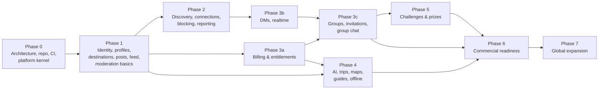

# 09 — Development Backlog and Dependencies

| | |
|---|---|
| **Status** | Draft v1.0 — Phase 0 |
| **Sizing** | T-shirt (S ≤ 2 d, M ≤ 5 d, L ≤ 10 d for one engineer). Re-estimated at each phase kickoff |
| **Item IDs** | `BL-<phase>.<nn>`. Each item lists the requirement IDs it satisfies |

## 1. Phase dependency graph

Cross-cutting rule: **identity, privacy, entitlement and authorization foundations are not deferred.** The entitlement evaluator, the authorization primitives, the audit log and the error and idempotency conventions land in Phase 0.

## 2. Phase 0 — Product and architecture (this delivery)

| ID | Item | Size | Depends | Req | Status |
|---|---|---|---|---|---|
| BL-0.01 | PRD with requirement IDs | M | — | all | ✅ Draft |
| BL-0.02 | System architecture + ADRs | M | — | NFR-* | ✅ Draft |
| BL-0.03 | Screen inventory, IA, UX flows | M | 0.01 | PROF-001, FEED-002 | ✅ Draft |
| BL-0.04 | ERD + retention schedule | L | 0.02 | SAFE-009 | ✅ Draft |
| BL-0.05 | OpenAPI 3.1 contract (all phases, phase-tagged) | L | 0.04 | — | ✅ Draft |
| BL-0.06 | Realtime protocol spec + JSON schemas | M | 0.05 | DM-003..006 | ✅ Draft |
| BL-0.07 | Subscription and entitlement policy | S | 0.01 | BILL-* | ✅ Draft |
| BL-0.08 | Threat model | M | 0.02 | SAFE-*, NFR-006 | ✅ Draft |
| BL-0.09 | Test strategy, infra plan, repo structure | M | 0.02 | NFR-012/013 | ✅ Draft |
| BL-0.10 | Monorepo initialization, tooling, conventions | S | — | NFR-012 | ✅ |
| BL-0.11 | Backend kernel: config, structured logging, request ID, problem+json errors, UUIDv7, signed cursors, feature flags, health/readiness | M | 0.10 | NFR-011 | ✅ |
| BL-0.12 | Authorization primitives (Principal, platform RBAC, policy decision type) | S | 0.11 | — | ✅ |
| BL-0.13 | Entitlement evaluator (pure) + group premium policy | S | 0.07 | BILL-007, GRP-009 | ✅ |
| BL-0.14 | Alembic baseline: extensions + platform tables (outbox, jobs, idempotency, audit) | S | 0.04 | SAFE-007 | ✅ |
| BL-0.15 | Docker Compose dev stack (PostGIS, Redis, MinIO) | S | — | — | ✅ |
| BL-0.16 | CI: lint, type, test (with PostGIS service), import boundaries, contract validation, mobile checks, secret scan | M | 0.10 | NFR-012 | ✅ |
| BL-0.17 | Mobile foundation: Expo + TS strict, router tabs, i18n (5 locales), theme tokens, API client, secure token store | M | 0.03 | I18N-001, OFF-003 | ✅ |
| BL-0.18 | Requirement traceability script | S | 0.01 | — | ✅ |
| BL-0.19 | Terraform module layout (cloud-neutral) | S | 0.02 | — | ✅ Layout documented. No resources until a cloud is chosen (Q-8) |
| BL-0.21 | Supabase as database: pooler/SSL support, Data API lockdown re-applied after every migration, extensions schema, remote-DB guard for tests (ADR-0018) | S | 0.14 | NFR-006 | ✅ Done. Migrations 0001–0002 applied to Supabase, lockdown verified, Data API disabled |
| BL-0.22 | Backend hosting (ADR-0019): Vercel serverless entry point (staging API) plus Render blueprint and `$PORT`-aware image (ready). Optional Redis. Supabase Auth as trusted issuer | S | 0.21 | — | ✅ Live: https://travel-buddy-api-jet.vercel.app (staging) |
| BL-0.20 | Move `mobile/` → `apps/mobile` into the npm workspace (ADR-0009). Consume shared `packages/*` (i18n resources, generated API client, domain types). Coordinate with the web workstream so the root lockfile isn't installed concurrently | M | 0.17, web | I18N-001 | ⏳ Planned |

Web-workstream items (Next.js app, BFF, web admin) are tracked by the web workstream in [docs/web](web/01-architecture.md). Backend work they depend on is listed in the phase tables below (BL-1.02, BL-3.01, BL-3.04, BL-3.14).

## 3. Phase 1 — Identity and local social feed

| ID | Item | Size | Depends | Req | Status |
|---|---|---|---|---|---|
| BL-1.01 | IdP port + OIDC verifier (JWKS cache, alg pinning) + DevIdentityProvider | M | 0.11 | AUTH-001..003, T-AUTH-01/08 | ✅ Done. Production IdP: Supabase Auth (ADR-0020), trusted in staging. `aal2` → `mfa`; `email_verified` only from the access token hook (migration 0003) |
| BL-1.02 | Platform sessions: access JWT, refresh rotation, reuse detection (30 s leeway, ADR-0011), `client` ∈ ios/android/web, session list/revoke | M | 1.01 | AUTH-006, AUTH-007 | ✅ Done |
| BL-1.03 | Registration with age gate, consent records, email-verified gate | M | 1.02 | AUTH-004, AUTH-008, AUTH-009 | ✅ Done. Email-verified gate enforced on posting (`403 email_unverified`) |
| BL-1.04 | Profiles, preferences, privacy settings (defaults per ERD) | M | 1.03 | PROF-001..007 | ✅ Done: `PATCH /v1/users/me` (handle uniqueness, reserved names, once-per-30-days change), onboarding completion, preferences and privacy GET/PATCH, consent ledger GET/POST mirrored into privacy settings, outbox events (`profile.updated`, `privacy.updated`, `discovery.disabled`, `user.onboarding_completed`). Avatar needs BL-1.08; social counters BL-1.11 |
| BL-1.05 | Destinations: schema, hierarchy, localization, seed loader (10 launch cities with boundaries) | L | 0.14 | DEST-001, DEST-002, DEST-005, LOC-006 | ✅ Done: hierarchy (path arrays, sibling-unique segments), 5-locale names/taglines/alt names, directory with stable `sort=slug` cursors, featured, lookup by path, children, idempotent seed loader (`python -m app.modules.destinations.seeding`) with the 35 web-aligned launch destinations. Boundaries are **approximate bounding boxes** until a licensed source is chosen (open decision) |
| BL-1.06 | Destination search (trigram + unaccent) | S | 1.05 | DEST-001 | ✅ Done: trigram + f_unaccent over localized and alternative names, typo-tolerant (DEST-001) |
| BL-1.07 | Point → destination resolution, browse-destination selection | S | 1.05 | LOC-002, LOC-003, LOC-005, LOC-007, LOC-008 | ✅ Done: `GET /v1/destinations/resolve` (ST_Covers, ~110 m rounding, never stored); browse destination GET/PUT/DELETE (in `Me.browse_destination`, localized in the user's UI language); upcoming destinations (dates, 20 max, sharing requires discovery consent) |
| BL-1.08 | Media pipeline: presign, finalize, worker (type sniff, scan port, EXIF strip, variants) | L | 0.14 | POST-004, SAFE-004, T-MED-* |
| BL-1.09 | Job queue + outbox relay + scheduler (leader lock) | M | 0.14 | — | ✅ Done: Postgres queue (SKIP LOCKED claiming, DB-clock scheduling, 15 s→15 min backoff, dead-letter, crash recovery, dedupe keys), outbox relay with event subscriptions, `python -m app.worker`, cron-secured `/internal/jobs/tick`, optional after-response tick for serverless. Periodic scheduling landed with BL-1.18 (`periodic_tasks`, atomic claim instead of a leader lock) |
| BL-1.10 | Posts CRUD with destination ancestor fan-out, visibility, tags | L | 1.05, 1.08 | POST-001..003, POST-007..009, POST-011 | 🟡 Partial: create (stored-response idempotency, verified-email gate, per-kind rules), get, edit (marks edited, re-fans), delete (tombstone, out of every feed), user post list; ancestor fan-out with denormalized visibility; private accounts handled by a job; web cache events. Media kinds need BL-1.08; places and trips later |
| BL-1.11 | Reactions, comments, bookmarks, follows (+ requests for private accounts), shares | M | 1.10 | POST-005, POST-006 | ✅ Done: reactions (one per user, changeable, by-type counts), comments (one reply level, idempotent create, tombstones, post-author moderation), bookmarks, share links (public posts only), follows with requests for private accounts (auto-approved on going public). Guest mode `GET /v1/public/posts[/{id}]` (public + approved + public accounts, 3-page cap) |
| BL-1.12 | Blocking (bidirectional effects) | M | 1.11 | SAFE-001 | ✅ Done: `user_blocks`; block/unblock/list; follows removed in the same transaction (composition-root hook); posts, profiles' post lists, comments, reactions, follower lists and follow attempts hidden both ways (404, nothing revealed). Feed, messaging and discovery use `trust_safety.service.blocked_ids` as they land |
| BL-1.13 | Feed: candidate generation, deterministic ranker, diversification, Redis snapshot, fallback chain, filters, tabs | L | 1.10, 1.12 | FEED-001..007, FEED-020, FEED-022 | ✅ Done: FEED-001 chain (gps → selected → upcoming → interests → global), tabs (for you, nearby, following, destinations), filters (destination, country, category, tag, language, sort, saved destinations), candidates via social (visibility, moderation, blocks, hidden posts in SQL), pure v1 ranker with versioned weights, author cap 2 per 20 + near-duplicate suppression, 15-min snapshots with `reset`, negative feedback. Snapshots in PostgreSQL (`feed_sessions`) instead of Redis so serverless works; Redis store later for scale |
| BL-1.14 | Reports + moderation queue + moderation actions + audit | M | 1.10 | SAFE-002, SAFE-003, SAFE-007, ADM-002 | ✅ Done: `POST /v1/reports` for posts, comments and users (evidence snapshot only when the reporter can see the target, one open report per reporter and target, optional block), queue ordered by severity priority then age, assign, resolve with an atomic action, idempotent moderation actions (remove/restore/limit content, suspend/ban/reinstate, warn/restrict recorded), staff user view with report and action counts. Removed posts disappear from feeds, destination pages and the web cache (`post.moderated`). Message, group, challenge and media targets arrive with their modules |
| BL-1.15 | Rate limiting middleware (Redis sliding window) + idempotency middleware | M | 0.11 | SAFE-005, NFR-006 | ✅ Done: stored-response idempotency (same-transaction claim, 24 h) on creating POSTs that declare it; rate limiting per docs/05 §5 with every contract class and bucket, sliding-window counter in Redis or PostgreSQL (UNLOGGED, for serverless) or memory (development), fail-open/closed per class, `RateLimit-*` headers and `429` with `Retry-After`, per-IdP-subject and per-session auth limits, trusted BFF client-IP forwarding (ADR-0021). The 7-day half limits for new accounts land with the contact, message and media modules |
| BL-1.16 | In-app notifications (center only) | S | 1.09 | NOTIF-001 | ✅ Done: list (cursor, `unread_only`), unread count, mark read by IDs or all; created from outbox events by a job (follow requests, new followers, reactions, comments, moderation notices), deduplicated per recipient (redelivery and react/un-react/react notify once), skipped for own activity, muted types (`in_app: false`) and blocked actors; blocked actors' existing notifications are hidden; title and body rendered at read time in `Accept-Language` or the user's UI locale (en, es, pt-BR, fr, de). Connections, messages, groups, challenges, billing, AI and exports notify when those modules land |
| BL-1.17 | Account deletion saga (grace period) | M | 1.03 | AUTH-010 | ✅ Done: `POST /v1/users/me/deletion` (idempotent, `sensitive` limit, signs out other devices, `DataSubjectRequest` with `scheduled_for`), `DELETE` cancels, signing in during the grace cancels; an hourly periodic job erases due accounts by deleting the `users` row (every module's data cascades; reports, moderation history and audit entries keep bare IDs), records `user.deleted` (web cache purge) and enqueues a retryable Supabase Auth Admin deletion (`SUPABASE_SECRET_KEY`); the `data_subject_requests` record outlives the account. Content stays visible during the grace period (hiding it is a product follow-up); messaging and billing pseudonymization join the saga with those modules |
| BL-1.18 | Retention jobs (sessions, notifications, idempotency, outbox, jobs) | S | 1.09 | SAFE-009 | ✅ Done: daily per-module purges scheduled through `periodic_tasks` (atomic claim per interval, no leader election needed; runs from workers, the cron tick or after-response ticks): sessions 90 d after revocation/expiry and `last_ip` nulled after 30 d, notifications 90 d, feed feedback 180 d and stale snapshots, idempotency keys past expiry, published outbox 7 d, succeeded jobs 7 d / dead 30 d, rate-limit counters, resolved reports 12 months, moderation actions 3 years (restrictions in force kept), user-deleted posts and comments hard-deleted after 30 d (comments with live replies kept). Batched `ctid` deletes in short transactions. Audit-log partition drops, discovery sessions, AI and billing rules land with their tables |
| BL-1.19 | Mobile: auth + onboarding flow | L | 1.03, 0.17 | PROF-001, PROF-002 | 🟡 Partial: Supabase email/password sign-in and sign-up (publishable key only, ADR-0020), dev-IdP sign-in for local builds, token exchange, age gate + consents registration, session restore from secure storage, profile display-name edit, sign-out. Verified on an Android emulator against the local backend and staging. Pending: Google/Apple (needs credentials), onboarding steps, transparent access-token refresh |
| BL-1.20 | Mobile: feed tabs, filters, post detail, composer with location precision | L | 1.13 | FEED-002/003, POST-002 |
| BL-1.21 | Mobile: profile, settings, privacy center, block/report flows | M | 1.04, 1.12, 1.14 | PROF-007, SAFE-001/002 |
| BL-1.22 | Admin web: minimal moderation console (queue, review, actions) | M | 1.14 | ADM-001..003 |
| BL-1.23 | Seed editorial content for launch destinations | M | 1.10 | FEED-001 |
| BL-1.24 | E2E: registration → location-based feed | S | 1.19, 1.20 | PROF-002, FEED-001 |
| BL-1.25 | Web cache revalidation: outbox consumer + signed `webCacheRevalidation` webhook (retries, secret rotation). Settings `WEB_REVALIDATE_URL`, `WEB_REVALIDATE_SECRET`. The web receiver is already live and verified (accepts `current,previous` secrets) | S | 1.09 | SAFE-012 | ✅ Done (code): `profile.updated`/`privacy.updated` → signed webhook (`X-TB-Signature`, event_id = outbox ID, 4xx permanent, 5xx/429 retried). To enable on staging: `WEB_REVALIDATE_URL`/`WEB_REVALIDATE_SECRET` on the API, the same secret in the web's `WEB_REVALIDATE_SECRETS`, and `JOBS_INLINE_AFTER_RESPONSE=true` + `CRON_SECRET` |
| BL-1.26 | Staff hardening on `/v1/admin/*`: MFA (`amr`) check, idle/absolute session limits, `X-Audit-Justification` dependency → audit log | S | 1.02, 1.14 | ADM-007, ADM-008, ADM-009 | ✅ Done: MFA enforced in `authorize_platform` (`403 mfa_required`, Supabase `aal2`; dev IdP `mfa: true`); `admin.deps.staff()` checks 30 min idle / 12 h absolute staff session limits (`401 reauthentication_required`) and requires `X-Audit-Justification` (10–500 chars, `400 justification_required`) on sensitive routes; the justification is stored in the audit log |
| BL-1.27 | Search-indexing consent: privacy setting, `indexable` on public profile/posts, sitemap filter | S | 1.04, 1.10 | PROF-008 |
| BL-1.28 | `MyAccount.restrictions` derived from active moderation actions | S | 1.14 | SAFE-013 | ✅ Done: `restrict` actions carry a `restriction_kind` (contract + migration 0014; required for and only for `restrict`), `Me.account.restrictions` lists active ones (not expired, not lifted by a later `reinstate`, longest per kind, `appealable: true` via support), `posting_limited` and `commenting_limited` are enforced with `403 account_restricted` (new contract code), and the user gets a moderation notice. Messaging, connection, discovery and media limits are enforced when those modules land |
| BL-1.29 | Tech debt: rename legacy check constraints whose names the naming convention doubled (`ck_<t>__ck_<t>__…`, migrations 0001–0013); new migrations pass `op.f(name)` | S | — | — |

## 4. Phase 2 — Travel companions

| ID | Item | Size | Depends | Req |
|---|---|---|---|---|
| BL-2.01 | Discovery consent + privacy settings UI and API | S | 1.04 | DISC-001, DISC-010 |
| BL-2.02 | Discovery sessions (start/stop, TTL, invisible mode, GPS → destination resolution and discard) | M | 1.07 | DISC-002, DISC-003, DISC-006, LOC-009 |
| BL-2.03 | Discover endpoint: matching score (interests, dates, languages, styles), block filtering, randomization within bands | M | 2.02, 1.12 | DISC-004, DISC-005, DISC-007, DISC-008 |
| BL-2.04 | Connection state machine + requests API + inbox | M | 1.04 | CONN-001..003, CONN-006..008 |
| BL-2.05 | Request policies, rate limits, new-account restrictions | S | 2.04, 1.15 | CONN-004, CONN-005, SAFE-006 |
| BL-2.06 | Block integration with connections and discovery | S | 2.04 | CONN-009 |
| BL-2.07 | Anti-enumeration limits + abuse signals | S | 2.03 | DISC-009, SAFE-011 |
| BL-2.08 | Mobile: Companions tab (discover, requests inbox, profile preview, safety guidance) | L | 2.03, 2.04 | DISC-*, SAFE-008 |
| BL-2.09 | Security tests: location enumeration, trilateration impossibility, block leakage | M | 2.03 | T-LOC-01..04 |
| BL-2.10 | DPIA for discovery (EU) | M | 2.03 | SAFE-010 |
| BL-2.11 | E2E: discovery → accepted connection | S | 2.08 | CONN-002 |

## 5. Phase 3 — Messaging, billing, groups

| ID | Item | Size | Depends | Req |
|---|---|---|---|---|
| BL-3.01 | Billing module: products, Apple + Google adapters (verify, server notifications), DevBillingProvider | L | 0.13 | BILL-001..006 |
| BL-3.02 | Entitlement materialization + Redis cache + entitlements endpoint | M | 3.01 | BILL-007 |
| BL-3.03 | Conversations + messages persistence (seq, idempotency), REST endpoints | L | 2.04 | DM-001, DM-004, DM-005, DM-010, DM-011 |
| BL-3.04 | Realtime gateway: auth frame, fanout via Redis, acks, sync, typing, receipts | L | 3.03, 1.09 | DM-003, DM-006..008 |
| BL-3.05 | Private media for message attachments (signed URLs) | S | 1.08, 3.03 | DM-002 |
| BL-3.06 | Push notifications (device registration, provider port, preferences, quiet hours) | M | 1.16 | DM-009, NOTIF-002..004 |
| BL-3.07 | Groups: create (entitlement), roles, settings, capacity, owned-group cap | M | 3.02 | GRP-001..004, GRP-007, GRP-012, GRP-013 |
| BL-3.08 | Invitations: direct + link (hashed tokens, max uses, expiry, revoke), redemption | M | 3.07 | GRP-005, GRP-008, T-GRP-01/02 |
| BL-3.09 | Group chat: announcements, threads, pins, mentions, moderation (remove, restrict), history policy | L | 3.03, 3.07 | GCHAT-001..007 |
| BL-3.10 | Owner lapse handling, admin grace, ownership transfer | M | 3.02, 3.07 | GRP-009..011, BILL-008 |
| BL-3.11 | Mobile: messages tab, DM screen, group chat, group management, paywall + purchase flow | L | 3.03..3.10 | DM-*, GRP-*, BILL-002/004 |
| BL-3.12 | Security tests: IDOR on messages, cross-group leakage, subscription bypass, invitation reuse | M | 3.09 | T-AZ-*, T-BILL-*, T-GRP-* |
| BL-3.13 | E2E: connection → DM, premium purchase (sandbox) → group, invitation → group chat | M | 3.11 | — |
| BL-3.14 | Stripe adapter for web: checkout and portal sessions, signed webhooks, `billing_customers` (ADR-0012) | M | 3.01 | BILL-002..006 |
| BL-3.15 | Realtime tickets for browsers + Origin allow-list (ADR-0013) | S | 3.04 | DM-003 |
| BL-3.16 | Web Push adapter (VAPID keys, encrypted endpoints, 404/410 pruning), `webpush` device registration | S | 3.06 | NOTIF-005 |

## 6. Phase 4 — AI travel guidance

| ID | Item | Size | Depends | Req |
|---|---|---|---|---|
| BL-4.01 | Places ingestion from licensed provider (adapter) + freshness | L | 1.05 | DEST-003 |
| BL-4.02 | AI provider port, adapters, telemetry, quotas, circuit breaker | M | 3.02 | AI-001, AI-009 |
| BL-4.03 | Itinerary generation (grounded candidates, schema, semantic validation, repair) | L | 4.01, 4.02 | AI-002..004, AI-007, AI-008 |
| BL-4.04 | Trips, days, items, saved places, collaborators, offline sync protocol | L | 1.05 | TRIP-001..005 |
| BL-4.05 | Replanning (premium) | M | 4.03, 4.04 | AI-005 |
| BL-4.06 | Maps integration (MapLibre, tiles provider, routing port) | L | 4.01 | GUIDE-001..003 |
| BL-4.07 | Guides + audio tours content model, admin authoring, purchase grants | L | 3.02 | GUIDE-004, GUIDE-005, BILL-001 |
| BL-4.08 | Offline packages: build pipeline, signed manifests, licensing, quota | L | 4.06, 4.07 | OFF-001, OFF-004, OFF-005 |
| BL-4.09 | Mobile: Explore tab, AI planner, trip editor, map, guide reader, audio player with geofences, downloads manager | XL | 4.03..4.08 | OFF-002 |
| BL-4.10 | Post translation (labelled) | M | 4.02 | POST-010, I18N-006 |
| BL-4.11 | E2E: offline download → airplane mode → playback | S | 4.09 | OFF-002 |

## 7. Phase 5 — Interactive community activities

| ID | Item | Size | Depends | Req |
|---|---|---|---|---|
| BL-5.01 | Challenge model, config validation, lifecycle + scheduler activation | M | 3.07 | CHAL-001..003 |
| BL-5.02 | Answer normalization + exact/multi-answer evaluation | S | 5.01 | CHAL-006 |
| BL-5.03 | Submissions: attempts, cooldown, transactional winner determination | M | 5.02 | CHAL-005, CHAL-009, CHAL-010 |
| BL-5.04 | Team mode (teams, captain, shared thread) | M | 5.03, 3.09 | CHAL-004 |
| BL-5.05 | Admin review + AI-assisted judging (never final for real rewards) | M | 5.03, 4.02 | CHAL-006, CHAL-007 |
| BL-5.06 | Rewards, review gate, fulfillment state machine, badges | M | 5.03 | CHAL-012..015 |
| BL-5.07 | Results publication, disputes | S | 5.06 | CHAL-011, CHAL-016 |
| BL-5.08 | Mobile: challenge screens (create, solve, team thread, results) | L | 5.01..5.07 | — |
| BL-5.09 | Security tests: answer leakage, brute force, race on first-correct | M | 5.03 | T-CHAL-* |

## 8. Phase 6 — Commercial readiness

| ID | Item | Size | Req |
|---|---|---|---|
| BL-6.01 | Subscription lifecycle hardening, refunds, restore, sandbox → production | M | BILL-* |
| BL-6.02 | Admin dashboards (moderation SLAs, ops), subscription config, promo grants | L | ADM-004..006, BILL-009 |
| BL-6.03 | Data export and DSR tooling | M | AUTH-011, SAFE-010 |
| BL-6.04 | Load and soak tests, chaos drills (Redis loss, realtime node loss) | M | NFR-001..005 |
| BL-6.05 | Privacy review, DPIA sign-off, records of processing, policies | M | SAFE-010 |
| BL-6.06 | App Store / Play readiness (UGC policies, account deletion in-app, privacy labels, data safety form) | M | — |
| BL-6.07 | Penetration test + remediation | M | NFR-006 |
| BL-6.09 | Supabase production readiness: upgrade to Pro, PITR add-on (NFR-004), decide region (EU project if needed), connection headroom (compute/IPv4 add-on), disable Data API, rotate DB password into the secret manager (ADR-0018). Auth (ADR-0020): CAPTCHA, leaked-password protection, custom SMTP, Auth rate limits raised for BFF egress (shared Vercel IPs), Auth Admin API deletion in the BL-1.17 saga | S | NFR-003/004, SAFE-010, T-AUTH-11 |
| BL-6.08 | Destination launch operations playbook | S | — |

## 9. Phase 7 — Global expansion (themes)

More destinations and languages · additional audio tours · ML ranking behind A/B (FEED-021) · partner integrations · preference learning (AI-010) · expanded challenge types (CHAL-017) · public groups.

## 10. Immediate next steps (Phase 1 kickoff, needs approval)

1. ~~Decide Q-1 (IdP vendor)~~: Supabase Auth (ADR-0020). Remaining dashboard steps are listed in the backend README.
2. Choose the boundary data source for the launch destinations (BL-1.05).
3. Start BL-1.01, BL-1.05 and BL-1.09 in parallel. They share no dependencies.
