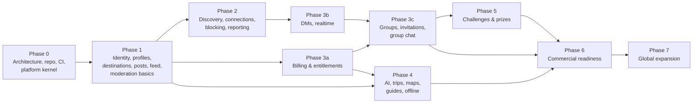

# 09 — Development Backlog and Dependencies

| | |
|---|---|
| **Status** | Draft v1.0 — Phase 0 |
| **Sizing** | T-shirt (S ≤ 2 d, M ≤ 5 d, L ≤ 10 d for one engineer). Re-estimated at each phase kickoff |
| **Item IDs** | `BL-<phase>.<nn>`. Each item lists the requirement IDs it satisfies |

## 1. Phase dependency graph

Cross-cutting rule: **identity, privacy, entitlement and authorization foundations are not deferred.** The entitlement evaluator, the authorization primitives, the audit log and the error and idempotency conventions land in Phase 0.

## 2. Phase 0 — Product and architecture (this delivery)

| ID | Item | Size | Depends | Req | Status |
|---|---|---|---|---|---|
| BL-0.01 | PRD with requirement IDs | M | — | all | ✅ Draft |
| BL-0.02 | System architecture + ADRs | M | — | NFR-* | ✅ Draft |
| BL-0.03 | Screen inventory, IA, UX flows | M | 0.01 | PROF-001, FEED-002 | ✅ Draft |
| BL-0.04 | ERD + retention schedule | L | 0.02 | SAFE-009 | ✅ Draft |
| BL-0.05 | OpenAPI 3.1 contract (all phases, phase-tagged) | L | 0.04 | — | ✅ Draft |
| BL-0.06 | Realtime protocol spec + JSON schemas | M | 0.05 | DM-003..006 | ✅ Draft |
| BL-0.07 | Subscription and entitlement policy | S | 0.01 | BILL-* | ✅ Draft |
| BL-0.08 | Threat model | M | 0.02 | SAFE-*, NFR-006 | ✅ Draft |
| BL-0.09 | Test strategy, infra plan, repo structure | M | 0.02 | NFR-012/013 | ✅ Draft |
| BL-0.10 | Monorepo initialization, tooling, conventions | S | — | NFR-012 | ✅ |
| BL-0.11 | Backend kernel: config, structured logging, request ID, problem+json errors, UUIDv7, signed cursors, feature flags, health/readiness | M | 0.10 | NFR-011 | ✅ |
| BL-0.12 | Authorization primitives (Principal, platform RBAC, policy decision type) | S | 0.11 | — | ✅ |
| BL-0.13 | Entitlement evaluator (pure) + group premium policy | S | 0.07 | BILL-007, GRP-009 | ✅ |
| BL-0.14 | Alembic baseline: extensions + platform tables (outbox, jobs, idempotency, audit) | S | 0.04 | SAFE-007 | ✅ |
| BL-0.15 | Docker Compose dev stack (PostGIS, Redis, MinIO) | S | — | — | ✅ |
| BL-0.16 | CI: lint, type, test (with PostGIS service), import boundaries, contract validation, mobile checks, secret scan | M | 0.10 | NFR-012 | ✅ |
| BL-0.17 | Mobile foundation: Expo + TS strict, router tabs, i18n (5 locales), theme tokens, API client, secure token store | M | 0.03 | I18N-001, OFF-003 | ✅ |
| BL-0.18 | Requirement traceability script | S | 0.01 | — | ✅ |
| BL-0.19 | Terraform module layout (cloud-neutral) | S | 0.02 | — | ✅ Layout documented. No resources until a cloud is chosen (Q-8) |
| BL-0.21 | Supabase as database: pooler/SSL support, Data API lockdown re-applied after every migration, extensions schema, remote-DB guard for tests (ADR-0018) | S | 0.14 | NFR-006 | ✅ Done. Migrations 0001–0002 applied to Supabase, lockdown verified, Data API disabled |
| BL-0.22 | Backend hosting (ADR-0019): Vercel serverless entry point (staging API) plus Render blueprint and `$PORT`-aware image (ready). Optional Redis. Supabase Auth as trusted issuer | S | 0.21 | — | ✅ Live: https://travel-buddy-api-jet.vercel.app (staging) |
| BL-0.20 | Move `mobile/` → `apps/mobile` into the npm workspace (ADR-0009). Consume shared `packages/*` (i18n resources, generated API client, domain types). Coordinate with the web workstream so the root lockfile isn't installed concurrently | M | 0.17, web | I18N-001 | ⏳ Planned |

Web-workstream items (Next.js app, BFF, web admin) are tracked by the web workstream in [docs/web](web/01-architecture.md). Backend work they depend on is listed in the phase tables below (BL-1.02, BL-3.01, BL-3.04, BL-3.14).

## 3. Phase 1 — Identity and local social feed

| ID | Item | Size | Depends | Req | Status |
|---|---|---|---|---|---|
| BL-1.01 | IdP port + OIDC verifier (JWKS cache, alg pinning) + DevIdentityProvider | M | 0.11 | AUTH-001..003, T-AUTH-01/08 | ✅ Done. Production IdP: Supabase Auth (ADR-0020), trusted in staging. `aal2` → `mfa`; `email_verified` only from the access token hook (migration 0003) |
| BL-1.02 | Platform sessions: access JWT, refresh rotation, reuse detection (30 s leeway, ADR-0011), `client` ∈ ios/android/web, session list/revoke | M | 1.01 | AUTH-006, AUTH-007 | ✅ Done |
| BL-1.03 | Registration with age gate, consent records, email-verified gate | M | 1.02 | AUTH-004, AUTH-008, AUTH-009 | ✅ Done. Email-verified gate enforced on posting (`403 email_unverified`) |
| BL-1.04 | Profiles, preferences, privacy settings (defaults per ERD) | M | 1.03 | PROF-001..007 | ✅ Done: `PATCH /v1/users/me` (handle uniqueness, reserved names, once-per-30-days change), onboarding completion, preferences and privacy GET/PATCH, consent ledger GET/POST mirrored into privacy settings, outbox events (`profile.updated`, `privacy.updated`, `discovery.disabled`, `user.onboarding_completed`). Avatar needs BL-1.08; social counters BL-1.11 |
| BL-1.05 | Destinations: schema, hierarchy, localization, seed loader (10 launch cities with boundaries) | L | 0.14 | DEST-001, DEST-002, DEST-005, LOC-006 | ✅ Done: hierarchy (path arrays, sibling-unique segments), 5-locale names/taglines/alt names, directory with stable `sort=slug` cursors, featured, lookup by path, children, idempotent seed loader (`python -m app.modules.destinations.seeding`) with the 35 web-aligned launch destinations. Boundaries are **approximate bounding boxes** until a licensed source is chosen (open decision) |
| BL-1.06 | Destination search (trigram + unaccent) | S | 1.05 | DEST-001 | ✅ Done: trigram + f_unaccent over localized and alternative names, typo-tolerant (DEST-001) |
| BL-1.07 | Point → destination resolution, browse-destination selection | S | 1.05 | LOC-002, LOC-003, LOC-005, LOC-007, LOC-008 | ✅ Done: `GET /v1/destinations/resolve` (ST_Covers, ~110 m rounding, never stored); browse destination GET/PUT/DELETE (in `Me.browse_destination`, localized in the user's UI language); upcoming destinations (dates, 20 max, sharing requires discovery consent) |
| BL-1.08 | Media pipeline: presign, finalize, worker (type sniff, scan port, EXIF strip, variants) | L | 0.14 | POST-004, SAFE-004, T-MED-* | ✅ Done for photos (ADR-0022): `POST /v1/media/uploads` (idempotent, per-purpose types and sizes, presigned PUT signing type and length, pending-upload cap), `GET /v1/media/{id}`, `POST /v1/media/{id}/finalize`; `media.process` job verifies size, SHA-256 and magic bytes, runs the scanner port, re-encodes to EXIF/GPS-free WebP variants (orientation applied, bomb-limited) in the public bucket; S3-compatible storage with own SigV4, in-process store for dev/test; account erasure deletes stored objects; abandoned/rejected uploads purged. Photos attach to posts (`media_ids`, own uploaded post media, order kept, placeholder until ready; hard-deleted posts erase their stored photos); avatars via `PATCH /v1/users/me {avatar_media_id}` shown on every `UserSummary`, `MyProfile` and `PublicProfile` (a replaced avatar is erased). Before launch: real malware scanner + CSAM hash matching (SAFE-004); HEIC decoding and video transcoding |
| BL-1.09 | Job queue + outbox relay + scheduler (leader lock) | M | 0.14 | — | ✅ Done: Postgres queue (SKIP LOCKED claiming, DB-clock scheduling, 15 s→15 min backoff, dead-letter, crash recovery, dedupe keys), outbox relay with event subscriptions, `python -m app.worker`, cron-secured `/internal/jobs/tick`, optional after-response tick for serverless. Periodic scheduling landed with BL-1.18 (`periodic_tasks`, atomic claim instead of a leader lock) |
| BL-1.10 | Posts CRUD with destination ancestor fan-out, visibility, tags | L | 1.05, 1.08 | POST-001..003, POST-007..009, POST-011 | ✅ Done: create (stored-response idempotency, verified-email gate, per-kind rules), get, edit (marks edited, re-fans), delete (tombstone, out of every feed), user post list; ancestor fan-out with denormalized visibility; private accounts handled by a job; web cache events; photo posts with up to 10 uploaded images (BL-1.08). Places and trips arrive in Phase 4 |
| BL-1.11 | Reactions, comments, bookmarks, follows (+ requests for private accounts), shares | M | 1.10 | POST-005, POST-006 | ✅ Done: reactions (one per user, changeable, by-type counts), comments (one reply level, idempotent create, tombstones, post-author moderation), bookmarks, share links (public posts only), follows with requests for private accounts (auto-approved on going public). Guest mode `GET /v1/public/posts[/{id}]` (public + approved + public accounts, 3-page cap) |
| BL-1.12 | Blocking (bidirectional effects) | M | 1.11 | SAFE-001 | ✅ Done: `user_blocks`; block/unblock/list; follows removed in the same transaction (composition-root hook); posts, profiles' post lists, comments, reactions, follower lists and follow attempts hidden both ways (404, nothing revealed). Feed, messaging and discovery use `trust_safety.service.blocked_ids` as they land |
| BL-1.13 | Feed: candidate generation, deterministic ranker, diversification, Redis snapshot, fallback chain, filters, tabs | L | 1.10, 1.12 | FEED-001..007, FEED-020, FEED-022 | ✅ Done: FEED-001 chain (gps → selected → upcoming → interests → global), tabs (for you, nearby, following, destinations), filters (destination, country, category, tag, language, sort, saved destinations), candidates via social (visibility, moderation, blocks, hidden posts in SQL), pure v1 ranker with versioned weights, author cap 2 per 20 + near-duplicate suppression, 15-min snapshots with `reset`, negative feedback. Snapshots in PostgreSQL (`feed_sessions`) instead of Redis so serverless works; Redis store later for scale |
| BL-1.14 | Reports + moderation queue + moderation actions + audit | M | 1.10 | SAFE-002, SAFE-003, SAFE-007, ADM-002 | ✅ Done: `POST /v1/reports` for posts, comments and users (evidence snapshot only when the reporter can see the target, one open report per reporter and target, optional block), queue ordered by severity priority then age, assign, resolve with an atomic action, idempotent moderation actions (remove/restore/limit content, suspend/ban/reinstate, warn/restrict recorded), staff user view with report and action counts. Removed posts disappear from feeds, destination pages and the web cache (`post.moderated`). Message, group, challenge and media targets arrive with their modules |
| BL-1.15 | Rate limiting middleware (Redis sliding window) + idempotency middleware | M | 0.11 | SAFE-005, NFR-006 | ✅ Done: stored-response idempotency (same-transaction claim, 24 h) on creating POSTs that declare it; rate limiting per docs/05 §5 with every contract class and bucket, sliding-window counter in Redis or PostgreSQL (UNLOGGED, for serverless) or memory (development), fail-open/closed per class, `RateLimit-*` headers and `429` with `Retry-After`, per-IdP-subject and per-session auth limits, trusted BFF client-IP forwarding (ADR-0021). The 7-day half limits for new accounts land with the contact, message and media modules |
| BL-1.16 | In-app notifications (center only) | S | 1.09 | NOTIF-001 | ✅ Done: list (cursor, `unread_only`), unread count, mark read by IDs or all; created from outbox events by a job (follow requests, new followers, reactions, comments, moderation notices), deduplicated per recipient (redelivery and react/un-react/react notify once), skipped for own activity, muted types (`in_app: false`) and blocked actors; blocked actors' existing notifications are hidden; title and body rendered at read time in `Accept-Language` or the user's UI locale (en, es, pt-BR, fr, de). Connections, messages, groups, challenges, billing, AI and exports notify when those modules land |
| BL-1.17 | Account deletion saga (grace period) | M | 1.03 | AUTH-010 | ✅ Done: `POST /v1/users/me/deletion` (idempotent, `sensitive` limit, signs out other devices, `DataSubjectRequest` with `scheduled_for`), `DELETE` cancels, signing in during the grace cancels; an hourly periodic job erases due accounts by deleting the `users` row (every module's data cascades; reports, moderation history and audit entries keep bare IDs), records `user.deleted` (web cache purge) and enqueues a retryable Supabase Auth Admin deletion (`SUPABASE_SECRET_KEY`); the `data_subject_requests` record outlives the account. Content stays visible during the grace period (hiding it is a product follow-up); messaging and billing pseudonymization join the saga with those modules |
| BL-1.18 | Retention jobs (sessions, notifications, idempotency, outbox, jobs) | S | 1.09 | SAFE-009 | ✅ Done: daily per-module purges scheduled through `periodic_tasks` (atomic claim per interval, no leader election needed; runs from workers, the cron tick or after-response ticks): sessions 90 d after revocation/expiry and `last_ip` nulled after 30 d, notifications 90 d, feed feedback 180 d and stale snapshots, idempotency keys past expiry, published outbox 7 d, succeeded jobs 7 d / dead 30 d, rate-limit counters, resolved reports 12 months, moderation actions 3 years (restrictions in force kept), user-deleted posts and comments hard-deleted after 30 d (comments with live replies kept). Batched `ctid` deletes in short transactions. Audit-log partition drops, discovery sessions, AI and billing rules land with their tables |
| BL-1.19 | Mobile: auth + onboarding flow | L | 1.03, 0.17 | PROF-001, PROF-002 | ✅ Done: sign-in (Supabase or development IdP), registration with age gate and legal versions, transparent token refresh, onboarding wizard (display name, app language applied immediately, interests, browse destination; optional steps skippable) that lands on the feed (PROF-002); returning users go straight to the feed. Location permission and traveler discovery steps arrive with Nearby and Phase 2 discovery |
| BL-1.20 | Mobile: feed tabs, filters, post detail, composer with location precision | L | 1.13 | FEED-002/003, POST-002 | 🟡 Mostly done: Home feed (For you / Nearby / Following, server fallback context, story-type filter, infinite scroll, pull to refresh, snapshot reset handling, guest mode with public stories); Nearby asks for location only when opened, coarse-only permission (fine and background blocked on Android), position rounded to ~1 km before it leaves the device, uncovered areas explained; post cards with optimistic likes; post detail with comments; composer for text stories with destination search and audience; transparent token refresh. Remaining: photo picker and upload in the composer (backend ready; storage not configured on staging) |
| BL-1.21 | Mobile: profile, settings, privacy center, block/report flows | M | 1.04, 1.12, 1.14 | PROF-007, SAFE-001/002 | ✅ Done: profile tab (avatar, bio, pending-deletion banner with keep-my-account, active restrictions with expiry, unread notifications), edit profile, privacy (private account, opt-in search indexing with the private-account caveat), blocked accounts with unblock, delete account (explicit confirmation, idempotent, 30-day grace), notification center (marks read, opens the story or profile), other travellers' profiles (follow/requested, report, block; private accounts withheld), report flow (12 reasons, details, block in the same step, urgent-help guidance) from posts and profiles |
| BL-1.22 | Admin web: minimal moderation console (queue, review, actions) | M | 1.14 | ADM-001..003 |
| BL-1.23 | Seed editorial content for launch destinations | M | 1.10 | FEED-001 | ✅ Done: `python -m app.modules.social.seeding` creates the Travel Buddy Editors system account (reserved handle `travelbuddy`, no sign-in identity, indexing on) and 36 evergreen posts across the 15 launch cities and 6 neighbourhoods (no prices, hours or safety claims), idempotently (deterministic IDs). Seeded on staging; new users see it through the feed's destination and global fallbacks |
| BL-1.24 | E2E: registration → location-based feed | S | 1.19, 1.20 | PROF-002, FEED-001 | ✅ Done (API level): `tests/integration/test_e2e_journey.py` registers, onboards (name, language, interests, browse destination), completes onboarding and gets the localized Lisbon feed (`selected`, neighbourhood stories included), reacts, and with PostGIS switches to the device's city on Nearby; the mobile screens for the same journey are covered by component tests. A device-driven E2E (Maestro) comes with release automation |
| BL-1.25 | Web cache revalidation: outbox consumer + signed `webCacheRevalidation` webhook (retries, secret rotation). Settings `WEB_REVALIDATE_URL`, `WEB_REVALIDATE_SECRET`. The web receiver is already live and verified (accepts `current,previous` secrets) | S | 1.09 | SAFE-012 | ✅ Done (code): `profile.updated`/`privacy.updated` → signed webhook (`X-TB-Signature`, event_id = outbox ID, 4xx permanent, 5xx/429 retried). To enable on staging: `WEB_REVALIDATE_URL`/`WEB_REVALIDATE_SECRET` on the API, the same secret in the web's `WEB_REVALIDATE_SECRETS`, and `JOBS_INLINE_AFTER_RESPONSE=true` + `CRON_SECRET` |
| BL-1.26 | Staff hardening on `/v1/admin/*`: MFA (`amr`) check, idle/absolute session limits, `X-Audit-Justification` dependency → audit log | S | 1.02, 1.14 | ADM-007, ADM-008, ADM-009 | ✅ Done: MFA enforced in `authorize_platform` (`403 mfa_required`, Supabase `aal2`; dev IdP `mfa: true`); `admin.deps.staff()` checks 30 min idle / 12 h absolute staff session limits (`401 reauthentication_required`) and requires `X-Audit-Justification` (10–500 chars, `400 justification_required`) on sensitive routes; the justification is stored in the audit log |
| BL-1.27 | Search-indexing consent: privacy setting, `indexable` on public profile/posts, sitemap filter | S | 1.04, 1.10 | PROF-008 | ✅ Done: `search_engine_indexing` privacy setting (consent-ledger mirrored, default off), `indexable` on posts and on the new `GET /v1/users/{id}` / `GET /v1/users/by-handle/{handle}` public profiles (true only for unrestricted public profiles that opted in), web cache purges on changes; sitemaps include only `indexable` items (web). Public profiles 404 on blocks or inactive accounts and withhold details for private accounts the viewer doesn't follow |
| BL-1.28 | `MyAccount.restrictions` derived from active moderation actions | S | 1.14 | SAFE-013 | ✅ Done: `restrict` actions carry a `restriction_kind` (contract + migration 0014; required for and only for `restrict`), `Me.account.restrictions` lists active ones (not expired, not lifted by a later `reinstate`, longest per kind, `appealable: true` via support), `posting_limited` and `commenting_limited` are enforced with `403 account_restricted` (new contract code), and the user gets a moderation notice. Messaging, connection, discovery and media limits are enforced when those modules land |
| BL-1.29 | Tech debt: rename legacy check constraints whose names the naming convention doubled (`ck_<t>__ck_<t>__…`, migrations 0001–0013); new migrations pass `op.f(name)` | S | — | — |

## 4. Phase 2 — Travel companions

| ID | Item | Size | Depends | Req | Status |
|---|---|---|---|---|---|
| BL-2.01 | Discovery consent + privacy settings UI and API | S | 1.04 | DISC-001, DISC-010 | ✅ Done: API (consent required to enable, withdrawal turns discovery off, city/neighbourhood granularity) and mobile consent screen (what's shared and never shown, safety guidance, explicit acknowledgement, granularity) |
| BL-2.02 | Discovery sessions (start/stop, TTL, invisible mode, GPS → destination resolution and discard) | M | 1.07 | DISC-002, DISC-003, DISC-006, LOC-009 | ✅ Done: `GET/PUT/DELETE /v1/users/me/discovery-location` (migration 0020, no coordinate column); by destination (neighbourhood only when the user chose that granularity) or GPS resolved with PostGIS and discarded (`GeoPointInput` repr redacted); 1-72 h TTL enforced by query filter; visible/invisible; one open session; 10 starts a day; purged 30 days after ending |
| BL-2.03 | Discover endpoint: matching score (interests, dates, languages, styles), block filtering, randomization within bands | M | 2.02, 1.12 | DISC-004, DISC-005, DISC-007, DISC-008 | ✅ Done: `GET /v1/travelers/discover` (`discovery` rate class): reciprocal (`here_now` only where the caller is visible; `upcoming` only with a shared trip there), invisible users neither appear nor browse, opted-out users vanish at once, blocks both ways excluded; documented weights (interests 0.40, styles 0.25, languages 0.20, dates 0.15) bucketed high/medium/low, shuffled within bands, declined requesters last; filters by style, interest, language; cards carry no coordinates, distances or activity times, respect profile visibility, show neighbourhood only if both chose it; relationship and can-request on each card |
| BL-2.04 | Connection state machine + requests API + inbox | M | 1.04 | CONN-001..003, CONN-006..008 | ✅ Done: `connection_requests` + canonical `user_connections` (migration 0019); pure state machine with every transition unit-tested (only the recipient accepts/declines, only the requester cancels, nothing connects without an accept); inbox (incoming/outgoing, by status), idempotent send, accept returns the connection, decline/cancel 204, connections list, silent idempotent removal; relationship state and `can_request_connection` on public profiles; notifications for requests and acceptances; 30-day expiry |
| BL-2.05 | Request policies, rate limits, new-account restrictions | S | 2.04, 1.15 | CONN-004, CONN-005, SAFE-006 | 🟡 Mostly done with BL-2.04: recipient policy (everyone / shared context = exploring the same destination / nobody) and blocks refused with one generic `connection_request_not_allowed`; 30-day decline cooldown; `contact` rate limit plus 5 a day for accounts under 7 days; `connection_requests_limited` restriction enforced. Group and discovery contexts join when those features land |
| BL-2.06 | Block integration with connections and discovery | S | 2.04 | CONN-009 | ✅ Done: blocking ends connections and pending requests (CONN-009) and blocked users never appear in discovery in either direction |
| BL-2.07 | Anti-enumeration limits + abuse signals | S | 2.03 | DISC-009, SAFE-011 | ✅ Done: discover rate class (60/min, 500/day), 10 discovery-location changes a day, new-account connection limits, and an hourly abuse-signal job (mass connection requests with half declined, mass reporting, discovery in 4+ cities a day) that files deduplicated system reports into the moderation queue with the counts as evidence; nothing is enforced automatically |
| BL-2.08 | Mobile: Companions tab (discover, requests inbox, profile preview, safety guidance) | L | 2.03, 2.04 | DISC-*, SAFE-008 | ✅ Done: Companions tab with discovery (opt-in via the consent screen, share a city by coarse location or search, visible/invisible, stop sharing, turn off; traveller cards with compatibility, things in common and Connect), requests inbox (accept/decline with note, cancel), connections list, Connect on profiles, safety guidance throughout |
| BL-2.09 | Security tests: location enumeration, trilateration impossibility, block leakage | M | 2.03 | T-LOC-01..04 | 🟡 Partial: integration tests assert no coordinate columns or keys anywhere in discovery responses, GPS values never echoed, blocked/invisible/opted-out users absent, cross-city browsing refused; formal security review pending |
| BL-2.10 | DPIA for discovery (EU) | M | 2.03 | SAFE-010 | 🟡 Draft written (`docs/13-dpia-traveler-discovery.md`) from the implemented controls; needs DPO/privacy counsel review and sign-off before EU launch |
| BL-2.11 | E2E: discovery → accepted connection | S | 2.08 | CONN-002 | ✅ Done (API level): `test_e2e_journey.py::test_discovery_to_accepted_connection` — two travellers opt in with consent, share Lisbon, one finds the other with shared interests, sends a discovery-context request with a note, the other accepts, both are connected and discovery shows the relationship |

## 5. Phase 3 — Messaging, billing, groups

| ID | Item | Size | Depends | Req | Status |
|---|---|---|---|---|---|
| BL-3.01 | Billing module: products, Apple + Google adapters (verify, server notifications), DevBillingProvider | L | 0.13 | BILL-001..006 | 🟡 Core done: products (seeded premium monthly/annual for iOS and Android), subscriptions, purchases, store-event inbox; `GET /v1/billing/products`, `POST /v1/billing/purchases/verify` and `/restore` (idempotent, one store transaction per account → `409 purchase_already_linked`), normalized store events through the docs/07 state machine (duplicates once, out-of-order ignored); `DevBillingProvider` + `/v1/dev/billing/events` in dev/test. Pending: Apple JWS + App Store Server API and Google Play adapters and their webhooks (need store credentials; verification answers 503 until configured) |
| BL-3.02 | Entitlement materialization + Redis cache + entitlements endpoint | M | 3.01 | BILL-007 | ✅ Done (without Redis cache: one indexed query per evaluation): grants rewritten on every state change in the same transaction; `GET /v1/billing/entitlements` (no-store) and `Me.entitlements` share one evaluator; status, grace end and `active_subscription` with its management path |
| BL-3.03 | Conversations + messages persistence (seq, idempotency), REST endpoints | L | 2.04 | DM-001, DM-004, DM-005, DM-010, DM-011 | ✅ Done: `/v1/conversations` (list, open direct, get, history and seq sync, send, edit within 15 min, delete as tombstone, reactions, threads, receipts, mute, clear, pins). Seq assigned under a conversation row lock; idempotent on `client_message_id`; authorization re-checked on every send (connection, blocks, `messaging_limited`); reciprocal read receipts; collapsed `new_message` notifications that respect mute and level and carry no bodies; message reports and staff removal; deleted accounts' messages tombstoned by retention |
| BL-3.04 | Realtime gateway: auth frame, fanout via Redis, acks, sync, typing, receipts | L | 3.03, 1.09 | DM-003, DM-006..008 | ✅ Done (ADR-0023): `/v1/realtime` with subprotocol and Origin checks, 5 s auth deadline, in-band re-auth and `auth.expiring`, send/edit/delete/receipts/typing through the messaging service (ack after commit, duplicate acks), `sync.request` → `sync.required`, per-connection frame limits, invalid-frame and idle closes; per-user fanout over a Memory or Redis bus with per-viewer rendering; every emitted frame validated against `contracts/realtime` in tests. Needs a long-running host + Redis to run on staging (REST fallback until then); web tickets are BL-3.15 |
| BL-3.05 | Private media for message attachments (signed URLs) | S | 1.08, 3.03 | DM-002 | ✅ Done: `message` media variants stored privately (`pm/` in the private bucket, never public); attachment refs carry 5-minute presigned GET URLs minted only after the membership check; tampered or expired URLs refused; deleting the message or account erases the objects |
| BL-3.06 | Push notifications (device registration, provider port, preferences, quiet hours) | M | 1.16 | DM-009, NOTIF-002..004 | ✅ Done: `POST`/`DELETE /v1/users/me/devices` (expo, fcm, apns, webpush; tokens AES-GCM encrypted, deduplicated by hash, scoped to the session and deleted on revoke); a push job per new notification honouring per-type push preferences, quiet hours in the user's time zone (`Preferences.quiet_hours`) and live sessions; titles and bodies from the notification templates in the reader's language (never message bodies or location); Expo push adapter with `DeviceNotRegistered` pruning, in-memory recorder in dev/test. FCM/APNs adapters pending credentials; Web Push sending is BL-3.16 |
| BL-3.07 | Groups: create (entitlement), roles, settings, capacity, owned-group cap | M | 3.02 | GRP-001..004, GRP-007, GRP-012, GRP-013 | ✅ Done: `/v1/groups` create (premium `groups.create` + owned-group quota via billing, idempotent; `feature_disabled` for public/request-to-join in v1), list, get (404 for non-members), update and settings with `If-Match` versions (428/412), archive (read-only chat, links revoked), roles matrix, members, role changes and removals by rank, restrictions, leave (owner must transfer first) |
| BL-3.08 | Invitations: direct + link (hashed tokens, max uses, expiry, revoke), redemption | M | 3.07 | GRP-005, GRP-008, T-GRP-01/02 | ✅ Done: direct invitations (inbox, accept free of charge, decline) and links (256-bit token shown once, only its hash stored, `#t=` URL); preview and redeem lock the invitation and check status, expiry, uses and capacity together; already-members don't consume a use; revoke |
| BL-3.09 | Group chat: announcements, threads, pins, mentions, moderation (remove, restrict), history policy | L | 3.03, 3.07 | GCHAT-001..007 | 🟡 Group chat done: one room per group created with it, membership kept in sync (removed/left members lose access at once), `full`/`from_join` history, member restrictions and admins-only mode enforced on send, moderator removals with a reason recorded as group moderation actions, pins need `messages.pin`, announcements (optionally pinned). Realtime `membership.changed` frames tell removed, restricted, re-roled or departing members at once; groups can be reported by their members (evidence snapshot) |
| BL-3.10 | Owner lapse handling, admin grace, ownership transfer | M | 3.02, 3.07 | GRP-009..011, BILL-008 | ✅ Done: group premium from the owner's grants with admin grace (`premium_features_active`, `premium_grace_until`); after lapse only inviting/approving/challenges stop, safety tools and transfer always work; ownership transfer offer → accept/decline/cancel (7 days). Owner account deletion: groups pass to the longest-tenured admin, then moderator, then member inside the erasure transaction, or are archived if nobody is left (never deleted). Owner and admins (never members) get localized notices when the admin grace starts, 3 days before it ends and at the lapse (6-hourly `groups.premium_watch`, once per stage) |
| BL-3.11 | Mobile: messages tab, DM screen, group chat, group management, paywall + purchase flow | L | 3.03..3.10 | DM-*, GRP-*, BILL-002/004 | 🟡 Direct messages done (messages tab with previews and unread counts, chat screen with polling per ADR-0023, idempotent send, read marks and reciprocal "Read", tombstones, delete/report from a long press, block restriction notice, "Message" on connected profiles, new-message notifications open the chat). Groups done: Companions → Groups (my groups, invitations to accept or decline, join by pasting a link or code with a preview, create when premium with destination search), group screen (members and roles, open chat, share an invitation link, leave), group chats with titles, sender names and announcements. Pending: paywall/purchase flow (needs StoreKit/Play Billing SDKs and store products) and push registration (needs `expo-notifications` and Firebase credentials for Android) |
| BL-3.12 | Security tests: IDOR on messages, cross-group leakage, subscription bypass, invitation reuse | M | 3.09 | T-AZ-*, T-BILL-*, T-GRP-* | ✅ Done (`test_phase3_security.py`): every message operation on someone else's conversation answers 404, message IDs can't be reached through another conversation (reply, pin, delete, thread, report), groups never leak into each other (group, members, settings, chat, cross-chat removal), client-asserted premium is ignored and another account's purchase unlocks nothing, links and capacity hold under concurrent redemption, direct invitations work once for their invitee only |
| BL-3.13 | E2E: connection → DM, premium purchase (sandbox) → group, invitation → group chat | M | 3.11 | — | ✅ Backend journey done (`test_e2e_phase3.py`): connect → DM with unread and notification → premium through the dev store → group → link invitation → announcement and group chat. Device E2E (Detox/Maestro) waits for the mobile group screens |
| BL-3.14 | Stripe adapter for web: checkout and portal sessions, signed webhooks, `billing_customers` (ADR-0012) | M | 3.01 | BILL-002..006 | ✅ Done (needs `STRIPE_SECRET_KEY`, `STRIPE_WEBHOOK_SECRET` and web products whose SKU is the Stripe price ID; 503 until set): `POST /v1/billing/checkout-sessions` (relative paths only, one Stripe customer per user in `billing_customers`, 409 when already entitled), `POST /v1/billing/portal-sessions`, `POST /v1/billing/webhooks/stripe` (HMAC over the raw body, 5-minute tolerance, stored once per event, subscription re-fetched, statuses mapped per docs/07 §6, refunds and lost disputes revoke) |
| BL-3.15 | Realtime tickets for browsers + Origin allow-list (ADR-0013) | S | 3.04 | DM-003 | ✅ Done: `POST /v1/realtime/tickets` (256-bit, 30 s, single use, only the SHA-256 stored in PostgreSQL since staging has no Redis, bound to the session; revoking it voids outstanding tickets); the gateway accepts `auth {ticket}`, requires re-auth 15 minutes after issuance, and checks the browser Origin allow-list |
| BL-3.16 | Web Push adapter (VAPID keys, encrypted endpoints, 404/410 pruning), `webpush` device registration | S | 3.06 | NOTIF-005 | ✅ Done (needs `WEB_PUSH_VAPID_PRIVATE_KEY`): RFC 8291 `aes128gcm` payload encryption (verified against the RFC's Appendix A vector), RFC 8292 VAPID tokens, `GET /v1/client-config` serves the public key, `webpush` subscriptions registered through the device registry (encrypted at rest), 404/410 disable the subscription, 429/5xx retry; pushes route to Expo or Web Push per device |

## 6. Phase 4 — AI travel guidance

| ID | Item | Size | Depends | Req | Status |
|---|---|---|---|---|---|
| BL-4.01 | Places ingestion from licensed provider (adapter) + freshness | L | 1.05 | DEST-003 | ✅ Done (ADR-0025; staging has OpenStreetMap places for the 7 featured destinations): `PlaceSource` port with an OpenStreetMap/Overpass adapter (ODbL attribution, published attributes only) and a JSON document source; idempotent ingestion command (`python -m app.modules.destinations.place_ingestion --destination <path>`) keeping editorial takedowns; `places` + `place_localizations` (migration 0031, lat/lng without PostGIS); `GET /v1/places/{id}` with attribution, freshness and `data_stale` (> 180 days), `/v1/places/search` (accent/typo-tolerant, destination subtree), `/v1/places/nearby` (bbox + haversine, cursors, point never stored); AI itineraries grounded on the most popular places per category; trip items reference active places |
| BL-4.02 | AI provider port, adapters, telemetry, quotas, circuit breaker | M | 3.02 | AI-001, AI-009 | ✅ Done (ADR-0024; Claude needs `ANTHROPIC_API_KEY`): `AIProvider` port with per-task model/effort/timeout config; Claude adapter on the official SDK (structured outputs, cacheable system prompt, server-side refusal fallback) and an offline fake for dev/tests; asynchronous `POST /v1/ai/itineraries/generate` → `GET /v1/ai/generations/{id}` with idempotency; `ai_generations` telemetry (tokens, cost, latency, attempts, validation errors; no prompts); monthly quotas through entitlements (failed generations are free; usage shown in `Me` and billing entitlements); database-backed daily spend and provider breakers (`503 ai_unavailable` + `Retry-After`); `ai_generation_ready` notification; retention (proposals 30 days, telemetry 13 months) |
| BL-4.03 | Itinerary generation (grounded candidates, schema, semantic validation, repair) | L | 4.01, 4.02 | AI-002..004, AI-007, AI-008 | 🟡 Generation done: draft schema with no hours/price/availability/safety fields, typed context builder grounded on catalog candidates (IDs, names and categories only), semantic checks (one day per date, candidate place IDs, no overlaps, before midnight), one repair retry then `ai_output_invalid`, licensed place joins with attribution and freshness, localized disclaimer and warnings, `POST /v1/trips/{id}/apply-itinerary` (replace/merge per day, AI origin, confidence and attribution kept). Pending: red-team eval set against a real model |
| BL-4.04 | Trips, days, items, saved places, collaborators, offline sync protocol | L | 1.05 | TRIP-001..005 | 🟡 Trips done: `/v1/trips` create (a day per date, destinations), list with role, get, edit and delete with `If-Match` versions; days and items (fractional ordering, moves between days, tombstones); `POST /sync` for offline batches (newer write wins, later server edits come back as conflicts with the server state, invalid ops reported, idempotent); owners and editors edit, viewers and public readers read. Saved places done: `/v1/users/me/saved-places` (idempotent `PUT` into named collections with a note, `DELETE`, newest-first list filtered by collection or destination subtree with cursors; taken-down places drop out). Pending: collaborator management endpoints (not in the contract yet), connections/group visibility |
| BL-4.05 | Replanning (premium) | M | 4.03, 4.04 | AI-005 |
| BL-4.06 | Maps integration (MapLibre, tiles provider, routing port) | L | 4.01 | GUIDE-001..003 |
| BL-4.07 | Guides + audio tours content model, admin authoring, purchase grants | L | 3.02 | GUIDE-004, GUIDE-005, BILL-001 |
| BL-4.08 | Offline packages: build pipeline, signed manifests, licensing, quota | L | 4.06, 4.07 | OFF-001, OFF-004, OFF-005 |
| BL-4.09 | Mobile: Explore tab, AI planner, trip editor, map, guide reader, audio player with geofences, downloads manager | XL | 4.03..4.08 | OFF-002 | 🟡 First slice released: Explore tab (places in a destination or near me, place search), place detail with licensed attributes, source and freshness (stale notice) and save/unsave, AI planner (destination, dates, pace, interests; privacy hint) with polling review (disclaimer, warnings, unverified badges) and "save as trip", trips list and read-only trip detail; 5 locales, tests. Pending: itinerary editor with offline sync, map (BL-4.06), guide reader and audio player (BL-4.07), downloads manager (BL-4.08) |
| BL-4.10 | Post translation (labelled) | M | 4.02 | POST-010, I18N-006 | ✅ Done: `GET /v1/posts/{id}/translation?target=` through the AI provider port: posts the viewer can see only, `post_translation` consent required, same-language and empty posts rejected, always `machine_translated: true` with provider attribution, original never replaced; translations cached per post and language until the text changes (`post_translations`, migration 0033, purged after 90 days); telemetry and the spend breaker apply. Mobile post cards offer "Translate" for posts in another language, label the result "Machine-translated from …" with "Show original", and ask for consent in place. Pending: the same toggle on the web (web session) |
| BL-4.11 | E2E: offline download → airplane mode → playback | S | 4.09 | OFF-002 |

## 7. Phase 5 — Interactive community activities

| ID | Item | Size | Depends | Req |
|---|---|---|---|---|
| BL-5.01 | Challenge model, config validation, lifecycle + scheduler activation | M | 3.07 | CHAL-001..003 |
| BL-5.02 | Answer normalization + exact/multi-answer evaluation | S | 5.01 | CHAL-006 |
| BL-5.03 | Submissions: attempts, cooldown, transactional winner determination | M | 5.02 | CHAL-005, CHAL-009, CHAL-010 |
| BL-5.04 | Team mode (teams, captain, shared thread) | M | 5.03, 3.09 | CHAL-004 |
| BL-5.05 | Admin review + AI-assisted judging (never final for real rewards) | M | 5.03, 4.02 | CHAL-006, CHAL-007 |
| BL-5.06 | Rewards, review gate, fulfillment state machine, badges | M | 5.03 | CHAL-012..015 |
| BL-5.07 | Results publication, disputes | S | 5.06 | CHAL-011, CHAL-016 |
| BL-5.08 | Mobile: challenge screens (create, solve, team thread, results) | L | 5.01..5.07 | — |
| BL-5.09 | Security tests: answer leakage, brute force, race on first-correct | M | 5.03 | T-CHAL-* |

## 8. Phase 6 — Commercial readiness

| ID | Item | Size | Req |
|---|---|---|---|
| BL-6.01 | Subscription lifecycle hardening, refunds, restore, sandbox → production | M | BILL-* |
| BL-6.02 | Admin dashboards (moderation SLAs, ops), subscription config, promo grants | L | ADM-004..006, BILL-009 |
| BL-6.03 | Data export and DSR tooling | M | AUTH-011, SAFE-010 |
| BL-6.04 | Load and soak tests, chaos drills (Redis loss, realtime node loss) | M | NFR-001..005 |
| BL-6.05 | Privacy review, DPIA sign-off, records of processing, policies | M | SAFE-010 |
| BL-6.06 | App Store / Play readiness (UGC policies, account deletion in-app, privacy labels, data safety form) | M | — |
| BL-6.07 | Penetration test + remediation | M | NFR-006 |
| BL-6.09 | Supabase production readiness: upgrade to Pro, PITR add-on (NFR-004), decide region (EU project if needed), connection headroom (compute/IPv4 add-on), disable Data API, rotate DB password into the secret manager (ADR-0018). Auth (ADR-0020): CAPTCHA, leaked-password protection, custom SMTP, Auth rate limits raised for BFF egress (shared Vercel IPs), Auth Admin API deletion in the BL-1.17 saga | S | NFR-003/004, SAFE-010, T-AUTH-11 |
| BL-6.08 | Destination launch operations playbook | S | — |

## 9. Phase 7 — Global expansion (themes)

More destinations and languages · additional audio tours · ML ranking behind A/B (FEED-021) · partner integrations · preference learning (AI-010) · expanded challenge types (CHAL-017) · public groups.

## 10. Immediate next steps (Phase 1 kickoff, needs approval)

1. ~~Decide Q-1 (IdP vendor)~~: Supabase Auth (ADR-0020). Remaining dashboard steps are listed in the backend README.
2. Choose the boundary data source for the launch destinations (BL-1.05).
3. Start BL-1.01, BL-1.05 and BL-1.09 in parallel. They share no dependencies.
