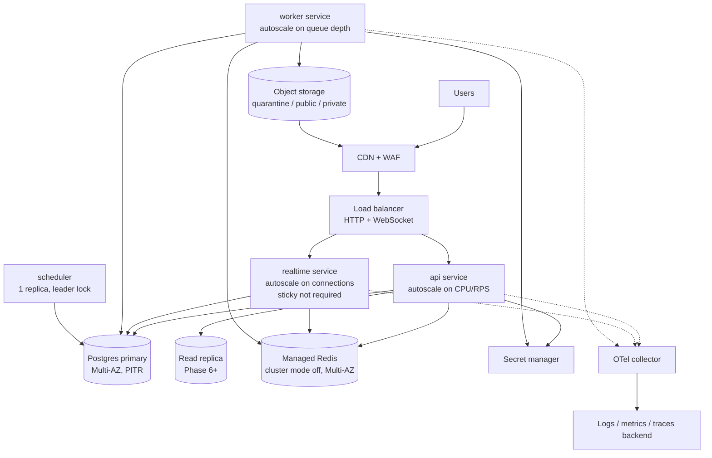
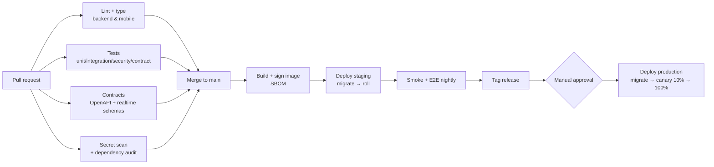

# 11 — Infrastructure and Deployment Plan

| | |
|---|---|
| **Status** | Draft v1.0 — Phase 0 |
| **Principle** | Managed services where practical. Cloud vendor kept configurable until deployment constraints are final (PRD Q-8). The Terraform layout is vendor-neutral at the module interface; the first concrete implementation targets AWS as the reference, and GCP/Azure equivalents are listed |

## 1. Environments

| Env | Purpose | Data | Deploy trigger |
|---|---|---|---|
| `local` | Developer loop | Synthetic | `docker compose up` |
| `ci` | Automated tests | Synthetic, ephemeral | Every push / PR |
| `preview` (Phase 1+) | Per-PR full stack | Synthetic seed | PR label `preview` |
| `staging` | Release candidate, store sandbox, IdP test tenant | Synthetic + test accounts | Merge to `main` |
| `production` | Live | Real | Manual approval of a tagged release |

### 1.1 Background jobs on the serverless staging API (ADR-0019)

Vercel functions cannot host the long-running `worker` role, so on staging the job queue (ADR-0004) is advanced by:

1. **After-response tick** (`JOBS_INLINE_AFTER_RESPONSE=true`): a request that recorded outbox events runs a short bounded tick (`JOBS_INLINE_BUDGET_SECONDS`, default 2 s) after its response. This meets the ≤ 10 s web cache purge target in the common case.
2. **Scheduler tick**: `GET|POST /internal/jobs/tick` with `Authorization: Bearer $CRON_SECRET` picks up retries and anything the inline tick missed. On Vercel Hobby, Cron runs at most daily, so retries can wait until the next request that records events or the next scheduled tick. `backend/vercel.json` schedules it daily at 03:00 UTC; Vercel sends the bearer token once `CRON_SECRET` is set on the project (until then the endpoint answers 404). Each tick also enqueues due periodic tasks (daily retention purges, BL-1.18).

Production runs `python -m app.worker` as its own process (always-on), so neither trigger is needed there. Retries are scheduled with the database clock, so any mix of triggers and workers is safe (`SKIP LOCKED`).

### 1.2 Rate limiting on serverless (ADR-0021)

With no `REDIS_URL`, `RATE_LIMIT_STORE=auto` counts in PostgreSQL (UNLOGGED `rate_limit_counters`). Production should set `REDIS_URL`. Settings:

| Variable | Default | Notes |
|---|---|---|
| `RATE_LIMIT_STORE` | `auto` | `redis`, `postgres`, `memory` (development), `disabled` (tests). Staging and production refuse `memory`/`disabled` |
| `RATE_LIMITS` | `{}` | JSON overrides per bucket, e.g. `{"write": "200/60", "contact": "20/86400,5/60"}`. Unknown buckets fail at boot |
| `TRUST_PROXY_HEADERS` | on when `VERCEL=1` | Use the edge's `X-Real-IP`/`X-Forwarded-For` as the client IP |
| `CLIENT_IP_FORWARDING_SECRET` | unset | ≥ 32 chars, same value on the API and the web BFF. Lets the BFF forward the browser IP (`X-TB-Client-IP`); without it, anonymous web traffic shares the BFF's egress IP quota |

### 1.3 Account deletion (BL-1.17)

`SUPABASE_SECRET_KEY` (server-only; a `sb_secret_…` key or the legacy `service_role` JWT) lets the deletion saga delete the Supabase Auth user once an account's 30-day grace ends. Without it, our data is still erased and the job logs `idp_account_not_deleted`. The saga runs from the hourly periodic task, so on staging it needs the cron tick (`CRON_SECRET`) or after-response ticks.

## 2. Runtime topology (production reference)



| Component | AWS (reference) | GCP | Azure |
|---|---|---|---|
| Containers | **Staging API: Vercel serverless (`iad1`, ADR-0019).** Long-running roles (realtime, workers): Render Docker services (`render.yaml`, ready) or ECS Fargate | Cloud Run / GKE | Container Apps / AKS |
| Postgres + PostGIS | **Supabase (chosen, ADR-0018)**: project `us-east-1`, Free plan now, Pro + PITR before real user data. Alternatives: RDS for PostgreSQL | Cloud SQL for PostgreSQL | Azure Database for PostgreSQL Flexible |
| Redis | ElastiCache for Redis | Memorystore | Azure Cache for Redis |
| Object storage + CDN | S3 + CloudFront | GCS + Cloud CDN | Blob Storage + Front Door |
| Secrets | Secrets Manager + KMS | Secret Manager + KMS | Key Vault |
| WAF | AWS WAF | Cloud Armor | Front Door WAF |
| Email (transactional) | IdP-managed / SES | IdP / SendGrid | IdP / ACS |
| Malware scan | ClamAV container (worker sidecar) | Same | Same |

## 3. Containers

One backend image (`backend/Dockerfile`, multi-stage, non-root, read-only root filesystem, distroless/slim runtime) runs with different commands per process role:

| Service | Command | Min/Max replicas (launch) | Health |
|---|---|---|---|
| api | `uvicorn app.main:app --host 0.0.0.0 --port 8000 --proxy-headers` | 2 / 20 | `/health/live`, `/health/ready` |
| realtime | `uvicorn app.realtime_main:app --port 8001` | 2 / 20 | `/health/live` |
| worker | `python -m app.worker` | 1 / 20 | Heartbeat row + liveness file |
| scheduler | `python -m app.worker --role scheduler` | 1 / 1 | Leader lock metric |

Database migrations run as a **one-off task** before the new version is rolled out (`alembic upgrade head`). Migrations must be backward-compatible with the previous release (expand → migrate → contract), so rolling deploys never break running pods.

## 4. Terraform layout

```
infra/terraform/
  modules/
    network/         # VPC, subnets, NAT, security groups
    database/        # Postgres + PostGIS, parameter group, backups, replicas
    cache/           # Redis
    storage/         # buckets (quarantine/public/private), lifecycle rules, CDN
    service/         # generic container service (image, cmd, env, secrets, autoscaling)
    secrets/         # secret containers (values set out of band)
    observability/   # log groups, dashboards, alerts
  envs/
    staging/         # composition of modules + tfvars (no secrets)
    production/
```

* Remote state in an encrypted bucket with state locking. One state per environment.
* CI uses OIDC federation to the cloud (no long-lived keys). `terraform plan` runs on PRs touching `infra/`, and `apply` requires manual approval.
* Bucket lifecycle: `quarantine` objects expire after 24 h. `private` attachments follow message retention. Versioning is on for `public` and `private`.

## 5. CI/CD pipeline



Mobile: EAS Build for store binaries (`development`, `preview`, `production` profiles). OTA updates through EAS Update **only** for JS-only fixes that are compatible with the native runtime, with a runtime-version policy. Store submissions go through EAS Submit after manual QA.

## 6. Configuration and secrets

* 12-factor configuration through environment variables, typed and validated at boot (`app/core/config.py`). Boot fails fast on invalid configuration.
* Secrets (DB password, JWT signing keys, IdP client secrets, store credentials, AI keys) live only in the secret manager, are injected at runtime, and are rotated on a schedule (JWT keys support multiple active `kid`s for rotation).
* `APP_ENV=production` boot guard: development adapters (dev IdP, dev billing, fake push, stub AI) cause startup failure.

## 7. Data protection and recovery

| Control | Setting |
|---|---|
| Postgres backups | Supabase: **none on the Free plan**. Pro gives daily backups (7 days). The PITR add-on gives RPO ≤ 5 min. Upgrade before any real user data (ADR-0018) |
| Restore drill | Quarterly, documented time-to-restore (RTO target ≤ 1 h) |
| Encryption | At rest (KMS) for DB, Redis, buckets. TLS 1.2+ in transit, including DB connections |
| Object storage | Versioning on public/private. Replication to a second region (Phase 6) |
| Audit logs | Monthly partitions exported to WORM storage (object lock) |

## 8. Observability and alerting

| Signal | Alert |
|---|---|
| API 5xx rate | > 1 % for 5 min |
| API p95 latency | > 500 ms for 10 min |
| Outbox lag | Oldest unpublished > 60 s |
| Job queue | Oldest queued > 5 min (per queue). Dead jobs > 0 for billing queue |
| Realtime | Connection drop rate spike. Fanout lag > 2 s |
| Billing webhooks | Processing failures > 0 |
| Moderation | Priority report unassigned > 1 h |
| AI | Daily spend > budget × 0.8 |

SLOs: API availability 99.9 %, message delivery p95 < 500 ms. Error budgets are reviewed monthly.

## 9. Regional strategy

Launch in a single region close to the core markets (an EU region, for GDPR and proximity to EU/UK, with acceptable latency to Brazil through the CDN), with the CDN serving media globally. Phase 7 evaluates a second region (Americas) with read replicas and regional realtime. That needs write-routing design and is deliberately deferred.

## 10. Cost guardrails

Budgets and alerts per environment. Staging scales to zero off-hours. Media size limits and CDN caching. AI spend circuit breaker. Log retention 30 days hot, 1 year cold.
