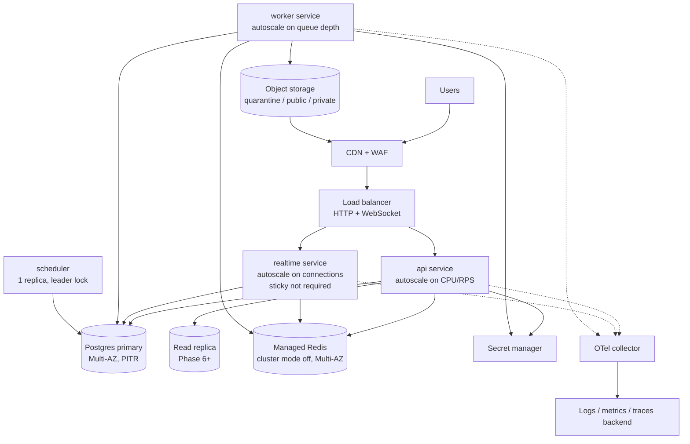
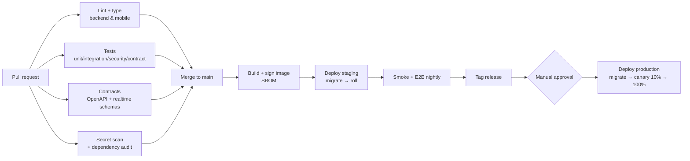

# 11 — Infrastructure and Deployment Plan

| | |
|---|---|
| **Status** | Draft v1.0 — Phase 0 |
| **Principle** | Managed services where practical. Cloud vendor kept configurable until deployment constraints are final (PRD Q-8). The Terraform layout is vendor-neutral at the module interface; the first concrete implementation targets AWS as the reference, and GCP/Azure equivalents are listed |

## 1. Environments

| Env | Purpose | Data | Deploy trigger |
|---|---|---|---|
| `local` | Developer loop | Synthetic | `docker compose up` |
| `ci` | Automated tests | Synthetic, ephemeral | Every push / PR |
| `preview` (Phase 1+) | Per-PR full stack | Synthetic seed | PR label `preview` |
| `staging` | Release candidate, store sandbox, IdP test tenant | Synthetic + test accounts | Merge to `main` |
| `production` | Live | Real | Manual approval of a tagged release |

### 1.0 Platform: Firebase and Railway (ADR-0028)

The platform is moving from Supabase and Vercel (ADR-0018, 0019, 0020) to the owner's Firebase project and Railway. The code supports both until the cutover: set the Firebase variables and the backend trusts both issuers, and the apps choose their provider from build configuration.

**Firebase console** (project on the **Blaze** plan; region `us-east4` (Northern Virginia) throughout, next to Railway US East):

1. **Authentication → Sign-in method:** enable *Email/Password*.
   * **Settings:** password policy at least 8 characters; *Email enumeration protection* on; add the web domain to *Authorized domains*.
   * **Templates:** set the sender name and, later, the custom email domain.
   * **Staff MFA (ADM-007):** upgrade to *Identity Platform* and enable TOTP.
2. **Project settings → General:** copy the project ID and the **Web API key**.
   * In Google Cloud console → APIs & Services → Credentials, restrict that key to the *Identity Toolkit API* and *Token Service API*.
   * Add an Android app with the package name from `mobile/app.json` and download `google-services.json` (needed for FCM).
3. **Cloud SQL** (Google Cloud console):
   * Enable the *Cloud SQL Admin API*.
   * Create a PostgreSQL 16 instance in `us-east4`. Start with the smallest Enterprise shared-core tier; backups on; point-in-time recovery on before real users (NFR-004).
   * Create database `travelbuddy` and user `travelbuddy` with a generated password.
   * Note the *instance connection name* (`project:region:instance`).
4. **Service account** (IAM → Service accounts):
   * Create `travelbuddy-api` with the roles *Cloud SQL Client* and *Firebase Authentication Admin*.
   * Create a JSON key. It is a secret: it goes only into Railway variables.
5. **Cloud Storage:**
   * Create buckets `<project>-media-quarantine` and `<project>-media-private` (private, uniform access) and `<project>-media-public` (grant `allUsers` the *Storage Object Viewer* role).
   * Settings → Interoperability: create an **HMAC key** for the service account.
6. **FCM:** Project settings → Cloud Messaging. Generate the FCM V1 service account key and upload it to EAS (§1.9).

**Railway** (one project, region US East, from the GitHub repository):

| Service | Settings |
|---|---|
| `api` | Root directory `backend`; builder Dockerfile; pre-deploy command `alembic upgrade head`; health check path `/health/live`; public domain (later `api.<domain>`) |
| `worker` | Same repository and root directory; start command `python -m app.worker`; no public domain; restart on failure |

Railway's config-as-code files are deprecated (new services can't use them), so these settings live in the dashboard.

**Variables** for both services (Railway shared variables):

* **Database:**
  * `DATABASE_URL=postgresql+asyncpg://travelbuddy:<password>@/travelbuddy`
  * `DATABASE_CLOUD_SQL_INSTANCE=<project>:us-east4:<instance>`
  * `GOOGLE_SERVICE_ACCOUNT_JSON=<key JSON>`
* **Identity:** `FIREBASE_PROJECT_ID`, `FIREBASE_WEB_API_KEY`.
* **Media:**
  * `MEDIA_S3_ENDPOINT=https://storage.googleapis.com`, `MEDIA_S3_REGION=auto`;
  * `MEDIA_S3_ACCESS_KEY_ID` and `MEDIA_S3_SECRET_ACCESS_KEY` (the HMAC key);
  * `MEDIA_QUARANTINE_BUCKET`, `MEDIA_PRIVATE_BUCKET`, `MEDIA_PUBLIC_BUCKET`;
  * `MEDIA_PUBLIC_BASE_URL=https://storage.googleapis.com/<project>-media-public`.
* **The rest of the existing staging set:** `APP_ENV`, `CURSOR_SIGNING_KEY`, `PLATFORM_JWT_PRIVATE_KEY`, `REFRESH_TOKEN_DERIVATION_KEY`, `PUBLIC_SITE_URL`, `CORS_ALLOWED_ORIGINS`, `FEATURE_FLAGS` and so on.

The worker makes the cron tick and after-response ticks unnecessary (§1.1): leave `CRON_SECRET` and `JOBS_INLINE_AFTER_RESPONSE` unset there.

**Apps:**

* **Mobile:** set `EXPO_PUBLIC_FIREBASE_API_KEY`, and `EXPO_PUBLIC_IDENTITY_PROVIDER=firebase` (or leave it unset). The APK workflow takes `identity_provider=firebase` and `firebase_api_key`.
* **Web:** the web workstream switches its BFF adapter.

**Live state (2026-11-10):** the Railway staging API is at https://api-production-9dfc555a.up.railway.app, and the worker is running jobs.
* **Database (ADR-0029):** Supabase PostgreSQL on the free plan, through the session pooler (`:5432`, `?ssl=require`, pools API 3 + 2, worker 3). The temporary Railway PostGIS service was removed. On the first tick the worker relayed the 44 events stuck since the Vercel API.
* **Photos (ADR-0029):** Supabase Storage through the S3 endpoint.
  * Buckets `media-quarantine` (private) and `media-public` (public), each for JPEG, PNG and WebP up to 25 MB.
  * The `railway-api` S3 access key is in Railway variables only.
  * Verified: upload, processing to WebP, and the public URL.
* **Sign-in:** it trusts Firebase Auth of `travel-buddy-tb` (`FIREBASE_PROJECT_ID`, `FIREBASE_WEB_API_KEY`), and still Supabase (`OIDC_ISSUERS`) during the switch.
* **Account deletion:** `GOOGLE_SERVICE_ACCOUNT_JSON` holds the key of service account `travelbuddy-api`, which has only the *Firebase Authentication Admin* role.
* **Firebase:** email/password, an 8-character password policy and enumeration protection are on, and the Android and web apps are registered. Cloud SQL and Cloud Storage are not used (ADR-0029), so Firebase stays on the free Spark plan.
* **Feature flags:** they are enforced by the API (BL-6.10). Staging turns on every feature the apps use; video posts, public groups and join requests stay off. Production's set is decided at launch.
* **Deploys:** `railway up --service api|worker` from `backend/` (`.railwayignore` keeps tests and local files out).
* **Loaders:** they run from a workstation through the PostGIS TCP proxy, because `railway ssh` needs a registered SSH key.

**Cutover:**

1. Deploy both Railway services and confirm that `/health/ready` answers and the worker logs ticks.
2. Run the seed commands against Cloud SQL (docs/16).
3. Point the apps at the Railway API.
4. Then remove the Supabase variables and the Vercel API project (BL-6.11).

### 1.1 Background jobs on the serverless staging API (ADR-0019)

On Railway (§1.0) the `worker` service runs the queue continuously, and nothing below is needed. This section applies while staging still runs on Vercel.

Vercel functions cannot host the long-running `worker` role, so on staging the job queue (ADR-0004) is advanced by:

1. **After-response tick** (`JOBS_INLINE_AFTER_RESPONSE=true`): a request that recorded outbox events runs a short bounded tick (`JOBS_INLINE_BUDGET_SECONDS`, default 2 s) after its response. This meets the ≤ 10 s web cache purge target in the common case.
2. **Scheduler tick**: `GET|POST /internal/jobs/tick` with `Authorization: Bearer $CRON_SECRET` picks up retries and anything the inline tick missed. On Vercel Hobby, Cron runs at most daily, so retries can wait until the next request that records events or the next scheduled tick. `backend/vercel.json` schedules it daily at 03:00 UTC; Vercel sends the bearer token once `CRON_SECRET` is set on the project (until then the endpoint answers 404). Each tick also enqueues due periodic tasks (daily retention purges, BL-1.18).

Production runs `python -m app.worker` as its own process (always-on), so neither trigger is needed there. Retries are scheduled with the database clock, so any mix of triggers and workers is safe (`SKIP LOCKED`).

### 1.2 Rate limiting on serverless (ADR-0021)

With no `REDIS_URL`, `RATE_LIMIT_STORE=auto` counts in PostgreSQL (UNLOGGED `rate_limit_counters`). Production should set `REDIS_URL`. Settings:

| Variable | Default | Notes |
|---|---|---|
| `RATE_LIMIT_STORE` | `auto` | `redis`, `postgres`, `memory` (development), `disabled` (tests). Staging and production refuse `memory`/`disabled` |
| `RATE_LIMITS` | `{}` | JSON overrides per bucket, e.g. `{"write": "200/60", "contact": "20/86400,5/60"}`. Unknown buckets fail at boot |
| `TRUST_PROXY_HEADERS` | on when `VERCEL=1` | Use the edge's `X-Real-IP`/`X-Forwarded-For` as the client IP |
| `CLIENT_IP_FORWARDING_SECRET` | unset | ≥ 32 chars, same value on the API and the web BFF. Lets the BFF forward the browser IP (`X-TB-Client-IP`); without it, anonymous web traffic shares the BFF's egress IP quota |

### 1.3 Account deletion (BL-1.17)

With Firebase (ADR-0028), `FIREBASE_PROJECT_ID` plus `GOOGLE_SERVICE_ACCOUNT_JSON` (role *Firebase Authentication Admin*) lets the saga delete the Firebase account. Accounts of either provider are handled while both are configured.

`SUPABASE_SECRET_KEY` (server-only; a `sb_secret_…` key or the legacy `service_role` JWT) lets the deletion saga delete the Supabase Auth user once an account's 30-day grace ends. Without it, our data is still erased and the job logs `idp_account_not_deleted`. The saga runs from the hourly periodic task, so on staging it needs the cron tick (`CRON_SECRET`) or after-response ticks.

### 1.4 Media storage (BL-1.08, ADR-0022)

Without storage settings, uploads answer `503` and everything else works. With Firebase (ADR-0028), use Cloud Storage through its S3-compatible XML API (§1.0, step 5): endpoint `https://storage.googleapis.com`, region `auto`, an HMAC key, and `MEDIA_PUBLIC_BASE_URL=https://storage.googleapis.com/<public bucket>`. To enable uploads on Supabase Storage instead:

1. Storage → create bucket `media-quarantine` (**private**, file size limit 25 MB, allowed types `image/jpeg,image/png,image/webp`) and bucket `media-public` (**public**).
2. Storage → S3 connection → create an access key pair.
3. Set on the API project: `MEDIA_S3_ENDPOINT=https://<ref>.supabase.co/storage/v1/s3`, `MEDIA_S3_REGION=<project region>`, `MEDIA_S3_ACCESS_KEY_ID`, `MEDIA_S3_SECRET_ACCESS_KEY`, `MEDIA_PUBLIC_BASE_URL=https://<ref>.supabase.co/storage/v1/object/public/media-public`. Message photos are stored privately in the quarantine bucket under `pm/` (or in `MEDIA_PRIVATE_BUCKET` if set; keep it private) and served through 5-minute presigned URLs.

Processing runs as a job (worker, cron tick or after-response tick).

### 1.5 AI itineraries (BL-4.02, ADR-0024)

Without `ANTHROPIC_API_KEY`, staging and production answer `503 ai_unavailable` for AI requests and everything else works. To enable them:

1. Create an API key in the Anthropic console, with a monthly spend limit for the workspace.
2. Set on the API project (and on any worker): `ANTHROPIC_API_KEY`, plus `AI_DAILY_BUDGET_USD` (the server's own daily spend breaker, default 25). `AI_ITINERARY_MODEL` (default `claude-opus-5-5`) and `AI_ITINERARY_EFFORT` (default `medium`) are optional.
3. Generations run as jobs. On the serverless API, set `JOBS_INLINE_AFTER_RESPONSE=true` so a generation starts right after its request, and allow a function duration long enough for one provider call (about 60 to 180 s). The daily cron alone would leave generations pending until they fail after 30 minutes.

### 1.6 Places catalog (BL-4.01, ADR-0025)

Places come from OpenStreetMap through the public Overpass API. Load or refresh a destination with `python -m app.modules.destinations.place_ingestion --destination portugal/lisbon` (optional `--radius` metres, `--limit`, or `--file` for a JSON document), run against the target database. Ingestion is idempotent and keeps editorial takedowns. Refresh at least every 180 days, after which place data is flagged as stale. Keep runs occasional: the public Overpass instance is rate-limited.

### 1.7 Guides and audio tours (BL-4.07)

Editorial content is published with `python -m app.modules.guides.seeding --file <document.json>` (default: the launch guides), run against the target database. The loader validates every section before writing, publishes each guide or tour by `(destination, locale, slug, version)`, retires older versions and updates `destinations.has_guides`. Re-running is safe.

### 1.8 Offline packages (BL-4.08, ADR-0026)

Offline downloads need shared S3-compatible storage (section 1.4) and a manifest signing key:

1. Generate a key with `openssl genpkey -algorithm ed25519` and set `OFFLINE_MANIFEST_PRIVATE_KEY` (PEM) and `OFFLINE_MANIFEST_KEY_ID` (for example `offline-1`) on the API project. The public key appears in `GET /v1/client-config` under `offline_manifest_keys`. To rotate, publish the new key id, then switch the private key.
2. Build packages with `python -m app.modules.guides.packaging --destination <path>` against the target database and storage, after publishing or updating guides.

Without the key, licensing and manifests answer 503 and listing still works.

### 1.9 Push notifications (BL-3.06, BL-6.06)

The API sends mobile pushes through the Expo push service (`PUSH_PROVIDER=auto` uses it outside
development; `EXPO_ACCESS_TOKEN` is optional, for Expo's enhanced push security). The app
registers a token per session only after the user allows notifications on the Notifications
screen. To make pushes reach devices:

1. Create the EAS project and set its id in `mobile/app.json` under `expo.extra.eas.projectId`
   (without it the app skips registration).
2. In EAS, upload the APNs key (iOS) and the FCM V1 service account key (Android) from the
   Firebase project (§1.0, step 6), and add the Android app's `google-services.json` to the build
   (`expo.android.googleServicesFile` in `mobile/app.json`).
3. Web Push for the browser needs `WEB_PUSH_VAPID_PRIVATE_KEY` (the public key is served in
   `/v1/client-config`).

### 1.10 Store billing (BL-6.01, ADR-0017)

Each store answers `503` until its settings exist; Stripe (web) is separate (section 6).

* **App Store:** `APPLE_BUNDLE_ID` and `APPLE_ROOT_CA_SHA256` (the SHA-256 fingerprint of Apple
  Root CA - G3 from apple.com/certificateauthority; several, comma-separated, during a rotation).
  In App Store Connect, set the Server Notifications v2 URL to `<api>/v1/billing/webhooks/apple`.
* **Google Play:** `GOOGLE_PLAY_PACKAGE_NAME` and `GOOGLE_PLAY_SERVICE_ACCOUNT_JSON` (a service
  account key with access to the Play Developer API, granted in Play Console → Users and
  permissions). For Real-time Developer Notifications: create a Pub/Sub topic, link it in Play
  Console → Monetization setup, and add an **authenticated push** subscription to
  `<api>/v1/billing/webhooks/google` with a dedicated service account; set
  `GOOGLE_PUBSUB_AUDIENCE` (the push audience, normally that URL) and
  `GOOGLE_PUBSUB_SERVICE_ACCOUNT` (its email). Pushes without that Google-signed token are
  refused.
* Products: create them in each store, then in `/v1/admin/products` with the same SKUs.
  Quota limits and the group admin grace are edited at runtime in `/v1/admin/billing/policy`.

### 1.11 Support contact (store readiness)

`SUPPORT_EMAIL` (default `support@travelbuddy.app`) appears on the apps' Help screen. Set
`SUPPORT_URL` (https) once the public help page exists; until then the apps show only the email.

### 1.12 Social sign-in (AUTH-002, AUTH-003)

The apps run "Continue with Apple / Google" through Supabase Auth with PKCE; Supabase handles the
provider and Apple's private-relay emails. Nothing shows until the API lists a provider:

1. In Supabase → Authentication → Providers, enable **Google** (a Google Cloud OAuth client; its
   authorized redirect URI is `https://<project>.supabase.co/auth/v1/callback`) and **Apple** (Services
   ID, Team ID, Key ID and the private key from the Apple Developer account).
2. In Supabase → Authentication → URL Configuration → Redirect URLs, add `travelbuddy://auth-callback`
   (store builds) and, for development in Expo Go, `exp://127.0.0.1:8081/--/auth-callback`.
3. Set `AUTH_SOCIAL_PROVIDERS=["apple", "google"]` on the API (`/v1/client-config` then lists them).
4. Enable Apple together with Google: App Store guideline 4.8 requires Sign in with Apple when an iOS
   app offers another social sign-in.

**With Firebase (ADR-0028, BL-6.12)** the mobile app uses native sign-in sheets instead of the browser:
Google Sign-In (`@react-native-google-signin/google-signin`) and Sign in with Apple
(`expo-apple-authentication`). Their ID tokens are exchanged with Firebase (`accounts:signInWithIdp`),
then for a platform session as usual. The buttons show only when the API lists the provider and the
build and device support it, so Expo Go never shows them. Setup:

1. Firebase → Authentication → Sign-in method: enable **Google**. Firebase creates the OAuth "Web client"; set its ID in
   the app as `EXPO_PUBLIC_GOOGLE_WEB_CLIENT_ID`.
2. Google Cloud → Credentials: add an **Android** OAuth client for `com.travelbuddy.app` with the SHA-1
   of each signing key (the release key, and the debug key for test APKs). Add an **iOS** client for
   `com.travelbuddy.app`, and give its reversed client ID to the Google Sign-In plugin in `app.json`
   (`iosUrlScheme`) or ship `GoogleService-Info.plist`.
3. Firebase → Sign-in method: enable **Apple** (Services ID, Team ID, Key ID and private key from the Apple
   Developer account). The `expo-apple-authentication` plugin adds the entitlement on iOS.
4. Keep Firebase's default of one account per email. A Google or Apple sign-in for an email that already
   uses a password then answers "This email already signs in another way".
5. Set `AUTH_SOCIAL_PROVIDERS=["apple", "google"]` on the API.

### 1.13 Demo content on staging

Staging carries **demo content** so the feed is not empty during reviews: six demo travellers and twelve photo
posts, created on 2026-11-11 through the public API (Firebase sign-in, registration, media upload, post), not by
writing to the database. **Remove it before launch**: delete the six accounts (their posts and photos go with them).

* **Travellers:** Mika Tanaka (`@mika.wanders`), Lucas Ferreira (`@lucas.onfoot`), Amélie Laurent (`@amelie.voyage`), Thabo Nkosi (`@thabo.trails`), Sofía Ramírez (`@sofia.rumbo`), Priya Nair (`@priya.packs`). Their sign-in emails are
  `demo.<first name>@travelbuddy.test` in Firebase Auth; the passwords are not stored in the repository.
* **Avatars:** illustrated, from DiceBear's *Lorelei* style by Lisa Wischofsky (CC0 1.0). No real person's photo is used.
* **Photos:** Wikimedia Commons files released under **CC0 1.0** (no attribution required; sources kept here for the record).
  They were resized to at most 1920 px, and the media pipeline stripped their metadata.

| Destination | Author | Commons file | Photographer | Licence |
| --- | --- | --- | --- | --- |
| `japan/tokyo` | @mika.wanders | [Shibuya scramble av night from Stream.jpg](https://commons.wikimedia.org/wiki/File:Shibuya_scramble_av_night_from_Stream.jpg) | Syced | CC0 1.0 |
| `japan/kyoto` | @mika.wanders | [20181110 Fushimi Inari Torii 12.jpg](https://commons.wikimedia.org/wiki/File:20181110_Fushimi_Inari_Torii_12.jpg) | Balon Greyjoy | CC0 1.0 |
| `brazil/rio-de-janeiro` | @lucas.onfoot | [Sugarloaf Cable Car viewed from Rio de Janeiro, Brazil.jpg](https://commons.wikimedia.org/wiki/File:Sugarloaf_Cable_Car_viewed_from_Rio_de_Janeiro,_Brazil.jpg) | Wilfredor | CC0 1.0 |
| `portugal/lisbon` | @lucas.onfoot | [The historical tram line in Lisbon. (52329191119).jpg](https://commons.wikimedia.org/wiki/File:The_historical_tram_line_in_Lisbon._(52329191119).jpg) | Ted Moravec | CC0 1.0 |
| `france/paris` | @amelie.voyage | [Overview Seine River to Eiffel Tower (37578867564).jpg](https://commons.wikimedia.org/wiki/File:Overview_Seine_River_to_Eiffel_Tower_(37578867564).jpg) | Alex Liivet from Chester, United Kingdom | CC0 1.0 |
| `italy/rome` | @amelie.voyage | [Colosseum of Rome, Italy.jpg](https://commons.wikimedia.org/wiki/File:Colosseum_of_Rome,_Italy.jpg) | Wilfredor | CC0 1.0 |
| `south-africa/cape-town` | @thabo.trails | [Table Mountain (Unsplash).jpg](https://commons.wikimedia.org/wiki/File:Table_Mountain_(Unsplash).jpg) | Bruno Wolff d0cz | CC0 1.0 |
| `morocco/marrakesh` | @thabo.trails | [Marrakech skyline view.jpg](https://commons.wikimedia.org/wiki/File:Marrakech_skyline_view.jpg) | hichamaarkoubi | CC0 1.0 |
| `mexico/mexico-city` | @sofia.rumbo | [Palacio de Bellas Artes - CDMX.jpg](https://commons.wikimedia.org/wiki/File:Palacio_de_Bellas_Artes_-_CDMX.jpg) | JUAN CARLOS GONZALEZ | CC0 1.0 |
| `spain/barcelona` | @sofia.rumbo | [Town-city-cityscape-vacation-amusement-park-tower-1103525.jpg](https://commons.wikimedia.org/wiki/File:Town-city-cityscape-vacation-amusement-park-tower-1103525.jpg) | Unknown author | CC0 1.0 |
| `thailand/bangkok` | @priya.packs | [Temple Wat Arun 1.jpg](https://commons.wikimedia.org/wiki/File:Temple_Wat_Arun_1.jpg) | Welcome to Thailand | CC0 1.0 |
| `australia/sydney` | @priya.packs | [Sydney Opera House. (19667312379).jpg](https://commons.wikimedia.org/wiki/File:Sydney_Opera_House._(19667312379).jpg) | Bernard Spragg. NZ from Christchurch, New Zealand | CC0 1.0 |

## 2. Runtime topology (production reference)



| Component | AWS (reference) | GCP | Azure |
|---|---|---|---|
| Containers | **Staging API: Vercel serverless (`iad1`, ADR-0019).** Long-running roles (realtime, workers): Render Docker services (`render.yaml`, ready) or ECS Fargate | Cloud Run / GKE | Container Apps / AKS |
| Postgres + PostGIS | **Supabase (chosen, ADR-0018)**: project `us-east-1`, Free plan now, Pro + PITR before real user data. Alternatives: RDS for PostgreSQL | Cloud SQL for PostgreSQL | Azure Database for PostgreSQL Flexible |
| Redis | ElastiCache for Redis | Memorystore | Azure Cache for Redis |
| Object storage + CDN | S3 + CloudFront | GCS + Cloud CDN | Blob Storage + Front Door |
| Secrets | Secrets Manager + KMS | Secret Manager + KMS | Key Vault |
| WAF | AWS WAF | Cloud Armor | Front Door WAF |
| Email (transactional) | IdP-managed / SES | IdP / SendGrid | IdP / ACS |
| Malware scan | ClamAV container (worker sidecar) | Same | Same |

## 3. Containers

One backend image (`backend/Dockerfile`, multi-stage, non-root, read-only root filesystem, distroless/slim runtime) runs with different commands per process role:

| Service | Command | Min/Max replicas (launch) | Health |
|---|---|---|---|
| api | `uvicorn app.main:app --host 0.0.0.0 --port 8000 --proxy-headers` | 2 / 20 | `/health/live`, `/health/ready` |
| realtime | `uvicorn app.realtime_main:app --port 8001` | 2 / 20 | `/health/live` |
| worker | `python -m app.worker` | 1 / 20 | Heartbeat row + liveness file |
| scheduler | `python -m app.worker --role scheduler` | 1 / 1 | Leader lock metric |

Database migrations run as a **one-off task** before the new version is rolled out (`alembic upgrade head`). Migrations must be backward-compatible with the previous release (expand → migrate → contract), so rolling deploys never break running pods.

## 4. Terraform layout

```
infra/terraform/
  modules/
    network/         # VPC, subnets, NAT, security groups
    database/        # Postgres + PostGIS, parameter group, backups, replicas
    cache/           # Redis
    storage/         # buckets (quarantine/public/private), lifecycle rules, CDN
    service/         # generic container service (image, cmd, env, secrets, autoscaling)
    secrets/         # secret containers (values set out of band)
    observability/   # log groups, dashboards, alerts
  envs/
    staging/         # composition of modules + tfvars (no secrets)
    production/
```

* Remote state in an encrypted bucket with state locking. One state per environment.
* CI uses OIDC federation to the cloud (no long-lived keys). `terraform plan` runs on PRs touching `infra/`, and `apply` requires manual approval.
* Bucket lifecycle: `quarantine` objects expire after 24 h. `private` attachments follow message retention. Versioning is on for `public` and `private`.

## 5. CI/CD pipeline



Mobile: EAS Build for store binaries (`development`, `preview`, `production` profiles). OTA updates through EAS Update **only** for JS-only fixes that are compatible with the native runtime, with a runtime-version policy. Store submissions go through EAS Submit after manual QA.

## 6. Configuration and secrets

* 12-factor configuration through environment variables, typed and validated at boot (`app/core/config.py`). Boot fails fast on invalid configuration.
* Secrets (DB password, JWT signing keys, IdP client secrets, store credentials, AI keys) live only in the secret manager, are injected at runtime, and are rotated on a schedule (JWT keys support multiple active `kid`s for rotation).
* `APP_ENV=production` boot guard: development adapters (dev IdP, dev billing, fake push, stub AI) cause startup failure.

## 7. Data protection and recovery

| Control | Setting |
|---|---|
| Postgres backups | Supabase: **none on the Free plan**. Pro gives daily backups (7 days). The PITR add-on gives RPO ≤ 5 min. Upgrade before any real user data (ADR-0018) |
| Restore drill | Quarterly, documented time-to-restore (RTO target ≤ 1 h) |
| Encryption | At rest (KMS) for DB, Redis, buckets. TLS 1.2+ in transit, including DB connections |
| Object storage | Versioning on public/private. Replication to a second region (Phase 6) |
| Audit logs | Monthly partitions exported to WORM storage (object lock) |

## 8. Observability and alerting

| Signal | Alert |
|---|---|
| API 5xx rate | > 1 % for 5 min |
| API p95 latency | > 500 ms for 10 min |
| Outbox lag | Oldest unpublished > 60 s |
| Job queue | Oldest queued > 5 min (per queue). Dead jobs > 0 for billing queue |
| Realtime | Connection drop rate spike. Fanout lag > 2 s |
| Billing webhooks | Processing failures > 0 |
| Moderation | Priority report unassigned > 1 h |
| AI | Daily spend > budget × 0.8 |

SLOs: API availability 99.9 %, message delivery p95 < 500 ms. Error budgets are reviewed monthly.

## 9. Regional strategy

Launch in a single region close to the core markets (an EU region, for GDPR and proximity to EU/UK, with acceptable latency to Brazil through the CDN), with the CDN serving media globally. Phase 7 evaluates a second region (Americas) with read replicas and regional realtime. That needs write-routing design and is deliberately deferred.

## 10. Cost guardrails

Budgets and alerts per environment. Staging scales to zero off-hours. Media size limits and CDN caching. AI: per-user monthly quotas, the server-side daily spend breaker (`AI_DAILY_BUDGET_USD`) and the Anthropic workspace spend limit. Log retention 30 days hot, 1 year cold.
