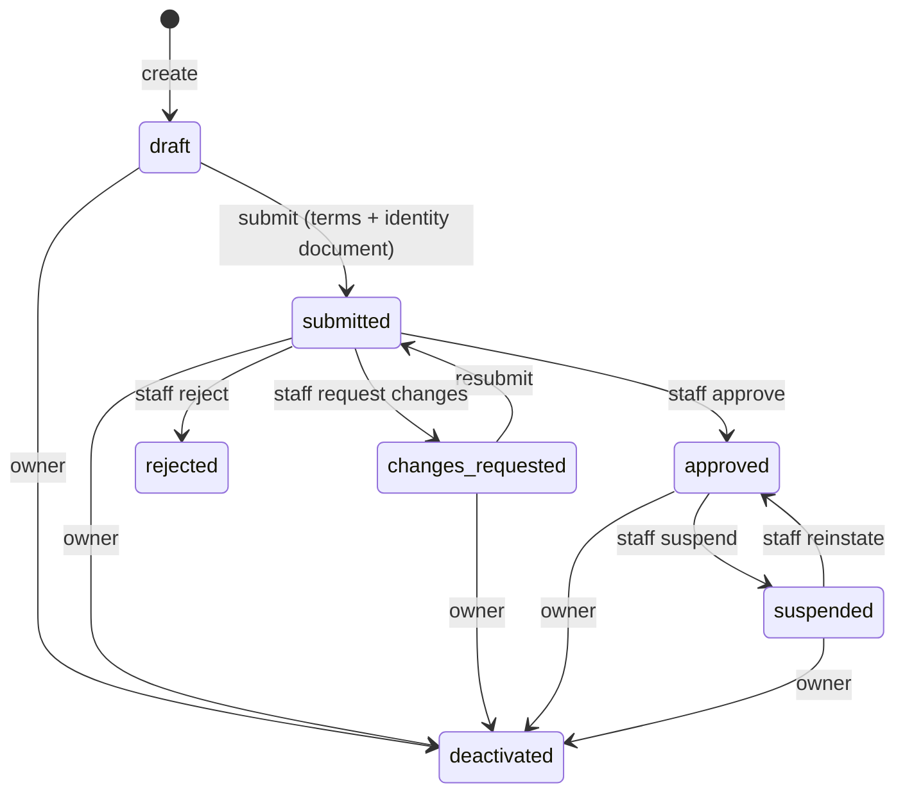
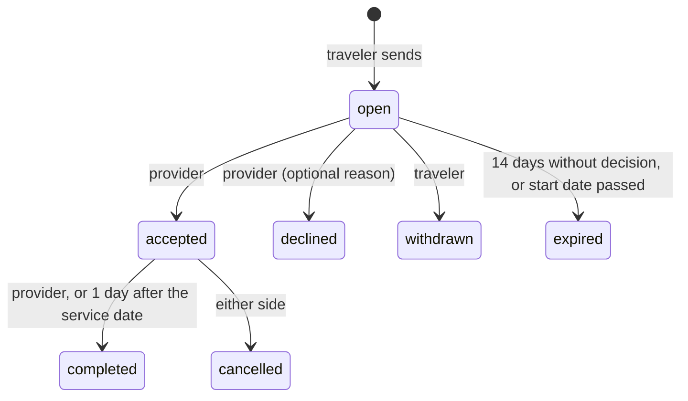

# 18 — Guides and travel companies marketplace

| | |
|---|---|
| **Status** | Phase 8a backend and contract built (2026-11-16); mobile and staff console screens next · Phase 8b (bookings, revenue) planned |
| **Decision** | [ADR-0036](adr/0036-guides-and-travel-companies-marketplace.md) |
| **Requirements** | PROV-001..PROV-018 ([PRD §4.22](01-prd.md#422-guides-and-travel-companies-prov)) |
| **Backlog** | BL-8.01..BL-8.12 ([09 §9a](09-development-backlog.md)) |
| **Flag** | `provider_marketplace` (default off). Phase 8b adds `provider_bookings` |

Travelers find local tour guides and travel service companies (agencies, tour operators, transfer and activity providers) on destination screens. They read profiles, offerings and reviews, and send a request that opens a chat with the provider. Providers apply in the app, and staff approve them before anyone can see them. Phase 8a moves no money: the two sides agree on payment outside the app.

## 1. Concepts

| Term | Meaning |
|---|---|
| **Provider** | A business profile: kind `guide` (one person working independently) or `company`. It is not an account type. Accounts belong to it as members |
| **Member** | An account acting for a provider. Roles: `owner` (exactly one), `manager` (profile, offerings, requests, team), `agent` (requests only). A guide has only its owner |
| **Offering** | Something the provider sells: a tour, activity, transfer, package, class or other. It has an indicative "from" price |
| **Inquiry** (request) | A traveler's request to a provider, with optional offering, dates or "flexible", party size and a message. Shown as a card in the provider chat |
| **Provider chat** | A conversation of kind `provider`: one thread per provider and traveler pair, reused by later requests. Its members are the traveler and the provider's active members |
| **Verification** | Staff review of the application and documents before the provider becomes visible |

## 2. State machines

### 2.1 Provider

- **Visible to travelers:** only `approved`. Members always see their own provider.
- **`rejected` and `deactivated` are final.** The owner can start a new application.
- **Locked after the first approval** (staff edit them through support): `kind`, `legal_name`, `country_code`, `registration_number`. Changing them returns `409 provider_field_locked`.
- **Submitting needs:**
  - display name, base town, at least one language, legal name;
  - at least one `identity` document;
  - a `business_registration` document for companies;
  - acceptance of the current Provider Terms version (consent type `provider_terms`).

### 2.2 Inquiry

- **Service date:** `end_date`, else `start_date`. Without dates, an accepted request completes 30 days after acceptance.
- **Limits:** one `open` request per traveler and provider. A traveler can send 10 new requests a day.
- **First response:** `first_response_at` is the provider's first decision, or the first chat message from a provider member after the request, whichever comes first. It feeds the response stats on the profile.

## 3. Data model (migration 0050)

All tables are private to the `providers` module. Other modules call `app.modules.providers.service` functions.

| Table | Key columns | Notes |
|---|---|---|
| `providers` | `id`, `kind`, `status`, `slug` (unique), `display_name` (2–80), `legal_name`, `tagline` (≤120), `about` (≤4000), `country_code`, `base_destination_id`→destinations, `languages text[]` (1–12, BCP 47), `specialties text[]` (≤8), `years_experience`, `website_url`, `registration_number`, `logo_media_id`, `cover_media_id`, `submitted_at`, `decided_at`, `decided_by`, `review_note`, `approved_at` (first approval, locks fields), `suspended_reason`, `rating_count`, `rating_sum`, `response_count`, `response_seconds_total`, `created_by`, `version`, timestamps, `deactivated_at` | `legal_name`, `registration_number` and `review_note` never appear in public schemas |
| `provider_members` | `provider_id`, `user_id`, `role`, `status` (`invited`, `active`), `invited_by`, `created_at`, `accepted_at` | Unique (provider, user). One active owner per provider (partial unique index) |
| `provider_service_areas` | `provider_id`, `destination_id` | PK both. At most 20 |
| `provider_documents` | `id`, `provider_id`, `kind`, `media_id`→media (purpose `provider_document`), `number`, `issuing_country`, `expires_on`, `status` (`pending`, `accepted`, `rejected`), `uploaded_by`, `decided_by`, `decided_at`, `file_deleted_at` | The file is deleted 90 days after the decision. The row stays |
| `provider_offerings` | `id`, `provider_id`, `status` (`draft`, `published`, `archived`, `removed`), `kind`, `title` (3–100), `description` (≤4000), `destination_id`, `duration_minutes`, `price_from_minor`, `currency`, `price_unit` (`per_person`, `per_group`), `max_group_size`, `languages text[]`, `cover_media_id`, `version`, `published_at`, timestamps | At most 50 published per provider. `removed` is staff-only |
| `provider_inquiries` | `id`, `provider_id`, `traveler_id` (SET NULL on erase), `offering_id`, `start_date`, `end_date`, `flexible_dates`, `party_size` (1–50), `message` (10–2000), `status`, `decline_reason`, `conversation_id`, `first_response_at`, `decided_at`, `completed_at`, `version`, timestamps | Partial unique (provider, traveler) where status = `open` |
| `provider_reviews` | `id`, `provider_id`, `inquiry_id` (unique), `author_id` (SET NULL), `rating` (1–5), `body` (≤2000), `status` (`visible`, `removed`), `reply_body` (≤2000), `replied_by`, `replied_at`, timestamps | Window: 60 days after the request completed |
| `provider_blocks` | `provider_id`, `traveler_id`, `side` (`traveler`, `provider`), `created_by`, `created_at` | PK (provider, traveler, side). Either side blocks the pair |

Changes in other modules:

- **messaging:** `ConversationKind.PROVIDER`, plus columns `conversations.provider_id` and `provider_traveler_id`, unique per pair. The `target_per_kind` check is extended.
- **media:** purposes `provider` (public still images, 10 MB) and `provider_document` (private still images, 15 MB, never in public variants).
- **trust_safety:** report targets `provider`, `provider_offering`, `provider_review`.
- **notifications:** types `provider_invitation`, `provider_application`, `provider_inquiry`, `provider_inquiry_update`, `provider_review`.
- **identity:** consent type `provider_terms`.
- **security:** permission `providers.verify` (moderator, admin, superadmin).

**Enumerations**

- **Specialties:** `city_tours`, `history_culture`, `food_drink`, `nature`, `adventure`, `water_activities`, `nightlife`, `photography`, `art_museums`, `family`, `wellness`, `accessible_travel`, `transfers`, `multi_day`.
- **Offering kinds:** `tour`, `activity`, `transfer`, `package`, `class`, `other`.
- **Document kinds:** `identity`, `tourism_registry` (e.g. CADASTUR), `guide_license`, `business_registration` (e.g. CNPJ), `insurance`, `other`.

## 4. API (contract: `contracts/openapi/openapi.yaml`, tag `providers`)

Every route sits behind `provider_marketplace`. "Anon" means it also works without signing in.

| Method and path | Who | Purpose |
|---|---|---|
| `GET /v1/providers` | anon | Approved providers. Filters: `destination_id` (the place and everything inside it), `kind`, `language`, `specialty`. Cursor pages of `ProviderSummary` |
| `GET /v1/providers/{id}` | anon / members | `ProviderProfile`. Members also see non-approved status and `membership` |
| `GET /v1/providers/{id}/offerings` | anon / members | Published offerings. Members get every status with `status=all` |
| `GET /v1/providers/{id}/reviews` | anon | Visible reviews, newest first |
| `GET /v1/provider-offerings/{id}` | anon / members | One offering |
| `GET /v1/users/me/providers` | signed in | My memberships and invitations |
| `POST /v1/providers` | verified email | Create a draft (`Idempotency-Key`). One guide profile per person |
| `GET /v1/providers/{id}/workspace` | members | `ProviderWorkspace`: status, staff note, legal fields, what's missing for submit, current terms version |
| `PATCH /v1/providers/{id}` | owner, manager | Edit (`If-Match` optional). Locked fields return 409 after approval |
| `PUT /v1/providers/{id}/service-areas` | owner, manager | Replace the service areas (≤20) |
| `GET/POST /v1/providers/{id}/documents`, `DELETE …/documents/{doc}` | owner, manager | Upload metadata for a `provider_document` media asset. Undecided documents only can be deleted. File links are never returned to members |
| `POST /v1/providers/{id}/submit` | owner, manager | `{terms_version}`, from draft or changes_requested |
| `POST /v1/providers/{id}/deactivate` | owner | Close the profile for good |
| `GET/POST /v1/providers/{id}/members`, `PATCH/DELETE …/members/{user}`, `POST …/members/me/accept` | per role | Team (companies only). Owners invite managers and agents, managers invite agents. Invitees accept. Anyone but the owner can leave |
| `GET/POST /v1/providers/{id}/offerings`, `PATCH /v1/provider-offerings/{id}`, `POST …/{id}/publish`, `POST …/{id}/archive` | owner, manager | Offerings. Publishing needs an approved provider |
| `POST /v1/providers/{id}/inquiries` | verified email, not a member | Send a request (`Idempotency-Key`). Returns `Inquiry` with `conversation_id` |
| `GET /v1/users/me/inquiries` | traveler | My requests |
| `GET /v1/providers/{id}/inquiries` | members | The provider's requests, filterable by status |
| `GET /v1/provider-inquiries/{id}` | either side | One request |
| `POST /v1/provider-inquiries/{id}/{accept,decline,complete,cancel,withdraw}` | per state machine | Transitions (`If-Match` optional) |
| `POST /v1/provider-inquiries/{id}/review` | traveler | Review after completion |
| `POST /v1/provider-reviews/{id}/reply`, `DELETE /v1/provider-reviews/{id}` | owner/manager, author | Reply once, or delete your own review |
| `PUT/DELETE /v1/providers/{id}/block` | traveler | Block a provider (it disappears from lists and its chat is closed) |
| `PUT/DELETE /v1/providers/{id}/blocked-travelers/{user}` | owner, manager | Block a traveler |
| `GET /v1/admin/providers` | `providers.verify` | Queue (filter by status, submitted oldest first) |
| `GET /v1/admin/providers/{id}` | `providers.verify`, justified | Full application: legal fields, members, documents, history |
| `GET /v1/admin/providers/{id}/documents/{doc}/file` | `providers.verify`, justified | A 5-minute signed link. Audited |
| `POST /v1/admin/providers/{id}/decision` | `providers.verify`, justified | `{decision: approve|request_changes|reject, note, documents: [{id, status}]}` |
| `POST /v1/admin/providers/{id}/{suspend,reinstate}` | `providers.verify`, justified | Suspend with a reason, or reinstate |

Offerings and reviews are removed through the existing moderation actions (`remove_content` / `restore_content` with the new target types).

**Errors** (problem `code`):

- `provider_not_found`
- `provider_field_locked`
- `provider_incomplete` (submit, with `missing` listing the gaps)
- `provider_not_approved`
- `guide_profile_exists`
- `inquiry_already_open`
- `inquiry_transition_invalid`
- `review_not_allowed`
- `provider_blocked`
- `offering_limit_reached`
- `service_area_limit`

## 5. Listing and ranking

- **Area match.** A provider matches destination D when its base town or one of its service areas is D or lies inside D (the destination path is a prefix match). So a country lists providers in its towns, and a district lists the providers of its city when they serve the city.
- **Order.** Approved, not blocked by the viewer, then by:
  1. Bayesian rating `(rating_sum + 4.0 × 5) / (rating_count + 5)`, descending.
  2. Response rate.
  3. `approved_at` descending.
  4. `id`.

  Cursors are keyset over that tuple.
- **Sponsored placement (8b)** is a separate labelled slot and never changes this order.

## 6. Notifications

| Type | To | When |
|---|---|---|
| `provider_invitation` | invited user | Added to a team |
| `provider_application` | owner, managers | Approved, changes requested, rejected, suspended, reinstated |
| `provider_inquiry` | active members | New request |
| `provider_inquiry_update` | the other side | Accepted, declined, cancelled, withdrawn, completed |
| `provider_review` | owner, managers | New review |

Chat messages use the existing `new_message` notifications.

## 7. Privacy, safety and retention

- **Documents** are private media. Members can't fetch them after upload. Staff open them through a 5-minute signed link, and each opening is audited with the justification. Files are deleted 90 days after the decision by the housekeeping job. The decision rows stay.
- **Public profile** never contains member emails, legal name, registration number, documents or the staff note. Members are not listed publicly. The profile shows "Verified by Travel Buddy" and the date.
- **Requests** never expose the traveler's account details to the provider beyond the public profile summary (display name, handle, avatar).
- **Safety.** Before a first request the app shows in-person safety tips: meet in public places, share plans with someone, pay through traceable means. Report and block are on every provider, offering, review and chat. Suspension hides the provider immediately.
- **Account erasure (AUTH-010).** Before an owner is erased, a company passes to its longest-serving active manager. Without one, the provider is deactivated. A guide profile is deactivated and its tagline, about, website and photos cleared. Reviews keep their text, with the author shown as "Former traveler".
- **Export (AUTH-011).** Memberships, providers owned, offerings, requests sent or handled, reviews written and blocks.

## 8. Phase 8b — bookings and revenue (planned, not built)

1. **Paid bookings.**
   - Stripe Connect Express onboarding for approved providers, and destination charges with `application_fee_amount` as the commission (a % set per country).
   - Availability slots, cancellation policies (flexible, moderate, strict), refunds, disputes, payout schedules.
   - Booking confirmation becomes the review gate.
   - In-app payments are allowed for real-world services (ADR-0031). In Brazil, marketplace invoicing (NFS-e) and intermediation rules need an accountant's review.
2. **Provider plans.** A web-sold Stripe subscription granting provider feature keys through `billing.service.has()`: more published offerings, analytics, priority support.
3. **Featured placement.** Paid, time-boxed slots per destination, labelled "Sponsored", with at most one per screen above organic results.

Each part needs its own ADR and legal review before it ships.
