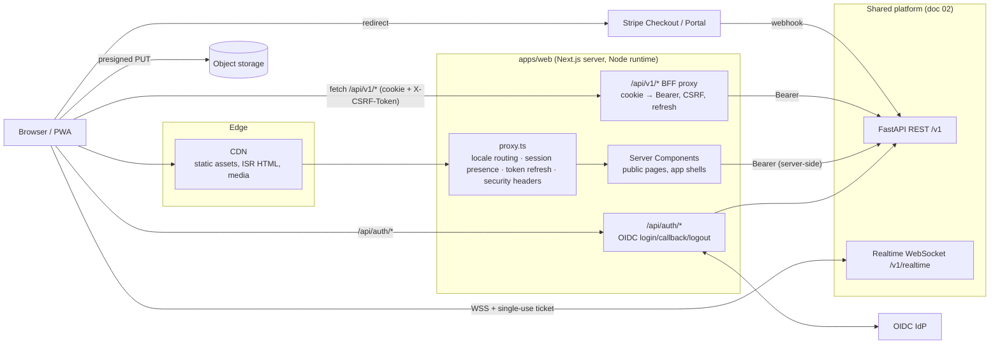

# Web 01 — Web Application Architecture

| | |
|---|---|
| **Status** | Draft v1.0 — Web Phase 1 |
| **Owner** | Architecture (web) |
| **Builds on** | [02 — System Architecture](../02-system-architecture.md) (normative for the backend, data and API conventions) |
| **Decisions** | [ADR-0009](../adr/0009-web-monorepo-layout.md) · [ADR-0010](../adr/0010-nextjs-for-web-and-admin.md) · [ADR-0011](../adr/0011-web-bff-cookie-sessions.md) · [ADR-0012](../adr/0012-web-billing-provider.md) · [ADR-0013](../adr/0013-realtime-tickets-for-browsers.md) · [ADR-0014](../adr/0014-web-maps-maplibre.md) |

This document is the anchor for every other `docs/web/*` document. When another web document disagrees with this one, this one wins until it is amended.

---

## 1. Scope and the one rule

The web platform has three experiences in **one Next.js application** (`apps/web`):

| Experience | Audience | Rendering | Indexed |
|---|---|---|---|
| **Public site**: marketing, destinations, public stories, pricing, legal | Anonymous visitors and crawlers | Static / ISR server rendering | Yes |
| **Traveler app**: feed, explore, trips, companions, groups, messages, profile, membership | Signed-in travelers | Dynamic server shell + client data via TanStack Query | No |
| **Admin**: moderation, users, destinations, billing ops, analytics | Platform staff with a platform role | Dynamic, `no-store` | No |

**The one rule:** the web is a *client* of the shared FastAPI platform described in doc 02. It owns no business data, no database and no authorization decisions. The Next.js server does three things only:

1. renders HTML (SEO, first paint);
2. acts as a **Backend-for-Frontend (BFF)** that turns HTTP-only session cookies into `Authorization: Bearer` calls to the platform API ([ADR-0011](../adr/0011-web-bff-cookie-sessions.md));
3. holds secrets that must never reach the browser (session sealing key, OIDC client secret).

Every permission check that matters is repeated by the backend. Hiding a control in the UI is a convenience, never a control.

## 2. Deviations from doc 02 (resolved by ADR)

| Doc 02 says | Web decision | ADR |
|---|---|---|
| Admin web is React + Vite (§18) | Admin is a route area of the Next.js app, sharing tokens, i18n and the API client. It can be extracted to `apps/admin` without rewrites. | 0010 |
| Clients send `Authorization: Bearer` (§5, §8) | Browsers never see platform tokens. The BFF stores them in a sealed HTTP-only cookie and adds the Bearer header server-side. Backend requirements added: `client: "web"` on login, and a refresh-reuse leeway. | 0011 |
| Billing is App Store / Google Play only (§10) | A third provider, **Stripe** (proposed), feeds the same `billing` module, the same `subscription_entitlements`, and the same `billing.service.has()` gate. | 0012 |
| WebSocket `auth` frame carries the access token (§12) | Browsers cannot read the access token, so they send a **single-use realtime ticket** from `POST /v1/realtime/tickets` (issued via the BFF) in the same `auth` frame. | 0013 |
| MapLibre Native on mobile (§14) | **MapLibre GL JS** on web with the same licensed vector-tile provider and style. | 0014 |

## 3. Repository layout

```text
apps/
  web/                    Next.js 16 App Router (public + traveler + admin)
    Dockerfile            web container image (multi-stage, Next standalone, non-root)
mobile/                   Expo app — standalone npm project with its own lockfile for now;
                          moves to apps/mobile in a coordinated later step (backlog BL-0.20)
backend/                  FastAPI platform per doc 02 (not part of the npm workspace)
contracts/openapi/        normative OpenAPI contract (owned by the backend/contracts stream)
infra/                    shared IaC and compose files (owned by the backend/infra stream)
packages/
  domain-types/           TS types mirroring the OpenAPI contract (hand-written until
                          contracts/openapi exists, then generated; see §11)
  validation/             Zod schemas shared by web and mobile (forms + response guards)
  api-client/             typed REST client, transports, problem+json errors, pagination,
                          idempotency, realtime client; mock adapter at a separate entry
  ui/                     design tokens (CSS + TS) and accessible web primitives (Radix)
  i18n/                   locale registry and message catalogs (en, es, pt-BR, fr, de)
  config/                 shared tsconfig presets
.github/workflows/
  ci-web.yml              web + shared packages pipeline (backend/mobile/contracts have their own)
docs/
  web/                    this document set
  adr/                    architecture decision records
```

Workspaces use **npm workspaces** (no extra tooling is required on a developer machine). Internal packages ship TypeScript source and are compiled by the consuming app (`transpilePackages`). Packages that mobile will share (`domain-types`, `validation`, `api-client`, `i18n`) must not import DOM, Node or Next.js APIs in their root entry point. `ui` is web-only. Design tokens are exported as plain TS objects so React Native can consume the same values.

## 4. Runtime topology



The browser talks to exactly three origins: the web origin, the realtime origin, and the media/CDN origin (plus Stripe and the IdP during redirects). The platform REST API is never called directly from browser code, so the API does not need permissive CORS.

## 5. Rendering and caching strategy

| Area | Strategy | Cache policy |
|---|---|---|
| Public pages (`/`, `/destinations/**`, `/stories/**`, `/pricing`, legal) | Server Components, statically generated per locale with ISR (`revalidate` 1 h for destinations, 10 min for story lists). Popular destinations are pre-rendered through `generateStaticParams`; the long tail renders on demand and is then cached. | Public CDN cache. **Never** reads cookies, so it is always safe to share. |
| Traveler shell layouts | Dynamic server render (reads the session cookie) that fetches `GET /v1/users/me` and renders navigation. | `private, no-store` |
| Traveler data (feed, trips, messages…) | Client components with TanStack Query through the BFF. Server prefetch + `HydrationBoundary` where first paint matters (feed). | Browser memory only. No shared caches. |
| Admin | Dynamic server render + client queries. | `private, no-store`, `X-Robots-Tag: noindex` |
| Media | CDN URLs from the platform. Private media through short-lived signed URLs (doc 02 §11). | Per platform policy |

A public page must never call `cookies()` or `headers()`. Anything personalized on a public page (for example "Saved" state on a destination) is a small client island that fetches through the BFF after hydration.

## 6. Sessions and authentication (summary of ADR-0011)

* **Login:** the BFF runs OIDC Authorization Code + PKCE with the IdP as a confidential client. On callback it posts the IdP ID token to `POST /v1/auth/login` (or `/register` with age attestation and terms consent) with `client: "web"`, and receives the platform access token (15 min) and refresh token.
* **Storage:** a single cookie `tb_session` holds `{access_token, access_expires_at, refresh_token, user_id, session_id, roles}`, sealed with AES-256-GCM (JWE `dir`/`A256GCM`, key from `SESSION_SECRET`). Attributes: `HttpOnly; Secure; SameSite=Lax; Path=/`; Max-Age equals the refresh lifetime. A fresh cookie is issued on every login (prevents session fixation).
* **Refresh:** `proxy.ts` refreshes on navigation when fewer than 60 s remain, and forwards the new cookie to both the request (so Server Components see it) and the response. The BFF proxy refreshes on demand. The backend grants a **30 s reuse leeway** on a just-rotated refresh token (returns the same successor), so parallel requests from one browser never trigger family revocation.
* **CSRF:** `SameSite=Lax`, plus a double-submit token (`tb_csrf` cookie readable by JS, echoed in `X-CSRF-Token`) required on every non-GET BFF call, plus an `Origin` / `Sec-Fetch-Site` check. Server Actions are not used for mutations against the platform; mutations go through the BFF so there is one CSRF path.
* **Identity adapters:** `IdentityProvider` port in `apps/web/src/server/auth`. `OidcIdentityProvider` for staging/production. `DevIdentityProvider` (persona picker at `/dev/login`) only when `APP_ENV ∈ {development, test}`; the server refuses to start otherwise. It obtains a development ID token from the platform's dev IdP (`POST /v1/dev/idp/token {sub, email, name}`; EdDSA JWT, `iss urn:travelbuddy:dev-idp`) and then follows the production path (`POST /v1/auth/login` or `/register`). Against the mock adapter, the same two calls are served in memory.
* **Registration, verification and password reset** are owned by the IdP (doc 02 §8). The web pages `/register`, `/verify-email` and `/forgot-password` collect the platform-specific parts (age attestation, terms consent, locale) and hand off to the IdP's hosted flows.

## 7. API access layers

```
packages/api-client
  src/core/       ApiClient, Transport interface, ApiError (RFC 9457), cursor pages, idempotency keys
  src/endpoints/  one module per platform module (destinations, feed, posts, users, ...)
  src/realtime/   WebSocket client: ticket auth, reconnect with backoff, seq gap detection
  src/mock/       MOCK ADAPTER: in-memory platform simulation (separate entry point)
```

| Transport | Used by | Behaviour |
|---|---|---|
| `fetchTransport({ baseUrl: API_BASE_URL, getAccessToken })` | Server Components, BFF | Direct to the platform with Bearer. Forwards `Accept-Language` and `X-Request-ID`. |
| `bffTransport()` | Browser code | Calls `/api/v1/*` on the same origin with `credentials: "same-origin"` and `X-CSRF-Token`. Never holds tokens. |
| `mockTransport()` | Server side only, in mock mode | Implements the same `/v1` routes in memory. Never bundled for the browser. |

All endpoint functions take an `ApiClient` and return typed values from `@travelbuddy/domain-types`. Errors are always `ApiError` with the stable `code` from doc 02 §5. UI code switches on `code`, never on message text.

### 7.1 Mock adapter policy (non-negotiable)

The platform backend does not exist yet. Until each backend module ships, the web runs against a **mock adapter** that obeys these rules:

1. It is enabled only when `TB_API_MODE=mock` **and** `APP_ENV ∈ {development, test}`. `src/server/env-core.ts` throws at startup for any other combination.
2. It lives at `@travelbuddy/api-client/mock` and is imported only by server files. It is never shipped to browsers.
3. Every mocked response carries `X-TB-Mock: 1`, and the UI shows a persistent **"Mock data"** environment banner.
4. It implements the documented `/v1` contract (paths, envelopes, error codes, authorization outcomes such as `404` for hidden resources). It is a contract simulator, not a UI shortcut.
5. It does **not** simulate payments, AI generations, live location or chat delivery as if they were real. Those endpoints return `503 service_unavailable` with `code: "feature_not_available_in_mock"` until a real provider is wired, and the UI shows an honest unavailable state.
6. Seed content (destinations, stories) is fixture data in `src/mock/fixtures`. It contains general, well-established descriptions only, no live facts (prices, opening hours, restrictions), and no third-party photographs.

## 8. Realtime on the web (summary of ADR-0013)

1. The browser calls `POST /api/realtime/ticket` (BFF, CSRF-protected). The BFF calls `POST /v1/realtime/tickets` with Bearer and returns `{ticket, url, expires_at}` (ticket TTL 30 s, single use, bound to `session_id`).
2. The client opens `wss://…/v1/realtime` and sends the standard envelope `{v:1, type:"auth", id, ts, data:{ticket}}` as the first frame (contract: `contracts/realtime/`). When the server sends `auth.expiring` (about every 15 min), the client fetches a fresh ticket and re-sends `auth` on the same socket.
3. On disconnect: exponential backoff with jitter (1 s → 30 s), then a new ticket, then a per-conversation catch-up via `GET /v1/conversations/{id}/messages?after_seq=n`. Messages are deduplicated by `id` and ordered by `seq`. Outgoing messages carry `client_message_id` and retry idempotently.
4. Browser notifications are opt-in from a settings toggle (never on first visit). Web Push uses VAPID through the shared device registry: `POST /v1/users/me/devices` with the `{provider: "webpush", device_id, subscription}` variant (`PushSubscription.toJSON()`), unregister with `DELETE /v1/users/me/devices/{id}`. The VAPID public key is `ClientConfig.web_push_vapid_public_key` (NOTIF-005).

## 9. State management plan

| Kind of state | Tool | Rules |
|---|---|---|
| Server state (anything that came from the API) | **TanStack Query v5** | Query keys from a single factory in `src/lib/query-keys.ts`, e.g. `['feed', tab, filters]`. `staleTime` 30 s default, 5 min for catalog data. Infinite queries for cursor pages. Mutations invalidate by key prefix. Optimistic updates only for idempotent toggles (reactions, bookmarks, follows) with rollback on error. |
| Realtime state | TanStack Query cache, patched by realtime events | The WebSocket client writes into the query cache (`setQueryData`) so there is one source of truth per conversation. |
| URL state (shareable) | Search params | Feed tab, directory filters, explore viewport, selected trip day. Pages read them on the server for SSR where public. |
| Form state | **React Hook Form + Zod** (`@travelbuddy/validation`) | The same schema validates on the client and is re-validated by the backend. |
| Ephemeral UI state | **Zustand** | Small, feature-scoped stores (`useComposerStore`, `useFeedLocationStore`, `useShellStore`). Persist to `localStorage` only for drafts and preferences, wrapped in try/catch, never for auth or other users' data. |
| Session | Server only | Components receive a minimal `ViewerSummary` (id, display name, avatar, roles, entitlements) from the shell layout via React context. |

## 10. Route map (canonical)

All routes accept an optional locale prefix: none for `en`, `/es`, `/pt-br`, `/fr`, `/de` ([§12](#12-internationalization)). "Phase" refers to [§31 of the product prompt](09-backlog.md).

### 10.1 Public (indexable)

| Route | Page | Phase |
|---|---|---|
| `/` | Homepage (signed-in users are redirected to `/feed`) | 2 |
| `/destinations` | Directory with search and filters (`?q=&region=&country=&category=`) | 2 |
| `/destinations/[country]` | Country page | 2 |
| `/destinations/[country]/[city]` | Destination page | 2 |
| `/destinations/[country]/[city]/attractions/[place]` | Attraction page | 6 |
| `/stories` | Public travel stories index | 2 |
| `/stories/[storyId]` | Public travel story (public visibility only) | 2 |
| `/u/[handle]` | Public profile (only when the owner allows public profile; indexable only with explicit search-engine consent) | 3 |
| `/guides`, `/guides/[guideId]` | Travel and audio guide library (public descriptions) | 6 |
| `/pricing` | Premium membership | 2 (page) / 5 (checkout) |
| `/download` | App Store / Google Play | 2 |
| `/about` | About the platform | 2 |
| `/legal/terms`, `/legal/privacy`, `/legal/cookies`, `/legal/community-guidelines` | Legal | 2 |

### 10.2 Authentication (noindex)

| Route | Page | Phase |
|---|---|---|
| `/login`, `/register` | Provider choice → IdP; register collects age attestation + terms | 1 |
| `/forgot-password`, `/verify-email` | Hand-off to the IdP flows with status messaging | 1 |
| `/onboarding` | Seven-step onboarding (session required) | 3 |
| `/dev/login` | Development identity persona picker (404 unless `DevIdentityProvider` is active) | 1 |

### 10.3 Traveler app (session required, noindex)

| Route | Page | Phase |
|---|---|---|
| `/feed` | Home feed, `?tab=for-you\|nearby\|following\|destinations` | 3 |
| `/posts/new`, `/posts/[postId]`, `/posts/[postId]/edit` | Composer, post detail with comments, edit | 3 |
| `/explore` | Map + list exploration (`?q=&category=&bbox=`) | 6 |
| `/saved` | Saved places, posts and tours | 3/6 |
| `/assistant` | AI travel assistant (also available as a global drawer) | 6 |
| `/trips`, `/trips/new`, `/trips/[tripId]` | My trips, create, trip detail with daily itinerary | 6 |
| `/companions` | Traveler discovery (opt-in) | 4 |
| `/companions/requests` | Connection-request inbox | 4 |
| `/messages`, `/messages/[conversationId]` | Private messaging | 4 |
| `/groups`, `/groups/discover`, `/groups/invitations`, `/groups/new` | Group directory and creation | 5 |
| `/groups/[groupId]` (+ `/chat`, `/members`, `/challenges`, `/challenges/[challengeId]`, `/itinerary`, `/settings`) | Group detail | 5/7 |
| `/tours/[tourId]` | Audio tour player | 6 |
| `/profile` (+ `/edit`, `/connections`, `/badges`) | Own profile | 3/4/7 |
| `/notifications` | Notification centre | 4 |
| `/membership`, `/membership/checkout`, `/membership/success` | Membership dashboard, checkout hand-off, confirmation | 5 |
| `/settings` (+ `/privacy`, `/notifications`, `/sessions`, `/data`) | Account, privacy, notification, session and data-rights settings | 3/4/9 |

### 10.4 Admin (platform role required, noindex, no-store)

| Route | Page | Phase |
|---|---|---|
| `/admin` | Overview metrics and operational alerts | 8 |
| `/admin/users`, `/admin/users/[userId]` | User search, account detail, suspension, moderation history | 8 |
| `/admin/reports`, `/admin/reports/[reportId]` | Report queue (posts, comments, users, groups, challenges) | 8 |
| `/admin/appeals` | Moderation appeals | 8 |
| `/admin/groups`, `/admin/groups/[groupId]` | Group investigation and suspension | 8 |
| `/admin/challenges`, `/admin/challenges/disputes` | Challenge review and prize disputes | 8 |
| `/admin/destinations`, `/admin/destinations/new`, `/admin/destinations/[destinationId]` | Destination catalog and featured placement | 8 |
| `/admin/guides` | Guide and audio content review | 8 |
| `/admin/billing`, `/admin/billing/entitlements`, `/admin/billing/events` | Subscriptions, entitlement mappings, billing events and failures | 8 |
| `/admin/audit` | Audit log viewer | 8 |

### 10.5 BFF route handlers (not pages)

| Route | Purpose |
|---|---|
| `GET /api/auth/login?intent=login\|signup\|reset&provider=&next=&locale=` | Start an OIDC (or dev) login, sign-up or password-reset flow |
| `GET /api/auth/refresh?next=` | Navigation-time token refresh hop (Server Components cannot set cookies) |
| `POST /api/revalidate` | Platform cache-revalidation webhook (contract `webhooks: webCacheRevalidation`, SAFE-012): HMAC `X-TB-Signature`, 300 s skew, two rotation secrets (`WEB_REVALIDATE_SECRETS`), idempotent on `event_id`; privacy reasons revalidate with `expire: 0` so stale content is never served |
| `GET /api/auth/callback` | OIDC callback → platform session cookie |
| `POST /api/auth/dev` | Development identity sign-in (dev/test only) |
| `POST /api/auth/logout` | Revoke the platform session and clear cookies |
| `GET /api/auth/session` | Minimal viewer summary for client code |
| `ALL /api/v1/[...path]` | Authenticated proxy to the platform `/v1` API |
| `POST /api/realtime/ticket` | Mint a realtime ticket |
| `GET /api/health` | Liveness for the web process |

## 11. Platform API surface consumed by the web

Full request/response contracts are in [06 — API integration contracts](06-api-integration.md). Conventions are doc 02 §5 without exception: `/v1`, `snake_case`, UUIDv7, RFC 3339, cursor pages `{data, page:{next_cursor, has_more}}`, `application/problem+json`, `Idempotency-Key` on retried creates, `If-Match` on versioned aggregates, `404` instead of `403` where existence would leak.

| Module (doc 02) | Endpoints the web uses | Phase |
|---|---|---|
| identity | `POST /v1/auth/register` (with `birth_date`, terms + privacy versions), `POST /v1/auth/login` (no provider field; verifier chosen by token `iss`), `POST /v1/dev/idp/token` (dev/test only), `POST /v1/auth/refresh`, `POST /v1/auth/logout`, `GET /v1/users/me`, `GET/DELETE /v1/users/me/sessions[/{id}]`, `POST /v1/realtime/tickets` | 1 |
| profiles | `GET/PATCH /v1/users/me`, `GET/PATCH /v1/users/me/preferences`, `GET/PATCH /v1/users/me/privacy`, `POST /v1/users/me/onboarding/complete`, `GET /v1/users/{userId}` | 3 |
| location | `PUT /v1/users/me/browse-destination`, `GET /v1/destinations/resolve?near=` (point is discarded), `POST/DELETE /v1/discovery/session` | 3/4 |
| destinations | `GET /v1/destinations`, `GET /v1/destinations/search`, `GET /v1/destinations/lookup?path=`, `GET /v1/destinations/{id}`, `GET /v1/destinations/{id}/places` | 2 |
| social | `GET /v1/public/posts`, `GET /v1/public/posts/{id}`, `POST /v1/posts`, `GET/PATCH/DELETE /v1/posts/{id}`, `POST /v1/posts/{id}/reactions {reaction}` (idempotent upsert), `DELETE /v1/posts/{id}/reactions/me`, `GET/POST /v1/posts/{id}/comments`, `PUT/DELETE /v1/posts/{id}/bookmark`, `PUT/DELETE /v1/users/{id}/follow` | 2/3 |
| feed | `GET /v1/feed?tab=&destination_id=&near=&radius_km=&cursor=&limit=` | 3 |
| media | `POST /v1/media/uploads`, `POST /v1/media/{id}/finalize`, `GET /v1/media/{id}` | 3 |
| trust_safety | `POST /v1/reports`, `PUT/DELETE /v1/users/{id}/block`, `GET /v1/users/me/blocks` | 3 |
| discovery | `GET /v1/discovery/travelers?destination_id=&interests=&from=&to=&languages=` | 4 |
| connections | `GET /v1/connections`, `GET/POST /v1/connection-requests`, `POST /v1/connection-requests/{id}/{accept\|decline\|cancel}`, `DELETE /v1/connections/{user_id}` | 4 |
| messaging | `GET /v1/conversations`, `POST /v1/conversations/direct`, `GET/POST /v1/conversations/{id}/messages`, `PATCH/DELETE /v1/messages/{id}`, `PUT/DELETE /v1/messages/{id}/reactions/{emoji}`, `POST /v1/conversations/{id}/read`, `PUT/DELETE /v1/conversations/{id}/mute` | 4 |
| groups, group_chat | `GET/POST /v1/groups`, `GET/PATCH /v1/groups/{id}`, members, roles, invitations, join requests, announcements, pins | 5 |
| challenges | `GET/POST /v1/groups/{id}/challenges`, `GET /v1/challenges/{id}`, hints, submissions, results, disputes | 7 |
| ai_assistant | `POST /v1/ai/itineraries`, `GET /v1/ai/generations/{id}`, `POST /v1/ai/chat` (SSE) | 6 |
| trips | `GET/POST /v1/trips`, `GET/PATCH/DELETE /v1/trips/{id}`, `PUT /v1/trips/{id}/itinerary` (If-Match), `POST /v1/trips/{id}/apply-itinerary`, `GET/PUT/DELETE /v1/users/me/saved-places` | 6 |
| guides | `GET /v1/guides`, `GET /v1/audio-tours/{id}`, `GET /v1/audio-tours/{id}/offline-manifest` | 6 |
| billing | `GET /v1/billing/products?platform=web`, `POST /v1/billing/checkout-sessions`, `POST /v1/billing/portal-sessions`, `GET /v1/billing/entitlements` (canonical, doc 07 §7), `GET /v1/users/me/subscriptions` | 5 |
| notifications | `GET /v1/notifications`, `POST /v1/notifications/read`, `POST /v1/users/me/devices` (webpush variant), `DELETE /v1/users/me/devices/{id}`, `GET /v1/client-config` (`feature_flags`, VAPID key) | 4 |
| admin | `/v1/admin/metrics/overview`, `/v1/admin/users…`, `/v1/admin/reports…`, `/v1/admin/moderation-actions`, `/v1/admin/groups…`, `/v1/admin/challenges…`, `/v1/admin/destinations…`, `/v1/admin/billing…`, `/v1/admin/audit-logs` | 8 |

**Contract source of truth.** Doc 02 names `contracts/openapi/openapi.yaml` as normative ([ADR-0002](../adr/0002-contract-first-openapi.md)). It is being written by the backend/contracts stream. Until it is stable, `packages/domain-types` is hand-written against doc 02 and [06](06-api-integration.md), and any web-originated contract change is requested from that stream rather than edited directly. Once the OpenAPI file is stable, types are generated with `openapi-typescript` into `packages/domain-types/src/generated.ts`, the hand-written types become aliases, and CI fails on drift.

## 12. Internationalization

* **Library:** `next-intl` v4 with a `[locale]` segment. Locales: `en` (default, no prefix), `es`, `pt-BR` (URL prefix `/pt-br`), `fr`, `de`. The registry lives in `@travelbuddy/i18n` so mobile uses the same list and catalogs.
* **Detection:** URL first, then the `NEXT_LOCALE` cookie, then `Accept-Language`. A signed-in user's saved `preferred_language` is applied on login by redirecting once. IP address is never used.
* **Strings:** every UI string is in `packages/i18n/messages/<locale>.json`. A unit test fails when a locale is missing a key that `en` has.
* **Formatting:** dates, relative times, numbers, currencies and units via `next-intl` formatters (ICU). Trip and event dates render in the **destination's** IANA time zone (doc 02 §5). Distances follow the user's `units` preference (metric default; imperial for `en-US` if chosen).
* **RTL readiness:** the locale registry carries `dir`. Layouts set `<html dir>`. Components use logical properties only (`ms-*`, `pe-*`, `start-*`, `text-start`). An RTL locale can be added without layout code changes.
* **User content** is shown in its original language with `lang` set on the container. Machine translation, when added, is a separate, labelled field (doc 02 §5) and never overwrites the original.
* **Destination metadata** uses the `Accept-Language` localizations from the API. Long-form copy that has no translation falls back to English, rendered with `lang="en"` and a visible note.

## 13. Design tokens (summary)

Full specification: [04 — Design system and component inventory](04-design-system.md). Source of truth in code: `packages/ui/src/tokens.css` and `packages/ui/src/tokens.ts`.

| Token | Light | Dark | Note |
|---|---|---|---|
| `--color-primary` (Ocean Blue) | `#087F8C` | `#2FB3BF` | Brand. 4.75:1 on white |
| `--color-secondary` (Tropical Teal) | `#15B8A6` | `#2DD4BF` | Decorative and fills. **Dark text only** (2.5:1 with white) |
| `--color-accent` (Sunset Coral) | `#FF735C` | `#FF8A75` | CTAs with **dark** foreground `#17252A` (white fails AA) |
| `--color-background` | `#FAFAF7` | `#0E1A1D` | Warm paper / deep ocean night |
| `--color-surface` | `#FFFFFF` | `#142429` | Cards and panels |
| `--color-foreground` | `#17252A` | `#ECF2F1` | 15:1 |
| `--color-muted-foreground` | `#5F6D71` | `#9DB0B3` | AA-adjusted from the brief's `#69777B`, which measures 4.44:1 on the background (below 4.5:1). `#69777B` stays available as `--color-slate` for icons and large text |

Typography: **Fraunces** (display serif, editorial travel voice) and **Plus Jakarta Sans** (UI and body), loaded with `next/font` (self-hosted at build, no runtime third-party requests). Themes switch via `data-theme` on `<html>` with a `prefers-color-scheme` default. Motion tokens respect `prefers-reduced-motion`.

## 14. Media and imagery policy

* All imagery comes from platform media (`media_assets`) or licensed catalog photography recorded with its licence in the destination record (`hero_image.credit`, `licence`). The web never hotlinks unlicensed images.
* When an image is missing, components render a deterministic **branded placeholder** (gradient and pattern derived from the destination's ID). It is never a broken image or a stock photo of a different place.
* `next/image` with the CDN as a remote pattern; responsive `sizes`; AVIF/WebP; explicit width and height to prevent layout shift.

## 15. Performance budgets (enforced before production)

| Metric (p75, mobile, 4G) | Public pages | Traveler app |
|---|---|---|
| LCP | ≤ 2.0 s | ≤ 2.5 s |
| INP | ≤ 200 ms | ≤ 200 ms |
| CLS | ≤ 0.05 | ≤ 0.1 |
| First-load JS (gzip) per route | ≤ 130 KB | ≤ 200 KB (map and editor chunks lazy) |
| TTFB (cached HTML) | ≤ 300 ms | — |

Maps (`maplibre-gl`), the media composer, the AI assistant and the audio player are dynamically imported. Feed and message lists use virtualization when lists exceed ~100 items. Budgets are checked in CI with Lighthouse CI (Phase 9) and bundle analysis on every PR.

## 16. Observability (web)

* Every BFF request gets an `X-Request-ID` (generated if absent) that is forwarded to the platform and returned to the browser. Problem details surface the `request_id` in error UIs ("Reference: …") for support.
* Server logs are structured JSON with redaction of `cookie`, `authorization`, `near`, `lat`, `lng`, `email`, `token`, `ticket` and message bodies. Coordinates never appear in web logs, URLs that are logged, or analytics.
* Real-user monitoring (Core Web Vitals) via `useReportWebVitals` posted to the platform analytics endpoint. No third-party trackers before consent.
* OpenTelemetry tracing for the Node server (Phase 9) propagating `traceparent` to the platform.

## 17. Cross-platform compatibility rules

1. Same identities: web and mobile share the IdP, the `users` table and platform sessions (`client` differs).
2. Same rules: entitlements, privacy settings, blocks and moderation outcomes come from the backend for all clients.
3. Same contract: web additions to the API are additive and documented in doc 06 and the OpenAPI file, never web-only shapes.
4. Same vocabulary: enums, error codes and translations come from shared packages.
5. Purchases made on any platform unlock features on every platform. The web only *manages* Stripe subscriptions; store subscriptions link to the store's own management page ([ADR-0012](../adr/0012-web-billing-provider.md)).
