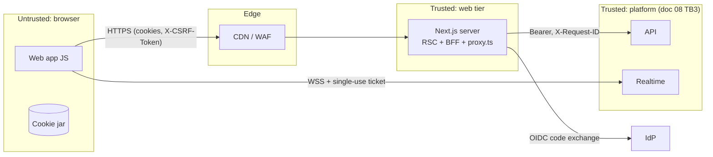

# Web 08 — Security and Privacy Plan (web extension of the threat model)

| | |
|---|---|
| **Status** | Draft v1.0 — Web Phase 1. Reviewed at the start of every web phase |
| **Owner** | Security engineering (web) · Trust and safety |
| **Extends** | [08 — Privacy and security threat model](../08-privacy-security-threat-model.md) (normative). This document **adds** the web trust boundary and `T-WEB-*` threats. It does not restate platform threats (`T-LOC-*`, `T-AZ-*`, …), which are mitigated by the backend and referenced by ID. |
| **Related** | [Web 01](01-architecture.md) · [Web 03](03-roles-permissions.md) · [Web 06](06-api-integration.md) · [ADR-0010](../adr/0010-nextjs-for-web-and-admin.md) · [ADR-0011](../adr/0011-web-bff-cookie-sessions.md) · [ADR-0013](../adr/0013-realtime-tickets-for-browsers.md) · [10 — Test strategy](../10-test-strategy.md) |

---

## 1. Scope

The web adds a new client (the browser) and a new **server** (the Next.js process acting as BFF) to the doc 08 data-flow diagram. Everything doc 08 says about the platform still holds. In particular, the backend authorizes every request, and nothing from the client is trusted (doc 08 §3 rule 1). The web's job is to:

1. never weaken a platform control (no tokens in the browser, no caching of private data in shared caches, no leaking of hidden resources);
2. defend the browser-specific attack surface (XSS, CSRF, clickjacking, open redirects, cache poisoning);
3. keep the BFF from becoming a confused deputy.

## 2. Web assets and trust boundaries

| Asset | Sensitivity | Where |
|---|---|---|
| AW1 `tb_session` cookie (sealed platform access + refresh tokens) | High (= doc 08 A4) | Browser cookie jar (HttpOnly) → Next.js server memory per request |
| AW2 `SESSION_SECRET` (cookie sealing key) | Critical | Secret manager → Next.js env |
| AW3 OIDC client secret | High | Secret manager → Next.js env |
| AW4 `tb_csrf` token | Medium | JS-readable cookie |
| AW5 Admin console UI and its data | High (= doc 08 A3, A7) | `/admin/**` |
| AW6 Rendered HTML / RSC payloads | Varies | CDN (public) or browser only (private) |
| AW7 Device location from the Geolocation API | Critical (= doc 08 A1) | Browser memory → one BFF request → platform (never stored) |



Boundary rules (in addition to doc 08 §3): (W1) the web tier is **trusted infrastructure** and must not run on an untrusted edge (ADR-0011); (W2) the CDN caches only responses explicitly marked public, and must never cache a response that set or depended on a cookie; (W3) the BFF forwards only `/v1/*` paths, only allowed methods, and never forwards browser cookies or arbitrary headers upstream.

## 3. Threat register (web)

Verification legend as in doc 08 §4: **U** unit, **I** integration, **S** security suite (web: Playwright/Vitest security tests), **R** review, **O** operational.

### 3.1 Sessions, authentication and CSRF

| ID | Threat (STRIDE) | Scenario | Mitigation | Verify |
|---|---|---|---|---|
| T-WEB-01 | Info disclosure / Spoofing | XSS steals platform tokens | Tokens only in the sealed HttpOnly `tb_session` cookie; never in JS, `localStorage`, URLs or RSC payloads (ADR-0011) | S (assert no token in `document.cookie`, storage, HTML), R |
| T-WEB-02 | Tampering | Attacker edits or forges `tb_session` | JWE `dir` + `A256GCM` (authenticated encryption); key ≥ 256 bits derived from `SESSION_SECRET`; any decrypt failure = anonymous + cookie cleared | U |
| T-WEB-03 | Spoofing | CSRF: third-party site triggers a mutation with the user's cookies | `SameSite=Lax`; double-submit `X-CSRF-Token` = `tb_csrf` (constant-time compare) on every non-GET BFF call; `Origin`/`Sec-Fetch-Site: same-origin` check; no state change on GET; logout is POST | U, S |
| T-WEB-04 | Spoofing | Login CSRF / session fixation | OIDC `state` + `nonce` + PKCE (S256) in a sealed `tb_oidc` cookie bound to the browser; new `tb_session` and rotated `tb_csrf` on every login | U, S |
| T-WEB-05 | Elevation | Open redirect via `next=` sends the user to a phishing page after login | `next` must be a relative path matching `^/(?!/)` (02 §3.3); otherwise `/feed` | U |
| T-WEB-06 | Denial / Spoofing | Parallel refreshes trip reuse detection and log the user out | Backend 30 s reuse leeway (doc 02 §8); proxy refresh coalesced per request; on `refresh_token_reused` → sign out with a security notice | I |
| T-WEB-07 | Info disclosure | Session survives on a shared computer | Logout clears cookies and calls `POST /v1/auth/logout`; `/settings/sessions` lists and revokes web sessions; TanStack Query cache cleared on logout and on user switch | S |
| T-WEB-08 | Spoofing | Dev identity provider reachable in production | `DevIdentityProvider` and the mock adapter refuse to start unless `APP_ENV ∈ {development, test}`; `/dev/login`, `POST /api/auth/dev` return 404 otherwise; BFF never proxies `/v1/dev/**` (= doc 08 T-AUTH-08) | U |
| T-WEB-09 | Info disclosure | Realtime credential leaks via URL/logs | Single-use 30 s ticket in the first frame, never in the URL (ADR-0013); `ticket` redacted from logs | U, R |

### 3.2 Output, injection and browser attacks

| ID | Threat | Scenario | Mitigation | Verify |
|---|---|---|---|---|
| T-WEB-10 | Tampering / Elevation | Stored XSS through captions, bios, group names, destination copy | React escaping; **no** HTML or Markdown rendering of user content; `dangerouslySetInnerHTML` banned by lint except the `JsonLd` component (escaped serializer, §6); URLs in user text pass a scheme allow-list (`https:` only) | U, S, R |
| T-WEB-11 | Tampering | XSS in the admin console via reported content | Admin renders evidence snapshots as text; strict nonce CSP on `/admin` (§7); no inline event handlers; same React escaping (= doc 08 T-INJ-02) | S |
| T-WEB-12 | Tampering | Clickjacking (for example "accept connection" in a hidden frame) | `frame-ancestors 'none'` + `X-Frame-Options: DENY` | S |
| T-WEB-13 | Tampering | `javascript:` / `data:` URLs from API data in `href`/`src` | `safeUrl()` helper (allow `https:`, relative paths, and `mailto:` where intended); `next/image` remote patterns restricted to the media CDN | U |
| T-WEB-14 | Elevation | DOM-based injection via `postMessage` or URL fragments | No `postMessage` listeners except from known origins (none at launch); query params parsed through Zod schemas before use | R |
| T-WEB-15 | Tampering | Reverse tabnabbing from user links | `rel="noopener noreferrer ugc nofollow"` on all external links; COOP `same-origin` | U |

### 3.3 BFF and caching

| ID | Threat | Scenario | Mitigation | Verify |
|---|---|---|---|---|
| T-WEB-16 | Elevation (confused deputy) / SSRF | Browser crafts `/api/v1/../internal` or an absolute URL to reach non-API hosts | Path allow-list `^[a-z0-9\-_/]+$`, no `..`, fixed upstream base `API_BASE_URL`, `/v1/` prefix enforced, `/v1/dev/**` blocked, method allow-list | U, S |
| T-WEB-17 | Info disclosure | Private responses cached by the CDN and served to another user | All BFF and app/admin responses `Cache-Control: private, no-store`; CDN never caches `/api/*` or any response with `Set-Cookie`; public pages never read cookies (01 §5) | S, O |
| T-WEB-18 | Info disclosure | Personalized data rendered into ISR HTML | Lint rule: no `cookies()`/`headers()`/session helpers in `(marketing)`; personalized islands fetch client-side | S, R |
| T-WEB-19 | Elevation | Non-staff session uses the BFF to call `/v1/admin/**` | BFF refuses admin paths without a platform role (defence in depth); the backend enforces `require_platform_permission` regardless | S |
| T-WEB-20 | Tampering | Cache poisoning via unkeyed headers (`X-Forwarded-Host`, `Accept-Language`) | Canonical URLs built from `NEXT_PUBLIC_SITE_URL`, never from request host headers; CDN cache key includes the locale path; `Vary` correct on the unprefixed locale redirect (07 §8) | R, S |
| T-WEB-21 | Denial | Oversized bodies or slow requests exhaust the Node process | 1 MB JSON limit at the BFF; uploads go direct to object storage; upstream timeout 10 s; CDN/WAF rate limits per IP on `/api/*` | S, O |
| T-WEB-22 | Info disclosure | Hidden resources leak existence through different web responses | Web mirrors backend `404` for hidden resources; identical not-found page and status; no "this group is private" message (03 §3) | S |

### 3.4 Privacy (LINDDUN) in the browser

| ID | Threat | Scenario | Mitigation | Verify |
|---|---|---|---|---|
| T-WEB-23 | Identifiability | Precise coordinates sent, logged or cached | Geolocation requested only after an explicit user action; client rounds to 3 dp; sent only on `nearby` feed and `/v1/destinations/resolve` requests; BFF log redaction of `near`, `lat`, `lng`; never stored in URL state, Zustand persistence, analytics or error reports (§9) | U, S |
| T-WEB-24 | Linkability | Third-party scripts profile users | No third-party scripts before consent; analytics first-party via the platform; no ad tech | R |
| T-WEB-25 | Disclosure | Sensitive data persisted in the browser | Only drafts and UI preferences are persisted (01 §9); cleared on logout; no messages or other users' data in `localStorage`/IndexedDB; the PWA service worker never caches `/api/*` or app HTML | S, R |
| T-WEB-26 | Unawareness | Users don't realize discovery or location is active | Persistent discovery indicator in the shell (doc 08 T-LOC-09); location permission explained before the browser prompt | R |
| T-WEB-27 | Disclosure | Error and RUM reports carry PII | Error tracker scrubbing (cookies, headers, query strings with `near`/`lat`/`lng`/`token`, message bodies, emails); RUM sends route templates, not concrete URLs with IDs | U, R |

## 4. Authentication and sessions

Normative design: [ADR-0011](../adr/0011-web-bff-cookie-sessions.md). Implementation requirements:

| Item | Requirement |
|---|---|
| Cookie names | `tb_session`, `tb_csrf`, `tb_oidc`, `NEXT_LOCALE`. In staging and production use the `__Host-` prefix for `tb_session`, `tb_csrf` and `tb_oidc` (forces `Secure`, `Path=/`, no `Domain`), configurable by env so local HTTP development keeps working. The `tb_oidc` path must then be `/` (a `__Host-` requirement) |
| `tb_session` attributes | `HttpOnly; Secure; SameSite=Lax; Path=/`; `Max-Age` = refresh lifetime (60 days sliding, ERD `user_sessions`) |
| Sealing | JWE compact, `alg: dir`, `enc: A256GCM`, `kid` header to support key rotation (two active keys during rotation; `SESSION_SECRET` and `SESSION_SECRET_PREVIOUS`) |
| Payload | `{at, at_exp, rt, uid, sid, roles, v}`. No profile data, no email |
| Refresh | Proxy refresh at < 60 s remaining; BFF refresh on `401 token_expired`; a failed refresh clears the cookie and returns `401 session_expired` |
| IdP | OIDC discovery, PKCE S256, `state` + `nonce`, `response_type=code`, confidential client (secret only on the server). ID token verification is done by the backend (doc 08 T-AUTH-01); the BFF validates `state` and passes `nonce` to `POST /v1/auth/login` |
| Re-authentication | Account deletion, email change and session revocation of *other* sessions require `auth_time` within 10 minutes (IdP `max_age=600` round-trip) |
| Credential stuffing, enumeration | Delegated to the IdP (doc 08 T-AUTH-04/05). The web shows uniform error messages and never says whether an email exists |
| Age gate | `/register` collects `birth_date`, sends it once to `POST /v1/auth/register` (it travels sealed in `tb_oidc`), and never stores it client-side (AUTH-008) |

## 5. CSRF

* Safe methods (GET, HEAD) never change state, including BFF routes.
* Non-safe BFF methods require **all** of: a valid session, `X-CSRF-Token` equal to the `tb_csrf` cookie (constant-time), and `Sec-Fetch-Site: same-origin` or (when absent) an `Origin` equal to `NEXT_PUBLIC_SITE_URL`.
* `tb_csrf` is rotated on login and logout. It is not secret from same-origin script (by design). XSS defeats CSRF protection, which is why XSS prevention and CSP (§6–7) are first-class.
* Next.js Server Actions are **not** used for platform mutations (01 §6), so there is a single CSRF path to audit.
* OIDC callback CSRF is covered by `state` (T-WEB-04).

## 6. XSS and output encoding

| Rule | Enforcement |
|---|---|
| All dynamic text renders through React (auto-escaped) | Code review |
| No `dangerouslySetInnerHTML`, `innerHTML`, `outerHTML`, `insertAdjacentHTML`, `document.write`, `eval`, `new Function` | ESLint (`react/no-danger`, `no-restricted-syntax`, `no-implied-eval`); allowed only in `components/seo/json-ld.tsx` |
| JSON-LD | `JSON.stringify` then escape `<` → `<`, `>` → `>`, `&` → `&`, U+2028/U+2029; built from typed objects only (07 §5) |
| User content formatting | Plain text with preserved line breaks. Links, mentions and hashtags are tokenized into React elements, never HTML strings. No Markdown for user content in v1 |
| URLs from data | `safeUrl()` (T-WEB-13). Media through `next/image` with allow-listed remote patterns |
| SVG | No user-uploaded SVG (media pipeline rejects it); icons are bundled React components |
| Third-party HTML embeds | None in v1 |

## 7. Content Security Policy and security headers

### 7.1 CSP profiles

Next.js nonce-based CSP requires **dynamic rendering**: a nonce must be unique per response, so it cannot live in CDN-cached static HTML. The web therefore uses two profiles.

| Profile | Applies to | `script-src` |
|---|---|---|
| **Strict** (nonce) | Everything dynamic: `(auth)`, `(traveler)`, `/onboarding`, `admin`, `/dev/login` | `'self' 'nonce-{random}' 'strict-dynamic'` (`'unsafe-eval'` only when `APP_ENV=development`) |
| **Static** | ISR/static public pages in `(marketing)` | `'self' 'unsafe-inline'`, required for Next.js inline bootstrap/RSC scripts in prerendered HTML. **Residual risk** documented below |

Common directives (both profiles):

```
default-src 'self';
base-uri 'none';
object-src 'none';
frame-ancestors 'none';
form-action 'self' {OIDC_ISSUER origin};
img-src 'self' data: blob: {MEDIA_CDN} {MAP_TILE_HOSTS};
media-src 'self' {MEDIA_CDN};
font-src 'self';
style-src 'self' 'unsafe-inline';
connect-src 'self' {REALTIME_URL (wss:)} {MEDIA_UPLOAD_HOST} {MAP_STYLE_AND_TILE_HOSTS} {RUM/ERROR_INGEST};
worker-src 'self' blob:;
manifest-src 'self';
frame-src 'none';
upgrade-insecure-requests;
report-to csp; (Reporting-Endpoints: csp="{CSP_REPORT_URL}")
```

* The nonce is generated in `proxy.ts` (128-bit, base64), set on the request (`x-nonce`) for Next.js to apply to its scripts, and placed in the CSP response header.
* `style-src 'unsafe-inline'` is accepted (Next.js/Tailwind and MapLibre inject styles; style injection is low impact without script execution).
* `connect-src` includes the object-storage upload host because presigned PUTs go direct from the browser (06 §4.7). Stripe and the IdP are top-level navigations, not fetches, so they are not in `connect-src`.
* Rollout: `Content-Security-Policy-Report-Only` in staging for one release, then enforced. Violation reports are sampled and monitored.

**Residual risk (Static profile).** An XSS on a public page could read `tb_csrf` and issue same-origin BFF mutations for a signed-in visitor. Compensating controls: public pages render only typed catalog/public-post data through React; no user HTML; the `JsonLd` escaping; lint bans; the security test suite runs an XSS payload corpus against every public template (§12). Hardening backlog item: per-route **hash-based** CSP generated at build for static pages, or Next.js SRI once it covers inline scripts (09, WEB-P9).

### 7.2 Security headers (all responses)

| Header | Value |
|---|---|
| `Strict-Transport-Security` | `max-age=63072000; includeSubDomains; preload` (production only) |
| `X-Content-Type-Options` | `nosniff` |
| `Referrer-Policy` | `strict-origin-when-cross-origin` (`no-referrer` on `/messages/**`, `/admin/**`) |
| `Permissions-Policy` | `geolocation=(self), camera=(), microphone=(), payment=(), usb=(), serial=(), browsing-topics=()` |
| `Cross-Origin-Opener-Policy` | `same-origin` |
| `Cross-Origin-Resource-Policy` | `same-site` |
| `X-Frame-Options` | `DENY` |
| `X-XSS-Protection` | `0` (legacy auditor disabled) |
| `X-Robots-Tag` | `noindex, nofollow` on app, auth, admin and `/api/*` (02 §2) |
| `Cache-Control` | `private, no-store` on app, auth, admin and `/api/*` |
| `X-Request-ID` | echoed on every response |

Verified by a Playwright header test per route class (10 §8) and by an external scan (Mozilla Observatory / securityheaders) before launch.

## 8. Input validation, uploads and rate limits

| Concern | Web control | Platform control (authoritative) |
|---|---|---|
| Form input | Zod schemas from `@travelbuddy/validation` with the same limits as the backend (lengths, list sizes, enums); errors mapped from `problem.errors[]` | Pydantic `extra="forbid"` (doc 08 T-AZ-06) |
| Query/route params | Parsed with Zod; unknown values fall back to defaults; IDs validated as UUID | Same |
| Uploads | Client checks MIME and size per purpose before requesting a presigned URL; JPEG/WebP EXIF stripped client-side via canvas re-encode where possible; upload direct to the quarantine bucket; the post references the media only after `ready` | Magic-byte sniffing, malware/CSAM scan, re-encode, EXIF strip (doc 08 T-MED-*, T-LOC-05) |
| Rate limits | Client debounce (search 300 ms, typing 3 s); buttons disabled during in-flight mutations; CDN/WAF per-IP limits on `/api/auth/*` (10/min) and `/api/v1/*` (300/min) | Per-principal sliding windows (doc 02 §5); quotas separate (`429 quota_exceeded`) |
| Body size | 1 MB BFF limit | 1 MB default (doc 08 T-INJ-05) |

## 9. Location privacy in the browser

1. The Geolocation API is called only from an explicit user gesture ("Use my location" on the Nearby tab, or onboarding step 6), after an in-app explanation. Never on page load.
2. `enableHighAccuracy: false`, `maximumAge: 15 min` (matches LOC-007). Readings with accuracy > 5 km are treated as city-level by the backend (LOC-008).
3. The client rounds to 3 decimals before sending. Coordinates are sent only as `near` on `GET /v1/feed?tab=nearby` and as `near` on `GET /v1/destinations/resolve`, then discarded from memory after the response.
4. Coordinates never appear in: the browser URL, history state, Zustand persisted stores, TanStack Query keys (the key holds a coarse `gps` marker plus the resolved destination ID), analytics events, RUM, error reports or server logs (redaction list in 01 §16).
5. The UI shows the resolved destination name, never coordinates or distances to people. Discovery uses destinations only (doc 08 T-LOC-01..04).
6. `Permissions-Policy: geolocation=(self)` prevents third-party frames from requesting location.
7. Withdrawing location consent takes effect immediately: the Nearby tab falls back to the selected destination, and nothing needs deleting because nothing was stored.

## 10. Data minimization, client storage and secrets

| Data | Browser | Next.js server | Notes |
|---|---|---|---|
| Platform tokens | Never (sealed cookie only) | Per request, in memory | |
| Viewer summary (id, handle, name, avatar, roles, plan) | React context | — | No email in client context except on `/settings` pages that need it |
| Other users' data | Query cache (memory) | — | Cleared on logout/user switch |
| Drafts (composer, onboarding) | `localStorage`, namespaced by user ID | — | Cleared on logout; media drafts are not persisted |
| Precise location | Memory, one request | One request | §9 |
| Secrets (`SESSION_SECRET`, `OIDC_CLIENT_SECRET`) | Never | Env from secret manager | Only `NEXT_PUBLIC_*` variables reach the client bundle; a CI check fails if a known secret name is prefixed `NEXT_PUBLIC_` or appears in `.next/static` |

Secrets management follows doc 11 §6: secret manager, runtime injection, rotation (sealing keys rotate quarterly with a two-key overlap), gitleaks in CI.

## 11. Admin console protections and audit

| Control | Detail |
|---|---|
| Access | Platform role required ([03 §4](03-roles-permissions.md#4-platform-roles-staff)); 404 otherwise; optional `ADMIN_ALLOWED_HOSTS` to serve admin only on a dedicated host behind SSO/IP allow-list (ADR-0010) |
| Step-up | Staff sessions require IdP MFA (enforced by IdP rule for users holding platform roles) and re-authentication (`max_age=600`) before destructive or sensitive actions (suspend, delete, reveal sensitive data, role grants) |
| Session lifetime | Admin idle timeout 30 min (client-side lock + server refresh refusal for staff after 30 min idle, request to backend §16) |
| Least privilege | Navigation and actions filtered by permission; the backend enforces (`require_platform_permission`) |
| Sensitive data | Field-level reveal with a mandatory justification (ADM-003, doc 08 T-AZ-07); evidence snapshots only, no message browsing |
| CSP | Strict profile, `Referrer-Policy: no-referrer` |
| Bundling | Admin code isolated by route and lint import rules (ADR-0010) |
| Audit | Every admin mutation is audited by the backend (SAFE-007, append-only `audit_logs`). The web adds `X-Request-ID` and an `X-Admin-Reason` header carrying the justification where required, so audit rows correlate with web logs |

## 12. Authorization test catalogue

Brief §29's mandatory tests mapped to concrete cases. **B** = backend security suite (doc 10 §3.4, owned by the backend), **W** = web security tests (Vitest for BFF units, Playwright for end-to-end; owned by the web). The web runs its W tests against the mock adapter in CI and against the live dev stack nightly.

| # | Brief §29 test | Case | Expected | Layer | Threats |
|---|---|---|---|---|---|
| A1 | Unauthorized DM access | User C requests `GET /v1/conversations/{AB}/messages` via the BFF | `404` | B, W | T-AZ-01 |
| A2 | Unauthorized DM access | User C navigates to `/messages/{AB}` | Not-found page, no message content in HTML/RSC payload | W | T-WEB-22 |
| A3 | Unauthorized DM access | C fetches an attachment URL taken from A's conversation after expiry | `403/404` from storage; URLs ≤ 5 min | B | T-MSG-04 |
| A4 | Unauthorized DM access | Group co-member without connection opens `POST /v1/conversations/direct` | `403 connection_required` | B, W | T-AZ-04, GCHAT-005 |
| A5 | Cross-user data leakage | User A logs out, user B logs in on the same browser | Query cache, drafts and viewer context contain none of A's data | W | T-WEB-07, T-WEB-25 |
| A6 | Cross-user data leakage | Two users request `/feed` through the CDN | Responses `private, no-store`; CDN logs show no cache hit on `/api/*` or app routes | W, O | T-WEB-17 |
| A7 | Cross-user data leakage | ISR public pages rendered while signed in | HTML identical to the anonymous version (byte comparison; static pages carry no nonce) | W | T-WEB-18 |
| A8 | Private group access | Non-member visits `/groups/{private}` and calls `GET /v1/groups/{id}` | `404` page / `404` API, identical to a nonexistent ID | B, W | T-AZ-02, T-WEB-22 |
| A9 | Private group access | Member removed while viewing chat | Realtime `membership.changed` → view closes; subsequent history fetch `404` | B, W | T-AZ-03, GCHAT-007 |
| A10 | Subscription bypass | Free user posts `POST /v1/groups` directly (bypassing the upsell UI) | `403 entitlement_required` | B, W | T-BILL-01, GRP-001 |
| A11 | Subscription bypass | Client tampers with `entitlements` in React state / devtools | Server still denies; UI shows the server error | W | T-BILL-01 |
| A12 | Subscription bypass | Visiting `/membership/success` without a Stripe webhook | No entitlement granted; page shows "waiting for confirmation" then a timeout message | W | ADR-0012 |
| A13 | Location enumeration | Feed/discovery responses inspected for `lat`, `lng`, `distance` on any other user | Absent (schema leakage scan) | B, W | T-LOC-01, LOC-009 |
| A14 | Location enumeration | Rapid destination switching on `/companions` | `429 rate_limited` after 10/day; UI shows the limit | B, W | T-LOC-03, DISC-009 |
| A15 | Location enumeration | Coordinates appear in BFF logs, URLs, analytics or error events after using Nearby | None found (log grep in the integration test) | W | T-WEB-23 |
| A16 | Admin privilege escalation | Non-staff session requests `/admin` and `/api/v1/admin/users` | `404` page; BFF refuses before upstream; backend `403/404` | B, W | T-WEB-19 |
| A17 | Admin privilege escalation | `support` user calls a moderator-only action (`POST /v1/admin/moderation-actions`) | `403` | B | 03 §4 |
| A18 | Admin privilege escalation | Superadmin grants a role to self | Rejected (two-person rule) | B | 03 §8 |
| A19 | Admin privilege escalation | Forged `roles` in a tampered `tb_session` | Decrypt fails → anonymous | W | T-WEB-02 |
| A20 | IDOR | `PATCH /v1/posts/{other_user_post}`, `DELETE /v1/trips/{other_trip}`, `GET /v1/ai/generations/{other}` | `404` | B | T-AZ-01 |
| A21 | IDOR | Edit page `/posts/{other}/edit` | Not-found page | W | — |
| A22 | CSRF | Cross-site form POST to `/api/v1/posts`, `/api/auth/logout`, `/api/realtime/ticket` | `403 csrf_failed` | W | T-WEB-03 |
| A23 | Open redirect | `/login?next=https://evil.example`, `next=//evil.example`, `next=/\evil` | Redirect to `/feed` | W | T-WEB-05 |
| A24 | BFF SSRF / traversal | `/api/v1/..%2f..%2fadmin`, `/api/v1/%2e%2e/x`, `/api/v1/dev/idp/token` | `400/404`, upstream never called | W | T-WEB-16 |
| A25 | XSS corpus | OWASP payload corpus in caption, bio, group name, display name, destination fields (mock fixtures) | Rendered as text on every template, no script execution, no CSP violation | W | T-WEB-10/11 |
| A26 | Dev adapters in production | Start the server with `APP_ENV=production` and `TB_API_MODE=mock` or the dev IdP configured | Process exits non-zero | W | T-WEB-08 |

The B rows are owned by backend items BL-2.09, BL-3.12 and BL-5.09 (doc 09). The W rows are web backlog items (09-backlog, epic WEB-P9-SEC) and part of `ci-web.yml`.

## 13. Privacy and GDPR workflows (web surfaces)

| Workflow | Web surface | Platform | Requirement |
|---|---|---|---|
| Consent at registration (terms + privacy, versioned) | `/register` checkboxes with links to the exact versions | `consent_records` | AUTH-009 |
| Discovery consent (separate, withdrawable) | Just-in-time screen before first enablement, with safety guidance (doc 08 §7); one-toggle withdrawal | `discovery_consent_version` | DISC-001, doc 08 §5.1 |
| Device location consent | In-app explanation → browser prompt; withdrawal in settings | `location_consent_version` | LOC-003 |
| Cookie consent | Banner on first visit (no pre-ticked boxes, "Reject all" as prominent as "Accept all"); only strictly necessary cookies before consent; preferences at `/settings/privacy` and a footer link | `consent_records` (signed-in) / `tb_consent` cookie (anonymous) | ePrivacy, GDPR Art. 7 |
| Data export | `/settings/data` → request → email/in-app link when ready | `data_subject_requests` | AUTH-011 |
| Account deletion (30-day reversible grace) | `/settings/data` → re-auth → typed confirmation → status page; login during grace offers cancel | deletion saga | AUTH-010 |
| Rectification | Profile, preferences and privacy editing | profiles | GDPR Art. 16 |
| Transparency | Privacy policy and cookie policy pages; "Why am I seeing this?" on feed context (source label) | — | doc 08 §5 Unawareness |

### 13.1 Cookie and storage inventory

| Name | Purpose | Category | Lifetime | Attributes |
|---|---|---|---|---|
| `tb_session` (`__Host-` in prod) | Sealed platform session | Strictly necessary | Refresh lifetime (60 days sliding) | HttpOnly, Secure, SameSite=Lax |
| `tb_csrf` (`__Host-` in prod) | CSRF double-submit | Strictly necessary | Session lifetime | Secure, SameSite=Strict |
| `tb_oidc` (`__Host-` in prod) | Login transaction (state, nonce, PKCE, sealed `birth_date` on signup) | Strictly necessary | 10 min | HttpOnly, Secure, SameSite=Lax |
| `NEXT_LOCALE` | Chosen language | Functional (user-requested, exempt) | 1 year | Secure, SameSite=Lax |
| `tb_consent` | Cookie-consent choices | Strictly necessary | 6 months | Secure, SameSite=Lax |
| `localStorage tb:{uid}:drafts:*` | Composer/onboarding drafts | Functional | Until sent or logout | — |
| `localStorage tb:prefs:*` | Theme, collapsed panels | Functional | Until cleared | — |
| Analytics (first-party, if any) | Product analytics | Analytics (**consent required**) | ≤ 13 months | Loaded only after consent |

## 14. Supply chain and build integrity

| Control | Detail |
|---|---|
| Lockfile | Single root `package-lock.json`; `npm ci` in CI; mobile has its own lockfile until BL-0.20 |
| Audit | `npm audit --audit-level=high` in `ci-web.yml` (doc 10 §5 gate); Dependabot/Renovate with grouped weekly updates |
| Version policy | Pin exact versions for runtime dependencies; avoid releases younger than 7 days except security fixes |
| Install scripts | `npm ci --ignore-scripts` where the build permits; packages that need install scripts are allow-listed |
| Secrets | gitleaks in CI (doc 08 T-OPS-01); no secrets in `NEXT_PUBLIC_*` |
| Image | `apps/web/Dockerfile`: multi-stage, Next standalone output, non-root user, read-only filesystem, minimal base, SBOM + signature at build (doc 11 §5) |
| Third-party scripts | None at runtime except the consented analytics loader (first-party preferred). No CDN-hosted JS; everything is bundled |
| Fonts | Self-hosted via `next/font`; no runtime calls to Google Fonts |

## 15. Per-PR security checklist (web)

- [ ] New BFF route or proxy behaviour has CSRF, method and path tests.
- [ ] No `cookies()`/`headers()`/session access in `(marketing)` routes.
- [ ] No `dangerouslySetInnerHTML` (outside `JsonLd`), no HTML/Markdown rendering of user content.
- [ ] New external origin? CSP `connect-src`/`img-src` updated and justified.
- [ ] Hidden-resource paths render the generic not-found page (no existence leak).
- [ ] No tokens, coordinates, emails or message bodies in logs, URLs, analytics or error reports.
- [ ] Persisted client state reviewed (drafts only, namespaced, cleared on logout).
- [ ] Authorization-dependent UI has a test for each behaviour code it renders (03 §3).
- [ ] Platform checklist (doc 08 §6) applied for any contract change requested from the backend.

## 16. Open questions / requests to backend stream

| # | Item |
|---|---|
| 1 | Staff idle-timeout enforcement on refresh (refuse refresh for platform-role sessions idle > 30 min), plus IdP MFA requirement for platform roles |
| 2 | `X-Admin-Reason` header (or a `justification` body field) recorded in `audit_logs` for sensitive admin reads/actions |
| 3 | CSP report ingestion endpoint (`CSP_REPORT_URL`): platform telemetry endpoint or the observability vendor |
| 4 | Data-export, deletion and consent endpoints (proposed shapes in 06 §4.1) must be in the OpenAPI spec before Phase 9 (BL-1.17, BL-6.03) |
| 5 | Hash-based CSP for static pages: evaluate a build-time per-route CSP manifest in Phase 9 to remove `'unsafe-inline'` from the Static profile |
