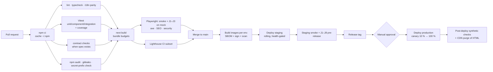

# Web 11 — Web Deployment Plan

| | |
|---|---|
| **Status** | Draft v1.0 — Web Phase 1 |
| **Owner** | DevOps (web) · Web engineering |
| **Defers to** | [11 — Infrastructure and deployment plan](../11-infrastructure-deployment.md) (normative for cloud topology, Terraform layout under `infra/`, environments, secrets, observability and SLO policy). **Shared IaC lives in `infra/` and is owned by the backend/infra stream.** This document states what the web tier needs from that infrastructure and how the web is built, configured, released and operated. It does not define a competing Terraform layout |
| **Related** | [Web 01 §4–5, §15–16](01-architecture.md) · [Web 07](07-seo-strategy.md) · [Web 08](08-security-privacy.md) · [Web 10 §13](10-test-strategy.md#13-ci-gates-githubworkflowsci-webyml-and-flake-policy) · [ADR-0009](../adr/0009-web-monorepo-layout.md) · [ADR-0010](../adr/0010-nextjs-for-web-and-admin.md) · [ADR-0011](../adr/0011-web-bff-cookie-sessions.md) |

---

## 1. What is deployed

| Artifact | Built from | Runs as |
|---|---|---|
| Web container image | `apps/web/Dockerfile` (multi-stage; Next.js `output: "standalone"`; Node 24 slim/distroless runtime; non-root UID; read-only root filesystem with a writable `/tmp`) | One stateless service (`web`), horizontally scaled, behind the CDN/WAF and load balancer of doc 11 §2 |
| Static assets (`/_next/static/*`, fonts, icons) | Same build | Served by the web service and cached immutably at the CDN. Optionally also uploaded to the public bucket for skew protection (§9) |
| Nothing else | — | The web has **no database, no queue and no worker**. Its only state is the ISR/data cache (§5) |

## 2. Environments

Aligned with doc 11 §1. Web-specific settings:

| Env | `APP_ENV` | `TB_API_MODE` | Backend | IdP | Billing | Indexing | Access |
|---|---|---|---|---|---|---|---|
| `local` | `development` | `mock` (default) or `live` against the docker compose stack | Mock adapter or local dev stack | `DevIdentityProvider` (dev IdP token endpoint) | Mock 503 / dev billing (live) | Off | Developer |
| `ci` | `test` | `mock` (PR); `live` against service containers (nightly) | Mock / ephemeral stack | Dev IdP | Mock 503 / dev billing | Off | CI only |
| `preview` (per PR, Phase 2+) | `test` | `mock`, or `live` against shared staging backend once Phase 1 backend is live | Mock / staging | Dev IdP (mock) or IdP test tenant (staging) | Mock 503 / Stripe test mode | **Off** (`Disallow: /`, global `noindex`) | SSO or basic auth at the CDN |
| `staging` | `staging` | `live` | Staging API/realtime | IdP test tenant | Stripe test mode | **Off** | Team + testers (SSO/IP allow-list) |
| `production` | `production` | `live` | Production | Production IdP | Stripe live | **On** | Public |

The boot guard (`src/server/env-core.ts`) refuses: `TB_API_MODE=mock` or the dev IdP with `APP_ENV ∈ {staging, production}`; a missing or short `SESSION_SECRET`; a missing `NEXT_PUBLIC_MAP_STYLE_URL` or `OIDC_*` in production (08 T-WEB-08).

## 3. Configuration

### 3.1 Environment variables

| Variable | Kind | Build or runtime | Required in | Notes |
|---|---|---|---|---|
| `APP_ENV` | config | runtime | all | `development \| test \| staging \| production` |
| `TB_API_MODE` | config | runtime | all | `mock \| live` |
| `API_BASE_URL` | config | runtime | live | **Internal** platform URL (service discovery / internal LB), so server-to-API traffic stays in the VPC |
| `REALTIME_URL` | config | runtime | live | Public `wss://` URL. Returned to the browser in the ticket response, so it needs no `NEXT_PUBLIC_` prefix |
| `SESSION_SECRET` | **secret** | runtime | all except mock-only local | ≥ 32 bytes random. JWE sealing key (ADR-0011) |
| `SESSION_SECRET_PREVIOUS` | **secret** | runtime | during rotation | Accepted for unsealing only |
| `COOKIE_HOST_PREFIX` | config | runtime | staging, prod = `true` | Enables `__Host-` cookie names (08 §4) |
| `OIDC_ISSUER`, `OIDC_CLIENT_ID`, `OIDC_REDIRECT_URI` | config | runtime | staging, prod | |
| `OIDC_CLIENT_SECRET` | **secret** | runtime | staging, prod | |
| `NEXT_PUBLIC_SITE_URL` | public | **build** (inlined) | all | Canonical origin for metadata, sitemaps and CSRF `Origin` checks |
| `NEXT_PUBLIC_MAP_STYLE_URL` | public | **build** (inlined) | prod (dev falls back to the demo style) | ADR-0014. The tile provider key must be a **public, domain-restricted** key |
| `MEDIA_CDN_ORIGIN` | config | **build** (`next.config` image `remotePatterns`) | all | Media/CDN host for `next/image` |
| `ADMIN_ALLOWED_HOSTS` | config | runtime | optional | Restrict `/admin` to dedicated hosts (ADR-0010) |
| `CSP_REPORT_URL` | config | runtime | staging, prod | 08 §7 |
| `ISR_CACHE_REDIS_URL` | **secret** | runtime | staging, prod (multi-replica) | Shared ISR/data cache (§5) |
| `OTEL_EXPORTER_OTLP_ENDPOINT`, `OTEL_SERVICE_NAME=web` | config | runtime | staging, prod | Traces/metrics (doc 11 §8 collector) |
| `ERROR_TRACKING_DSN` | secret (server) | runtime | staging, prod | Server-side error tracking with scrubbing (08 T-WEB-27) |
| `NEXT_PUBLIC_ERROR_TRACKING_DSN`, `NEXT_PUBLIC_RUM_ENDPOINT` | public | build | staging, prod | Browser error/RUM ingest (loaded after consent where required) |
| `LOG_LEVEL` | config | runtime | all | `info` default; never `debug` in production |
| `PORT`, `HOSTNAME=0.0.0.0` | config | runtime | container | Next standalone server |

Rules: only `NEXT_PUBLIC_*` variables reach the browser bundle. CI fails if a variable whose name matches `SECRET|TOKEN|PASSWORD|KEY` (except the domain-restricted map key embedded in the style URL) is prefixed `NEXT_PUBLIC_`, or if a known secret value appears in `.next/static` (08 §10).

### 3.2 Build-once vs per-environment images

`NEXT_PUBLIC_*` values and `images.remotePatterns` are fixed **at build time**. Until Phase 9 the pipeline builds **one image per environment from the same commit and lockfile** (staging and production builds are reproducible and both are scanned and signed). In Phase 9 (WEB-P9-OPS-001), environment-specific public values move to runtime: the root layout reads server env and passes it to client components, so a single image can be promoted from staging to production unchanged. Recorded as an open question (§15).

## 4. Hosting

### 4.1 Recommended: long-running containers behind the platform CDN

The web runs as a container service using the infra stream's generic `service` module (doc 11 §4) on the same cloud as the platform (reference AWS: ECS Fargate; equivalents Cloud Run / Azure Container Apps).

| Requirement for the infra stream | Value (launch) |
|---|---|
| Service | `web`, image from the registry, command = Next standalone `node server.js` |
| Size | 1 vCPU / 2 GB per task (re-tuned after load tests) |
| Replicas | min 2 (multi-AZ), max 20; autoscale on CPU 60 % and request count per target |
| Health | Liveness and readiness `GET /api/health` (no dependency checks); start period 20 s |
| Graceful shutdown | SIGTERM → drain 30 s (in-flight SSE streams close with a retry hint) |
| Networking | Private subnets; egress to the internal API endpoint, the IdP, Redis (ISR cache), the OTel collector; no inbound except from the load balancer |
| Secrets | From the secret manager via the `secrets` module (doc 11 §6) |
| Logs | JSON stdout → log group with 30-day hot retention (doc 11 §10) |
| Load balancer | HTTP/1.1 + HTTP/2, idle timeout ≥ 120 s (SSE), no sticky sessions required |

### 4.2 Why not edge/serverless for the BFF

| Concern | Why containers |
|---|---|
| Trust boundary | The BFF unseals tokens and holds `SESSION_SECRET` and `OIDC_CLIENT_SECRET`. ADR-0011 requires trusted infrastructure in our VPC, not a multi-tenant edge runtime |
| Latency to the API | In-VPC calls to the internal API endpoint beat edge → public API round-trips for every authenticated request |
| Streaming | AI chat SSE and long-lived responses need a stable process and generous timeouts |
| Shared cache | ISR and on-demand revalidation need a shared cache handler (§5), simpler on a fixed fleet |
| Vendor neutrality | Same image runs on any container platform (doc 11 §2 vendor table) |

The CDN still serves cached public HTML and static assets from the edge, so public-page performance does not depend on origin location. A managed Next.js host (for example Vercel) remains an option for the **public site only** if the team later splits it out; the BFF would stay in the VPC.

### 4.3 Hostnames

| Host | Origin | Notes |
|---|---|---|
| `www.<domain>` (canonical) | CDN → web service | Public site, traveler app, BFF; apex redirects to `www` (or vice versa, decided once) |
| `admin.<domain>` (optional) | CDN → same web service | When `ADMIN_ALLOWED_HOSTS` is set; extra WAF/IP or SSO rules (ADR-0010) |
| `api.<domain>` | Platform API (doc 11) | Mobile clients. The web server uses the internal endpoint instead |
| `rt.<domain>` | Realtime service | Browser WSS (ADR-0013); WebSocket Origin allow-list includes `www` |
| `media.<domain>` | Media CDN | `next/image` remote pattern; CSP `img-src`/`media-src` |
| `preview-<pr>.<preview-domain>`, `staging.<domain>` | Web service per env | Always `noindex` + access-protected (07 §11 #5) |

## 5. ISR and data cache across replicas

Next.js stores ISR pages and `fetch` cache entries on the local filesystem by default. With ≥ 2 replicas, each instance would revalidate independently and on-demand revalidation (`revalidateTag`) would reach only one instance.

**Decision:** configure a custom Next.js `cacheHandler` backed by Redis (`ISR_CACHE_REDIS_URL`), key prefix `web:{buildId}:`, with in-memory LRU disabled (`cacheMaxMemorySize: 0`). On-demand revalidation (tag purge when destinations, stories or visibility change) then applies fleet-wide, followed by a CDN purge by surrogate key (§6).

Request to the infra stream: a Redis logical database (or a separate small instance) for the web cache, isolated from platform keys (doc 02 §15 key spaces). Losing it only costs re-rendering; it holds **no private data**, because only public pages are cached (01 §5).

Revalidation triggers: platform outbox events (`DestinationUpdated`, `PostPublished`, `PostRemoved`, visibility/moderation changes) are delivered to an authenticated web endpoint `POST /api/revalidate` (HMAC-signed, internal network only), which calls `revalidateTag` and the CDN purge API. This is a new BFF route not yet in 01 §10.5, and a backend webhook consumer is required (§15).

## 6. CDN caching rules

| Route class | Cache at CDN | Policy |
|---|---|---|
| `/_next/static/*`, fonts, icons | Yes | `public, max-age=31536000, immutable` (content-hashed) |
| `/_next/image` | Yes | Key on `url`, `w`, `q` and `Accept` (AVIF/WebP); TTL 7 days; only the allow-listed media origin |
| Public ISR/static HTML (`(marketing)` routes, per locale) | Yes | `s-maxage` = route revalidate (02 §2.1), `stale-while-revalidate=86400`, `stale-if-error=86400`; surrogate keys = Next cache tags for purges |
| Unprefixed locale-redirect responses (02 §3.1 rule 4) | Yes, keyed on a **normalized** `Accept-Language` bucket (supported locale or `en`) and presence of `NEXT_LOCALE` | Prevents one visitor's redirect being served to another without fragmenting the cache on raw headers (07 §8) |
| `sitemap.xml`, `/sitemaps/*`, `robots.txt` | Yes | `s-maxage=3600` (stories chunks 600) |
| OG images (`opengraph-image`) | Yes | Same tags as their page |
| Any response with `Set-Cookie` | **Never** | CDN rule: bypass cache when the origin sets cookies |
| `(auth)`, `(traveler)`, `/onboarding`, `/admin/**`, `/dev/**` | **Never** | `private, no-store`; forward cookies |
| `/api/*` (BFF) | **Never** | Forward cookies, `Origin` and `Sec-Fetch-*` headers; no request coalescing |

The CDN forwards cookies **only** to non-cacheable behaviours. Cacheable behaviours strip cookies from the cache key and the origin request, so a cookie can never influence cached HTML (08 T-WEB-17/18/20).

## 7. CI/CD pipeline

`.github/workflows/ci-web.yml` runs on PRs touching `apps/web/**`, `packages/**`, the root lockfile or the workflow. Backend, mobile and contracts keep their own workflows (doc 11 §5).

| Stage | Detail |
|---|---|
| Image build | Docker Buildx with layer cache; `npm ci --omit=dev` in the runtime stage via standalone output; SBOM (Syft) and signature (Cosign) per doc 11 §5; vulnerability scan blocks on high/critical with a fix available |
| Deploy | Through the infra stream's deploy mechanism (CI OIDC federation to the cloud, no long-lived keys, doc 11 §4). New task definition per release |
| Canary | 10 % of traffic for 15 minutes; automatic rollback if web 5xx > 1 %, BFF upstream error rate > 2 %, or login failure rate doubles |
| Post-deploy | Synthetic checks (home, city page, login page, `/api/health`, signed-in feed with a synthetic account); CDN purge of HTML surrogate keys (`html:*`), never of static assets |
| Nightly | Full E2E matrix against the dev stack, visual regression, full Lighthouse (10 §13) |

## 8. Preview environments

* Created per PR with the label `preview` (doc 11 §1), destroyed on merge or close.
* Default `TB_API_MODE=mock` (no backend needed, no real data). With label `preview-live`: points at the shared staging backend with the IdP test tenant.
* Always `noindex`, `Disallow: /`, access-protected (SSO/basic auth at the CDN). URLs are posted to the PR only.
* Preview secrets are distinct from staging and production (own `SESSION_SECRET`).

## 9. Release coupling, skew and rollbacks

| Concern | Practice |
|---|---|
| Contract compatibility | Web changes depend only on endpoints already live in the target environment. Backend changes ship expand-first (doc 11 §3). The web tolerates the previous backend release (unknown fields ignored, unknown enums defaulted, 06 §9) |
| Deploy order | Backend (migrations → API) first, then web, for features that need new endpoints. Features ship dark behind flags until both sides are live |
| Version skew (old tabs vs new deploy) | `deploymentId` set to the release SHA; on a mismatch Next.js does a hard navigation instead of failing chunk loads. Static assets of the previous **two** releases stay available (CDN/bucket) so open tabs keep working during rolling deploys |
| Rollback | Redeploy the previous image (immutable tags). The ISR cache is keyed by `buildId`, so rolled-back pages never mix with newer cache entries. Purge HTML at the CDN after rollback |
| Session compatibility | Cookie payload versioned (`v`). New releases read the previous version; sealing-key rotation uses the two-key overlap (08 §4) |
| Database/migrations | None on the web side |

## 10. Feature flags

* Product flags come from the platform's feature-flag service (doc 02 `core/feature_flags.py`). The web reads them server-side from `GET /v1/client-config` → `feature_flags` (global, UI-only, keyed by backend flag names), cached 60 s, and passes the evaluated set to client components. Flags that gate security-relevant behaviour are always enforced by the backend as well.
* Emergency kill switches per web feature (`WEB_DISABLE_*` runtime env) allow hiding a broken surface without a redeploy of the backend.
* Flagged-off features render nothing or an honest "not available" state, never a fake UI.
* Known flags at launch: group discovery and join requests (GRP-004/006), AI chat (AI-006), web push, offline packages (PWA), attraction pages.

## 11. Monitoring and alerting

| Signal | Source | Alert (paging unless noted) |
|---|---|---|
| Web 5xx rate | LB + app logs | > 1 % for 5 min |
| BFF upstream errors (`502/503` from the platform) | App metrics | > 2 % for 5 min (also signals platform incidents) |
| Origin TTFB p95 (dynamic routes) | OTel | > 800 ms for 10 min |
| CDN cache hit ratio on public HTML | CDN analytics | < 80 % for 1 h (ticket) |
| Login failures (callback errors, `refresh_token_reused` spikes) | App metrics | 2× baseline for 15 min (possible IdP incident or attack) |
| CSP violation reports | Report endpoint | Spike > 5× baseline (ticket; possible injection) |
| Core Web Vitals (RUM p75 per template) | RUM | Regression beyond 01 §15 budgets for 24 h (ticket) |
| Synthetic uptime (home, city page, login, signed-in feed) | Uptime checker, 1-min interval, 3 regions | 2 consecutive failures |
| Error tracking (new issue types, regressions) | Error tracker with scrubbing | New high-volume issue (ticket) |
| Container health | Orchestrator | Task restarts > 3 in 10 min |
| Certificate expiry | CDN/LB | < 21 days |

Logs are JSON to stdout with `request_id`, pseudonymous `user_id`, route template, status and latency, and the redaction list of 01 §16. Traces use the OpenTelemetry Node SDK with W3C `traceparent` propagated to the platform. Dashboards: web RED metrics, BFF upstream latency by API module, cache hit ratios, CWV by template and locale. SLO: public site availability 99.9 % monthly (aligned with NFR-003); BFF overhead p95 < 50 ms.

## 12. Secrets management

Per doc 11 §6: secrets live only in the secret manager and are injected at runtime. Web secrets are `SESSION_SECRET`, `SESSION_SECRET_PREVIOUS`, `OIDC_CLIENT_SECRET`, `ISR_CACHE_REDIS_URL`, `ERROR_TRACKING_DSN` and the revalidation HMAC key.

| Secret | Rotation |
|---|---|
| `SESSION_SECRET` | Quarterly and on suspicion. Set the new key as current and the old as `_PREVIOUS` for one refresh lifetime window or until forced re-login is acceptable. Rotation without overlap logs everyone out (acceptable as an incident response) |
| `OIDC_CLIENT_SECRET` | Per IdP policy (≥ yearly); dual-secret support at the IdP during rotation |
| Revalidation HMAC key | Quarterly; dual-key verification during rotation |

Staging and production never share secret values. Preview environments get their own.

## 13. Disaster recovery

The web tier is **stateless**. Recovery is redeploying the last known-good image (RTO ≤ 15 min, well inside NFR-004's 1 h). The ISR cache can be lost without data loss. During an origin outage the CDN keeps serving public pages via `stale-if-error` (24 h), so the marketing and destination site stays up even if the web service or platform is down; the traveler app shows an outage state. Multi-region follows the platform's regional strategy (doc 11 §9); the web can run in a second region before the platform does because it is stateless, but there is no benefit until the API is regional.

## 14. Production readiness checklist (web)

- [ ] Boot guard verified: production refuses mock, dev IdP, short secrets, missing OIDC or map style.
- [ ] Cookies use `__Host-` names in production; `Secure` and `HttpOnly` as specified (08 §13.1).
- [ ] CSP enforced (strict profile on dynamic routes, static profile on public pages); security headers verified by scan (08 §7).
- [ ] CDN rules match §6; a test proves no `Set-Cookie` or private route is cached.
- [ ] Shared ISR cache handler live; on-demand revalidation reaches all replicas; CDN purge wired.
- [ ] Skew protection: previous two releases' assets available; `deploymentId` set.
- [ ] Canary and automatic rollback thresholds configured.
- [ ] Alerts in §11 routed to on-call; runbooks for IdP outage, platform outage, CDN purge, secret rotation, rollback.
- [ ] Synthetic checks in three regions.
- [ ] RUM and error tracking scrub PII; analytics gated by consent.
- [ ] Staging and production secrets distinct; rotation procedure rehearsed.
- [ ] `robots.txt`/sitemaps correct per environment (07 §12).
- [ ] Load test of BFF overhead and SSE streaming through the CDN passed (10 §7).
- [ ] Pen test findings closed (WEB-P9-SEC-003).
- [ ] Accessibility audit passed (10 §6).

## 15. Requests to the backend/infra stream and open questions

| # | Item | Owner |
|---|---|---|
| 1 | `web` service definition in `infra/` using the generic `service` module with the values in §4.1 | Infra |
| 2 | CDN behaviours and WAF rules per §6 (cookie-free cacheable behaviours, normalized `Accept-Language` bucket for the locale redirect, rate limits on `/api/auth/*` and `/api/v1/*`) | Infra |
| 3 | Redis logical database or instance for the web ISR cache (§5) | Infra |
| 4 | Outbox → web revalidation webhook (`POST /api/revalidate`, HMAC-signed, internal network) for destination/post/visibility changes; the route must also be added to 01 §10.5 | Backend + web |
| 5 | Feature-flag read endpoint for clients (for example `GET /v1/config/flags`, evaluated per principal) | Backend |
| 6 | Internal API endpoint reachable from the web service without traversing the public WAF | Infra |
| 7 | Build-once/promote for the web image requires moving `NEXT_PUBLIC_SITE_URL`, `NEXT_PUBLIC_MAP_STYLE_URL` and `MEDIA_CDN_ORIGIN` to runtime injection (§3.2); until then images are built per environment | Web |
| 8 | CI access to staging secrets (IdP test tenant, Stripe test mode) for pre-release E2E jobs (10 §15) | DevOps |
